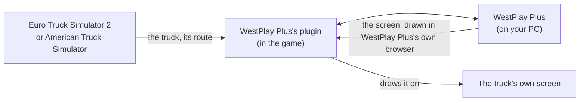

<p align="center"></p>

<h1 align="center">WestPlay Plus</h1>

<p align="center">
  <b>A CarPlay-style screen for the trucks of Euro Truck Simulator 2 and American Truck Simulator.</b><br>
  Your map, your music and YouTube, on your truck's own dashboard screen.
  <br>
  A modified branch of <a href="https://github.com/enes-less/WestPlay">WestPlay</a>, for Chinese-speaking players.
</p>

<p align="center">
  <a href="https://github.com/HandsomeTurtle0307/WestPlay-Plus/releases/latest"></a>
  
  
  
  <a href="LICENSE"></a>
</p>

WestPlay Plus puts a phone-style car screen on your truck's own dashboard display, inside the game: Euro Truck
Simulator 2 or American Truck Simulator, one screen for both. Your route on a map made from your own game, your
music, YouTube, the weather on your drive: right where a real truck has its screen, used with the mouse while you
hold a key.

## Features

**Maps from your own game.** Drawn from your game's map, map mods included (ProMods and others), with your route,
turn-by-turn guidance, and search that adds stops to the game's own GPS.

**A Dashboard for the drive.** The map beside what's playing and where you're going, the weather on your drive, all
on one screen.

**Your music.** Apple Music, Spotify and YouTube Music, with Now Playing and lyrics. A song's music video plays right
in Now Playing, and YouTube has its channels, playlists, captions and quality. Player plays the songs you put in the
game's own music folder.

**Light and dark, and your own look.** It turns dark at night or when you switch your headlights on, like a car's
light sensor. Bring your own wallpapers and app icons.

**The companion app** on your PC sets everything up: it finds your games, ETS2, ATS or both, installs WestPlay CN
Plus into each, builds their maps, and stays out of the way after that.

## How it works



WestPlay Plus draws its screen in a browser of its own on your PC, and its plugin puts each frame on your truck's
display, inside the game. The trucks' own screens and their information bars stay theirs: WestPlay Plus takes the
GPS's place, and its Vehicle Bar setting says whether the truck's bar stays beside it.

## Trucks

WestPlay Plus shows up in two ways: on the truck's own screen, or on the WestPlay Plus tablet.

**On the truck's own screen.** In the trucks that have CarPlay in real life, WestPlay Plus takes the GPS's place
on the dashboard screen, shaped to it. There's nothing to buy or fit: get in and it's there. In Euro Truck
Simulator 2:

- **DAF** XF and XG/XG+ 2021, XF Electric and XD (and Jasper's DAF 2021)
- **Scania** S and R, with the 7" screen or the Smart Dash, and the S BEV
- **Iveco** S-Way
- **Renault** T (2024)
- **Volvo** FH (2021 and 2024)
- **Coaches DLC:** the Scania Touring and the MAN Lion's Coach (2024)
- **Oyuncuyusbis' coaches:** the Mercedes-Benz Travego 16 SHD, the MAN Lion's Coach and the Setra S 531 DT on their
  dashboard screens
- **Setra S 516 HD/2** (Oyuncuyusbis'): on the coach's own GPS screen, its "Gps" part, which you fit in the truck
  shop: the coach's own screen, as its players asked, but one you add

**On the WestPlay Plus tablet.** Every other truck, the game's and mod trucks alike, gets WestPlay Plus on a
tablet you fit in the truck shop: under Accessories, in Hanging Items or as a dashboard set. The truck's own screen
keeps the game's navigation. The tablet is in every truck with hanging items, including truck mods you install
later (they get it the next time you start the game).

**In American Truck Simulator**, WestPlay Plus is on the tablet in every truck for now. The trucks whose real
counterparts have CarPlay get WestPlay Plus on their own screens later.

|                       | Truck's own screen        | WestPlay Plus tablet                           |
| --------------------- | ------------------------- | ---------------------------------------------- |
| Trucks                | The ETS2 trucks above     | Every other truck, and every ATS truck for now |
| To get it             | Nothing: it's there       | Fit it in the truck shop                       |
| The game's navigation | Replaced by WestPlay Plus | Stays on the truck's screen                    |

### Sound

Music plays from the truck's own speakers, each where it sits in the cab, in these Euro Truck Simulator 2 trucks.
Other trucks, and American Truck Simulator's for now, play plain stereo.

- **Scania S and R (2016), S BEV** — door woofers, A-pillar tweeters, roof bass
- **Scania R (2009), Streamline** — door woofers, A-pillar tweeters
- **DAF XF (105)** — A-pillar tweeters; two pairs on the overhead shelf in the Super Space Cab, one overhead unit in the others
- **DAF XF Euro 6** — door woofers, A-pillar tweeters; two pairs on the overhead shelf in the Super Space Cab, one overhead unit in the others
- **DAF XF, XG, XG+ (2021), XF Electric and XD** — door woofers, A-pillar tweeters, an overhead pair, a centre
- **MAN TGX** — door woofers; in the XXL, two small units high in each side wall too
- **MAN TGX Euro 6** — door woofers; in the XL, a small unit in each roof corner too
- **MAN TGX (2020)** — a woofer and a midrange in each door, A-pillar tweeters
- **Mercedes-Benz Actros (2014)** — door woofers, an overhead pair, A-pillar tweeters
- **Mercedes-Benz Actros (2009)** — door woofers, a pair at the overhead shelf's front corners
- **Volvo FH (2021, 2024), FH16 (2012)** — door woofers, back-wall bass
- **Volvo FH16 (2009)** — a unit in each door
- **Iveco Stralis** — a unit in each end of the overhead console, and in the high roofs a small one on the passenger's side
- **Iveco Hi-Way** — a unit in each end of the overhead console, and one high on each side
- **Iveco S-Way** — a woofer and a tweeter in each door
- **Renault Magnum** — a unit in each roof corner, tweeters on the overhead console
- **Renault Premium** — a unit in each side of the roof, lower in the low roof
- **Renault T** — A-pillar tweeters, a back-wall pair; door woofers in the 2024 interiors
- **Renault E-Tech T** — door woofers, A-pillar tweeters, a back-wall pair
- **JuseeTV's Scania PGR** — the speakers of the parts you fit: doors, A-pillars, top console, rear wall

## Install

1. Download the installer from the [latest release](https://github.com/HandsomeTurtle0307/WestPlay-Plus/releases/latest) and run it.
2. The companion opens and walks you through the rest: it finds your games (ETS2, ATS or both), installs
   WestPlay Plus's plugin and its screens mod in each, and builds your maps.
3. Start the game and get in a truck.

**Updates:** this branch does not update itself. To check for a newer version, visit the
[Releases page](https://github.com/HandsomeTurtle0307/WestPlay-Plus/releases). The companion's About page has
the same link.

**Requirements:** Windows 10 or 11 (64-bit), Euro Truck Simulator 2 version 1.62 (or 1.61) or American Truck
Simulator version 1.62 (other versions may work; the companion says when one is untested), and Microsoft Edge WebView2
(part of Windows 11; the installer adds it where it's missing).

## Privacy

WestPlay Plus has no servers, no accounts of its own and no analytics. It doesn't collect or send anything about you.

- You sign in to Apple Music, Spotify and YouTube on their own pages, in WestPlay Plus's own browser profile on
  your PC, as you would in a browser. WestPlay Plus keeps no account data of its own.
- Your map is built from your game on your PC and stays there.
- WestPlay Plus talks to the services you use, and to GitHub only when you open its Releases page.

## Feedback

Bugs, questions and ideas: open an issue on
[GitHub](https://github.com/HandsomeTurtle0307/WestPlay-Plus/issues).

## Building from source

You need [Rust](https://rustup.rs) (stable) and [Node.js](https://nodejs.org) 24, on Windows.

```sh
npm install      # the companion's tools and the UI's packages
npm run dev      # WestPlay Plus, with the UI served live
```

`cargo test --workspace` and `npm test --prefix ui` run the tests. The game plugin is built with
`cargo build --release -p westplay-plugin`.

## Licence

WestPlay Plus is free software: you can redistribute it and modify it under the terms of the GNU General Public
License, version 3 or (at your option) any later version. See [LICENSE](LICENSE).

Copyright © 2026 HandsomeTurtle0307. The libraries WestPlay Plus ships keep their own licences: see
[THIRD_PARTY_LICENSES.md](THIRD_PARTY_LICENSES.md), and [THIRD_PARTY_NOTICES.md](THIRD_PARTY_NOTICES.md) for the
work it follows.

## Where this project comes from

WestPlay Plus is a modified branch (fork) of [WestPlay](https://github.com/enes-less/WestPlay), a superb
CarPlay-style screen mod for Euro Truck Simulator 2 and American Truck Simulator, made by **enes-less**. Almost all
of the original design, code and assets are his work; this branch keeps its own changes on top of it and is
grateful for what he built. If you enjoy this project, please also have a look at the original.

本项目的绝大部分设计、代码与素材来自原项目 **WestPlay**（作者 [enes-less](https://github.com/enes-less/WestPlay)），
这是一个极其优秀的欧卡 2 / 美卡车内中控屏模组。本分支只是在它之上做了适合中文玩家的修改，并对原作者表示由衷感谢。
建议同时支持原项目（如果可以的话能支持支持我嘛😭😭😭，开发软件不易啊~）

<sub>WestPlay Plus is an independent project, not affiliated with or endorsed by Apple, SCS Software, Spotify, Google or the truck makers. CarPlay, Apple Music, Spotify, YouTube, YouTube Music and the truck makers' names and logos are trademarks of their owners, used to name what WestPlay Plus works with.</sub>
