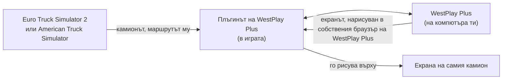

<p align="center"></p>

<h1 align="center">WestPlay Plus</h1>

<!-- languages:start -->
<p align="center">
  <a href="../../README.md">English</a> · <a href="README.zh-CN.md">简体中文</a> · <a href="README.zh-TW.md">繁體中文</a> · <a href="README.ja.md">日本語</a> · <a href="README.ko.md">한국어</a> · <a href="README.de.md">Deutsch</a> · <a href="README.fr.md">Français</a> · <a href="README.fr-CA.md">Français (Canada)</a> · <a href="README.es.md">Español</a> · <a href="README.es-419.md">Español (Latinoamérica)</a> · <a href="README.it.md">Italiano</a> · <a href="README.pt-BR.md">Português (Brasil)</a> · <a href="README.pt-PT.md">Português (Portugal)</a> · <a href="README.ru.md">Русский</a> · <a href="README.pl.md">Polski</a> · <a href="README.szl.md">Ślōnsko godka</a> · <a href="README.nl.md">Nederlands</a> · <a href="README.tr.md">Türkçe</a> · <a href="README.uk.md">Українська</a> · <a href="README.cs.md">Čeština</a> · <a href="README.sk.md">Slovenčina</a> · <a href="README.hu.md">Magyar</a> · <a href="README.ro.md">Română</a> · <b>Български</b> · <a href="README.hr.md">Hrvatski</a> · <a href="README.sr-Latn.md">Srpski (latinica)</a> · <a href="README.sr-Cyrl.md">Српски (ћирилица)</a> · <a href="README.sl.md">Slovenščina</a> · <a href="README.mk.md">Македонски</a> · <a href="README.el.md">Ελληνικά</a> · <a href="README.sv.md">Svenska</a> · <a href="README.da.md">Dansk</a> · <a href="README.no.md">Norsk</a> · <a href="README.fi.md">Suomi</a> · <a href="README.et.md">Eesti</a> · <a href="README.lt.md">Lietuvių</a> · <a href="README.lv.md">Latviešu</a> · <a href="README.ca.md">Català</a> · <a href="README.gl.md">Galego</a> · <a href="README.eu.md">Euskara</a> · <a href="README.ka.md">ქართული</a> · <a href="README.vi.md">Tiếng Việt</a>
</p>
<!-- languages:end -->

<p align="center">
  <b>Екран в стил CarPlay за камионите в Euro Truck Simulator 2 и American Truck Simulator.</b><br>
  Твоята карта, твоята музика и YouTube – на таблото на собствения ти камион.
  <br>
  Модифициран клон на <a href="https://github.com/enes-less/WestPlay">WestPlay</a>, с няколко оптимизации и нови функции.
</p>

<p align="center">
  <a href="https://github.com/HandsomeTurtle0307/WestPlay-Plus/releases/latest"></a>
  
  
  
  <a href="../../LICENSE"></a>
</p>

WestPlay Plus слага екран като на телефон на таблото на твоя камион, вътре в играта: Euro Truck Simulator 2 или American Truck Simulator, един екран и за двата. Маршрутът ти върху карта, нарисувана от твоята собствена игра, музиката ти, YouTube, времето по пътя: точно там, където истинският камион има екран, управляван с мишката, докато държиш клавиш.

<!-- why:start -->

## Защо направих това

Първоначално търсех мод за CarPlay, после попаднах на WestPlay и видях, че е направен много добре (наистина, много много добре). Само оптимизацията беше слаба и ми замрази компютъра. Затова реших сам да го доизпипам: да пооправя производителността и да добавя няколко нови функции (стоя на раменете на гигант, хе хе~😊).

<!-- why:end -->

## Функции

**Карти от твоята собствена игра.** Нарисувани от картата на играта ти, включително модове за карти (ProMods и други), с твоя маршрут, упътвания завой по завой и търсене, което добавя спирки в собствения GPS на играта.

**Табло за пътуването.** Картата до това, което свири, и до това накъде отиваш, времето по маршрута, всичко на един екран.

**Твоята музика.** Apple Music, Spotify и YouTube Music, с Now Playing и текстове. Клипът на песен се пуска направо в Now Playing, а YouTube има своите канали, плейлисти, субтитри и качества. Плеърът пуска песните, които сложиш в музикалната папка на играта.

**Светла и тъмна тема, и твой собствен вид.** Потъмнява нощем или когато включиш фаровете, като светлинен сензор в кола. Собствени тапети и икони можеш да добавиш сам.

**Придружаващото приложение** на компютъра ти подготвя всичко: намира игрите ти (ETS2, ATS или и двете), инсталира WestPlay Plus във всяка от тях, построява картите им и след това не пречи.

## Как работи



WestPlay Plus рисува екрана си в собствен браузър на компютъра ти, а плъгинът му слага всеки кадър на екрана на камиона ти, вътре в играта. Екраните на самите камиони и информационните им ленти си остават техни: WestPlay Plus заема мястото на GPS, а настройката „Vehicle Bar“ решава дали лентата на камиона остава до него.

## Камиони

WestPlay Plus се появява по два начина: на екрана на самия камион или на таблета WestPlay Plus.

**На екрана на самия камион.** В камионите, които реално имат CarPlay, WestPlay Plus заема мястото на GPS на екрана на таблото, оформен по него. Нищо за купуване или монтиране: качваш се и е там. В Euro Truck Simulator 2:

- **DAF** XF и XG/XG+ 2021, XF Electric и XD (както и DAF 2021 на Jasper)
- **Scania** S и R, със 7" екран или със Smart Dash, и S BEV
- **Iveco** S-Way
- **Renault** T (2024)
- **Volvo** FH (2021 и 2024)
- **Coaches DLC:** Scania Touring и MAN Lion's Coach (2024)
- **Автобусите на Oyuncuyusbis:** Mercedes-Benz Travego 16 SHD, MAN Lion's Coach и Setra S 531 DT на собствените им екрани на таблото
- **Setra S 516 HD/2** (на Oyuncuyusbis): на собствения GPS екран на автобуса, неговата част „Gps“, която монтираш в автокъщата: екранът на самия автобус, както поискаха играчите му, но такъв, който ти добавяш

**На таблета WestPlay Plus.** Всички останали камиони, от играта и от модове, получават WestPlay Plus на таблет, който монтираш в автокъщата: в Аксесоари, сред висящите предмети или като комплект за табло. Екранът на самия камион запазва навигацията на играта. Таблетът е във всеки камион с висящи предмети, включително в модовете за камиони, които инсталираш по-късно (получават го при следващото стартиране на играта).

**В American Truck Simulator** засега WestPlay Plus е на таблета във всеки камион. Камионите, чиито реални аналози имат CarPlay, ще получат WestPlay Plus на собствения си екран по-късно.

|                        | Екран на самия камион | Таблет WestPlay Plus |
| ---------------------- | --------------------- | -------------------- |
| Камиони                | Камионите ETS2 отгоре | Всички останали, и засега всички камиони ATS |
| Как се получава        | Нищо: вече е там      | Монтира се в автокъщата |
| Навигацията на играта  | Заменя се от WestPlay Plus | Остава на екрана на камиона |

### Звук

В тези камиони от Euro Truck Simulator 2 музиката излиза от собствените високоговорители на камиона, всеки на мястото си в кабината. Останалите камиони, и засега тези от American Truck Simulator, свирят обикновено стерео.

- **Scania S и R (2016), S BEV** — високоговорители в вратите, пищялки в A-колоните, бас в тавана
- **Scania R (2009), Streamline** — високоговорители в вратите, пищялки в A-колоните
- **DAF XF (105)** — пищялки в A-колоните; две двойки на рафта в тавана при Super Space Cab, една таванна единица при останалите
- **DAF XF Euro 6** — високоговорители в вратите, пищялки в A-колоните; две двойки на рафта в тавана при Super Space Cab, една таванна единица при останалите
- **DAF XF, XG, XG+ (2021), XF Electric и XD** — високоговорители в вратите, пищялки в A-колоните, една двойка отгоре, една централна единица
- **MAN TGX** — високоговорители в вратите; при XXL и по две малки единици високо във всяка странична стена
- **MAN TGX Euro 6** — високоговорители в вратите; при XL и по една малка единица във всеки ъгъл на тавана
- **MAN TGX (2020)** — високоговорител и средночестотен във всяка врата, пищялки в A-колоните
- **Mercedes-Benz Actros (2014)** — високоговорители в вратите, една двойка отгоре, пищялки в A-колоните
- **Mercedes-Benz Actros (2009)** — високоговорители в вратите, една двойка в предните ъгли на таванния рафт
- **Volvo FH (2021, 2024), FH16 (2012)** — високоговорители в вратите, бас в задната стена
- **Volvo FH16 (2009)** — по една единица във всяка врата
- **Iveco Stralis** — по една единица в двата края на таванната конзола, а при високите тавани една малка от страната на пътника
- **Iveco Hi-Way** — по една единица в двата края на таванната конзола и по една високо от всяка страна
- **Iveco S-Way** — високоговорител и пищялка във всяка врата
- **Renault Magnum** — по една единица във всеки ъгъл на тавана, пищялки на таванната конзола
- **Renault Premium** — по една единица от всяка страна на тавана, по-ниско при ниския таван
- **Renault T** — пищялки в A-колоните, една двойка в задната стена; високоговорители в вратите при интериорите от 2024
- **Renault E-Tech T** — високоговорители в вратите, пищялки в A-колоните, една двойка в задната стена
- **Scania PGR на JuseeTV** — високоговорителите на частите, които монтираш: врати, A-колони, горна конзола, задна стена

## Инсталиране

1. Изтегли инсталатора от [последната версия](https://github.com/HandsomeTurtle0307/WestPlay-Plus/releases/latest) и го стартирай.
2. Отваря се придружаващото приложение и те превежда през останалото: намира игрите ти (ETS2, ATS или и двете), инсталира във всяка плъгина на WestPlay Plus и мода за екрана и построява картите ти.
3. Стартирай играта и се качи в камион.

**Актуализации:** този клон не се обновява сам. За да провериш дали има по-нова версия, посети [страницата с изданията](https://github.com/HandsomeTurtle0307/WestPlay-Plus/releases). Същата връзка има и на страницата „Относно“ в придружаващото приложение.

**Изисквания:** Windows 10 или 11 (64 бита), Euro Truck Simulator 2 версия 1.62 (или 1.61) или American Truck Simulator версия 1.62 (други версии може да работят; придружаващото приложение казва, когато дадена не е тествана) и Microsoft Edge WebView2 (част от Windows 11; инсталаторът го добавя, където липсва).

## Поверителност

WestPlay Plus няма сървъри, собствени акаунти и анализи. Не събира и не изпраща нищо за теб.

- Влизаш в Apple Music, Spotify и YouTube на техните собствени страници, в собствения профил на браузъра на WestPlay Plus на компютъра ти, както в браузър. Сам WestPlay Plus не пази данни за акаунти.
- Картата ти се построява на компютъра ти от играта ти и остава там.
- WestPlay Plus говори с услугите, които използваш, и с GitHub само когато отвориш страницата му с изданията.

## Обратна връзка

Грешки, въпроси и идеи: отвори issue в [GitHub](https://github.com/HandsomeTurtle0307/WestPlay-Plus/issues).

## Компилиране от изходния код

Трябват ти [Rust](https://rustup.rs) (stable) и [Node.js](https://nodejs.org) 24, под Windows.

```sh
npm install      # инструментите на придружаващото приложение и пакетите на интерфейса
npm run dev      # WestPlay Plus с интерфейс, сервиран на живо
```

`cargo test --workspace` и `npm test --prefix ui` пускат тестовете. Плъгинът на играта се компилира с `cargo build --release -p westplay-plugin`.

## Лиценз

WestPlay Plus е свободен софтуер: можеш да го разпространяваш и променяш при условията на GNU General Public License, версия 3 или (по твой избор) всяка по-късна версия. Виж [LICENSE](../../LICENSE).

Copyright © 2026 HandsomeTurtle0307. Библиотеките, които вървят с WestPlay Plus, запазват собствените си лицензи: виж [THIRD_PARTY_LICENSES.md](../../THIRD_PARTY_LICENSES.md) и [THIRD_PARTY_NOTICES.md](../../THIRD_PARTY_NOTICES.md) за произведенията, които следва.

## Откъде идва този проект

WestPlay Plus е модифициран клон (fork) на [WestPlay](https://github.com/enes-less/WestPlay) – изключителен мод с екран в стил CarPlay за Euro Truck Simulator 2 и American Truck Simulator, направен от **enes-less**. Почти целият оригинален дизайн, код и ресурси са негова работа; този клон задържа собствените си промени отгоре и е благодарен за това, което е построил. Ако проектът ти харесва, погледни и оригинала.

Подкрепи и оригиналния проект (а ако можеш, подкрепи и мен 😭😭😭 – да правиш софтуер не е лесно~).

<!-- translated:start -->
<sub>Този README е превод на английската версия. Авторът, разбира се, не говори всички 43 езика 😭😭, затова преводът може да е непълен на места. Извинявам се~ Ако забележите грешка на вашия език, кажете ми, ще съм много благодарен~</sub>
<!-- translated:end -->

<sub>WestPlay Plus е независим проект, без връзка с Apple, SCS Software, Spotify, Google или производителите на камиони и без тяхно одобрение. CarPlay, Apple Music, Spotify, YouTube, YouTube Music, както и имената и логата на производителите, са търговски марки на своите собственици и се използват тук само за да назовaт това, с което WestPlay Plus работи.</sub>
