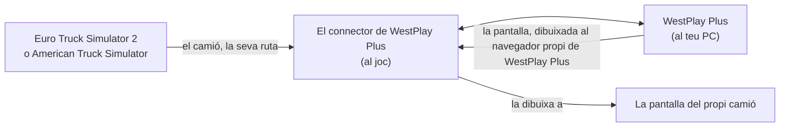

<p align="center"></p>

<h1 align="center">WestPlay Plus</h1>

<!-- languages:start -->
<p align="center">
  <a href="../../README.md">English</a> · <a href="README.zh-CN.md">简体中文</a> · <a href="README.zh-TW.md">繁體中文</a> · <a href="README.ja.md">日本語</a> · <a href="README.ko.md">한국어</a> · <a href="README.de.md">Deutsch</a> · <a href="README.fr.md">Français</a> · <a href="README.fr-CA.md">Français (Canada)</a> · <a href="README.es.md">Español</a> · <a href="README.es-419.md">Español (Latinoamérica)</a> · <a href="README.it.md">Italiano</a> · <a href="README.pt-BR.md">Português (Brasil)</a> · <a href="README.pt-PT.md">Português (Portugal)</a> · <a href="README.ru.md">Русский</a> · <a href="README.pl.md">Polski</a> · <a href="README.nl.md">Nederlands</a> · <a href="README.tr.md">Türkçe</a> · <a href="README.uk.md">Українська</a> · <a href="README.cs.md">Čeština</a> · <a href="README.sk.md">Slovenčina</a> · <a href="README.hu.md">Magyar</a> · <a href="README.ro.md">Română</a> · <a href="README.bg.md">Български</a> · <a href="README.hr.md">Hrvatski</a> · <a href="README.sr-Latn.md">Srpski (latinica)</a> · <a href="README.sr-Cyrl.md">Српски (ћирилица)</a> · <a href="README.sl.md">Slovenščina</a> · <a href="README.mk.md">Македонски</a> · <a href="README.el.md">Ελληνικά</a> · <a href="README.sv.md">Svenska</a> · <a href="README.da.md">Dansk</a> · <a href="README.no.md">Norsk</a> · <a href="README.fi.md">Suomi</a> · <a href="README.et.md">Eesti</a> · <a href="README.lt.md">Lietuvių</a> · <a href="README.lv.md">Latviešu</a> · <b>Català</b> · <a href="README.gl.md">Galego</a> · <a href="README.vi.md">Tiếng Việt</a>
</p>
<!-- languages:end -->

<!-- english-only:start -->
<p align="center"><sub>El silesià, el basc i el georgià són compatibles amb l'aplicació, però encara no tenen README: no hi ha hagut ningú que revisés una traducció en aquestes llengües. Tot el contingut és a la versió anglesa de l'arrel del repositori.</sub></p>
<!-- english-only:end -->

<p align="center">
  <b>Una pantalla a l'estil de CarPlay per als camions d'Euro Truck Simulator 2 i American Truck Simulator.</b><br>
  El teu mapa, la teva música i YouTube, al tauler de comandament del teu camió.
  <br>
  Una branca modificada de <a href="https://github.com/enes-less/WestPlay">WestPlay</a>, amb algunes optimitzacions i funcions noves.
</p>

<p align="center">
  <a href="https://github.com/HandsomeTurtle0307/WestPlay-Plus/releases/latest"></a>
  
  
  
  <a href="../../LICENSE"></a>
</p>

WestPlay Plus posa una pantalla com la d'un mòbil al tauler de comandament del teu camió, dins del joc: Euro Truck Simulator 2 o American Truck Simulator, una pantalla per als dos. La teva ruta en un mapa dibuixat a partir del teu propi joc, la teva música, YouTube, el temps del teu viatge: exactament on un camió de veritat té la seva pantalla, controlada amb el ratolí mentre mantens premuda una tecla.

<!-- why:start -->

## Per què vaig fer això

Al principi buscava un mod de CarPlay, i vaig topar amb el WestPlay: està molt ben fet (de debò, molt i molt ben fet), només que l'optimització no era bona i em va penjar l'ordinador. Així que vaig decidir millorar-lo jo mateix: polir el rendiment i afegir unes quantes funcions noves (a espatlles d'un gegant, jeje~😊).

<!-- why:end -->

## Funcions

**Mapes del teu propi joc.** Dibuixats a partir del mapa del teu joc, amb els mods de mapa inclosos (ProMods i d'altres), amb la teva ruta, les indicacions gir a gir i una cerca que afegeix parades al GPS del propi joc.

**Un tauler per a la carretera.** El mapa al costat del que sona i del lloc on vas, el temps del trajecte, tot en una sola pantalla.

**La teva música.** Apple Music, Spotify i YouTube Music, amb Now Playing i lletres. El videoclip d'una cançó es reprodueix directament a Now Playing, i YouTube té els seus canals, llistes, subtítols i qualitats. El reproductor posa les cançons que poses a la carpeta de música del joc.

**Clar i fosc, i el teu aspecte.** S'enfosqueix de nit o quan encens els llums, com el sensor de llum d'un cotxe. Els fons de pantalla i les icones els pots posar tu.

**L'aplicació acompanyant** al teu PC ho prepara tot: troba els teus jocs (ETS2, ATS o tots dos), instal·la WestPlay Plus a cadascun, construeix els seus mapes i després ja no molesta.

## Com funciona



WestPlay Plus dibuixa la seva pantalla en un navegador propi al teu PC, i el seu connector posa cada fotograma a la pantalla del teu camió, dins del joc. Les pantalles dels propis camions i les seves barres d'informació continuen sent seves: WestPlay Plus ocupa el lloc del GPS, i el paràmetre «Vehicle Bar» decideix si la barra del camió es queda al costat.

## Camions

WestPlay Plus apareix de dues maneres: a la pantalla del propi camió o a la tauleta WestPlay Plus.

**A la pantalla del propi camió.** Als camions que a la realitat tenen CarPlay, WestPlay Plus ocupa el lloc del GPS a la pantalla del tauler, adaptat a la seva forma. No hi ha res a comprar ni a muntar: hi puges i ja hi és. A Euro Truck Simulator 2:

- **DAF** XF i XG/XG+ 2021, XF Electric i XD (i el DAF 2021 del Jasper)
- **Scania** S i R, amb la pantalla de 7" o el Smart Dash, i el S BEV
- **Iveco** S-Way
- **Renault** T (2024)
- **Volvo** FH (2021 i 2024)
- **Coaches DLC:** el Scania Touring i el MAN Lion's Coach (2024)
- **Els autocars d'Oyuncuyusbis:** el Mercedes-Benz Travego 16 SHD, el MAN Lion's Coach i el Setra S 531 DT als seus propis taulers
- **Setra S 516 HD/2** (d'Oyuncuyusbis): a la pantalla GPS del propi autocar, la seva part «Gps», que muntes al concessionari: la pantalla del propi autocar, com van demanar els seus jugadors, però una que hi afegeixes tu

**A la tauleta WestPlay Plus.** Tots els altres camions, tant els del joc com els mods, reben WestPlay Plus en una tauleta que muntes al concessionari: a Accessoris, entre els objectes penjants o com a conjunt de tauler. La pantalla del propi camió conserva la navegació del joc. La tauleta hi és a tots els camions amb objectes penjants, també als mods de camió que instal·lis més endavant (la reben la propera vegada que iniciïs el joc).

**A American Truck Simulator**, de moment WestPlay Plus va a la tauleta a tots els camions. Els camions els equivalents reals dels quals tenen CarPlay rebran WestPlay Plus a la seva pròpia pantalla més endavant.

|                        | Pantalla del propi camió | Tauleta WestPlay Plus |
| ---------------------- | ------------------------ | --------------------- |
| Camions                | Els camions ETS2 d'aquí dalt | Tots els altres, i de moment tots els d'ATS |
| Com aconseguir-ho      | Res: ja hi és            | Muntar-la al concessionari |
| Navegació del joc      | La substitueix WestPlay Plus | Es queda a la pantalla del camió |

### So

En aquests camions d'Euro Truck Simulator 2, la música surt dels altaveus propis del camió, cadascun al seu lloc a la cabina. Els altres camions, i de moment els d'American Truck Simulator, sonen en estèreo normal.

- **Scania S i R (2016), S BEV** — greus de porta, tweeters del pilar A, greus de sostre
- **Scania R (2009), Streamline** — greus de porta, tweeters del pilar A
- **DAF XF (105)** — tweeters del pilar A; dues parelles a la prestatgeria del sostre al Super Space Cab, una unitat de sostre als altres
- **DAF XF Euro 6** — greus de porta, tweeters del pilar A; dues parelles a la prestatgeria del sostre al Super Space Cab, una unitat de sostre als altres
- **DAF XF, XG, XG+ (2021), XF Electric i XD** — greus de porta, tweeters del pilar A, una parella a dalt, una unitat central
- **MAN TGX** — greus de porta; a l'XXL, a més, dues unitats petites a dalt de cada paret lateral
- **MAN TGX Euro 6** — greus de porta; a l'XL, a més, una unitat petita a cada cantonada del sostre
- **MAN TGX (2020)** — un greu i un mitjà a cada porta, tweeters del pilar A
- **Mercedes-Benz Actros (2014)** — greus de porta, una parella a dalt, tweeters del pilar A
- **Mercedes-Benz Actros (2009)** — greus de porta, una parella a les cantonades davanteres de la prestatgeria del sostre
- **Volvo FH (2021, 2024), FH16 (2012)** — greus de porta, greus a la paret del darrere
- **Volvo FH16 (2009)** — una unitat a cada porta
- **Iveco Stralis** — una unitat a cada extrem de la consola del sostre, i als sostres alts una de petita al costat del passatger
- **Iveco Hi-Way** — una unitat a cada extrem de la consola del sostre, i una a dalt de cada costat
- **Iveco S-Way** — un greu i un tweeter a cada porta
- **Renault Magnum** — una unitat a cada cantonada del sostre, tweeters a la consola del sostre
- **Renault Premium** — una unitat a cada costat del sostre, més avall al sostre baix
- **Renault T** — tweeters del pilar A, una parella a la paret del darrere; greus de porta als interiors del 2024
- **Renault E-Tech T** — greus de porta, tweeters del pilar A, una parella a la paret del darrere
- **Scania PGR de JuseeTV** — els altaveus de les peces que muntes: portes, pilars A, consola superior, paret del darrere

## Instal·lació

1. Baixa l'instal·lador de la [darrera versió](https://github.com/HandsomeTurtle0307/WestPlay-Plus/releases/latest) i executa'l.
2. S'obre l'aplicació acompanyant i et guia per la resta: troba els teus jocs (ETS2, ATS o tots dos), instal·la a cadascun el connector de WestPlay Plus i el seu mod de pantalla, i construeix els teus mapes.
3. Inicia el joc i puja a un camió.

**Actualitzacions:** aquesta branca no s'actualitza sola. Per veure si hi ha una versió més nova, visita la [pàgina de versions](https://github.com/HandsomeTurtle0307/WestPlay-Plus/releases). El mateix enllaç és a la pàgina «Quant a» de l'aplicació acompanyant.

**Requisits:** Windows 10 o 11 (64 bits), Euro Truck Simulator 2 versió 1.62 (o 1.61) o American Truck Simulator versió 1.62 (altres versions poden funcionar; l'aplicació acompanyant t'avisa quan una no està provada) i Microsoft Edge WebView2 (forma part de Windows 11; l'instal·lador l'afegeix on falta).

## Privadesa

WestPlay Plus no té servidors, ni comptes propis, ni analítiques. No recull ni envia res sobre tu.

- Inicies sessió a Apple Music, Spotify i YouTube a les seves pròpies pàgines, amb el perfil de navegador propi de WestPlay Plus al teu PC, com faries en un navegador. WestPlay Plus no desa cap dada de compte.
- El teu mapa es construeix al teu PC a partir del teu joc i s'hi queda.
- WestPlay Plus parla amb els serveis que utilitzes, i amb GitHub només quan obres la seva pàgina de versions.

## Comentaris

Errors, dubtes i idees: obre una issue a [GitHub](https://github.com/HandsomeTurtle0307/WestPlay-Plus/issues).

## Compilació des del codi font

Necessites [Rust](https://rustup.rs) (stable) i [Node.js](https://nodejs.org) 24, a Windows.

```sh
npm install      # les eines de l'aplicació acompanyant i els paquets de la interfície
npm run dev      # WestPlay Plus, amb la interfície servida en directe
```

`cargo test --workspace` i `npm test --prefix ui` executen les proves. El connector del joc es compila amb `cargo build --release -p westplay-plugin`.

## Llicència

WestPlay Plus és programari lliure: el pots redistribuir i modificar segons els termes de la GNU General Public License, versió 3 o (si ho tries) qualsevol versió posterior. Consulta [LICENSE](../../LICENSE).

Copyright © 2026 HandsomeTurtle0307. Les biblioteques que distribueix WestPlay Plus conserven les seves pròpies llicències: consulta [THIRD_PARTY_LICENSES.md](../../THIRD_PARTY_LICENSES.md), i [THIRD_PARTY_NOTICES.md](../../THIRD_PARTY_NOTICES.md) per a les obres que segueix.

## D'on ve aquest projecte

WestPlay Plus és una branca modificada (fork) de [WestPlay](https://github.com/enes-less/WestPlay), un excel·lent mod de pantalla a l'estil de CarPlay per a Euro Truck Simulator 2 i American Truck Simulator, fet per **enes-less**. Gairebé tot el disseny, el codi i els recursos originals són obra seva; aquesta branca hi manté els seus propis canvis a sobre i li està agraïda pel que va construir. Si t'agrada aquest projecte, fes un cop d'ull també a l'original.

Dóna suport també al projecte original (i si pots, dóna'm suport a mi també 😭😭😭 — no és fàcil fer programari~).

<!-- translated:start -->
<sub>Aquest README és una traducció de la versió en anglès. L’autor no parla les 43 llengües, ni de bon tros 😭😭, així que la traducció pot estar incompleta en alguns punts. Disculpeu~ Si detecteu alguna cosa estranya en la vostra llengua, digueu-m’ho, us ho agrairé molt~</sub>
<!-- translated:end -->

<sub>WestPlay Plus és un projecte independent, sense cap vincle ni aprovació d'Apple, SCS Software, Spotify, Google ni dels fabricants de camions. CarPlay, Apple Music, Spotify, YouTube, YouTube Music i els noms i logotips dels fabricants són marques dels seus propietaris i s'utilitzen aquí només per anomenar allò amb què funciona WestPlay Plus.</sub>
