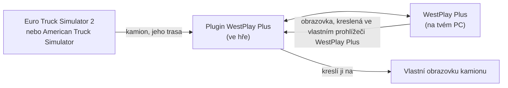

<p align="center"></p>

<h1 align="center">WestPlay Plus</h1>

<!-- languages:start -->
<p align="center">
  <a href="../../README.md">English</a> · <a href="README.zh-CN.md">简体中文</a> · <a href="README.zh-TW.md">繁體中文</a> · <a href="README.ja.md">日本語</a> · <a href="README.ko.md">한국어</a> · <a href="README.de.md">Deutsch</a> · <a href="README.fr.md">Français</a> · <a href="README.fr-CA.md">Français (Canada)</a> · <a href="README.es.md">Español</a> · <a href="README.es-419.md">Español (Latinoamérica)</a> · <a href="README.it.md">Italiano</a> · <a href="README.pt-BR.md">Português (Brasil)</a> · <a href="README.pt-PT.md">Português (Portugal)</a> · <a href="README.ru.md">Русский</a> · <a href="README.pl.md">Polski</a> · <a href="README.szl.md">Ślōnsko godka</a> · <a href="README.nl.md">Nederlands</a> · <a href="README.tr.md">Türkçe</a> · <a href="README.uk.md">Українська</a> · <b>Čeština</b> · <a href="README.sk.md">Slovenčina</a> · <a href="README.hu.md">Magyar</a> · <a href="README.ro.md">Română</a> · <a href="README.bg.md">Български</a> · <a href="README.hr.md">Hrvatski</a> · <a href="README.sr-Latn.md">Srpski (latinica)</a> · <a href="README.sr-Cyrl.md">Српски (ћирилица)</a> · <a href="README.sl.md">Slovenščina</a> · <a href="README.mk.md">Македонски</a> · <a href="README.el.md">Ελληνικά</a> · <a href="README.sv.md">Svenska</a> · <a href="README.da.md">Dansk</a> · <a href="README.no.md">Norsk</a> · <a href="README.fi.md">Suomi</a> · <a href="README.et.md">Eesti</a> · <a href="README.lt.md">Lietuvių</a> · <a href="README.lv.md">Latviešu</a> · <a href="README.ca.md">Català</a> · <a href="README.gl.md">Galego</a> · <a href="README.eu.md">Euskara</a> · <a href="README.ka.md">ქართული</a> · <a href="README.vi.md">Tiếng Việt</a>
</p>
<!-- languages:end -->

<p align="center">
  <b>Obrazovka ve stylu CarPlay pro kamiony z Euro Truck Simulator 2 a American Truck Simulator.</b><br>
  Tvoje mapa, tvoje hudba a YouTube, na obrazovce palubní desky tvého kamionu.
  <br>
  Upravená větev <a href="https://github.com/enes-less/WestPlay">WestPlay</a>, s několika optimalizacemi a novými funkcemi.
</p>

<p align="center">
  <a href="https://github.com/HandsomeTurtle0307/WestPlay-Plus/releases/latest"></a>
  
  
  
  <a href="../../LICENSE"></a>
</p>

WestPlay Plus dává obrazovku jako z telefonu na palubní desku tvého kamionu, přímo ve hře: Euro Truck Simulator 2 nebo American Truck Simulator, jedna obrazovka pro oba. Tvoje trasa na mapě nakreslené z tvé vlastní hry, tvoje hudba, YouTube, počasí na cestě: přesně tam, kde má opravdový kamion svou obrazovku, ovládaná myší, zatímco držíš klávesu.

<!-- why:start -->

## Proč jsem to udělal

Nejdřív jsem hledal mod na CarPlay, až jsem narazil na WestPlay a zjistil, že je fakt hodně dobře udělaný (vážně, hodně moc dobře). Jen optimalizace byla slabá a zamrzla mi u toho celá bedna. Tak jsem se rozhodl si ho doladit sám: vyladit výkon a přidat pár nových funkcí (stojím na ramenou obra, hi hi~😊).

<!-- why:end -->

## Funkce

**Mapy z tvé vlastní hry.** Kreslené z mapy tvé hry, včetně mapových modů (ProMods a další), s tvou trasou, navigačními pokyny zatáčku po zatáčce a hledáním, které přidává zastávky do GPS samotné hry.

**Palubní deska na cestu.** Mapa vedle toho, co právě hraje, a toho, kam jedeš, počasí na cestě, to vše na jedné obrazovce.

**Tvoje hudba.** Apple Music, Spotify a YouTube Music, s Now Playing a texty písní. Klip k písni se přehraje přímo v Now Playing a YouTube má své kanály, playlisty, titulky a kvality. Přehrávač hraje písně, které dáš do hudební složky hry.

**Světlý a tmavý režim a tvůj vlastní vzhled.** V noci nebo když rozsvítíš světla ztmavne, jako světelný senzor v autě. Vlastní tapety a ikony aplikací si přineseš sám.

**Doprovodná aplikace** na tvém PC všechno připraví: najde tvé hry (ETS2, ATS nebo obě), nainstaluje WestPlay Plus do každé z nich, postaví jejich mapy a pak už nepřekáží.

## Jak to funguje



WestPlay Plus kreslí svou obrazovku ve vlastním prohlížeči na tvém PC a jeho plugin pokládá každý snímek na obrazovku tvého kamionu, ve hře. Vlastní obrazovky kamionů a jejich informační lišty zůstávají jejich: WestPlay Plus zaujímá místo GPS a nastavení „Vehicle Bar“ říká, zda lišta kamionu zůstane vedle.

## Kamiony

WestPlay Plus se objevuje dvěma způsoby: na vlastní obrazovce kamionu, nebo na tabletu WestPlay Plus.

**Na vlastní obrazovce kamionu.** V kamionech, které mají CarPlay i ve skutečnosti, zaujímá WestPlay Plus místo GPS na obrazovce palubní desky a přizpůsobí se jejímu tvaru. Není co kupovat ani montovat: nastoupíš a je tam. V Euro Truck Simulator 2:

- **DAF** XF a XG/XG+ 2021, XF Electric a XD (a DAF 2021 od Jaspera)
- **Scania** S a R, se 7" obrazovkou nebo se Smart Dash, a S BEV
- **Iveco** S-Way
- **Renault** T (2024)
- **Volvo** FH (2021 a 2024)
- **Coaches DLC:** Scania Touring a MAN Lion's Coach (2024)
- **Autobusy Oyuncuyusbis:** Mercedes-Benz Travego 16 SHD, MAN Lion's Coach a Setra S 531 DT na jejich vlastních palubních deskách
- **Setra S 516 HD/2** (od Oyuncuyusbis): na vlastní GPS obrazovce autobusu, jeho části „Gps“, kterou namontuješ v prodejně kamionů: vlastní obrazovka autobusu, jak si jeho hráči přáli, ale taková, kterou přidáš ty

**Na tabletu WestPlay Plus.** Všechny ostatní kamiony, ze hry i z modů, dostávají WestPlay Plus na tabletu, který namontuješ v prodejně kamionů: v Příslušenství, mezi visícími předměty nebo jako sadu na palubní desku. Vlastní obrazovka kamionu si ponechá navigaci hry. Tablet je v každém kamionu s visícími předměty, včetně modů kamionů, které nainstaluješ později (dostanou ho při příštím spuštění hry).

**V American Truck Simulator** je WestPlay Plus zatím na tabletu v každém kamionu. Kamiony, jejichž skutečné protějšky mají CarPlay, dostanou WestPlay Plus na vlastní obrazovku později.

|                        | Vlastní obrazovka kamionu | Tablet WestPlay Plus |
| ---------------------- | ------------------------- | -------------------- |
| Kamiony                | Kamiony ETS2 výše         | Všechny ostatní a zatím všechny kamiony ATS |
| Jak ho získat          | Nic: už tam je            | Namontovat v prodejně |
| Navigace hry           | Nahrazena WestPlay Plus   | Zůstává na obrazovce kamionu |

### Zvuk

V těchto kamionech z Euro Truck Simulator 2 hraje hudba z vlastních reproduktorů kamionu, každý na svém místě v kabině. Ostatní kamiony a zatím i ty z American Truck Simulator hrají obyčejné stereo.

- **Scania S a R (2016), S BEV** — basové reproduktory ve dveřích, výškové v A sloupcích, bas v stropě
- **Scania R (2009), Streamline** — basové reproduktory ve dveřích, výškové v A sloupcích
- **DAF XF (105)** — výškové reproduktory v A sloupcích; dva páry na stropní poličce v Super Space Cab, jedna stropní jednotka v ostatních
- **DAF XF Euro 6** — basové reproduktory ve dveřích, výškové v A sloupcích; dva páry na stropní poličce v Super Space Cab, jedna stropní jednotka v ostatních
- **DAF XF, XG, XG+ (2021), XF Electric a XD** — basové reproduktory ve dveřích, výškové v A sloupcích, pár nahoře, středová jednotka
- **MAN TGX** — basové reproduktory ve dveřích; v XXL navíc dvě malé jednotky vysoko v každé boční stěně
- **MAN TGX Euro 6** — basové reproduktory ve dveřích; v XL navíc malá jednotka v každém rohu stropu
- **MAN TGX (2020)** — basový a středový reproduktor v každých dveřích, výškové v A sloupcích
- **Mercedes-Benz Actros (2014)** — basové reproduktory ve dveřích, pár nahoře, výškové v A sloupcích
- **Mercedes-Benz Actros (2009)** — basové reproduktory ve dveřích, pár v předních rozích stropní poličky
- **Volvo FH (2021, 2024), FH16 (2012)** — basové reproduktory ve dveřích, bas v zadní stěně
- **Volvo FH16 (2009)** — jedna jednotka v každých dveřích
- **Iveco Stralis** — jedna jednotka na každém konci stropní konzole a ve vysokých střechách malá na straně spolujezdce
- **Iveco Hi-Way** — jedna jednotka na každém konci stropní konzole a jedna vysoko na každé straně
- **Iveco S-Way** — basový a výškový reproduktor v každých dveřích
- **Renault Magnum** — jedna jednotka v každém rohu stropu, výškové na stropní konzoli
- **Renault Premium** — jedna jednotka na každé straně stropu, níž v nízké střeše
- **Renault T** — výškové reproduktory v A sloupcích, pár v zadní stěně; basové ve dveřích v interiérech 2024
- **Renault E-Tech T** — basové reproduktory ve dveřích, výškové v A sloupcích, pár v zadní stěně
- **Scania PGR od JuseeTV** — reproduktory dílů, které namontuješ: dveře, A sloupky, horní konzole, zadní stěna

## Instalace

1. Stáhni instalátor z [nejnovější verze](https://github.com/HandsomeTurtle0307/WestPlay-Plus/releases/latest) a spusť ho.
2. Otevře se doprovodná aplikace a provede tě zbytkem: najde tvé hry (ETS2, ATS nebo obě), nainstaluje do každé plugin WestPlay Plus a jeho mod obrazovky a postaví tvé mapy.
3. Spusť hru a nasedni do kamionu.

**Aktualizace:** tato větev se neaktualizuje sama. Jestli je k dispozici novější verze, zjistíš na [stránce vydání](https://github.com/HandsomeTurtle0307/WestPlay-Plus/releases). Stejný odkaz je na stránce „O aplikaci“ v doprovodné aplikaci.

**Požadavky:** Windows 10 nebo 11 (64 bitů), Euro Truck Simulator 2 verze 1.62 (nebo 1.61) nebo American Truck Simulator verze 1.62 (jiné verze mohou fungovat; když některá není otestovaná, doprovodná aplikace to řekne) a Microsoft Edge WebView2 (součást Windows 11; instalátor ho přidá tam, kde chybí).

## Soukromí

WestPlay Plus nemá servery, vlastní účty ani analytiku. Neshromažďuje a neodesílá o tobě nic.

- Do Apple Music, Spotify a YouTube se přihlašuješ na jejich vlastních stránkách, ve vlastním profilu prohlížeče WestPlay Plus na svém PC, jako v prohlížeči. WestPlay Plus sám neukládá žádné údaje o účtech.
- Tvoje mapa se staví na tvém PC z tvé hry a zůstává tam.
- WestPlay Plus mluví se službami, které používáš, a s GitHubem jen když otevřeš jeho stránku vydání.

## Zpětná vazba

Chyby, dotazy a nápady: otevři issue na [GitHubu](https://github.com/HandsomeTurtle0307/WestPlay-Plus/issues).

## Sestavení ze zdrojového kódu

Potřebuješ [Rust](https://rustup.rs) (stable) a [Node.js](https://nodejs.org) 24, na Windows.

```sh
npm install      # nástroje doprovodné aplikace a balíčky rozhraní
npm run dev      # WestPlay Plus s rozhraním servírovaným naživo
```

`cargo test --workspace` a `npm test --prefix ui` spouštějí testy. Plugin hry se sestaví pomocí `cargo build --release -p westplay-plugin`.

## Licence

WestPlay Plus je svobodný software: můžeš ho šířit a upravovat za podmínek GNU General Public License, verze 3 nebo (podle tvé volby) jakékoli pozdější verze. Viz [LICENSE](../../LICENSE).

Copyright © 2026 HandsomeTurtle0307. Knihovny dodávané s WestPlay Plus si zachovávají vlastní licence: viz [THIRD_PARTY_LICENSES.md](../../THIRD_PARTY_LICENSES.md) a [THIRD_PARTY_NOTICES.md](../../THIRD_PARTY_NOTICES.md) pro díla, která následuje.

## Odkud tento projekt pochází

WestPlay Plus je upravená větev (fork) projektu [WestPlay](https://github.com/enes-less/WestPlay), vynikajícího modu s obrazovkou ve stylu CarPlay pro Euro Truck Simulator 2 a American Truck Simulator, který vytvořil **enes-less**. Téměř celý původní design, kód a podklady jsou jeho práce; tato větev na nich drží své vlastní změny a je mu vděčná za to, co postavil. Pokud se ti projekt líbí, podívej se i na originál.

Podpoř prosím také původní projekt (a pokud můžeš, podpoř i mě 😭😭😭 — vyvíjet software není snadné~).

<!-- translated:start -->
<sub>Tento README je překladem anglické verze. Autor samozřejmě neumí všech 43 jazyků 😭😭, takže překlad může být místy neúplný. Omlouvám se~ Pokud ve svém jazyce narazíte na chybu, dejte vědět, budu rád~</sub>
<!-- translated:end -->

<sub>WestPlay Plus je nezávislý projekt, nespojený s Apple, SCS Software, Spotify, Google ani výrobci kamionů a jimi neschválený. CarPlay, Apple Music, Spotify, YouTube, YouTube Music a názvy a loga výrobců jsou ochranné známky jejich vlastníků a jsou zde použity jen k pojmenování toho, s čím WestPlay Plus spolupracuje.</sub>
