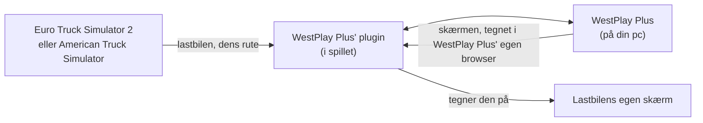

<p align="center"></p>

<h1 align="center">WestPlay Plus</h1>

<!-- languages:start -->
<p align="center">
  <a href="../../README.md">English</a> · <a href="README.zh-CN.md">简体中文</a> · <a href="README.zh-TW.md">繁體中文</a> · <a href="README.ja.md">日本語</a> · <a href="README.ko.md">한국어</a> · <a href="README.de.md">Deutsch</a> · <a href="README.fr.md">Français</a> · <a href="README.fr-CA.md">Français (Canada)</a> · <a href="README.es.md">Español</a> · <a href="README.es-419.md">Español (Latinoamérica)</a> · <a href="README.it.md">Italiano</a> · <a href="README.pt-BR.md">Português (Brasil)</a> · <a href="README.pt-PT.md">Português (Portugal)</a> · <a href="README.ru.md">Русский</a> · <a href="README.pl.md">Polski</a> · <a href="README.szl.md">Ślōnsko godka</a> · <a href="README.nl.md">Nederlands</a> · <a href="README.tr.md">Türkçe</a> · <a href="README.uk.md">Українська</a> · <a href="README.cs.md">Čeština</a> · <a href="README.sk.md">Slovenčina</a> · <a href="README.hu.md">Magyar</a> · <a href="README.ro.md">Română</a> · <a href="README.bg.md">Български</a> · <a href="README.hr.md">Hrvatski</a> · <a href="README.sr-Latn.md">Srpski (latinica)</a> · <a href="README.sr-Cyrl.md">Српски (ћирилица)</a> · <a href="README.sl.md">Slovenščina</a> · <a href="README.mk.md">Македонски</a> · <a href="README.el.md">Ελληνικά</a> · <a href="README.sv.md">Svenska</a> · <b>Dansk</b> · <a href="README.no.md">Norsk</a> · <a href="README.fi.md">Suomi</a> · <a href="README.et.md">Eesti</a> · <a href="README.lt.md">Lietuvių</a> · <a href="README.lv.md">Latviešu</a> · <a href="README.ca.md">Català</a> · <a href="README.gl.md">Galego</a> · <a href="README.eu.md">Euskara</a> · <a href="README.ka.md">ქართული</a> · <a href="README.vi.md">Tiếng Việt</a>
</p>
<!-- languages:end -->

<p align="center">
  <b>En CarPlay-agtig skærm til lastbilerne i Euro Truck Simulator 2 og American Truck Simulator.</b><br>
  Dit kort, din musik og YouTube, på din egen lastbils instrumentbræt.
  <br>
  En modificeret gren af <a href="https://github.com/enes-less/WestPlay">WestPlay</a>, for kinesisktalende spillere.
</p>

<p align="center">
  <a href="https://github.com/HandsomeTurtle0307/WestPlay-Plus/releases/latest"></a>
  
  
  
  <a href="../../LICENSE"></a>
</p>

WestPlay Plus sætter en telefonskærm på instrumentbrættet i din egen lastbil, inde i spillet: Euro Truck Simulator 2 eller American Truck Simulator, én skærm til begge. Din rute på et kort tegnet fra dit eget spil, din musik, YouTube, vejret på din tur: præcis hvor en rigtig lastbil har sin skærm, styret med musen, mens du holder en tast nede.

<!-- why:start -->

## Hvorfor jeg lavede det her

I starten ledte jeg efter et CarPlay-mod, og så faldt jeg over WestPlay og kunne se, at det er virkelig godt lavet (helt seriøst, virkelig virkelig godt). Det var bare optimeringen, der var dårlig, og den fik min computer til at fryse. Så jeg besluttede at forbedre det selv: fixe ydelsen og tilføje et par nye funktioner (står på skuldrene af en kæmpe, hihi~😊).

<!-- why:end -->

## Funktioner

**Kort fra dit eget spil.** Tegnet fra spillets kort, inklusive kortmods (ProMods og andre), med din rute, sving-for-sving-vejledning og en søgning, der føjer stop til spillets egen GPS.

**Et instrumentbræt til turen.** Kortet ved siden af det, der spiller, og det, du er på vej til, vejret på turen, alt på én skærm.

**Din musik.** Apple Music, Spotify og YouTube Music, med Now Playing og sangtekster. En sangs musikvideo afspilles direkte i Now Playing, og YouTube har sine kanaler, spillelister, undertekster og kvaliteter. Afspilleren spiller de sange, du lægger i spillets musikmappe.

**Lyst og mørkt, og dit eget udseende.** Det bliver mørkt om natten, eller når du tænder for lygterne, som en lyssensor i en bil. Egne baggrunde og appikoner tager du selv med.

**Følgeprogrammet** på din pc sætter det hele op: det finder dine spil (ETS2, ATS eller begge), installerer WestPlay Plus i hver af dem, bygger deres kort og holder sig derefter væk.

## Sådan virker det



WestPlay Plus tegner sin skærm i en egen browser på din pc, og dets plugin lægger hver billedramme på din lastbils skærm, inde i spillet. Lastbilernes egne skærme og deres informationslinjer forbliver deres: WestPlay Plus tager GPS'ens plads, og indstillingen »Vehicle Bar« afgør, om lastbilens linje bliver ved siden af.

## Lastbiler

WestPlay Plus vises på to måder: på lastbilens egen skærm eller på WestPlay Plus-tabletten.

**På lastbilens egen skærm.** I de lastbiler, der har CarPlay i virkeligheden, tager WestPlay Plus GPS'ens plads på instrumentbrættets skærm og former sig efter den. Der er intet at købe eller montere: sæt dig ind, og den er der. I Euro Truck Simulator 2:

- **DAF** XF og XG/XG+ 2021, XF Electric og XD (samt Jaspers DAF 2021)
- **Scania** S og R, med 7"-skærmen eller Smart Dash, og S BEV
- **Iveco** S-Way
- **Renault** T (2024)
- **Volvo** FH (2021 og 2024)
- **Coaches DLC:** Scania Touring og MAN Lion's Coach (2024)
- **Oyuncuyusbis' busser:** Mercedes-Benz Travego 16 SHD, MAN Lion's Coach og Setra S 531 DT på deres egne instrumentbrætter
- **Setra S 516 HD/2** (fra Oyuncuyusbis): på bussens egen GPS-skærm, dens »Gps«-del, som du monterer i lastbilforhandleren: bussens egen skærm, som dens spillere bad om, men en du selv tilføjer

**På WestPlay Plus-tabletten.** Alle andre lastbiler, spillets som moddenes, får WestPlay Plus på en tablet, du monterer i lastbilforhandleren: under Tilbehør, blandt hængende genstande eller som instrumentbrætssæt. Lastbilens egen skærm beholder spillets navigation. Tabletten sidder i enhver lastbil med hængende genstande, også i lastbilmods, du installerer senere (de får den næste gang, du starter spillet).

**I American Truck Simulator** sidder WestPlay Plus foreløbig på tabletten i alle lastbiler. De lastbiler, hvis virkelige modstykker har CarPlay, får WestPlay Plus på deres egen skærm senere.

|                        | Lastbilens egen skærm | WestPlay Plus-tablet |
| ---------------------- | --------------------- | -------------------- |
| Lastbiler              | ETS2-lastbilerne ovenfor | Alle andre, og foreløbig alle ATS-lastbiler |
| Sådan får du den       | Intet: den er der     | Monter den i forhandleren |
| Spillets navigation    | Erstattes af WestPlay Plus | Bliver på lastbilens skærm |

### Lyd

I disse lastbiler i Euro Truck Simulator 2 kommer musikken fra lastbilens egne højttalere, hver på sin plads i kabinen. Andre lastbiler, og foreløbig dem i American Truck Simulator, spiller almindelig stereo.

- **Scania S og R (2016), S BEV** — dørwoofere, A-stolpe-diskanter, tagbas
- **Scania R (2009), Streamline** — dørwoofere, A-stolpe-diskanter
- **DAF XF (105)** — A-stolpe-diskanter; to par på taghylden i Super Space Cab, én tagenhed i de andre
- **DAF XF Euro 6** — dørwoofere, A-stolpe-diskanter; to par på taghylden i Super Space Cab, én tagenhed i de andre
- **DAF XF, XG, XG+ (2021), XF Electric og XD** — dørwoofere, A-stolpe-diskanter, et par oppe, en centerenhed
- **MAN TGX** — dørwoofere; i XXL også to små enheder højt i hver sidevæg
- **MAN TGX Euro 6** — dørwoofere; i XL også en lille enhed i hvert taghjørne
- **MAN TGX (2020)** — en woofer og en mellemtone i hver dør, A-stolpe-diskanter
- **Mercedes-Benz Actros (2014)** — dørwoofere, et par oppe, A-stolpe-diskanter
- **Mercedes-Benz Actros (2009)** — dørwoofere, et par i taghyldens forreste hjørner
- **Volvo FH (2021, 2024), FH16 (2012)** — dørwoofere, bas i bagvæggen
- **Volvo FH16 (2009)** — en enhed i hver dør
- **Iveco Stralis** — en enhed i hver ende af tagkonsollen, og i de høje tage en lille på passagersiden
- **Iveco Hi-Way** — en enhed i hver ende af tagkonsollen, og en højt på hver side
- **Iveco S-Way** — en woofer og en diskant i hver dør
- **Renault Magnum** — en enhed i hvert taghjørne, diskanter på tagkonsollen
- **Renault Premium** — en enhed på hver side af taget, lavere i det lave tag
- **Renault T** — A-stolpe-diskanter, et par i bagvæggen; dørwoofere i 2024-interiørerne
- **Renault E-Tech T** — dørwoofere, A-stolpe-diskanter, et par i bagvæggen
- **JuseeTVs Scania PGR** — højttalerne i de dele, du monterer: døre, A-stolper, topkonsol, bagvæg

## Installation

1. Download installationsprogrammet fra den [nyeste version](https://github.com/HandsomeTurtle0307/WestPlay-Plus/releases/latest), og kør det.
2. Følgeprogrammet åbner og guider dig gennem resten: det finder dine spil (ETS2, ATS eller begge), installerer WestPlay Plus' plugin og dets skærmmod i hver af dem og bygger dine kort.
3. Start spillet, og sæt dig i en lastbil.

**Opdateringer:** denne gren opdaterer ikke sig selv. Vil du se, om der er en nyere version, så besøg [udgivelsessiden](https://github.com/HandsomeTurtle0307/WestPlay-Plus/releases). Samme link findes på følgeprogrammets »Om«-side.

**Krav:** Windows 10 eller 11 (64-bit), Euro Truck Simulator 2 version 1.62 (eller 1.61) eller American Truck Simulator version 1.62 (andre versioner kan fungere; følgeprogrammet siger til, når en ikke er testet), og Microsoft Edge WebView2 (en del af Windows 11; installationsprogrammet tilføjer det, hvor det mangler).

## Privatliv

WestPlay Plus har ingen servere, ingen egne konti og ingen analyse. Det indsamler eller sender intet om dig.

- Du logger ind på Apple Music, Spotify og YouTube på deres egne sider, i WestPlay Plus' egen browserprofil på din pc, som i en browser. WestPlay Plus gemmer selv ingen kontooplysninger.
- Dit kort bygges på din pc ud fra dit spil og bliver der.
- WestPlay Plus taler med de tjenester, du bruger, og med GitHub kun, når du åbner dets udgivelsesside.

## Feedback

Fejl, spørgsmål og idéer: åbn et issue på [GitHub](https://github.com/HandsomeTurtle0307/WestPlay-Plus/issues).

## Byg fra kildekoden

Du skal bruge [Rust](https://rustup.rs) (stable) og [Node.js](https://nodejs.org) 24, på Windows.

```sh
npm install      # følgeprogrammets værktøjer og grænsefladens pakker
npm run dev      # WestPlay Plus med grænsefladen serveret live
```

`cargo test --workspace` og `npm test --prefix ui` kører testene. Spillets plugin bygges med `cargo build --release -p westplay-plugin`.

## Licens

WestPlay Plus er fri software: du må videredistribuere og ændre det på vilkårene i GNU General Public License, version 3 eller (hvis du vælger det) enhver senere version. Se [LICENSE](../../LICENSE).

Copyright © 2026 HandsomeTurtle0307. De biblioteker, der følger med WestPlay Plus, beholder deres egne licenser: se [THIRD_PARTY_LICENSES.md](../../THIRD_PARTY_LICENSES.md), og [THIRD_PARTY_NOTICES.md](../../THIRD_PARTY_NOTICES.md) for de værker, det følger.

## Hvor projektet kommer fra

WestPlay Plus er en modificeret gren (fork) af [WestPlay](https://github.com/enes-less/WestPlay), et fremragende skærmmod i CarPlay-stil til Euro Truck Simulator 2 og American Truck Simulator, lavet af **enes-less**. Næsten alt det oprindelige design, kode og materiale er hans arbejde; denne gren har sine egne ændringer ovenpå og er taknemmelig for det, han byggede. Kan du lide projektet, så kig også på originalen.

Støt også gerne det oprindelige projekt (og hvis du kan, så støt også mig 😭😭😭 — det er ikke let at lave software~).

<!-- translated:start -->
<sub>Denne README er oversat fra den engelske version. Forfatteren taler naturligvis ikke alle 43 sprog 😭😭, så oversættelsen kan være ufuldstændig hist og her. Undskyld~ Hvis du finder en fejl på dit sprog, så sig til, det er meget værdsat~</sub>
<!-- translated:end -->

<sub>WestPlay Plus er et uafhængigt projekt, uden tilknytning til eller godkendelse fra Apple, SCS Software, Spotify, Google eller lastbilproducenterne. CarPlay, Apple Music, Spotify, YouTube, YouTube Music samt producenternes navne og logoer er varemærker tilhørende deres ejere og bruges her kun til at betegne det, WestPlay Plus fungerer med.</sub>
