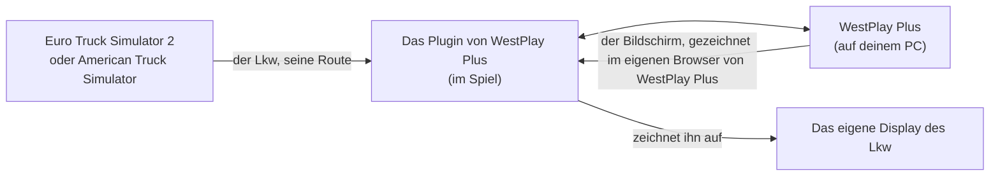

<p align="center"></p>

<h1 align="center">WestPlay Plus</h1>

<!-- languages:start -->
<p align="center">
  <a href="../../README.md">English</a> · <a href="README.zh-CN.md">简体中文</a> · <a href="README.zh-TW.md">繁體中文</a> · <a href="README.ja.md">日本語</a> · <a href="README.ko.md">한국어</a> · <b>Deutsch</b> · <a href="README.fr.md">Français</a> · <a href="README.fr-CA.md">Français (Canada)</a> · <a href="README.es.md">Español</a> · <a href="README.es-419.md">Español (Latinoamérica)</a> · <a href="README.it.md">Italiano</a> · <a href="README.pt-BR.md">Português (Brasil)</a> · <a href="README.pt-PT.md">Português (Portugal)</a> · <a href="README.ru.md">Русский</a> · <a href="README.pl.md">Polski</a> · <a href="README.nl.md">Nederlands</a> · <a href="README.tr.md">Türkçe</a> · <a href="README.uk.md">Українська</a> · <a href="README.cs.md">Čeština</a> · <a href="README.sk.md">Slovenčina</a> · <a href="README.hu.md">Magyar</a> · <a href="README.ro.md">Română</a> · <a href="README.bg.md">Български</a> · <a href="README.hr.md">Hrvatski</a> · <a href="README.sr-Latn.md">Srpski (latinica)</a> · <a href="README.sr-Cyrl.md">Српски (ћирилица)</a> · <a href="README.sl.md">Slovenščina</a> · <a href="README.mk.md">Македонски</a> · <a href="README.el.md">Ελληνικά</a> · <a href="README.sv.md">Svenska</a> · <a href="README.da.md">Dansk</a> · <a href="README.no.md">Norsk</a> · <a href="README.fi.md">Suomi</a> · <a href="README.et.md">Eesti</a> · <a href="README.lt.md">Lietuvių</a> · <a href="README.lv.md">Latviešu</a> · <a href="README.ca.md">Català</a> · <a href="README.gl.md">Galego</a> · <a href="README.vi.md">Tiếng Việt</a>
</p>
<!-- languages:end -->

<!-- english-only:start -->
<p align="center"><sub>Schlesisch, Baskisch und Georgisch unterstützt die App, aber eine README gibt es dafür noch nicht: Niemand konnte bisher eine Übersetzung in diese Sprachen prüfen. Alle Inhalte stehen in der englischen Fassung im Repository-Stamm.</sub></p>
<!-- english-only:end -->

<p align="center">
  <b>Ein Bildschirm im CarPlay-Stil für die Lkw in Euro Truck Simulator 2 und American Truck Simulator.</b><br>
  Deine Karte, deine Musik und YouTube – auf dem eigenen Display deines Lkw.
  <br>
  Ein modifizierter Zweig von <a href="https://github.com/enes-less/WestPlay">WestPlay</a>, mit einigen Optimierungen und neuen Funktionen.
</p>

<p align="center">
  <a href="https://github.com/HandsomeTurtle0307/WestPlay-Plus/releases/latest"></a>
  
  
  
  <a href="../../LICENSE"></a>
</p>

WestPlay Plus bringt einen Bildschirm im Handy-Stil auf das eigene Armaturendisplay deines Lkw, mitten im Spiel: Euro Truck Simulator 2 oder American Truck Simulator, ein Bildschirm für beide. Deine Route auf einer Karte, die aus deinem eigenen Spiel gezeichnet ist, deine Musik, YouTube, das Wetter auf deiner Fahrt: genau dort, wo ein echter Lkw seinen Bildschirm hat, mit der Maus bedient, während du eine Taste hältst.

<!-- why:start -->

## Warum ich das gebaut habe

Eigentlich wollte ich nur einen CarPlay-Mod finden, dann bin ich über WestPlay gestolpert – und das ist wirklich sehr gut gemacht (wirklich, richtig gut). Bloß die Optimierung war mies und hat meinen Rechner eingefroren. Also habe ich beschlossen, selbst Hand anzulegen: Performance aufpolieren, ein paar neue Funktionen dazu (auf den Schultern eines Riesen, hihi~😊).

<!-- easter-egg:start -->
> Eigentlich gibt es noch einen Grund: Früher, wenn ich sehr aufgewühlt war, habe ich Dinge getan (man kann sagen: viele), die andere getroffen haben – vor allem jemanden, den ich wirklich nicht verletzen wollte. Wenn ich heute daran denke, fühle ich mich schuldig und es tut mir sehr weh, und die Zukunft kommt mir neblig vor (auch Studium und Pläne). Deshalb klammere ich mich an das Einzige, was ich kontrollieren kann – das Programmieren – und decke damit vorerst den Schmerz an anderen Stellen zu. Ach🥲 Was ich weiter machen soll, weiß ich auch nicht, ich gehe Schritt für Schritt :)‍💨
<!-- easter-egg:end -->

<!-- why:end -->

## Funktionen

**Karten aus deinem eigenen Spiel.** Gezeichnet aus der Karte deines Spiels, Kartenmods inklusive (ProMods und andere), mit deiner Route, Abbiegehinweisen und einer Suche, die Zwischenziele ins GPS des Spiels einträgt.

**Ein Dashboard für die Fahrt.** Die Karte neben dem, was gerade läuft, und dem, wohin du fährst, dazu das Wetter auf deiner Strecke, alles auf einem Bildschirm.

**Deine Musik.** Apple Music, Spotify und YouTube Music, mit Now Playing und Songtexten. Das Musikvideo eines Songs läuft direkt im Now Playing, und YouTube hat seine Kanäle, Playlists, Untertitel und Qualitätsstufen. Der Player spielt die Songs, die du in den Musikordner des Spiels legst.

**Hell und dunkel, und dein eigener Look.** Nachts oder wenn du das Licht einschaltest, wird es dunkel, wie bei einem Lichtsensor im Auto. Eigene Hintergrundbilder und App-Symbole bringst du selbst mit.

**Die Begleit-App** auf deinem PC richtet alles ein: Sie findet deine Spiele – ETS2, ATS oder beide –, installiert WestPlay Plus in jedes davon, baut deren Karten und hält sich danach heraus.

## So funktioniert es



WestPlay Plus zeichnet seinen Bildschirm in einem eigenen Browser auf deinem PC, und sein Plugin setzt jedes Bild auf das Display deines Lkw, mitten im Spiel. Die eigenen Bildschirme der Lkw und ihre Infoleisten bleiben ihre: WestPlay Plus nimmt den Platz des GPS ein, und die Einstellung „Vehicle Bar“ entscheidet, ob die Leiste des Lkw daneben bleibt.

## Lkw

WestPlay Plus erscheint auf zwei Arten: auf dem eigenen Display des Lkw oder auf dem WestPlay-Plus-Tablet.

**Auf dem eigenen Display des Lkw.** In den Lkw, die in Wirklichkeit CarPlay haben, nimmt WestPlay Plus den Platz des GPS auf dem Armaturendisplay ein, passend zu dessen Form. Nichts zu kaufen, nichts einzubauen: einsteigen, und es ist da. In Euro Truck Simulator 2:

- **DAF** XF und XG/XG+ 2021, XF Electric und XD (sowie Jaspers DAF 2021)
- **Scania** S und R, mit dem 7"-Display oder dem Smart Dash, und der S BEV
- **Iveco** S-Way
- **Renault** T (2024)
- **Volvo** FH (2021 und 2024)
- **Coaches DLC:** der Scania Touring und der MAN Lion's Coach (2024)
- **Die Busse von Oyuncuyusbis:** der Mercedes-Benz Travego 16 SHD, der MAN Lion's Coach und der Setra S 531 DT auf ihren eigenen Armaturendisplays
- **Setra S 516 HD/2** (von Oyuncuyusbis): auf dem eigenen GPS-Display des Reisebusses, seinem „Gps“-Teil, den du im Lkw-Shop einbaust: das eigene Display des Busses, wie es sich seine Spieler gewünscht haben, aber eines, das du selbst hinzufügst

**Auf dem WestPlay-Plus-Tablet.** Jeder andere Lkw, ob aus dem Spiel oder als Mod, bekommt WestPlay Plus auf einem Tablet, das du im Lkw-Shop einbaust: unter Zubehör, bei den Hängeartikeln oder als Armaturenbrett-Set. Das eigene Display des Lkw behält die Navigation des Spiels. Das Tablet steckt in jedem Lkw mit Hängeartikeln, auch in Lkw-Mods, die du später installierst (sie bekommen es beim nächsten Spielstart).

**In American Truck Simulator** ist WestPlay Plus vorerst in jedem Lkw auf dem Tablet. Die Lkw, deren reale Gegenstücke CarPlay haben, bekommen WestPlay Plus später auf ihrem eigenen Display.

|                       | Eigenes Display des Lkw | WestPlay-Plus-Tablet |
| --------------------- | ----------------------- | -------------------- |
| Lkw                   | Die ETS2-Lkw oben       | Jeder andere Lkw, und vorerst jeder ATS-Lkw |
| So bekommst du es     | Nichts: es ist da       | Im Lkw-Shop einbauen |
| Navigation des Spiels | Ersetzt durch WestPlay Plus | Bleibt auf dem Display des Lkw |

### Sound

In diesen Lkw von Euro Truck Simulator 2 kommt die Musik aus den eigenen Lautsprechern des Lkw, jeder an seinem Platz in der Kabine. Andere Lkw, und vorerst die von American Truck Simulator, spielen einfaches Stereo.

- **Scania S und R (2016), S BEV** — Tür-Tieftöner, A-Säulen-Hochtöner, Dachbass
- **Scania R (2009), Streamline** — Tür-Tieftöner, A-Säulen-Hochtöner
- **DAF XF (105)** — A-Säulen-Hochtöner; zwei Paare auf dem Dachregal im Super Space Cab, eine Dacheinheit in den anderen
- **DAF XF Euro 6** — Tür-Tieftöner, A-Säulen-Hochtöner; zwei Paare auf dem Dachregal im Super Space Cab, eine Dacheinheit in den anderen
- **DAF XF, XG, XG+ (2021), XF Electric und XD** — Tür-Tieftöner, A-Säulen-Hochtöner, ein Paar oben, eine Mitten-Einheit
- **MAN TGX** — Tür-Tieftöner; im XXL zusätzlich zwei kleine Einheiten hoch in jeder Seitenwand
- **MAN TGX Euro 6** — Tür-Tieftöner; im XL zusätzlich eine kleine Einheit in jeder Dachecke
- **MAN TGX (2020)** — ein Tieftöner und ein Mitteltöner in jeder Tür, A-Säulen-Hochtöner
- **Mercedes-Benz Actros (2014)** — Tür-Tieftöner, ein Paar oben, A-Säulen-Hochtöner
- **Mercedes-Benz Actros (2009)** — Tür-Tieftöner, ein Paar an den vorderen Ecken des Dachregals
- **Volvo FH (2021, 2024), FH16 (2012)** — Tür-Tieftöner, Bass an der Rückwand
- **Volvo FH16 (2009)** — eine Einheit in jeder Tür
- **Iveco Stralis** — eine Einheit an jedem Ende der Dachkonsole, und in den hohen Dächern eine kleine auf der Beifahrerseite
- **Iveco Hi-Way** — eine Einheit an jedem Ende der Dachkonsole, und eine hoch auf jeder Seite
- **Iveco S-Way** — ein Tieftöner und ein Hochtöner in jeder Tür
- **Renault Magnum** — eine Einheit in jeder Dachecke, Hochtöner an der Dachkonsole
- **Renault Premium** — eine Einheit in jeder Dachseite, im niedrigen Dach tiefer
- **Renault T** — A-Säulen-Hochtöner, ein Paar an der Rückwand; Tür-Tieftöner in den Interieurs von 2024
- **Renault E-Tech T** — Tür-Tieftöner, A-Säulen-Hochtöner, ein Paar an der Rückwand
- **JuseeTVs Scania PGR** — die Lautsprecher der Teile, die du einbaust: Türen, A-Säulen, Dachkonsole, Rückwand

## Installation

1. Lade den Installer von der [neuesten Version](https://github.com/HandsomeTurtle0307/WestPlay-Plus/releases/latest) herunter und führe ihn aus.
2. Die Begleit-App öffnet sich und führt dich durch den Rest: Sie findet deine Spiele (ETS2, ATS oder beide), installiert in jedem das Plugin von WestPlay Plus und dessen Bildschirm-Mod und baut deine Karten.
3. Starte das Spiel und steig in einen Lkw.

**Updates:** Dieser Zweig aktualisiert sich nicht selbst. Ob es eine neuere Version gibt, siehst du auf der [Releases-Seite](https://github.com/HandsomeTurtle0307/WestPlay-Plus/releases). Die Seite „Über“ der Begleit-App hat denselben Link.

**Voraussetzungen:** Windows 10 oder 11 (64 Bit), Euro Truck Simulator 2 Version 1.62 (oder 1.61) oder American Truck Simulator Version 1.62 (andere Versionen können funktionieren; die Begleit-App sagt es, wenn eine ungetestet ist), und Microsoft Edge WebView2 (Teil von Windows 11; der Installer fügt es hinzu, wo es fehlt).

## Datenschutz

WestPlay Plus hat keine Server, keine eigenen Konten und keine Analysedienste. Es sammelt und sendet nichts über dich.

- Du meldest dich bei Apple Music, Spotify und YouTube auf deren eigenen Seiten an, im eigenen Browserprofil von WestPlay Plus auf deinem PC, so wie in einem Browser. WestPlay Plus speichert selbst keine Kontodaten.
- Deine Karte wird auf deinem PC aus deinem Spiel gebaut und bleibt dort.
- WestPlay Plus spricht mit den Diensten, die du nutzt, und mit GitHub nur, wenn du dessen Releases-Seite öffnest.

## Rückmeldung

Fehler, Fragen und Ideen: öffne ein Issue auf [GitHub](https://github.com/HandsomeTurtle0307/WestPlay-Plus/issues).

## Aus dem Quellcode bauen

Du brauchst [Rust](https://rustup.rs) (stable) und [Node.js](https://nodejs.org) 24, unter Windows.

```sh
npm install      # die Werkzeuge der Begleit-App und die Pakete der UI
npm run dev      # WestPlay Plus, mit live ausgelieferter UI
```

`cargo test --workspace` und `npm test --prefix ui` führen die Tests aus. Das Spiel-Plugin wird mit `cargo build --release -p westplay-plugin` gebaut.

## Lizenz

WestPlay Plus ist freie Software: Du kannst es unter den Bedingungen der GNU General Public License, Version 3 oder (nach deiner Wahl) jeder späteren Version, weitergeben und verändern. Siehe [LICENSE](../../LICENSE).

Copyright © 2026 HandsomeTurtle0307. Die mitgelieferten Bibliotheken behalten ihre eigenen Lizenzen: siehe [THIRD_PARTY_LICENSES.md](../../THIRD_PARTY_LICENSES.md) und, für die Werke, denen dieses Projekt folgt, [THIRD_PARTY_NOTICES.md](../../THIRD_PARTY_NOTICES.md).

## Woher dieses Projekt kommt

WestPlay Plus ist ein modifizierter Zweig (Fork) von [WestPlay](https://github.com/enes-less/WestPlay), einem hervorragenden Bildschirm-Mod im CarPlay-Stil für Euro Truck Simulator 2 und American Truck Simulator von **enes-less**. Fast das gesamte ursprüngliche Design, der Code und die Assets sind seine Arbeit; dieser Zweig setzt seine eigenen Änderungen darauf und ist dankbar für das, was er gebaut hat. Wenn dir dieses Projekt gefällt, schau dir bitte auch das Original an.

Bitte unterstützt auch das Originalprojekt (und wenn ihr könnt, unterstützt bitte auch mich 😭😭😭 – Software zu entwickeln ist nicht leicht~).

<!-- translated:start -->
<sub>Diese README wurde aus der englischen Fassung übersetzt. Der Autor spricht natürlich nicht alle 43 Sprachen 😭😭, deshalb kann die Übersetzung an manchen Stellen unvollständig oder holprig sein. Bitte habt Nachsicht~ Wenn dir in deiner Sprache etwas auffällt, sag gern Bescheid~</sub>
<!-- translated:end -->

<sub>WestPlay Plus ist ein unabhängiges Projekt, weder mit Apple, SCS Software, Spotify, Google noch mit den Lkw-Herstellern verbunden noch von ihnen unterstützt. CarPlay, Apple Music, Spotify, YouTube, YouTube Music sowie die Namen und Logos der Lkw-Hersteller sind Marken ihrer jeweiligen Inhaber und werden hier nur verwendet, um zu benennen, womit WestPlay Plus zusammenarbeitet.</sub>
