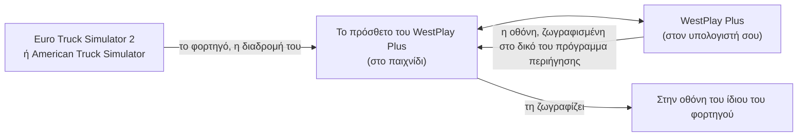

<p align="center"></p>

<h1 align="center">WestPlay Plus</h1>

<!-- languages:start -->
<p align="center">
  <a href="../../README.md">English</a> · <a href="README.zh-CN.md">简体中文</a> · <a href="README.zh-TW.md">繁體中文</a> · <a href="README.ja.md">日本語</a> · <a href="README.ko.md">한국어</a> · <a href="README.de.md">Deutsch</a> · <a href="README.fr.md">Français</a> · <a href="README.fr-CA.md">Français (Canada)</a> · <a href="README.es.md">Español</a> · <a href="README.es-419.md">Español (Latinoamérica)</a> · <a href="README.it.md">Italiano</a> · <a href="README.pt-BR.md">Português (Brasil)</a> · <a href="README.pt-PT.md">Português (Portugal)</a> · <a href="README.ru.md">Русский</a> · <a href="README.pl.md">Polski</a> · <a href="README.szl.md">Ślōnsko godka</a> · <a href="README.nl.md">Nederlands</a> · <a href="README.tr.md">Türkçe</a> · <a href="README.uk.md">Українська</a> · <a href="README.cs.md">Čeština</a> · <a href="README.sk.md">Slovenčina</a> · <a href="README.hu.md">Magyar</a> · <a href="README.ro.md">Română</a> · <a href="README.bg.md">Български</a> · <a href="README.hr.md">Hrvatski</a> · <a href="README.sr-Latn.md">Srpski (latinica)</a> · <a href="README.sr-Cyrl.md">Српски (ћирилица)</a> · <a href="README.sl.md">Slovenščina</a> · <a href="README.mk.md">Македонски</a> · <b>Ελληνικά</b> · <a href="README.sv.md">Svenska</a> · <a href="README.da.md">Dansk</a> · <a href="README.no.md">Norsk</a> · <a href="README.fi.md">Suomi</a> · <a href="README.et.md">Eesti</a> · <a href="README.lt.md">Lietuvių</a> · <a href="README.lv.md">Latviešu</a> · <a href="README.ca.md">Català</a> · <a href="README.gl.md">Galego</a> · <a href="README.eu.md">Euskara</a> · <a href="README.ka.md">ქართული</a> · <a href="README.vi.md">Tiếng Việt</a>
</p>
<!-- languages:end -->

<p align="center">
  <b>Μια οθόνη σε στυλ CarPlay για τα φορτηγά των Euro Truck Simulator 2 και American Truck Simulator.</b><br>
  Ο χάρτης σου, η μουσική σου και το YouTube, στο ταμπλό του δικού σου φορτηγού.
  <br>
  Ένας τροποποιημένος κλάδος του <a href="https://github.com/enes-less/WestPlay">WestPlay</a>, για παίκτες που μιλούν κινεζικά.
</p>

<p align="center">
  <a href="https://github.com/HandsomeTurtle0307/WestPlay-Plus/releases/latest"></a>
  
  
  
  <a href="../../LICENSE"></a>
</p>

Το WestPlay Plus βάζει μια οθόνη σαν κινητού στο ταμπλό του δικού σου φορτηγού, μέσα στο παιχνίδι: Euro Truck Simulator 2 ή American Truck Simulator, μία οθόνη και για τα δύο. Η διαδρομή σου σε έναν χάρτη ζωγραφισμένο από το δικό σου παιχνίδι, η μουσική σου, το YouTube, ο καιρός στο ταξίδι σου: ακριβώς εκεί που ένα πραγματικό φορτηγό έχει την οθόνη του, με χειρισμό ποντικιού κρατώντας πατημένο ένα πλήκτρο.

<!-- why:start -->

## Γιατί το έφτιαξα

Στην αρχή έψαχνα ένα mod για CarPlay, ώσπου έπεσα πάνω στο WestPlay και είδα ότι είναι πολύ καλά φτιαγμένο (αλήθεια, πάρα πολύ καλά). Μόνο που η βελτιστοποίηση δεν ήταν καλή και μου κόλλησε τον υπολογιστή. Έτσι αποφάσισα να το φτιάξω μόνος μου: έπιασα τις επιδόσεις και πρόσθεσα μερικές νέες λειτουργίες (πάνω στους ώμους ενός γίγαντα, χε χε~😊).

<!-- why:end -->

## Δυνατότητες

**Χάρτες από το δικό σου παιχνίδι.** Ζωγραφισμένοι από τον χάρτη του παιχνιδιού σου, με τα mods χάρτη να περιλαμβάνονται (ProMods και άλλα), με τη διαδρομή σου, οδηγίες στροφή προς στροφή και αναζήτηση που προσθέτει στάσεις στο GPS του ίδιου του παιχνιδιού.

**Ένα ταμπλό για το ταξίδι.** Ο χάρτης δίπλα σε αυτό που παίζει και σε αυτό όπου πηγαίνεις, ο καιρός της διαδρομής, όλα σε μία οθόνη.

**Η μουσική σου.** Apple Music, Spotify και YouTube Music, με Now Playing και στίχους. Το βίντεο κλιπ ενός τραγουδιού παίζει κατευθείαν στο Now Playing, και το YouTube έχει τα κανάλια, τις λίστες αναπαραγωγής, τους υπότιτλους και τις ποιότητές του. Η αναπαραγωγή παίζει τα τραγούδια που βάζεις στον φάκελο μουσικής του παιχνιδιού.

**Φωτεινό και σκοτεινό, και η δική σου εμφάνιση.** Σκοτεινιάζει τη νύχτα ή όταν ανάβεις τα φώτα, σαν αισθητήρας φωτός αυτοκινήτου. Δικές σου ταπετσαρίες και εικονίδια τα φέρνεις μόνος σου.

**Η συνοδευτική εφαρμογή** στον υπολογιστή σου τα ρυθμίζει όλα: βρίσκει τα παιχνίδια σου (ETS2, ATS ή και τα δύο), εγκαθιστά το WestPlay Plus σε καθένα, χτίζει τους χάρτες τους και μετά δεν ενοχλεί.

## Πώς λειτουργεί



Το WestPlay Plus ζωγραφίζει την οθόνη του σε δικό του πρόγραμμα περιήγησης στον υπολογιστή σου και το πρόσθετό του βάζει κάθε καρέ στην οθόνη του φορτηγού σου, μέσα στο παιχνίδι. Οι οθόνες των ίδιων των φορτηγών και οι μπάρες πληροφοριών τους παραμένουν δικές τους: το WestPlay Plus παίρνει τη θέση του GPS, και η ρύθμιση «Vehicle Bar» λέει αν η μπάρα του φορτηγού μένει δίπλα.

## Φορτηγά

Το WestPlay Plus εμφανίζεται με δύο τρόπους: στην οθόνη του ίδιου του φορτηγού ή στο tablet του WestPlay Plus.

**Στην οθόνη του ίδιου του φορτηγού.** Στα φορτηγά που έχουν CarPlay στην πραγματικότητα, το WestPlay Plus παίρνει τη θέση του GPS στην οθόνη του ταμπλό, προσαρμοσμένο στο σχήμα της. Δεν υπάρχει τίποτα να αγοράσεις ή να τοποθετήσεις: μπαίνεις και είναι εκεί. Στο Euro Truck Simulator 2:

- **DAF** XF και XG/XG+ 2021, XF Electric και XD (και το DAF 2021 του Jasper)
- **Scania** S και R, με την οθόνη 7" ή το Smart Dash, και το S BEV
- **Iveco** S-Way
- **Renault** T (2024)
- **Volvo** FH (2021 και 2024)
- **Coaches DLC:** το Scania Touring και το MAN Lion's Coach (2024)
- **Τα πούλμαν της Oyuncuyusbis:** το Mercedes-Benz Travego 16 SHD, το MAN Lion's Coach και το Setra S 531 DT στις δικές τους οθόνες ταμπλό
- **Setra S 516 HD/2** (της Oyuncuyusbis): στην οθόνη GPS του ίδιου του πούλμαν, στο τμήμα του «Gps», που το τοποθετείς στην αντιπροσωπεία φορτηγών: η οθόνη του ίδιου του πούλμαν, όπως ζήτησαν οι παίκτες του, αλλά μια που την προσθέτεις εσύ

**Στο tablet του WestPlay Plus.** Κάθε άλλο φορτηγό, του παιχνιδιού και των mods, παίρνει το WestPlay Plus σε ένα tablet που τοποθετείς στην αντιπροσωπεία φορτηγών: στα Αξεσουάρ, στα κρεμαστά αντικείμενα ή ως σετ ταμπλό. Η οθόνη του ίδιου του φορτηγού κρατά την πλοήγηση του παιχνιδιού. Το tablet υπάρχει σε κάθε φορτηγό με κρεμαστά αντικείμενα, και στα mods φορτηγών που εγκαθιστάς αργότερα (το παίρνουν στην επόμενη εκκίνηση του παιχνιδιού).

**Στο American Truck Simulator**, προς το παρόν το WestPlay Plus είναι στο tablet σε κάθε φορτηγό. Τα φορτηγά των οποίων τα πραγματικά αντίστοιχα έχουν CarPlay θα πάρουν το WestPlay Plus στην οθόνη τους αργότερα.

|                        | Οθόνη του ίδιου του φορτηγού | Tablet WestPlay Plus |
| ---------------------- | ---------------------------- | -------------------- |
| Φορτηγά                | Τα φορτηγά ETS2 παραπάνω     | Κάθε άλλο, και προς το παρόν κάθε φορτηγό ATS |
| Πώς το αποκτάς         | Τίποτα: είναι ήδη εκεί       | Τοποθέτησέ το στην αντιπροσωπεία |
| Πλοήγηση παιχνιδιού    | Αντικαθίσταται από το WestPlay Plus | Μένει στην οθόνη του φορτηγού |

### Ήχος

Σε αυτά τα φορτηγά του Euro Truck Simulator 2, η μουσική βγαίνει από τα δικά τους ηχεία, το καθένα στη θέση του στην καμπίνα. Τα άλλα φορτηγά, και προς το παρόν εκείνα του American Truck Simulator, παίζουν απλό στερεοφωνικό.

- **Scania S και R (2016), S BEV** — γούφερ θυρών, τουίτερ κολόνας A, μπάσο οροφής
- **Scania R (2009), Streamline** — γούφερ θυρών, τουίτερ κολόνας A
- **DAF XF (105)** — τουίτερ κολόνας A· δύο ζεύγη στο ράφι οροφής στο Super Space Cab, μία μονάδα οροφής στα άλλα
- **DAF XF Euro 6** — γούφερ θυρών, τουίτερ κολόνας A· δύο ζεύγη στο ράφι οροφής στο Super Space Cab, μία μονάδα οροφής στα άλλα
- **DAF XF, XG, XG+ (2021), XF Electric και XD** — γούφερ θυρών, τουίτερ κολόνας A, ένα ζεύγος ψηλά, μία κεντρική μονάδα
- **MAN TGX** — γούφερ θυρών· στο XXL και δύο μικρές μονάδες ψηλά σε κάθε πλαϊνό τοίχωμα
- **MAN TGX Euro 6** — γούφερ θυρών· στο XL και μία μικρή μονάδα σε κάθε γωνία οροφής
- **MAN TGX (2020)** — ένα γούφερ και ένα μεσαίο σε κάθε πόρτα, τουίτερ κολόνας A
- **Mercedes-Benz Actros (2014)** — γούφερ θυρών, ένα ζεύγος ψηλά, τουίτερ κολόνας A
- **Mercedes-Benz Actros (2009)** — γούφερ θυρών, ένα ζεύγος στις μπροστινές γωνίες του ραφιού οροφής
- **Volvo FH (2021, 2024), FH16 (2012)** — γούφερ θυρών, μπάσο στον πίσω τοίχο
- **Volvo FH16 (2009)** — μία μονάδα σε κάθε πόρτα
- **Iveco Stralis** — μία μονάδα σε κάθε άκρο της κονσόλας οροφής, και στις ψηλές οροφές μία μικρή στην πλευρά του συνοδηγού
- **Iveco Hi-Way** — μία μονάδα σε κάθε άκρο της κονσόλας οροφής, και μία ψηλά σε κάθε πλευρά
- **Iveco S-Way** — ένα γούφερ και ένα τουίτερ σε κάθε πόρτα
- **Renault Magnum** — μία μονάδα σε κάθε γωνία οροφής, τουίτερ στην κονσόλα οροφής
- **Renault Premium** — μία μονάδα σε κάθε πλευρά της οροφής, πιο χαμηλά στην χαμηλή οροφή
- **Renault T** — τουίτερ κολόνας A, ένα ζεύγος στον πίσω τοίχο· γούφερ θυρών στα εσωτερικά του 2024
- **Renault E-Tech T** — γούφερ θυρών, τουίτερ κολόνας A, ένα ζεύγος στον πίσω τοίχο
- **Το Scania PGR της JuseeTV** — τα ηχεία των εξαρτημάτων που τοποθετείς: πόρτες, κολόνες A, πάνω κονσόλα, πίσω τοίχος

## Εγκατάσταση

1. Κατέβασε τον οδηγό εγκατάστασης από την [τελευταία έκδοση](https://github.com/HandsomeTurtle0307/WestPlay-Plus/releases/latest) και εκτέλεσέ τον.
2. Ανοίγει η συνοδευτική εφαρμογή και σε καθοδηγεί στα υπόλοιπα: βρίσκει τα παιχνίδια σου (ETS2, ATS ή και τα δύο), εγκαθιστά σε καθένα το πρόσθετο του WestPlay Plus και το mod οθόνης, και χτίζει τους χάρτες σου.
3. Ξεκίνα το παιχνίδι και μπες σε ένα φορτηγό.

**Ενημερώσεις:** αυτός ο κλάδος δεν ενημερώνεται μόνος του. Για να δεις αν υπάρχει νεότερη έκδοση, επισκέψου τη [σελίδα εκδόσεων](https://github.com/HandsomeTurtle0307/WestPlay-Plus/releases). Τον ίδιο σύνδεσμο έχει και η σελίδα «Σχετικά» της συνοδευτικής εφαρμογής.

**Απαιτήσεις:** Windows 10 ή 11 (64 bit), Euro Truck Simulator 2 έκδοση 1.62 (ή 1.61) ή American Truck Simulator έκδοση 1.62 (άλλες εκδόσεις μπορεί να δουλέψουν· η συνοδευτική εφαρμογή σε ειδοποιεί όταν κάποια δεν έχει δοκιμαστεί), και Microsoft Edge WebView2 (μέρος των Windows 11· ο οδηγός εγκατάστασης το προσθέτει όπου λείπει).

## Απόρρητο

Το WestPlay Plus δεν έχει διακομιστές, δικούς του λογαριασμούς και αναλύσεις. Δεν συλλέγει και δεν στέλνει τίποτα για σένα.

- Συνδέεσαι στο Apple Music, το Spotify και το YouTube στις δικές τους σελίδες, στο δικό του προφίλ προγράμματος περιήγησης του WestPlay Plus στον υπολογιστή σου, όπως σε ένα πρόγραμμα περιήγησης. Το WestPlay Plus δεν αποθηκεύει το ίδιο δεδομένα λογαριασμού.
- Ο χάρτης σου χτίζεται στον υπολογιστή σου από το παιχνίδι σου και μένει εκεί.
- Το WestPlay Plus μιλά με τις υπηρεσίες που χρησιμοποιείς και με το GitHub μόνο όταν ανοίγεις τη σελίδα εκδόσεών του.

## Σχόλια

Σφάλματα, ερωτήσεις και ιδέες: άνοιξε ένα issue στο [GitHub](https://github.com/HandsomeTurtle0307/WestPlay-Plus/issues).

## Κατασκευή από τον πηγαίο κώδικα

Χρειάζεσαι [Rust](https://rustup.rs) (stable) και [Node.js](https://nodejs.org) 24, σε Windows.

```sh
npm install      # τα εργαλεία της συνοδευτικής εφαρμογής και τα πακέτα του interface
npm run dev      # το WestPlay Plus, με το interface να σερβίρεται ζωντανά
```

Τα `cargo test --workspace` και `npm test --prefix ui` τρέχουν τα τεστ. Το πρόσθετο του παιχνιδιού χτίζεται με `cargo build --release -p westplay-plugin`.

## Άδεια

Το WestPlay Plus είναι ελεύθερο λογισμικό: μπορείς να το διανέμεις και να το τροποποιείς υπό τους όρους της GNU General Public License, έκδοση 3 ή (κατ' επιλογήν σου) οποιασδήποτε μεταγενέστερης έκδοσης. Δες [LICENSE](../../LICENSE).

Copyright © 2026 HandsomeTurtle0307. Οι βιβλιοθήκες που διανέμονται με το WestPlay Plus διατηρούν τις δικές τους άδειες: δες [THIRD_PARTY_LICENSES.md](../../THIRD_PARTY_LICENSES.md), και [THIRD_PARTY_NOTICES.md](../../THIRD_PARTY_NOTICES.md) για τα έργα που ακολουθεί.

## Από πού προέρχεται αυτό το έργο

Το WestPlay Plus είναι ένας τροποποιημένος κλάδος (fork) του [WestPlay](https://github.com/enes-less/WestPlay), ενός εξαιρετικού mod οθόνης σε στυλ CarPlay για τα Euro Truck Simulator 2 και American Truck Simulator, φτιαγμένου από τον **enes-less**. Σχεδόν όλο το αρχικό design, ο κώδικας και τα assets είναι δική του δουλειά· αυτός ο κλάδος κρατά τις δικές του αλλαγές από πάνω και είναι ευγνώμων για ό,τι έχτισε. Αν σου αρέσει το έργο, ρίξε μια ματιά και στο πρωτότυπο.

Στήριξε κι εσύ το αρχικό έργο (και αν μπορείς, στήριξε κι εμένα 😭😭😭 — δεν είναι εύκολο να φτιάχνεις λογισμικό~).

<!-- translated:start -->
<sub>Αυτό το README είναι μετάφραση της αγγλικής έκδοσης. Ο συγγραφέας, φυσικά, δεν μιλάει και τις 43 γλώσσες 😭😭, οπότε η μετάφραση μπορεί κατά τόπους να είναι ελλιπής. Συγγνώμη~ Αν εντοπίσετε λάθος στη γλώσσα σας, πείτε μου, θα το εκτιμούσα πολύ~</sub>
<!-- translated:end -->

<sub>Το WestPlay Plus είναι ανεξάρτητο έργο, χωρίς σχέση ή έγκριση από την Apple, τη SCS Software, το Spotify, τη Google ή τους κατασκευαστές φορτηγών. Τα CarPlay, Apple Music, Spotify, YouTube, YouTube Music καθώς και τα ονόματα και τα λογότυπα των κατασκευαστών είναι εμπορικά σήματα των ιδιοκτητών τους και χρησιμοποιούνται εδώ μόνο για να ονομάσουν εκείνα με τα οποία λειτουργεί το WestPlay Plus.</sub>
