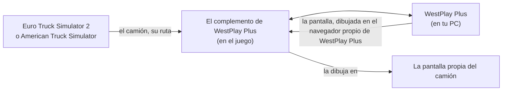

<p align="center"></p>

<h1 align="center">WestPlay Plus</h1>

<!-- languages:start -->
<p align="center">
  <a href="../../README.md">English</a> · <a href="README.zh-CN.md">简体中文</a> · <a href="README.zh-TW.md">繁體中文</a> · <a href="README.ja.md">日本語</a> · <a href="README.ko.md">한국어</a> · <a href="README.de.md">Deutsch</a> · <a href="README.fr.md">Français</a> · <a href="README.fr-CA.md">Français (Canada)</a> · <a href="README.es.md">Español</a> · <b>Español (Latinoamérica)</b> · <a href="README.it.md">Italiano</a> · <a href="README.pt-BR.md">Português (Brasil)</a> · <a href="README.pt-PT.md">Português (Portugal)</a> · <a href="README.ru.md">Русский</a> · <a href="README.pl.md">Polski</a> · <a href="README.szl.md">Ślōnsko godka</a> · <a href="README.nl.md">Nederlands</a> · <a href="README.tr.md">Türkçe</a> · <a href="README.uk.md">Українська</a> · <a href="README.cs.md">Čeština</a> · <a href="README.sk.md">Slovenčina</a> · <a href="README.hu.md">Magyar</a> · <a href="README.ro.md">Română</a> · <a href="README.bg.md">Български</a> · <a href="README.hr.md">Hrvatski</a> · <a href="README.sr-Latn.md">Srpski (latinica)</a> · <a href="README.sr-Cyrl.md">Српски (ћирилица)</a> · <a href="README.sl.md">Slovenščina</a> · <a href="README.mk.md">Македонски</a> · <a href="README.el.md">Ελληνικά</a> · <a href="README.sv.md">Svenska</a> · <a href="README.da.md">Dansk</a> · <a href="README.no.md">Norsk</a> · <a href="README.fi.md">Suomi</a> · <a href="README.et.md">Eesti</a> · <a href="README.lt.md">Lietuvių</a> · <a href="README.lv.md">Latviešu</a> · <a href="README.ca.md">Català</a> · <a href="README.gl.md">Galego</a> · <a href="README.eu.md">Euskara</a> · <a href="README.ka.md">ქართული</a> · <a href="README.vi.md">Tiếng Việt</a>
</p>
<!-- languages:end -->

<p align="center">
  <b>Una pantalla al estilo CarPlay para los camiones de Euro Truck Simulator 2 y American Truck Simulator.</b><br>
  Tu mapa, tu música y YouTube, en la pantalla del tablero de tu propio camión.
  <br>
  Una rama modificada de <a href="https://github.com/enes-less/WestPlay">WestPlay</a>, para jugadores de habla china.
</p>

<p align="center">
  <a href="https://github.com/HandsomeTurtle0307/WestPlay-Plus/releases/latest"></a>
  
  
  
  <a href="../../LICENSE"></a>
</p>

WestPlay Plus pone una pantalla de celular en la pantalla del tablero de tu propio camión, dentro del juego: Euro Truck Simulator 2 o American Truck Simulator, una sola pantalla para los dos. Tu ruta sobre un mapa dibujado a partir de tu propio juego, tu música, YouTube, el clima de tu viaje: justo donde un camión de verdad tiene su pantalla, manejada con el mouse mientras mantienes presionada una tecla.

## Funciones

**Mapas sacados de tu propio juego.** Dibujados a partir del mapa de tu juego, con los mods de mapa incluidos (ProMods y otros), con tu ruta, las indicaciones giro a giro y una búsqueda que agrega paradas al GPS del propio juego.

**Un tablero para la ruta.** El mapa junto a lo que suena y a dónde vas, el clima del viaje, todo en una sola pantalla.

**Tu música.** Apple Music, Spotify y YouTube Music, con Now Playing y letras. El video de una canción se reproduce directamente en Now Playing, y YouTube tiene sus canales, listas, subtítulos y calidades. El reproductor pone las canciones que pongas en la carpeta de música del juego.

**Claro y oscuro, y tu propio estilo.** Se oscurece de noche o cuando enciendes las luces, como el sensor de luz de un auto. Puedes poner tus propios fondos de pantalla e íconos.

**La aplicación complementaria** en tu PC lo prepara todo: encuentra tus juegos (ETS2, ATS o los dos), instala WestPlay Plus en cada uno, genera sus mapas y después no vuelve a molestar.

## Cómo funciona



WestPlay Plus dibuja su pantalla en un navegador propio en tu PC, y su complemento pone cada cuadro en la pantalla de tu camión, dentro del juego. Las pantallas propias de los camiones y sus barras de información siguen siendo suyas: WestPlay Plus ocupa el lugar del GPS, y su ajuste «Vehicle Bar» decide si la barra del camión se queda al lado.

## Camiones

WestPlay Plus aparece de dos maneras: en la pantalla propia del camión o en la tablet WestPlay Plus.

**En la pantalla propia del camión.** En los camiones que en la realidad llevan CarPlay, WestPlay Plus ocupa el lugar del GPS en la pantalla del tablero, adaptándose a su forma. No hay nada que comprar ni montar: te subes y ya está ahí. En Euro Truck Simulator 2:

- **DAF** XF y XG/XG+ 2021, XF Electric y XD (y el DAF 2021 de Jasper)
- **Scania** S y R, con la pantalla de 7" o el Smart Dash, y el S BEV
- **Iveco** S-Way
- **Renault** T (2024)
- **Volvo** FH (2021 y 2024)
- **Coaches DLC:** el Scania Touring y el MAN Lion's Coach (2024)
- **Los autobuses de Oyuncuyusbis:** el Mercedes-Benz Travego 16 SHD, el MAN Lion's Coach y el Setra S 531 DT en sus propias pantallas del tablero
- **Setra S 516 HD/2** (de Oyuncuyusbis): en la pantalla GPS propia del autobús, su parte «Gps», que montas en el concesionario: la pantalla propia del autobús, como pidieron sus jugadores, pero una que agregas tú

**En la tablet WestPlay Plus.** Todos los demás camiones, tanto los del juego como los mods, reciben WestPlay Plus en una tablet que montas en el concesionario: en Accesorios, entre los objetos colgantes o como juego de tablero. La pantalla propia del camión conserva la navegación del juego. La tablet está en todos los camiones con objetos colgantes, incluidos los camiones mod que instales más adelante (la reciben la próxima vez que inicies el juego).

**En American Truck Simulator**, por ahora WestPlay Plus va en la tablet en todos los camiones. Los camiones cuyos equivalentes reales llevan CarPlay recibirán WestPlay Plus en su propia pantalla más adelante.

|                          | Pantalla propia del camión | Tablet WestPlay Plus |
| ------------------------ | -------------------------- | -------------------- |
| Camiones                 | Los camiones de ETS2 de arriba | Todos los demás, y todos los de ATS por ahora |
| Cómo conseguirlo         | Nada: ya está ahí          | Montarla en el concesionario |
| Navegación del juego     | La reemplaza WestPlay Plus | Se queda en la pantalla del camión |

### Sonido

En estos camiones de Euro Truck Simulator 2, la música sale por los parlantes propios del camión, cada uno en su lugar de la cabina. Los demás camiones, y los de American Truck Simulator por ahora, suenan en estéreo normal.

- **Scania S y R (2016), S BEV** — graves de puerta, agudos del pilar A, graves de techo
- **Scania R (2009), Streamline** — graves de puerta, agudos del pilar A
- **DAF XF (105)** — agudos del pilar A; dos pares en el estante del techo en el Super Space Cab, una unidad de techo en los demás
- **DAF XF Euro 6** — graves de puerta, agudos del pilar A; dos pares en el estante del techo en el Super Space Cab, una unidad de techo en los demás
- **DAF XF, XG, XG+ (2021), XF Electric y XD** — graves de puerta, agudos del pilar A, un par arriba, una unidad central
- **MAN TGX** — graves de puerta; en el XXL, además dos unidades pequeñas en lo alto de cada pared lateral
- **MAN TGX Euro 6** — graves de puerta; en el XL, además una unidad pequeña en cada esquina del techo
- **MAN TGX (2020)** — un grave y un medio en cada puerta, agudos del pilar A
- **Mercedes-Benz Actros (2014)** — graves de puerta, un par arriba, agudos del pilar A
- **Mercedes-Benz Actros (2009)** — graves de puerta, un par en las esquinas delanteras del estante del techo
- **Volvo FH (2021, 2024), FH16 (2012)** — graves de puerta, graves de la pared trasera
- **Volvo FH16 (2009)** — una unidad en cada puerta
- **Iveco Stralis** — una unidad en cada extremo de la consola del techo, y en los techos altos una pequeña del lado del acompañante
- **Iveco Hi-Way** — una unidad en cada extremo de la consola del techo, y una en lo alto de cada lado
- **Iveco S-Way** — un grave y un agudo en cada puerta
- **Renault Magnum** — una unidad en cada esquina del techo, agudos en la consola del techo
- **Renault Premium** — una unidad en cada lado del techo, más abajo en el techo bajo
- **Renault T** — agudos del pilar A, un par en la pared trasera; graves de puerta en los interiores de 2024
- **Renault E-Tech T** — graves de puerta, agudos del pilar A, un par en la pared trasera
- **Scania PGR de JuseeTV** — los parlantes de las piezas que montes: puertas, pilares A, consola superior, pared trasera

## Instalación

1. Descarga el instalador desde la [última versión](https://github.com/HandsomeTurtle0307/WestPlay-Plus/releases/latest) y ejecútalo.
2. Se abre la aplicación complementaria y te guía por el resto: encuentra tus juegos (ETS2, ATS o los dos), instala en cada uno el complemento de WestPlay Plus y su mod de pantalla, y genera tus mapas.
3. Inicia el juego y súbete a un camión.

**Actualizaciones:** esta rama no se actualiza sola. Para ver si hay una versión más nueva, visita la [página de versiones](https://github.com/HandsomeTurtle0307/WestPlay-Plus/releases). La página «Acerca de» de la aplicación complementaria tiene el mismo enlace.

**Requisitos:** Windows 10 u 11 (64 bits), Euro Truck Simulator 2 versión 1.62 (o 1.61) o American Truck Simulator versión 1.62 (otras versiones pueden funcionar; la aplicación complementaria avisa cuando una no está probada), y Microsoft Edge WebView2 (viene con Windows 11; el instalador lo agrega donde falta).

## Privacidad

WestPlay Plus no tiene servidores, ni cuentas propias, ni analíticas. No recopila ni envía nada sobre ti.

- Inicias sesión en Apple Music, Spotify y YouTube en sus propias páginas, en el perfil de navegador propio de WestPlay Plus en tu PC, igual que en un navegador. WestPlay Plus no guarda ningún dato de cuenta.
- Tu mapa se genera en tu PC a partir de tu juego y se queda ahí.
- WestPlay Plus habla con los servicios que usas, y con GitHub solo cuando abres su página de versiones.

## Comentarios

Errores, dudas e ideas: abre un issue en [GitHub](https://github.com/HandsomeTurtle0307/WestPlay-Plus/issues).

## Compilar desde el código fuente

Necesitas [Rust](https://rustup.rs) (stable) y [Node.js](https://nodejs.org) 24, en Windows.

```sh
npm install      # las herramientas de la aplicación complementaria y los paquetes de la interfaz
npm run dev      # WestPlay Plus, con la interfaz servida en vivo
```

`cargo test --workspace` y `npm test --prefix ui` ejecutan las pruebas. El complemento del juego se compila con `cargo build --release -p westplay-plugin`.

## Licencia

WestPlay Plus es software libre: puedes redistribuirlo y modificarlo según los términos de la GNU General Public License, versión 3 o (a tu elección) cualquier versión posterior. Consulta [LICENSE](../../LICENSE).

Copyright © 2026 HandsomeTurtle0307. Las bibliotecas que distribuye WestPlay Plus conservan sus propias licencias: consulta [THIRD_PARTY_LICENSES.md](../../THIRD_PARTY_LICENSES.md), y [THIRD_PARTY_NOTICES.md](../../THIRD_PARTY_NOTICES.md) para las obras que sigue.

## De dónde viene este proyecto

WestPlay Plus es una rama modificada (fork) de [WestPlay](https://github.com/enes-less/WestPlay), un excelente mod de pantalla al estilo CarPlay para Euro Truck Simulator 2 y American Truck Simulator, hecho por **enes-less**. Casi todo el diseño, el código y los recursos originales son obra suya; esta rama mantiene sus propios cambios encima y le agradece lo que construyó. Si te gusta este proyecto, échale también un vistazo al original.

Apoya también el proyecto original (y si puedes, apóyame a mí también 😭😭😭, que desarrollar software no es fácil~).

<!-- translated:start -->
<sub>Este README está traducido de la versión en inglés. El autor no habla los 43 idiomas, ni de lejos 😭😭, así que la traducción puede estar incompleta en algunos puntos. Disculpen las molestias~ Si detectas algo raro en tu idioma, avísame, se agradece mucho~</sub>
<!-- translated:end -->

<sub>WestPlay Plus es un proyecto independiente, sin relación ni respaldo de Apple, SCS Software, Spotify, Google ni los fabricantes de camiones. CarPlay, Apple Music, Spotify, YouTube, YouTube Music y los nombres y logotipos de los fabricantes son marcas de sus respectivos dueños, usadas aquí solo para nombrar aquello con lo que funciona WestPlay Plus.</sub>
