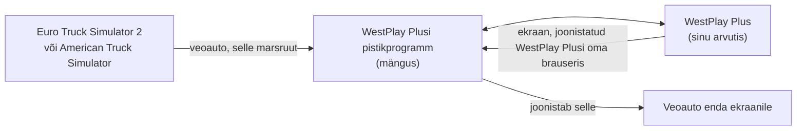

<p align="center"></p>

<h1 align="center">WestPlay Plus</h1>

<!-- languages:start -->
<p align="center">
  <a href="../../README.md">English</a> · <a href="README.zh-CN.md">简体中文</a> · <a href="README.zh-TW.md">繁體中文</a> · <a href="README.ja.md">日本語</a> · <a href="README.ko.md">한국어</a> · <a href="README.de.md">Deutsch</a> · <a href="README.fr.md">Français</a> · <a href="README.fr-CA.md">Français (Canada)</a> · <a href="README.es.md">Español</a> · <a href="README.es-419.md">Español (Latinoamérica)</a> · <a href="README.it.md">Italiano</a> · <a href="README.pt-BR.md">Português (Brasil)</a> · <a href="README.pt-PT.md">Português (Portugal)</a> · <a href="README.ru.md">Русский</a> · <a href="README.pl.md">Polski</a> · <a href="README.szl.md">Ślōnsko godka</a> · <a href="README.nl.md">Nederlands</a> · <a href="README.tr.md">Türkçe</a> · <a href="README.uk.md">Українська</a> · <a href="README.cs.md">Čeština</a> · <a href="README.sk.md">Slovenčina</a> · <a href="README.hu.md">Magyar</a> · <a href="README.ro.md">Română</a> · <a href="README.bg.md">Български</a> · <a href="README.hr.md">Hrvatski</a> · <a href="README.sr-Latn.md">Srpski (latinica)</a> · <a href="README.sr-Cyrl.md">Српски (ћирилица)</a> · <a href="README.sl.md">Slovenščina</a> · <a href="README.mk.md">Македонски</a> · <a href="README.el.md">Ελληνικά</a> · <a href="README.sv.md">Svenska</a> · <a href="README.da.md">Dansk</a> · <a href="README.no.md">Norsk</a> · <a href="README.fi.md">Suomi</a> · <b>Eesti</b> · <a href="README.lt.md">Lietuvių</a> · <a href="README.lv.md">Latviešu</a> · <a href="README.ca.md">Català</a> · <a href="README.gl.md">Galego</a> · <a href="README.eu.md">Euskara</a> · <a href="README.ka.md">ქართული</a> · <a href="README.vi.md">Tiếng Việt</a>
</p>
<!-- languages:end -->

<p align="center">
  <b>CarPlay-stiilis ekraan Euro Truck Simulator 2 ja American Truck Simulatori veoautodele.</b><br>
  Sinu kaart, sinu muusika ja YouTube – sinu veoauto armatuurlaual.
  <br>
  <a href="https://github.com/enes-less/WestPlay">WestPlay</a> muudetud haru, kuhu on lisatud optimeerimisi ja uusi funktsioone.
</p>

<p align="center">
  <a href="https://github.com/HandsomeTurtle0307/WestPlay-Plus/releases/latest"></a>
  
  
  
  <a href="../../LICENSE"></a>
</p>

WestPlay Plus paneb telefonistiilis ekraani sinu veoauto armatuurlauale, mängu sees: Euro Truck Simulator 2 või American Truck Simulator, üks ekraan mõlemale. Sinu marsruut sinu enda mängust joonistatud kaardil, sinu muusika, YouTube, ilm teel: täpselt seal, kus päris veoautol on oma ekraan, juhitav hiirega, hoides klahvi all.

<!-- why:start -->

## Miks ma selle tegin

Alguses otsisin CarPlay modi, siis leidsin WestPlay ja avastasin, et see on väga hästi tehtud (tõesti, väga-väga hästi) — ainult optimeerimine oli kehv ja arvuti külmus ära. Nii otsustasin selle ise korda teha: võimsust lihvida ja paar uut funktsiooni lisada (seisan hiiglase õlgadel, hi hi~😊).

<!-- easter-egg:start -->
> On veel üks põhjus: varem, kui olin väga emotsionaalne, tegin asju (päris palju), mis mõjutasid teisi — eriti neid, keda ma tegelikult ei tahtnud haavata. Nüüd, kui selle peale mõtlen, tunnen süüd ja mul on väga raske, ja tulevik tundub segane (ka õpingud ja plaanid). Nii haarangi ainsast, mida saan kontrollida — programmeerimisest — ja sellega katan praegu valu mujal. Oh🥲 Mida edasi teha, seda ma ka ei tea, lähen samm-sammult :)‍💨
<!-- easter-egg:end -->

<!-- why:end -->

## Funktsioonid

**Kaardid sinu enda mängust.** Joonistatud sinu mängu kaardilt, kaardimodid kaasa arvatud (ProMods ja teised), sinu marsruudi, pööre pöörde haaval juhistega ja otsinguga, mis lisab peatusi mängu enda GPS-i.

**Armatuurlaud sõiduks.** Kaart selle kõrval, mis mängib, ja selle kõrval, kuhu sõidad, ilm teel, kõik ühel ekraanil.

**Sinu muusika.** Apple Music, Spotify ja YouTube Music, Now Playingi ja sõnadega. Loo muusikavideo mängib otse Now Playingis ning YouTube'il on oma kanalid, esitusloendid, subtiitrid ja kvaliteedid. Pleier mängib lugusid, mille paned mängu muusikakausta.

**Hele ja tume, ja sinu oma välimus.** Öösel või tuled sisse lülitades muutub see tumedaks, nagu auto valgusandur. Oma taustapildid ja ikoonid tood ise.

**Kaasrakendus** sinu arvutis seab kõik üles: leiab sinu mängud (ETS2, ATS või mõlemad), paigaldab WestPlay Plusi igasse neist, ehitab nende kaardid ja hoiab end seejärel eemale.

## Kuidas see töötab



WestPlay Plus joonistab oma ekraani oma brauseris sinu arvutis ja selle pistikprogramm paneb iga kaadri sinu veoauto ekraanile, mängu sees. Veoautode endi ekraanid ja nende infotriibud jäävad nende omaks: WestPlay Plus võtab GPS-i koha ja säte „Vehicle Bar“ otsustab, kas veoauto triip jääb kõrvale.

## Veoautod

WestPlay Plus ilmub kahel viisil: veoauto enda ekraanil või WestPlay Plusi tahvelarvutis.

**Veoauto enda ekraanil.** Veoautodes, millel on CarPlay ka päriselt, võtab WestPlay Plus GPS-i koha armatuurlaua ekraanil ja kohandub selle kujuga. Midagi pole osta ega paigaldada: istud sisse ja see on juba seal. Euro Truck Simulator 2-s:

- **DAF** XF ja XG/XG+ 2021, XF Electric ja XD (ning Jasperi DAF 2021)
- **Scania** S ja R, 7" ekraani või Smart Dashiga, ja S BEV
- **Iveco** S-Way
- **Renault** T (2024)
- **Volvo** FH (2021 ja 2024)
- **Coaches DLC:** Scania Touring ja MAN Lion's Coach (2024)
- **Oyuncuyusbise bussid:** Mercedes-Benz Travego 16 SHD, MAN Lion's Coach ja Setra S 531 DT oma armatuurlaudadel
- **Setra S 516 HD/2** (Oyuncuyusbiselt): bussi enda GPS-ekraanil, selle „Gps“-osal, mille paigaldad veoautode müüja juures: bussi enda ekraan, nagu selle mängijad palusid, aga selline, mille lisad ise

**WestPlay Plusi tahvelarvutis.** Kõik teised veoautod, nii mängu kui ka modide omad, saavad WestPlay Plusi tahvelarvutis, mille paigaldad veoautode müüja juures: jaotises Tarvikud, rippuvate esemete hulgas või armatuurlaua komplektina. Veoauto enda ekraan säilitab mängu navigatsiooni. Tahvelarvuti on igas rippuvate esemetega veoautos, ka hiljem paigaldatud veoautomodides (need saavad selle järgmisel mängukäivitusel).

**American Truck Simulatoris** on WestPlay Plus praegu tahvelarvutis igas veoautos. Veoautod, mille päris vastetel on CarPlay, saavad WestPlay Plusi oma ekraanile hiljem.

|                        | Veoauto enda ekraan   | WestPlay Plusi tahvelarvuti |
| ---------------------- | --------------------- | --------------------------- |
| Veoautod               | Ülal loetletud ETS2 veoautod | Kõik teised ja praegu kõik ATS veoautod |
| Kuidas selle saad      | Ei midagi: see on juba seal | Paigalda see müüja juures |
| Mängu navigatsioon     | WestPlay Plus asendab selle | Jääb veoauto ekraanile |

### Heli

Nendes Euro Truck Simulator 2 veoautodes tuleb muusika veoauto enda kõlaritest, igaüks oma kohal kabiinis. Teised veoautod, ja praegu ka American Truck Simulatori omad, mängivad tavalist stereot.

- **Scania S ja R (2016), S BEV** — uste bassikõlarid, A-piilari kõrgsageduskõlarid, katuse bass
- **Scania R (2009), Streamline** — uste bassikõlarid, A-piilari kõrgsageduskõlarid
- **DAF XF (105)** — A-piilari kõrgsageduskõlarid; kaks paari katuseriiulil Super Space Cabis, üks katuseüksus teistes
- **DAF XF Euro 6** — uste bassikõlarid, A-piilari kõrgsageduskõlarid; kaks paari katuseriiulil Super Space Cabis, üks katuseüksus teistes
- **DAF XF, XG, XG+ (2021), XF Electric ja XD** — uste bassikõlarid, A-piilari kõrgsageduskõlarid, üks paar ülal, üks kesküksus
- **MAN TGX** — uste bassikõlarid; XXL-is lisaks kaks väikest üksust kõrgel kummaski külgseinas
- **MAN TGX Euro 6** — uste bassikõlarid; XL-is lisaks väike üksus igas katusenurgas
- **MAN TGX (2020)** — bassi- ja keskkõlar igas ukses, A-piilari kõrgsageduskõlarid
- **Mercedes-Benz Actros (2014)** — uste bassikõlarid, üks paar ülal, A-piilari kõrgsageduskõlarid
- **Mercedes-Benz Actros (2009)** — uste bassikõlarid, üks paar katuseriiuli esinurkades
- **Volvo FH (2021, 2024), FH16 (2012)** — uste bassikõlarid, bass tagaseinas
- **Volvo FH16 (2009)** — üks üksus igas ukses
- **Iveco Stralis** — üks üksus katusekonsooli mõlemas otsas ja kõrgetes katustes väike reisija poolel
- **Iveco Hi-Way** — üks üksus katusekonsooli mõlemas otsas ja üks kõrgel kummagil pool
- **Iveco S-Way** — bassi- ja kõrgsageduskõlar igas ukses
- **Renault Magnum** — üks üksus igas katusenurgas, kõrgsageduskõlarid katusekonsoolil
- **Renault Premium** — üks üksus katuse kummalgi poolel, madalas katuses madalamal
- **Renault T** — A-piilari kõrgsageduskõlarid, üks paar tagaseinas; uste bassikõlarid 2024. aasta sisemustes
- **Renault E-Tech T** — uste bassikõlarid, A-piilari kõrgsageduskõlarid, üks paar tagaseinas
- **JuseeTV Scania PGR** — paigaldatavate osade kõlarid: uksed, A-piilarid, ülakonsool, tagasein

## Paigaldamine

1. Laadi paigaldusprogramm alla [uusimast versioonist](https://github.com/HandsomeTurtle0307/WestPlay-Plus/releases/latest) ja käivita see.
2. Avaneb kaasrakendus ja juhatab sind läbi ülejäänu: leiab sinu mängud (ETS2, ATS või mõlemad), paigaldab kõigisse WestPlay Plusi pistikprogrammi ja selle ekraanimodi ning ehitab sinu kaardid.
3. Käivita mäng ja istu veoautosse.

**Uuendused:** see haru ei uuenda end ise. Kas on uuem versioon, vaata [väljaannete lehelt](https://github.com/HandsomeTurtle0307/WestPlay-Plus/releases). Sama link on ka kaasrakenduse lehel „Teave“.

**Nõuded:** Windows 10 või 11 (64-bitine), Euro Truck Simulator 2 versioon 1.62 (või 1.61) või American Truck Simulator versioon 1.62 (teised versioonid võivad töötada; kui mõni on testimata, ütleb kaasrakendus seda) ja Microsoft Edge WebView2 (Windows 11 osa; paigaldusprogramm lisab selle sinna, kus seda pole).

## Privaatsus

WestPlay Plusil pole servereid, oma kontosid ega analüütikat. See ei kogu ega saada sinu kohta midagi.

- Apple Musicisse, Spotifyisse ja YouTube'i logid sisse nende endi lehtedel, WestPlay Plusi oma brauseriprofiilis sinu arvutis, nagu brauseris. WestPlay Plus ise ei salvesta mingeid kontoandmeid.
- Sinu kaart ehitatakse sinu arvutis sinu mängust ja jääb sinna.
- WestPlay Plus suhtleb teenustega, mida kasutad, ja GitHubiga ainult siis, kui avad selle väljaannete lehe.

## Tagasiside

Vead, küsimused ja ideed: ava issue [GitHubis](https://github.com/HandsomeTurtle0307/WestPlay-Plus/issues).

## Ehitamine lähtekoodist

Vaja on [Rusti](https://rustup.rs) (stable) ja [Node.js](https://nodejs.org) 24, Windowsis.

```sh
npm install      # kaasrakenduse tööriistad ja liidese paketid
npm run dev      # WestPlay Plus, liides serveeritakse reaalajas
```

`cargo test --workspace` ja `npm test --prefix ui` käivitavad testid. Mängu pistikprogramm ehitatakse käsuga `cargo build --release -p westplay-plugin`.

## Litsents

WestPlay Plus on vaba tarkvara: võid seda levitada ja muuta GNU General Public License'i versiooni 3 (või sinu valitud hilisema versiooni) tingimustel. Vaata [LICENSE](../../LICENSE).

Copyright © 2026 HandsomeTurtle0307. WestPlay Plusiga kaasas olevad teegid säilitavad oma litsentsid: vaata [THIRD_PARTY_LICENSES.md](../../THIRD_PARTY_LICENSES.md) ja [THIRD_PARTY_NOTICES.md](../../THIRD_PARTY_NOTICES.md) teoste kohta, mida see järgib.

## Kust see projekt pärineb

WestPlay Plus on muudetud haru (fork) projektist [WestPlay](https://github.com/enes-less/WestPlay), suurepärane CarPlay-stiilis ekraanimod Euro Truck Simulator 2 ja American Truck Simulatori jaoks, mille tegi **enes-less**. Peaaegu kogu algne disain, kood ja materjalid on tema töö; see haru hoiab oma muudatusi selle peal ja on tänulik selle eest, mille ta üles ehitas. Kui projekt sulle meeldib, vaata ka originaali.

Toeta ka originaalprojekti (ja kui saad, toeta ka mind 😭😭😭 – tarkvara tegemine pole lihtne~).

<!-- translated:start -->
<sub>See README on tõlgitud ingliskeelsest versioonist. Autor ei loomulikult räägi kõiki 43 keelt 😭😭, seega võib tõlge kohati puudulik olla. Vabandust~ Kui märkad oma keeles viga, anna teada, olen väga tänulik~</sub>
<!-- translated:end -->

<sub>WestPlay Plus on sõltumatu projekt, mis ei ole seotud Apple'i, SCS Software'i, Spotify, Google'i ega veoautotootjatega ega nende poolt heaks kiidetud. CarPlay, Apple Music, Spotify, YouTube, YouTube Music ning tootjate nimed ja logod on nende omanike kaubamärgid ja neid kasutatakse siin ainult selle nimetamiseks, millega WestPlay Plus töötab.</sub>
