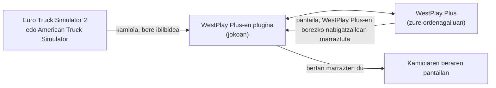

<p align="center"></p>

<h1 align="center">WestPlay Plus</h1>

<!-- languages:start -->
<p align="center">
  <a href="../../README.md">English</a> · <a href="README.zh-CN.md">简体中文</a> · <a href="README.zh-TW.md">繁體中文</a> · <a href="README.ja.md">日本語</a> · <a href="README.ko.md">한국어</a> · <a href="README.de.md">Deutsch</a> · <a href="README.fr.md">Français</a> · <a href="README.fr-CA.md">Français (Canada)</a> · <a href="README.es.md">Español</a> · <a href="README.es-419.md">Español (Latinoamérica)</a> · <a href="README.it.md">Italiano</a> · <a href="README.pt-BR.md">Português (Brasil)</a> · <a href="README.pt-PT.md">Português (Portugal)</a> · <a href="README.ru.md">Русский</a> · <a href="README.pl.md">Polski</a> · <a href="README.szl.md">Ślōnsko godka</a> · <a href="README.nl.md">Nederlands</a> · <a href="README.tr.md">Türkçe</a> · <a href="README.uk.md">Українська</a> · <a href="README.cs.md">Čeština</a> · <a href="README.sk.md">Slovenčina</a> · <a href="README.hu.md">Magyar</a> · <a href="README.ro.md">Română</a> · <a href="README.bg.md">Български</a> · <a href="README.hr.md">Hrvatski</a> · <a href="README.sr-Latn.md">Srpski (latinica)</a> · <a href="README.sr-Cyrl.md">Српски (ћирилица)</a> · <a href="README.sl.md">Slovenščina</a> · <a href="README.mk.md">Македонски</a> · <a href="README.el.md">Ελληνικά</a> · <a href="README.sv.md">Svenska</a> · <a href="README.da.md">Dansk</a> · <a href="README.no.md">Norsk</a> · <a href="README.fi.md">Suomi</a> · <a href="README.et.md">Eesti</a> · <a href="README.lt.md">Lietuvių</a> · <a href="README.lv.md">Latviešu</a> · <a href="README.ca.md">Català</a> · <a href="README.gl.md">Galego</a> · <b>Euskara</b> · <a href="README.ka.md">ქართული</a> · <a href="README.vi.md">Tiếng Việt</a>
</p>
<!-- languages:end -->

<p align="center">
  <b>CarPlay estiloko pantaila bat Euro Truck Simulator 2 eta American Truck Simulator-eko kamioientzat.</b><br>
  Zure mapa, zure musika eta YouTube, zure kamioiaren aginte-panelean.
  <br>
  <a href="https://github.com/enes-less/WestPlay">WestPlay</a>ren adar aldatua, optimizazio batzuekin eta funtzio berriekin.
</p>

<p align="center">
  <a href="https://github.com/HandsomeTurtle0307/WestPlay-Plus/releases/latest"></a>
  
  
  
  <a href="../../LICENSE"></a>
</p>

WestPlay Plus-ek telefonu baten antzeko pantaila jartzen du zure kamioiaren aginte-panelean, jokoaren barruan: Euro Truck Simulator 2 edo American Truck Simulator, pantaila bat bietarako. Zure ibilbidea zure joko propiotik marraztutako mapa batean, zure musika, YouTube, zure bidaiako eguraldia: benetako kamioi batek pantaila duen leku berean, saguarekin kontrolatuta tekla bat sakatuta edukita.

<!-- why:start -->

## Zergatik egin nuen hau

Hasieran CarPlay mod bat bilatzen hasi nintzen, eta WestPlay aurkitu nuen. Oso ondo eginda dago (benetan, oso-oso ondo), baina optimizazioa ez zen ona eta ordenagailua izoztu zidan. Beraz, nik neuk hobetzea erabaki nuen: errendimendua findu, eta funtzio berri batzuk gehitu (erraldoi baten sorbaldetan nago eta, jeje~😊).

<!-- easter-egg:start -->
> Beste arrazoi bat ere badago: lehen, oso urduri nengoela, beste batzuei eragin zieten gauzak egin nituen (asko, egia esan) — batez ere inoiz mindu nahi ez nituenei. Orain pentsatuta, errudun eta gaizki sentitzen naiz, eta etorkizunari begira galdu samar nabil (ikasketak eta etorkizunerako planak barne). Beraz, nire esku dagoen gauza bakarra hartu dut — programazioa — eta horrekin estaltzen ditut beste aldeko minak, behin-behinean. Ai🥲 Gero zer egin ez dakit, baina pausoz pauso joango naiz :)‍💨
<!-- easter-egg:end -->

<!-- why:end -->

## Ezaugarriak

**Mapak zure joko propiotik.** Zure jokoaren mapatik marraztuta, mapa-modak barne (ProMods eta beste batzuk), zure ibilbidearekin, bira biraneko jarraibideekin eta jokoaren GPSan geldialdiak gehitzen dituen bilaketarekin.

**Bidaia baterako aginte-panela.** Mapa, jotzen ari denaren eta zoazen lekuaren ondoan, ibilbideko eguraldia, dena pantaila bakarrean.

**Zure musika.** Apple Music, Spotify eta YouTube Music, Now Playing eta hitzekin. Abesti baten bideoklipa zuzenean Now Playing-en abiatzen da, eta YouTubek bere kanalak, zerrendak, azpitituluak eta kalitateak ditu. Erreproduzitzaileak jokoaren musika-karpetan jartzen dituzun abestiak jotzen ditu.

**Argi eta ilun, eta zure itxura.** Gauez edo argiak pizten dituzunean iluntzen da, auto baten argi-sentsoreak bezala. Zure horma-paperak eta ikonoak zuk zeuk ekartzen dituzu.

**Laguntzaile-aplikazioak** zure ordenagailuan dena prestatzen du: zure jokoak aurkitzen ditu (ETS2, ATS edo biak), WestPlay Plus bakoitzean instalatzen du, haien mapak eraikitzen ditu eta gero ez du molestatzen.

## Nola dabilen



WestPlay Plus-ek bere pantaila berezko nabigatzaile batean marrazten du zure ordenagailuan, eta haren pluginak fotograma bakoitza zure kamioiaren pantailan jartzen du, jokoaren barruan. Kamioien beren pantailak eta haien informazio-barrak haiena izaten jarraitzen dute: WestPlay Plus-ek GPSaren lekua hartzen du, eta «Vehicle Bar» ezarpenak esaten du kamioiaren barra ondoan geratzen den ala ez.

## Kamioiak

WestPlay Plus bi modutan agertzen da: kamioiaren beraren pantailan edo WestPlay Plus tabletetan.

**Kamioiaren beraren pantailan.** Errealitatean CarPlay duten kamioietan, WestPlay Plus-ek GPSaren lekua hartzen du aginte-panelaren pantailan, haren formara egokituta. Ez dago ezer erosi edo muntatu beharrik: sartu eta han dago. Euro Truck Simulator 2-n:

- **DAF** XF eta XG/XG+ 2021, XF Electric eta XD (eta Jasperren DAF 2021)
- **Scania** S eta R, 7" pantailarekin edo Smart Dash-ekin, eta S BEV
- **Iveco** S-Way
- **Renault** T (2024)
- **Volvo** FH (2021 eta 2024)
- **Coaches DLC:** Scania Touring eta MAN Lion's Coach (2024)
- **Oyuncuyusbis-en autobusak:** Mercedes-Benz Travego 16 SHD, MAN Lion's Coach eta Setra S 531 DT beren aginte-paneletan
- **Setra S 516 HD/2** (Oyuncuyusbisena): autobusaren beraren GPS pantailan, haren «Gps» atalean, kamioi-saltzailean muntatzen duzuna: autobusaren beraren pantaila, haren jokalariek eskatu bezala, baina zuk gehitzen duzun bat

**WestPlay Plus tabletetan.** Beste kamioi guztiek, jokokoek zein modetakoek, WestPlay Plus jasotzen dute kamioi-saltzailean muntatzen duzun tablet batean: Osagarriak atalean, zintzilikatutako objektuen artean edo aginte-panel multzo gisa. Kamioiaren beraren pantailak jokoaren nabigazioa mantentzen du. Tableta zintzilikatutako objektuak dituen kamioi guztietan dago, geroago instalatzen dituzun kamioi-modetan ere (hurrengo joko-hasierako jasoko dute).

**American Truck Simulator-en** oraingoz WestPlay Plus tabletetan dago kamioi guztietan. Benetako baliokideek CarPlay duten kamioiek geroago jasoko dute WestPlay Plus beren pantailan.

|                        | Kamioiaren beraren pantaila | WestPlay Plus tableta |
| ---------------------- | --------------------------- | --------------------- |
| Kamioiak               | Goiko ETS2 kamioiak         | Beste guztiak, eta oraingoz ATS-ko kamioi guztiak |
| Nola lortu             | Ezer ez: han dago jada      | Saltzailean muntatu   |
| Jokoaren nabigazioa    | WestPlay Plus-ek ordezkatzen du | Kamioiaren pantailan geratzen da |

### Soinua

Euro Truck Simulator 2-ko kamioi hauetan, musika kamioiaren beraren bozgorailuetatik ateratzen da, bakoitza kabinan duen lekuan. Beste kamioiek, eta oraingoz American Truck Simulator-koek, estereo arruntean jotzen dute.

- **Scania S eta R (2016), S BEV** — ateko wooferrak, A-zutabearen tweeterrak, sabaiako baxua
- **Scania R (2009), Streamline** — ateko wooferrak, A-zutabearen tweeterrak
- **DAF XF (105)** — A-zutabearen tweeterrak; bi bikote sabaiako apalean Super Space Cab-en, sabai-unitate bat besteetan
- **DAF XF Euro 6** — ateko wooferrak, A-zutabearen tweeterrak; bi bikote sabaiako apalean Super Space Cab-en, sabai-unitate bat besteetan
- **DAF XF, XG, XG+ (2021), XF Electric eta XD** — ateko wooferrak, A-zutabearen tweeterrak, bikote bat goian, erdiko unitate bat
- **MAN TGX** — ateko wooferrak; XXL-n, gainera, bi unitate txiki alde bakoitzaren goialdean
- **MAN TGX Euro 6** — ateko wooferrak; XL-n, gainera, unitate txiki bat sabaiaren izkina bakoitzean
- **MAN TGX (2020)** — woofer bat eta ertain bat ate bakoitzean, A-zutabearen tweeterrak
- **Mercedes-Benz Actros (2014)** — ateko wooferrak, bikote bat goian, A-zutabearen tweeterrak
- **Mercedes-Benz Actros (2009)** — ateko wooferrak, bikote bat sabaiako apalaren aurreko izkinetan
- **Volvo FH (2021, 2024), FH16 (2012)** — ateko wooferrak, baxua atzeko horman
- **Volvo FH16 (2009)** — unitate bat ate bakoitzean
- **Iveco Stralis** — unitate bat sabaiako kontsolaren bi muturretan, eta sabai altuetan txiki bat bidaiariaren aldean
- **Iveco Hi-Way** — unitate bat sabaiako kontsolaren bi muturretan, eta bana alde bakoitzaren goialdean
- **Iveco S-Way** — woofer bat eta tweeter bat ate bakoitzean
- **Renault Magnum** — unitate bat sabaiaren izkina bakoitzean, tweeterrak sabaiako kontsolan
- **Renault Premium** — unitate bat sabaiaren alde bakoitzean, beherago sabai baxuan
- **Renault T** — A-zutabearen tweeterrak, bikote bat atzeko horman; ateko wooferrak 2024ko barnealdeetan
- **Renault E-Tech T** — ateko wooferrak, A-zutabearen tweeterrak, bikote bat atzeko horman
- **JuseeTV-ren Scania PGR** — muntatzen dituzun piezen bozgorailuak: ateak, A-zutabeak, goiko kontsola, atzeko horma

## Instalazioa

1. Deskargatu instalatzailea [azken bertsiotik](https://github.com/HandsomeTurtle0307/WestPlay-Plus/releases/latest) eta exekutatu.
2. Laguntzaile-aplikazioa irekitzen da eta gainerakoan gidatuko zaitu: zure jokoak aurkitzen ditu (ETS2, ATS edo biak), bakoitzean WestPlay Plus-en plugina eta haren pantaila-moda instalatzen ditu, eta zure mapak eraikitzen ditu.
3. Hasi jokoa eta igo kamioi batera.

**Eguneratzeak:** adar honek ez du bere burua eguneratzen. Bertsio berriagorik dagoen ikusteko, joan [argitalpenen orrialdera](https://github.com/HandsomeTurtle0307/WestPlay-Plus/releases). Esteka bera dago laguntzaile-aplikazioaren «Honi buruz» orrialdean.

**Baldintzak:** Windows 10 edo 11 (64 bit), Euro Truck Simulator 2 1.62 bertsioa (edo 1.61) edo American Truck Simulator 1.62 bertsioa (beste bertsio batzuek funtziona dezakete; probatu gabeko bat dagoenean laguntzaile-aplikazioak esaten dizu) eta Microsoft Edge WebView2 (Windows 11-ren parte da; instalatzaileak gehitzen du falta den lekuan).

## Pribatutasuna

WestPlay Plus-ek ez du zerbitzaririk, ez du kontu propiorik eta ez du analitikarik. Ez du zutaz ezer biltzen edo bidaltzen.

- Apple Music, Spotify eta YouTuben haien orrialdeetan hasten duzu saioa, WestPlay Plus-en berezko nabigatzaile-profilean zure ordenagailuan, nabigatzaile batean bezala. WestPlay Plus-ek berak ez du kontu-daturik gordetzen.
- Zure mapa zure ordenagailuan eraikitzen da zure jokotik eta han geratzen da.
- WestPlay Plus erabiltzen dituzun zerbitzuekin mintzatzen da, eta GitHube-rekin haren argitalpenen orrialdea irekitzen duzunean soilik.

## Iruzkinak

Akatsak, galderak eta ideiak: ireki issue bat [GitHub](https://github.com/HandsomeTurtle0307/WestPlay-Plus/issues)en.

## Kode iturritik eraikitzea

[Rust](https://rustup.rs) (stable) eta [Node.js](https://nodejs.org) 24 behar dituzu, Windowsean.

```sh
npm install      # laguntzaile-aplikazioaren tresnak eta interfazearen paketeak
npm run dev      # WestPlay Plus, interfazea zuzenean zerbitzatuta
```

`cargo test --workspace` eta `npm test --prefix ui` aginduak probak exekutatzen dituzte. Jokoaren plugina `cargo build --release -p westplay-plugin` bidez eraikitzen da.

## Lizentzia

WestPlay Plus software librea da: GNU General Public License-ren 3. bertsioaren (edo zuk aukeratutako edozein bertsio berriagoren) baldintzen arabera banatu eta alda dezakezu. Ikus [LICENSE](../../LICENSE).

Copyright © 2026 HandsomeTurtle0307. WestPlay Plus-ekin banatzen diren liburutegiek beren lizentziak mantentzen dituzte: ikus [THIRD_PARTY_LICENSES.md](../../THIRD_PARTY_LICENSES.md), eta [THIRD_PARTY_NOTICES.md](../../THIRD_PARTY_NOTICES.md) jarraitzen dituen obren berri izateko.

## Proiektu hau nondik datorren

WestPlay Plus [WestPlay](https://github.com/enes-less/WestPlay) proiektuaren adar aldatua (fork) da, Euro Truck Simulator 2 eta American Truck Simulator-erako CarPlay estiloko pantaila-mod bikaina, **enes-less**-ek egina. Jatorrizko diseinu, kode eta baliabide ia guztiak haren lana dira; adar honek bere aldaketak gainean dauzka eta eskertuta dago berak eraikitakoarekin. Proiektua gustatzen bazaizu, begiratu originala ere.

Lagundu jatorrizko proiektua ere (eta ahal baduzu, lagundu niri ere 😭😭😭 — ez da erraza softwarea egitea~).

<!-- translated:start -->
<sub>README hau ingelesezko bertsiotik itzulia dago. Egileak, jakina, ez ditu 43 hizkuntzak hitz egiten 😭😭, beraz itzulpena tokian-tokian osatugabea izan daiteke. Barkatu~ Zure hizkuntzan zerbait arraroa ikusten baduzu, esan iezadazu, oso eskertuko dizut~</sub>
<!-- translated:end -->

<sub>WestPlay Plus proiektu independentea da, ez du loturarik Apple, SCS Software, Spotify, Google edo kamioi-ekoizleekin, eta ez du haien onespenik. CarPlay, Apple Music, Spotify, YouTube, YouTube Music eta ekoizleen izen eta logoak beren jabeen markak dira, eta hemen WestPlay Plus-ek zerekin funtzionatzen duen izendatzeko soilik erabiltzen dira.</sub>
