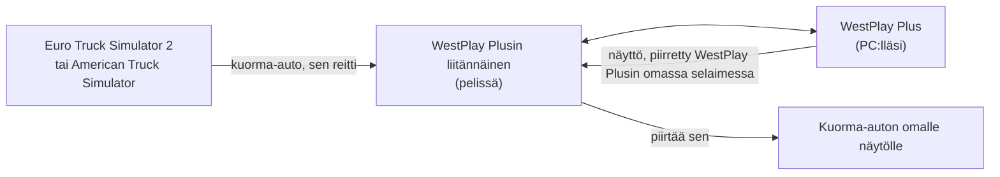

<p align="center"></p>

<h1 align="center">WestPlay Plus</h1>

<!-- languages:start -->
<p align="center">
  <a href="../../README.md">English</a> · <a href="README.zh-CN.md">简体中文</a> · <a href="README.zh-TW.md">繁體中文</a> · <a href="README.ja.md">日本語</a> · <a href="README.ko.md">한국어</a> · <a href="README.de.md">Deutsch</a> · <a href="README.fr.md">Français</a> · <a href="README.fr-CA.md">Français (Canada)</a> · <a href="README.es.md">Español</a> · <a href="README.es-419.md">Español (Latinoamérica)</a> · <a href="README.it.md">Italiano</a> · <a href="README.pt-BR.md">Português (Brasil)</a> · <a href="README.pt-PT.md">Português (Portugal)</a> · <a href="README.ru.md">Русский</a> · <a href="README.pl.md">Polski</a> · <a href="README.szl.md">Ślōnsko godka</a> · <a href="README.nl.md">Nederlands</a> · <a href="README.tr.md">Türkçe</a> · <a href="README.uk.md">Українська</a> · <a href="README.cs.md">Čeština</a> · <a href="README.sk.md">Slovenčina</a> · <a href="README.hu.md">Magyar</a> · <a href="README.ro.md">Română</a> · <a href="README.bg.md">Български</a> · <a href="README.hr.md">Hrvatski</a> · <a href="README.sr-Latn.md">Srpski (latinica)</a> · <a href="README.sr-Cyrl.md">Српски (ћирилица)</a> · <a href="README.sl.md">Slovenščina</a> · <a href="README.mk.md">Македонски</a> · <a href="README.el.md">Ελληνικά</a> · <a href="README.sv.md">Svenska</a> · <a href="README.da.md">Dansk</a> · <a href="README.no.md">Norsk</a> · <b>Suomi</b> · <a href="README.et.md">Eesti</a> · <a href="README.lt.md">Lietuvių</a> · <a href="README.lv.md">Latviešu</a> · <a href="README.ca.md">Català</a> · <a href="README.gl.md">Galego</a> · <a href="README.eu.md">Euskara</a> · <a href="README.ka.md">ქართული</a> · <a href="README.vi.md">Tiếng Việt</a>
</p>
<!-- languages:end -->

<p align="center">
  <b>CarPlay-tyylinen näyttö Euro Truck Simulator 2:n ja American Truck Simulatorin kuorma-autoihin.</b><br>
  Karttasi, musiikkisi ja YouTube – oman kuorma-autosi kojelaudan näytöllä.
  <br>
  <a href="https://github.com/enes-less/WestPlay">WestPlay</a>-projektin muokattu haara, kiinankielisille pelaajille.
</p>

<p align="center">
  <a href="https://github.com/HandsomeTurtle0307/WestPlay-Plus/releases/latest"></a>
  
  
  
  <a href="../../LICENSE"></a>
</p>

WestPlay Plus tuo puhelinmäisen näytön oman kuorma-autosi kojelaudalle, pelin sisällä: Euro Truck Simulator 2 tai American Truck Simulator, yksi näyttö molemmille. Reittisi omasta pelistäsi piirretyllä kartalla, musiikkisi, YouTube, matkasi sää: juuri siinä, missä oikeassa kuorma-autossa on näyttö, hiirellä käytettynä näppäintä pohjassa pitäen.

## Ominaisuudet

**Kartat omasta pelistäsi.** Piirretty pelisi kartasta, karttamodit mukaan lukien (ProMods ja muut), reittisi, käännös kerrallaan -ohjeet ja haku, joka lisää pysähdyksiä pelin omaan GPS:ään.

**Kojelauta matkalle.** Kartta sen vieressä, mitä soi ja minne olet menossa, matkan sää, kaikki yhdellä näytöllä.

**Musiikkisi.** Apple Music, Spotify ja YouTube Music, Now Playing ja sanoitukset. Kappaleen musiikkivideo toistuu suoraan Now Playingissa, ja YouTubessa ovat sen kanavat, soittolistat, tekstitykset ja laadut. Soitin toistaa kappaleet, jotka laitat pelin musiikkikansioon.

**Vaalea ja tumma, ja oma ulkoasu.** Näyttö tummenee yöllä tai kun laitat valot päälle, kuin auton valotunnistin. Omia taustakuvia ja kuvakkeita voit tuoda itse.

**Kumppanisovellus** PC:lläsi hoitaa kaiken: se löytää pelisi (ETS2, ATS tai molemmat), asentaa WestPlay Plusin kuhunkin niistä, rakentaa niiden kartat ja pysyy sitten poissa tieltä.

## Näin se toimii



WestPlay Plus piirtää näyttönsä omassa selaimessaan PC:lläsi, ja sen liitännäinen laittaa jokaisen kuvan kuorma-autosi näytölle, pelin sisällä. Kuorma-autojen omat näytöt ja tietopalkit pysyvät niiden omina: WestPlay Plus ottaa GPS:n paikan, ja ”Vehicle Bar” -asetus kertoo, jääkö kuorma-auton palkki sen viereen.

## Kuorma-autot

WestPlay Plus näkyy kahdella tavalla: kuorma-auton omalla näytöllä tai WestPlay Plus -tabletilla.

**Kuorma-auton omalla näytöllä.** Kuorma-autoissa, joissa on CarPlay oikeastikin, WestPlay Plus ottaa GPS:n paikan kojelaudan näytöllä ja mukautuu sen muotoon. Mitään ei tarvitse ostaa tai asentaa: istu alas, ja se on siinä. Euro Truck Simulator 2:ssa:

- **DAF** XF ja XG/XG+ 2021, XF Electric ja XD (sekä Jasperin DAF 2021)
- **Scania** S ja R, 7" näytöllä tai Smart Dashilla, ja S BEV
- **Iveco** S-Way
- **Renault** T (2024)
- **Volvo** FH (2021 ja 2024)
- **Coaches DLC:** Scania Touring ja MAN Lion's Coach (2024)
- **Oyuncuyusbisin linja-autot:** Mercedes-Benz Travego 16 SHD, MAN Lion's Coach ja Setra S 531 DT omilla kojelaudan näytöillään
- **Setra S 516 HD/2** (Oyuncuyusbisilta): linja-auton omalla GPS-näytöllä, sen ”Gps”-osassa, jonka asennat kuorma-autoliikkeessä: linja-auton oma näyttö, kuten sen pelaajat pyysivät, mutta sellainen jonka lisäät itse

**WestPlay Plus -tabletilla.** Kaikki muut kuorma-autot, niin pelin kuin modienkin, saavat WestPlay Plusin tabletilla, jonka asennat kuorma-autoliikkeessä: Lisävarusteet-kohdassa, roikkuvien esineiden joukossa tai kojelautasarjana. Kuorma-auton oma näyttö säilyttää pelin navigoinnin. Tabletti on jokaisessa kuorma-autossa, jossa on roikkuvia esineitä, myös myöhemmin asentamissasi kuorma-automodeissa (ne saavat sen seuraavalla pelikerralla).

**American Truck Simulatorissa** WestPlay Plus on toistaiseksi tabletilla jokaisessa kuorma-autossa. Kuorma-autot, joiden oikeilla vastineilla on CarPlay, saavat WestPlay Plusin omalle näytölleen myöhemmin.

|                        | Kuorma-auton oma näyttö | WestPlay Plus -tabletti |
| ---------------------- | ----------------------- | ----------------------- |
| Kuorma-autot           | Yllä olevat ETS2-autot  | Kaikki muut, ja toistaiseksi kaikki ATS-autot |
| Miten sen saa          | Ei mitään: se on siinä  | Asenna se liikkeessä    |
| Pelin navigointi       | WestPlay Plus korvaa sen | Jää kuorma-auton näytölle |

### Ääni

Näissä Euro Truck Simulator 2:n kuorma-autoissa musiikki tulee kuorma-auton omista kaiuttimista, kukin paikallaan ohjaamossa. Muut kuorma-autot, ja toistaiseksi American Truck Simulatorin autot, soivat tavallisena stereona.

- **Scania S ja R (2016), S BEV** — ovikaiuttimet, A-pilarin diskantit, kattobasso
- **Scania R (2009), Streamline** — ovikaiuttimet, A-pilarin diskantit
- **DAF XF (105)** — A-pilarin diskantit; kaksi paria kattohyllyllä Super Space Cabissa, yksi kattoyksikkö muissa
- **DAF XF Euro 6** — ovikaiuttimet, A-pilarin diskantit; kaksi paria kattohyllyllä Super Space Cabissa, yksi kattoyksikkö muissa
- **DAF XF, XG, XG+ (2021), XF Electric ja XD** — ovikaiuttimet, A-pilarin diskantit, pari ylhäällä, keskikaiutin
- **MAN TGX** — ovikaiuttimet; XXL:ssä lisäksi kaksi pientä yksikköä korkealla kummassakin sivuseinässä
- **MAN TGX Euro 6** — ovikaiuttimet; XL:ssä lisäksi pieni yksikkö jokaisessa kattokulmassa
- **MAN TGX (2020)** — basso ja keskialue kummassakin ovessa, A-pilarin diskantit
- **Mercedes-Benz Actros (2014)** — ovikaiuttimet, pari ylhäällä, A-pilarin diskantit
- **Mercedes-Benz Actros (2009)** — ovikaiuttimet, pari kattohyllyn etukulmissa
- **Volvo FH (2021, 2024), FH16 (2012)** — ovikaiuttimet, basso takaseinässä
- **Volvo FH16 (2009)** — yksi yksikkö kummassakin ovessa
- **Iveco Stralis** — yksi yksikkö kattokonsolin kummassakin päässä, ja korkeissa katoissa pieni matkustajan puolella
- **Iveco Hi-Way** — yksi yksikkö kattokonsolin kummassakin päässä, ja yksi korkealla kummallakin puolella
- **Iveco S-Way** — basso ja diskantti kummassakin ovessa
- **Renault Magnum** — yksi yksikkö jokaisessa kattokulmassa, diskantit kattokonsolissa
- **Renault Premium** — yksi yksikkö katon kummallakin puolella, matalammassa katossa alempana
- **Renault T** — A-pilarin diskantit, pari takaseinässä; ovikaiuttimet vuoden 2024 sisustoissa
- **Renault E-Tech T** — ovikaiuttimet, A-pilarin diskantit, pari takaseinässä
- **JuseeTV:n Scania PGR** — asentamiesi osien kaiuttimet: ovet, A-pilarit, yläkonsoli, takaseinä

## Asennus

1. Lataa asennusohjelma [uusimmasta versiosta](https://github.com/HandsomeTurtle0307/WestPlay-Plus/releases/latest) ja suorita se.
2. Kumppanisovellus avautuu ja opastaa loput: se löytää pelisi (ETS2, ATS tai molemmat), asentaa kumpaankin WestPlay Plusin liitännäisen ja sen näyttömodin sekä rakentaa karttasi.
3. Käynnistä peli ja istu kuorma-autoon.

**Päivitykset:** tämä haara ei päivity itsestään. Tarkista uudempi versio [julkaisusivulta](https://github.com/HandsomeTurtle0307/WestPlay-Plus/releases). Sama linkki on kumppanisovelluksen ”Tietoja”-sivulla.

**Vaatimukset:** Windows 10 tai 11 (64-bittinen), Euro Truck Simulator 2 versio 1.62 (tai 1.61) tai American Truck Simulator versio 1.62 (muut versiot voivat toimia; kumppanisovellus kertoo, jos jotain ei ole testattu) ja Microsoft Edge WebView2 (osa Windows 11:tä; asennusohjelma lisää sen, jos se puuttuu).

## Tietosuoja

WestPlay Plusilla ei ole palvelimia, omia tilejä eikä analytiikkaa. Se ei kerää eikä lähetä mitään sinusta.

- Kirjaudut Apple Musicin, Spotifyn ja YouTuben omille sivuilleen WestPlay Plusin omalla selainprofiililla PC:lläsi, kuten selaimessa. WestPlay Plus ei tallenna itse mitään tilitietoja.
- Karttasi rakennetaan PC:lläsi pelistäsi ja se pysyy siellä.
- WestPlay Plus keskustelee käyttämiesi palvelujen kanssa ja GitHubin kanssa vain, kun avaat sen julkaisusivun.

## Palaute

Virheet, kysymykset ja ideat: avaa issue [GitHubissa](https://github.com/HandsomeTurtle0307/WestPlay-Plus/issues).

## Kääntäminen lähdekoodista

Tarvitset [Rustin](https://rustup.rs) (stable) ja [Node.js](https://nodejs.org) 24:n, Windowsilla.

```sh
npm install      # kumppanisovelluksen työkalut ja käyttöliittymän paketit
npm run dev      # WestPlay Plus, käyttöliittymä livenä tarjoiltuna
```

`cargo test --workspace` ja `npm test --prefix ui` ajavat testit. Pelin liitännäinen käännetään komennolla `cargo build --release -p westplay-plugin`.

## Lisenssi

WestPlay Plus on vapaa ohjelmisto: voit levittää ja muokata sitä GNU General Public Licensen version 3 (tai valintasi mukaan minkä tahansa myöhemmän version) ehdoilla. Katso [LICENSE](../../LICENSE).

Copyright © 2026 HandsomeTurtle0307. WestPlay Plusin mukana tulevat kirjastot säilyttävät omat lisenssinsä: katso [THIRD_PARTY_LICENSES.md](../../THIRD_PARTY_LICENSES.md) ja [THIRD_PARTY_NOTICES.md](../../THIRD_PARTY_NOTICES.md) teoksista, joita se seuraa.

## Mistä projekti tulee

WestPlay Plus on muokattu haara (fork) projektista [WestPlay](https://github.com/enes-less/WestPlay), **enes-lessin** tekemä erinomainen CarPlay-tyylinen näyttömodi Euro Truck Simulator 2:een ja American Truck Simulatoriin. Lähes kaikki alkuperäinen suunnittelu, koodi ja materiaalit ovat hänen työtään; tämä haara pitää omat muutoksensa sen päällä ja on kiitollinen siitä, mitä hän rakensi. Jos pidät tästä projektista, katso myös alkuperäistä.

Tue myös alkuperäistä projektia (ja jos voit, tue minuakin 😭😭😭 – ohjelmiston tekeminen ei ole helppoa~).

<!-- translated:start -->
<sub>Tämä README on käännetty englanninkielisestä versiosta. Tekijä ei tietenkään puhu kaikkia 43 kieltä 😭😭, joten käännös voi olla paikoin puutteellinen. Anteeksi siitä~ Jos huomaat virheen omalla kielelläsi, kerro siitä, arvostan sitä kovasti~</sub>
<!-- translated:end -->

<sub>WestPlay Plus on itsenäinen projekti, joka ei ole sidoksissa Appleen, SCS Softwareen, Spotifyhin, Googleen tai kuorma-autovalmistajiin eikä näiden hyväksymä. CarPlay, Apple Music, Spotify, YouTube, YouTube Music sekä valmistajien nimet ja logot ovat omistajiensa tavaramerkkejä, ja niitä käytetään tässä vain nimeämään se, minkä kanssa WestPlay Plus toimii.</sub>
