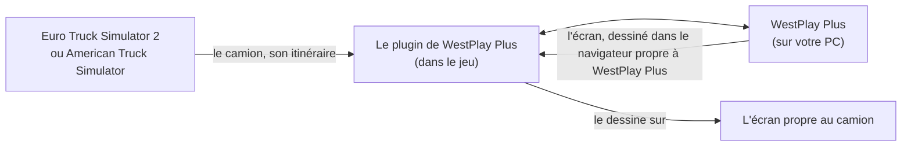

<p align="center"></p>

<h1 align="center">WestPlay Plus</h1>

<!-- languages:start -->
<p align="center">
  <a href="../../README.md">English</a> · <a href="README.zh-CN.md">简体中文</a> · <a href="README.zh-TW.md">繁體中文</a> · <a href="README.ja.md">日本語</a> · <a href="README.ko.md">한국어</a> · <a href="README.de.md">Deutsch</a> · <b>Français</b> · <a href="README.fr-CA.md">Français (Canada)</a> · <a href="README.es.md">Español</a> · <a href="README.es-419.md">Español (Latinoamérica)</a> · <a href="README.it.md">Italiano</a> · <a href="README.pt-BR.md">Português (Brasil)</a> · <a href="README.pt-PT.md">Português (Portugal)</a> · <a href="README.ru.md">Русский</a> · <a href="README.pl.md">Polski</a> · <a href="README.szl.md">Ślōnsko godka</a> · <a href="README.nl.md">Nederlands</a> · <a href="README.tr.md">Türkçe</a> · <a href="README.uk.md">Українська</a> · <a href="README.cs.md">Čeština</a> · <a href="README.sk.md">Slovenčina</a> · <a href="README.hu.md">Magyar</a> · <a href="README.ro.md">Română</a> · <a href="README.bg.md">Български</a> · <a href="README.hr.md">Hrvatski</a> · <a href="README.sr-Latn.md">Srpski (latinica)</a> · <a href="README.sr-Cyrl.md">Српски (ћирилица)</a> · <a href="README.sl.md">Slovenščina</a> · <a href="README.mk.md">Македонски</a> · <a href="README.el.md">Ελληνικά</a> · <a href="README.sv.md">Svenska</a> · <a href="README.da.md">Dansk</a> · <a href="README.no.md">Norsk</a> · <a href="README.fi.md">Suomi</a> · <a href="README.et.md">Eesti</a> · <a href="README.lt.md">Lietuvių</a> · <a href="README.lv.md">Latviešu</a> · <a href="README.ca.md">Català</a> · <a href="README.gl.md">Galego</a> · <a href="README.eu.md">Euskara</a> · <a href="README.ka.md">ქართული</a> · <a href="README.vi.md">Tiếng Việt</a>
</p>
<!-- languages:end -->

<p align="center">
  <b>Un écran façon CarPlay pour les camions d'Euro Truck Simulator 2 et d'American Truck Simulator.</b><br>
  Votre carte, votre musique et YouTube, sur l'écran de bord de votre camion.
  <br>
  Une branche modifiée de <a href="https://github.com/enes-less/WestPlay">WestPlay</a>, pour les joueurs sinophones.
</p>

<p align="center">
  <a href="https://github.com/HandsomeTurtle0307/WestPlay-Plus/releases/latest"></a>
  
  
  
  <a href="../../LICENSE"></a>
</p>

WestPlay Plus installe un écran de téléphone sur l'écran de bord de votre camion, dans le jeu : Euro Truck Simulator 2 ou American Truck Simulator, un seul écran pour les deux. Votre itinéraire sur une carte dessinée depuis votre propre jeu, votre musique, YouTube, la météo de votre trajet : là où un vrai camion a son écran, au pilotage à la souris, une touche maintenue.

## Fonctionnalités

**Des cartes tirées de votre propre jeu.** Dessinées depuis la carte de votre jeu, mods de carte compris (ProMods et d'autres), avec votre itinéraire, les indications virage par virage et une recherche qui ajoute des étapes au GPS du jeu.

**Un tableau de bord pour la route.** La carte à côté de ce qui joue et de votre destination, la météo du trajet, le tout sur un seul écran.

**Votre musique.** Apple Music, Spotify et YouTube Music, avec Now Playing et les paroles. Le clip d'une chanson se lit directement dans Now Playing, et YouTube a ses chaînes, ses playlists, ses sous-titres et ses qualités. Le lecteur joue les chansons que vous placez dans le dossier de musique du jeu.

**Clair et sombre, et votre propre look.** L'écran passe en sombre la nuit ou quand vous allumez les phares, comme le capteur de lumière d'une voiture. Apportez vos propres fonds d'écran et icônes d'applications.

**L'application compagnon** sur votre PC s'occupe de tout : elle trouve vos jeux (ETS2, ATS ou les deux), installe WestPlay Plus dans chacun, construit leurs cartes, puis se fait oublier.

## Comment ça marche



WestPlay Plus dessine son écran dans un navigateur qui lui est propre, sur votre PC, et son plugin pose chaque image sur l'écran de votre camion, dans le jeu. Les écrans propres aux camions et leurs barres d'informations restent les leurs : WestPlay Plus prend la place du GPS, et son réglage « Vehicle Bar » dit si la barre du camion reste à côté.

## Camions

WestPlay Plus apparaît de deux façons : sur l'écran propre du camion, ou sur la tablette WestPlay Plus.

**Sur l'écran propre du camion.** Dans les camions qui ont CarPlay dans la réalité, WestPlay Plus prend la place du GPS sur l'écran de bord, à sa forme. Rien à acheter ni à monter : vous montez, et il est là. Dans Euro Truck Simulator 2 :

- **DAF** XF et XG/XG+ 2021, XF Electric et XD (et le DAF 2021 de Jasper)
- **Scania** S et R, avec l'écran 7" ou le Smart Dash, et le S BEV
- **Iveco** S-Way
- **Renault** T (2024)
- **Volvo** FH (2021 et 2024)
- **Coaches DLC :** le Scania Touring et le MAN Lion's Coach (2024)
- **Les autocars d'Oyuncuyusbis :** le Mercedes-Benz Travego 16 SHD, le MAN Lion's Coach et le Setra S 531 DT sur leurs propres écrans de bord
- **Setra S 516 HD/2** (d'Oyuncuyusbis) : sur l'écran GPS propre de l'autocar, sa partie « Gps », que vous montez à l'atelier : l'écran propre de l'autocar, comme ses joueurs l'ont demandé, mais un écran que vous ajoutez

**Sur la tablette WestPlay Plus.** Tous les autres camions, ceux du jeu comme les camions moddés, reçoivent WestPlay Plus sur une tablette que vous montez à l'atelier : sous Accessoires, dans les objets suspendus ou en kit de tableau de bord. L'écran propre du camion garde la navigation du jeu. La tablette est dans chaque camion à objets suspendus, y compris les camions moddés que vous installez plus tard (ils la reçoivent au prochain démarrage du jeu).

**Dans American Truck Simulator**, WestPlay Plus est sur la tablette dans tous les camions pour l'instant. Les camions dont les équivalents réels ont CarPlay recevront WestPlay Plus sur leur propre écran plus tard.

|                        | Écran propre du camion   | Tablette WestPlay Plus |
| ---------------------- | ------------------------ | ---------------------- |
| Camions                | Les camions ETS2 ci-dessus | Tous les autres, et tous les camions ATS pour l'instant |
| Comment l'avoir        | Rien : il est déjà là    | À monter à l'atelier   |
| Navigation du jeu      | Remplacée par WestPlay Plus | Reste sur l'écran du camion |

### Son

Dans ces camions d'Euro Truck Simulator 2, la musique sort des haut-parleurs propres du camion, chacun à sa place dans la cabine. Les autres camions, et ceux d'American Truck Simulator pour l'instant, jouent en simple stéréo.

- **Scania S et R (2016), S BEV** — woofers de portière, tweeters de montant A, basses de pavillon
- **Scania R (2009), Streamline** — woofers de portière, tweeters de montant A
- **DAF XF (105)** — tweeters de montant A ; deux paires sur l'étagère de pavillon en Super Space Cab, une unité de pavillon dans les autres
- **DAF XF Euro 6** — woofers de portière, tweeters de montant A ; deux paires sur l'étagère de pavillon en Super Space Cab, une unité de pavillon dans les autres
- **DAF XF, XG, XG+ (2021), XF Electric et XD** — woofers de portière, tweeters de montant A, une paire en hauteur, une unité centrale
- **MAN TGX** — woofers de portière ; en XXL, deux petites unités en haut de chaque paroi latérale en plus
- **MAN TGX Euro 6** — woofers de portière ; en XL, une petite unité dans chaque coin de pavillon en plus
- **MAN TGX (2020)** — un woofer et un médium dans chaque portière, tweeters de montant A
- **Mercedes-Benz Actros (2014)** — woofers de portière, une paire en hauteur, tweeters de montant A
- **Mercedes-Benz Actros (2009)** — woofers de portière, une paire aux coins avant de l'étagère de pavillon
- **Volvo FH (2021, 2024), FH16 (2012)** — woofers de portière, basses de cloison arrière
- **Volvo FH16 (2009)** — une unité dans chaque portière
- **Iveco Stralis** — une unité à chaque extrémité de la console de pavillon, et dans les toits hauts une petite côté passager
- **Iveco Hi-Way** — une unité à chaque extrémité de la console de pavillon, et une en hauteur de chaque côté
- **Iveco S-Way** — un woofer et un tweeter dans chaque portière
- **Renault Magnum** — une unité dans chaque coin de pavillon, des tweeters sur la console de pavillon
- **Renault Premium** — une unité de chaque côté du pavillon, plus bas en toit bas
- **Renault T** — tweeters de montant A, une paire en cloison arrière ; woofers de portière dans les intérieurs 2024
- **Renault E-Tech T** — woofers de portière, tweeters de montant A, une paire en cloison arrière
- **Scania PGR de JuseeTV** — les haut-parleurs des pièces que vous montez : portières, montants A, console de toit, cloison arrière

## Installation

1. Téléchargez l'installateur depuis la [dernière version](https://github.com/HandsomeTurtle0307/WestPlay-Plus/releases/latest) et lancez-le.
2. L'application compagnon s'ouvre et vous guide pour le reste : elle trouve vos jeux (ETS2, ATS ou les deux), installe dans chacun le plugin de WestPlay Plus et son mod d'écran, et construit vos cartes.
3. Démarrez le jeu et montez dans un camion.

**Mises à jour :** cette branche ne se met pas à jour toute seule. Pour vérifier s'il existe une version plus récente, consultez la [page des versions](https://github.com/HandsomeTurtle0307/WestPlay-Plus/releases). La page « À propos » de l'application compagnon donne le même lien.

**Configuration requise :** Windows 10 ou 11 (64 bits), Euro Truck Simulator 2 en version 1.62 (ou 1.61) ou American Truck Simulator en version 1.62 (d'autres versions peuvent fonctionner ; l'application compagnon vous le dit quand une version n'a pas été testée), et Microsoft Edge WebView2 (fourni avec Windows 11 ; l'installateur l'ajoute là où il manque).

## Confidentialité

WestPlay Plus n'a ni serveurs, ni comptes qui lui soient propres, ni mesure d'audience. Il ne collecte et n'envoie rien sur vous.

- Vous vous connectez à Apple Music, Spotify et YouTube sur leurs propres pages, dans le profil de navigateur propre à WestPlay Plus sur votre PC, comme dans un navigateur. WestPlay Plus ne conserve aucune donnée de compte.
- Votre carte est construite sur votre PC depuis votre jeu et y reste.
- WestPlay Plus parle aux services que vous utilisez, et à GitHub seulement quand vous ouvrez sa page des versions.

## Retours

Bogues, questions et idées : ouvrez un ticket sur [GitHub](https://github.com/HandsomeTurtle0307/WestPlay-Plus/issues).

## Construire depuis les sources

Il vous faut [Rust](https://rustup.rs) (stable) et [Node.js](https://nodejs.org) 24, sous Windows.

```sh
npm install      # les outils de l'application compagnon et les paquets de l'interface
npm run dev      # WestPlay Plus, avec l'interface servie en direct
```

`cargo test --workspace` et `npm test --prefix ui` lancent les tests. Le plugin du jeu se construit avec `cargo build --release -p westplay-plugin`.

## Licence

WestPlay Plus est un logiciel libre : vous pouvez le redistribuer et le modifier selon les termes de la GNU General Public License, version 3 ou (à votre choix) toute version ultérieure. Voir [LICENSE](../../LICENSE).

Copyright © 2026 HandsomeTurtle0307. Les bibliothèques livrées avec WestPlay Plus gardent leurs propres licences : voir [THIRD_PARTY_LICENSES.md](../../THIRD_PARTY_LICENSES.md), et [THIRD_PARTY_NOTICES.md](../../THIRD_PARTY_NOTICES.md) pour les œuvres qu'il suit.

## D'où vient ce projet

WestPlay Plus est une branche modifiée (fork) de [WestPlay](https://github.com/enes-less/WestPlay), un excellent mod d'écran façon CarPlay pour Euro Truck Simulator 2 et American Truck Simulator, réalisé par **enes-less**. Presque tout le design, le code et les ressources d'origine sont son travail ; cette branche garde ses propres changements par-dessus et lui est reconnaissante de ce qu'il a construit. Si ce projet vous plaît, jetez aussi un œil à l'original.

Merci de soutenir aussi le projet original (et si vous le pouvez, soutenez-moi aussi 😭😭😭 — développer un logiciel, ce n’est pas facile~).

<!-- translated:start -->
<sub>Ce README est traduit de la version anglaise. L’auteur ne parle évidemment pas les 43 langues 😭😭, la traduction peut donc être incomplète par endroits. Merci de votre indulgence~ Si vous repérez une erreur dans votre langue, signalez-la, ce sera très apprécié~</sub>
<!-- translated:end -->

<sub>WestPlay Plus est un projet indépendant, sans lien ni approbation d'Apple, de SCS Software, de Spotify, de Google ou des constructeurs de camions. CarPlay, Apple Music, Spotify, YouTube, YouTube Music ainsi que les noms et logos des constructeurs sont des marques de leurs propriétaires respectifs, utilisées ici pour nommer ce avec quoi WestPlay Plus fonctionne.</sub>
