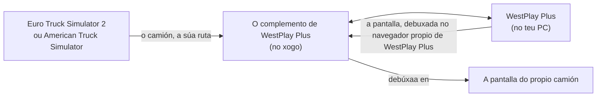

<p align="center"></p>

<h1 align="center">WestPlay Plus</h1>

<!-- languages:start -->
<p align="center">
  <a href="../../README.md">English</a> · <a href="README.zh-CN.md">简体中文</a> · <a href="README.zh-TW.md">繁體中文</a> · <a href="README.ja.md">日本語</a> · <a href="README.ko.md">한국어</a> · <a href="README.de.md">Deutsch</a> · <a href="README.fr.md">Français</a> · <a href="README.fr-CA.md">Français (Canada)</a> · <a href="README.es.md">Español</a> · <a href="README.es-419.md">Español (Latinoamérica)</a> · <a href="README.it.md">Italiano</a> · <a href="README.pt-BR.md">Português (Brasil)</a> · <a href="README.pt-PT.md">Português (Portugal)</a> · <a href="README.ru.md">Русский</a> · <a href="README.pl.md">Polski</a> · <a href="README.szl.md">Ślōnsko godka</a> · <a href="README.nl.md">Nederlands</a> · <a href="README.tr.md">Türkçe</a> · <a href="README.uk.md">Українська</a> · <a href="README.cs.md">Čeština</a> · <a href="README.sk.md">Slovenčina</a> · <a href="README.hu.md">Magyar</a> · <a href="README.ro.md">Română</a> · <a href="README.bg.md">Български</a> · <a href="README.hr.md">Hrvatski</a> · <a href="README.sr-Latn.md">Srpski (latinica)</a> · <a href="README.sr-Cyrl.md">Српски (ћирилица)</a> · <a href="README.sl.md">Slovenščina</a> · <a href="README.mk.md">Македонски</a> · <a href="README.el.md">Ελληνικά</a> · <a href="README.sv.md">Svenska</a> · <a href="README.da.md">Dansk</a> · <a href="README.no.md">Norsk</a> · <a href="README.fi.md">Suomi</a> · <a href="README.et.md">Eesti</a> · <a href="README.lt.md">Lietuvių</a> · <a href="README.lv.md">Latviešu</a> · <a href="README.ca.md">Català</a> · <b>Galego</b> · <a href="README.eu.md">Euskara</a> · <a href="README.ka.md">ქართული</a> · <a href="README.vi.md">Tiếng Việt</a>
</p>
<!-- languages:end -->

<p align="center">
  <b>Unha pantalla ao estilo CarPlay para os camións de Euro Truck Simulator 2 e American Truck Simulator.</b><br>
  O teu mapa, a túa música e YouTube, no salpicadoiro do teu propio camión.
  <br>
  Unha rama modificada de <a href="https://github.com/enes-less/WestPlay">WestPlay</a>, para xogadores que falan chinés.
</p>

<p align="center">
  <a href="https://github.com/HandsomeTurtle0307/WestPlay-Plus/releases/latest"></a>
  
  
  
  <a href="../../LICENSE"></a>
</p>

WestPlay Plus pon unha pantalla coma a dun móbil no salpicadoiro do teu propio camión, dentro do xogo: Euro Truck Simulator 2 ou American Truck Simulator, unha pantalla para os dous. A túa ruta nun mapa debuxado a partir do teu propio xogo, a túa música, YouTube, o tempo da túa viaxe: exactamente onde un camión de verdade ten a súa pantalla, controlada co rato mentres mantés premida unha tecla.

<!-- why:start -->

## Por que fixen isto

Ao principio buscaba un mod de CarPlay, e atopei WestPlay: está moi ben feito (de verdade, moi moi ben), só que a optimización non era boa e o ordenador conxelóuseme. Así que decidín melloralo eu mesmo, afinar o rendemento e engadir algunhas funcións novas (estou subido aos ombros dun xigante, jeje~😊).

<!-- easter-egg:start -->
> Hai outro motivo: antes, cando estaba moi alterado, fixen cousas (bastantes, a verdade) que afectaron a outras persoas — sobre todo a alguén a quen non quería facer dano. Agora, ao pensalo, síntome culpable e moi mal, e vexo o futuro con moita dúbida (tamén os estudos e os plans). Por iso agárrome ao único que podo controlar — programar — e con iso vou tapando, por agora, a dor doutras partes. Ai🥲 Tampouco sei que farei despois; irei paso a paso :)‍💨
<!-- easter-egg:end -->

<!-- why:end -->

## Funcións

**Mapas do teu propio xogo.** Debuxados a partir do mapa do teu xogo, cos mods de mapa incluídos (ProMods e outros), coa túa ruta, as indicacións xiro a xiro e unha busca que engade paradas ao GPS do propio xogo.

**Un salpicadoiro para a estrada.** O mapa ao carón do que soa e de cara a onde vas, o tempo da viaxe, todo nunha soa pantalla.

**A túa música.** Apple Music, Spotify e YouTube Music, con Now Playing e letras. O videoclip dunha canción reprodúcese directamente en Now Playing, e YouTube ten as súas canles, listas, subtítulos e calidades. O reprodutor pon as cancións que metes no cartafol de música do xogo.

**Claro e escuro, e o teu aspecto.** Escurece de noite ou cando acendes as luces, coma o sensor de luz dun coche. Os fondos de pantalla e as iconas podes poñelos ti.

**A aplicación acompañante** no teu PC prepárao todo: atopa os teus xogos (ETS2, ATS ou os dous), instala WestPlay Plus en cada un, constrúe os seus mapas e despois xa non molesta.

## Como funciona



WestPlay Plus debuxa a súa pantalla nun navegador propio no teu PC, e o seu complemento pon cada fotograma na pantalla do teu camión, dentro do xogo. As pantallas dos propios camións e as súas barras de información seguen a ser súas: WestPlay Plus ocupa o lugar do GPS, e o axuste «Vehicle Bar» decide se a barra do camión queda ao carón.

## Camións

WestPlay Plus aparece de dúas maneiras: na pantalla do propio camión ou na tablet WestPlay Plus.

**Na pantalla do propio camión.** Nos camións que na realidade teñen CarPlay, WestPlay Plus ocupa o lugar do GPS na pantalla do salpicadoiro, adaptado á súa forma. Non hai nada que mercar nin montar: subes e xa está alí. En Euro Truck Simulator 2:

- **DAF** XF e XG/XG+ 2021, XF Electric e XD (e o DAF 2021 de Jasper)
- **Scania** S e R, coa pantalla de 7" ou o Smart Dash, e o S BEV
- **Iveco** S-Way
- **Renault** T (2024)
- **Volvo** FH (2021 e 2024)
- **Coaches DLC:** o Scania Touring e o MAN Lion's Coach (2024)
- **Os autocares de Oyuncuyusbis:** o Mercedes-Benz Travego 16 SHD, o MAN Lion's Coach e o Setra S 531 DT nos seus propios salpicadoiros
- **Setra S 516 HD/2** (de Oyuncuyusbis): na pantalla GPS do propio autocar, a súa parte «Gps», que montas no concesionario: a pantalla do propio autocar, como pediron os seus xogadores, pero unha que engades ti

**Na tablet WestPlay Plus.** Todos os demais camións, tanto os do xogo coma os mods, reciben WestPlay Plus nunha tablet que montas no concesionario: en Accesorios, entre os obxectos colgantes ou como conxunto de salpicadoiro. A pantalla do propio camión conserva a navegación do xogo. A tablet está en todos os camións con obxectos colgantes, incluídos os mods de camión que instales despois (recíbea a próxima vez que inicies o xogo).

**En American Truck Simulator**, de momento WestPlay Plus vai na tablet en todos os camións. Os camións cuxos equivalentes reais teñen CarPlay recibirán WestPlay Plus na súa propia pantalla máis adiante.

|                        | Pantalla do propio camión | Tablet WestPlay Plus |
| ---------------------- | ------------------------- | -------------------- |
| Camións                | Os camións ETS2 de arriba | Todos os demais, e de momento todos os de ATS |
| Como conseguilo        | Nada: xa está alí         | Montala no concesionario |
| Navegación do xogo     | Substitúea WestPlay Plus  | Queda na pantalla do camión |

### Son

Nestes camións de Euro Truck Simulator 2, a música sae polos altofalantes propios do camión, cada un no seu sitio na cabina. Os demais camións, e de momento os de American Truck Simulator, soan en estéreo normal.

- **Scania S e R (2016), S BEV** — graves de porta, tweeters do piar A, graves de teito
- **Scania R (2009), Streamline** — graves de porta, tweeters do piar A
- **DAF XF (105)** — tweeters do piar A; dúas parellas no estante do teito no Super Space Cab, unha unidade de teito nos outros
- **DAF XF Euro 6** — graves de porta, tweeters do piar A; dúas parellas no estante do teito no Super Space Cab, unha unidade de teito nos outros
- **DAF XF, XG, XG+ (2021), XF Electric e XD** — graves de porta, tweeters do piar A, unha parella arriba, unha unidade central
- **MAN TGX** — graves de porta; no XXL, ademais, dúas unidades pequenas no alto de cada parede lateral
- **MAN TGX Euro 6** — graves de porta; no XL, ademais, unha unidade pequena en cada recanto do teito
- **MAN TGX (2020)** — un grave e un medio en cada porta, tweeters do piar A
- **Mercedes-Benz Actros (2014)** — graves de porta, unha parella arriba, tweeters do piar A
- **Mercedes-Benz Actros (2009)** — graves de porta, unha parella nos recantos dianteiros do estante do teito
- **Volvo FH (2021, 2024), FH16 (2012)** — graves de porta, graves na parede traseira
- **Volvo FH16 (2009)** — unha unidade en cada porta
- **Iveco Stralis** — unha unidade en cada extremo da consola do teito, e nos teitos altos unha pequena do lado do pasaxeiro
- **Iveco Hi-Way** — unha unidade en cada extremo da consola do teito, e unha no alto de cada lado
- **Iveco S-Way** — un grave e un tweeter en cada porta
- **Renault Magnum** — unha unidade en cada recanto do teito, tweeters na consola do teito
- **Renault Premium** — unha unidade en cada lado do teito, máis abaixo no teito baixo
- **Renault T** — tweeters do piar A, unha parella na parede traseira; graves de porta nos interiores de 2024
- **Renault E-Tech T** — graves de porta, tweeters do piar A, unha parella na parede traseira
- **Scania PGR de JuseeTV** — os altofalantes das pezas que montas: portas, piares A, consola superior, parede traseira

## Instalación

1. Descarga o instalador desde a [última versión](https://github.com/HandsomeTurtle0307/WestPlay-Plus/releases/latest) e execútao.
2. Abre a aplicación acompañante e guíate polo resto: atopa os teus xogos (ETS2, ATS ou os dous), instala en cada un o complemento de WestPlay Plus e o seu mod de pantalla, e constrúe os teus mapas.
3. Inicia o xogo e sobe a un camión.

**Actualizacións:** esta rama non se actualiza soa. Para ver se hai unha versión máis nova, visita a [páxina de versións](https://github.com/HandsomeTurtle0307/WestPlay-Plus/releases). A mesma ligazón está na páxina «Acerca de» da aplicación acompañante.

**Requisitos:** Windows 10 ou 11 (64 bits), Euro Truck Simulator 2 versión 1.62 (ou 1.61) ou American Truck Simulator versión 1.62 (outras versións poden funcionar; a aplicación acompañante avísate cando unha non está probada) e Microsoft Edge WebView2 (forma parte de Windows 11; o instalador engádeo onde falta).

## Privacidade

WestPlay Plus non ten servidores, nin contas propias, nin analíticas. Non recolle nin envía nada sobre ti.

- Inicias sesión en Apple Music, Spotify e YouTube nas súas propias páxinas, co perfil de navegador propio de WestPlay Plus no teu PC, como farías nun navegador. WestPlay Plus non garda ningún dato de conta.
- O teu mapa constrúese no teu PC a partir do teu xogo e queda alí.
- WestPlay Plus fala cos servizos que usas, e con GitHub só cando abres a súa páxina de versións.

## Comentarios

Erros, dúbidas e ideas: abre unha issue en [GitHub](https://github.com/HandsomeTurtle0307/WestPlay-Plus/issues).

## Compilación desde o código fonte

Necesitas [Rust](https://rustup.rs) (stable) e [Node.js](https://nodejs.org) 24, en Windows.

```sh
npm install      # as ferramentas da aplicación acompañante e os paquetes da interface
npm run dev      # WestPlay Plus, coa interface servida en directo
```

`cargo test --workspace` e `npm test --prefix ui` executan as probas. O complemento do xogo compílase con `cargo build --release -p westplay-plugin`.

## Licenza

WestPlay Plus é software libre: podes redistribuílo e modificalo segundo os termos da GNU General Public License, versión 3 ou (se o escolles) calquera versión posterior. Consulta [LICENSE](../../LICENSE).

Copyright © 2026 HandsomeTurtle0307. As bibliotecas que distribúe WestPlay Plus conservan as súas propias licenzas: consulta [THIRD_PARTY_LICENSES.md](../../THIRD_PARTY_LICENSES.md), e [THIRD_PARTY_NOTICES.md](../../THIRD_PARTY_NOTICES.md) para as obras que segue.

## De onde vén este proxecto

WestPlay Plus é unha rama modificada (fork) de [WestPlay](https://github.com/enes-less/WestPlay), un excelente mod de pantalla ao estilo CarPlay para Euro Truck Simulator 2 e American Truck Simulator, feito por **enes-less**. Case todo o deseño, o código e os recursos orixinais son obra súa; esta rama mantén os seus propios cambios por riba e está agradecida polo que construíu. Se che gusta este proxecto, bótalle un ollo tamén ao orixinal.

Dálle apoio tamén ao proxecto orixinal (e se podes, apóiame a min tamén 😭😭😭 — non é doado facer software~).

<!-- translated:start -->
<sub>Este README é unha tradución da versión en inglés. O autor non fala os 43 idiomas, nin de lonxe 😭😭, así que a tradución pode estar incompleta nalgúns puntos. Desculpade~ Se atopades algo raro no voso idioma, dicídemo, agradézoo moito~</sub>
<!-- translated:end -->

<sub>WestPlay Plus é un proxecto independente, sen vínculo nin aprobación de Apple, SCS Software, Spotify, Google nin dos fabricantes de camións. CarPlay, Apple Music, Spotify, YouTube, YouTube Music e os nomes e logotipos dos fabricantes son marcas dos seus propietarios e úsanse aquí só para nomear aquilo co que funciona WestPlay Plus.</sub>
