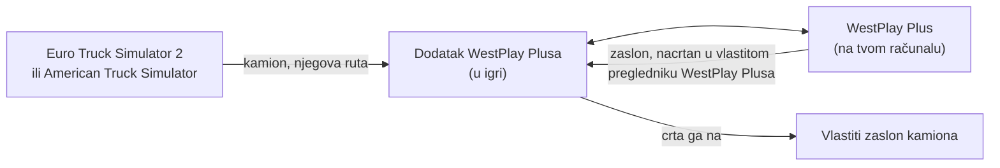

<p align="center"></p>

<h1 align="center">WestPlay Plus</h1>

<!-- languages:start -->
<p align="center">
  <a href="../../README.md">English</a> · <a href="README.zh-CN.md">简体中文</a> · <a href="README.zh-TW.md">繁體中文</a> · <a href="README.ja.md">日本語</a> · <a href="README.ko.md">한국어</a> · <a href="README.de.md">Deutsch</a> · <a href="README.fr.md">Français</a> · <a href="README.fr-CA.md">Français (Canada)</a> · <a href="README.es.md">Español</a> · <a href="README.es-419.md">Español (Latinoamérica)</a> · <a href="README.it.md">Italiano</a> · <a href="README.pt-BR.md">Português (Brasil)</a> · <a href="README.pt-PT.md">Português (Portugal)</a> · <a href="README.ru.md">Русский</a> · <a href="README.pl.md">Polski</a> · <a href="README.szl.md">Ślōnsko godka</a> · <a href="README.nl.md">Nederlands</a> · <a href="README.tr.md">Türkçe</a> · <a href="README.uk.md">Українська</a> · <a href="README.cs.md">Čeština</a> · <a href="README.sk.md">Slovenčina</a> · <a href="README.hu.md">Magyar</a> · <a href="README.ro.md">Română</a> · <a href="README.bg.md">Български</a> · <b>Hrvatski</b> · <a href="README.sr-Latn.md">Srpski (latinica)</a> · <a href="README.sr-Cyrl.md">Српски (ћирилица)</a> · <a href="README.sl.md">Slovenščina</a> · <a href="README.mk.md">Македонски</a> · <a href="README.el.md">Ελληνικά</a> · <a href="README.sv.md">Svenska</a> · <a href="README.da.md">Dansk</a> · <a href="README.no.md">Norsk</a> · <a href="README.fi.md">Suomi</a> · <a href="README.et.md">Eesti</a> · <a href="README.lt.md">Lietuvių</a> · <a href="README.lv.md">Latviešu</a> · <a href="README.ca.md">Català</a> · <a href="README.gl.md">Galego</a> · <a href="README.eu.md">Euskara</a> · <a href="README.ka.md">ქართული</a> · <a href="README.vi.md">Tiếng Việt</a>
</p>
<!-- languages:end -->

<p align="center">
  <b>Zaslon u stilu CarPlaya za kamione iz Euro Truck Simulator 2 i American Truck Simulator.</b><br>
  Tvoja karta, tvoja glazba i YouTube, na armaturi tvog kamiona.
  <br>
  Izmijenjena grana <a href="https://github.com/enes-less/WestPlay">WestPlaya</a>, za igrače koji govore kineski.
</p>

<p align="center">
  <a href="https://github.com/HandsomeTurtle0307/WestPlay-Plus/releases/latest"></a>
  
  
  
  <a href="../../LICENSE"></a>
</p>

WestPlay Plus stavlja zaslon poput onog na mobitelu na armaturu tvog kamiona, unutar igre: Euro Truck Simulator 2 ili American Truck Simulator, jedan zaslon za oba. Tvoja ruta na karti nacrtanoj iz tvoje vlastite igre, tvoja glazba, YouTube, vrijeme na tvom putu: točno tamo gdje pravi kamion ima svoj zaslon, upravljan mišem dok držiš tipku.

## Značajke

**Karte iz tvoje vlastite igre.** Crtane iz karte tvoje igre, uključujući modove za karte (ProMods i drugi), s tvojom rutom, uputama skretanje po skretanje i pretraživanjem koje dodaje stajališta u GPS same igre.

**Armatura za vožnju.** Karta pokraj onoga što svira i onoga kamo ideš, vrijeme na putu, sve na jednom zaslonu.

**Tvoja glazba.** Apple Music, Spotify i YouTube Music, s Now Playingom i tekstovima. Spot pjesme reproducira se izravno u Now Playingu, a YouTube ima svoje kanale, playliste, titlove i kvalitete. Player reproducira pjesme koje staviš u glazbenu mapu igre.

**Svijetlo i tamno, i tvoj vlastiti izgled.** Po noći ili kad upališ svjetla potamni, kao senzor svjetla u automobilu. Vlastite pozadine i ikone možeš donijeti sam.

**Popratna aplikacija** na tvom računalu sve postavlja: pronalazi tvoje igre (ETS2, ATS ili obje), instalira WestPlay Plus u svaku od njih, gradi njihove karte i nakon toga se ne miješa.

## Kako radi



WestPlay Plus crta svoj zaslon u vlastitom pregledniku na tvom računalu, a njegov dodatak stavlja svaku sličicu na zaslon tvog kamiona, unutar igre. Vlastiti zasloni kamiona i njihove informacijske trake ostaju njihovi: WestPlay Plus zauzima mjesto GPS-a, a postavka „Vehicle Bar” odlučuje ostaje li traka kamiona pokraj njega.

## Kamioni

WestPlay Plus pojavljuje se na dva načina: na vlastitom zaslonu kamiona ili na tabletu WestPlay Plus.

**Na vlastitom zaslonu kamiona.** U kamionima koji imaju CarPlay i u stvarnosti, WestPlay Plus zauzima mjesto GPS-a na zaslonu armature, prilagođen njegovu obliku. Ništa se ne kupuje ni montira: uđeš i već je tamo. U Euro Truck Simulator 2:

- **DAF** XF i XG/XG+ 2021, XF Electric i XD (te Jasperov DAF 2021)
- **Scania** S i R, sa 7" zaslonom ili Smart Dashom, i S BEV
- **Iveco** S-Way
- **Renault** T (2024)
- **Volvo** FH (2021 i 2024)
- **Coaches DLC:** Scania Touring i MAN Lion's Coach (2024)
- **Autobusi Oyuncuyusbisa:** Mercedes-Benz Travego 16 SHD, MAN Lion's Coach i Setra S 531 DT na svojim armaturama
- **Setra S 516 HD/2** (od Oyuncuyusbisa): na vlastitom GPS zaslonu autobusa, njegovu dijelu „Gps”, koji montiraš kod prodavača kamiona: vlastiti zaslon autobusa, kako su njegovi igrači tražili, ali onaj koji sam dodaješ

**Na tabletu WestPlay Plus.** Svi ostali kamioni, iz igre i iz modova, dobivaju WestPlay Plus na tabletu koji montiraš kod prodavača kamiona: u Priboru, među visećim predmetima ili kao set za armaturu. Vlastiti zaslon kamiona zadržava navigaciju igre. Tablet je u svakom kamionu s visećim predmetima, uključujući modove kamiona koje instaliraš kasnije (dobivaju ga pri sljedećem pokretanju igre).

**U American Truck Simulatoru** za sada je WestPlay Plus na tabletu u svakom kamionu. Kamioni čiji stvarni pandani imaju CarPlay dobit će WestPlay Plus na vlastiti zaslon kasnije.

|                        | Vlastiti zaslon kamiona | Tablet WestPlay Plus |
| ---------------------- | ----------------------- | -------------------- |
| Kamioni                | Gore navedeni ETS2 kamioni | Svi ostali, i za sada svi ATS kamioni |
| Kako ga dobiti         | Ništa: već je tamo      | Montirati kod prodavača |
| Navigacija igre        | Zamjenjuje ju WestPlay Plus | Ostaje na zaslonu kamiona |

### Zvuk

U ovim kamionima iz Euro Truck Simulator 2 glazba dolazi iz vlastitih zvučnika kamiona, svaki na svom mjestu u kabini. Ostali kamioni, i za sada oni iz American Truck Simulatora, sviraju obični stereo.

- **Scania S i R (2016), S BEV** — wooferi u vratima, visokotonci u A-stupovima, bas na stropu
- **Scania R (2009), Streamline** — wooferi u vratima, visokotonci u A-stupovima
- **DAF XF (105)** — visokotonci u A-stupovima; dva para na stropnoj polici u Super Space Cabu, jedna stropna jedinica u ostalima
- **DAF XF Euro 6** — wooferi u vratima, visokotonci u A-stupovima; dva para na stropnoj polici u Super Space Cabu, jedna stropna jedinica u ostalima
- **DAF XF, XG, XG+ (2021), XF Electric i XD** — wooferi u vratima, visokotonci u A-stupovima, par gore, središnja jedinica
- **MAN TGX** — wooferi u vratima; u XXL-u još dvije male jedinice visoko u svakom bočnom zidu
- **MAN TGX Euro 6** — wooferi u vratima; u XL-u još mala jedinica u svakom kutu stropa
- **MAN TGX (2020)** — woofer i srednjetonac u svakim vratima, visokotonci u A-stupovima
- **Mercedes-Benz Actros (2014)** — wooferi u vratima, par gore, visokotonci u A-stupovima
- **Mercedes-Benz Actros (2009)** — wooferi u vratima, par u prednjim kutovima stropne police
- **Volvo FH (2021, 2024), FH16 (2012)** — wooferi u vratima, bas u stražnjem zidu
- **Volvo FH16 (2009)** — jedna jedinica u svakim vratima
- **Iveco Stralis** — jedna jedinica na svakom kraju stropne konzole, a u visokim krovovima mala na suvozačevoj strani
- **Iveco Hi-Way** — jedna jedinica na svakom kraju stropne konzole i jedna visoko sa svake strane
- **Iveco S-Way** — woofer i visokotonac u svakim vratima
- **Renault Magnum** — jedna jedinica u svakom kutu stropa, visokotonci na stropnoj konzoli
- **Renault Premium** — jedna jedinica sa svake strane stropa, niže u niskom krovu
- **Renault T** — visokotonci u A-stupovima, par u stražnjem zidu; wooferi u vratima u interijerima iz 2024.
- **Renault E-Tech T** — wooferi u vratima, visokotonci u A-stupovima, par u stražnjem zidu
- **Scania PGR od JuseeTV-a** — zvučnici dijelova koje montiraš: vrata, A-stupovi, gornja konzola, stražnji zid

## Instalacija

1. Preuzmi instalacijski program s [najnovije verzije](https://github.com/HandsomeTurtle0307/WestPlay-Plus/releases/latest) i pokreni ga.
2. Otvori se popratna aplikacija i vodi te kroz ostalo: pronalazi tvoje igre (ETS2, ATS ili obje), instalira u svaku dodatak WestPlay Plusa i njegov mod zaslona te gradi tvoje karte.
3. Pokreni igru i sjedni u kamion.

**Ažuriranja:** ova se grana ne ažurira sama. Postoji li novija verzija, provjeri na [stranici izdanja](https://github.com/HandsomeTurtle0307/WestPlay-Plus/releases). Ista je poveznica i na stranici „O programu” u popratnoj aplikaciji.

**Zahtjevi:** Windows 10 ili 11 (64 bita), Euro Truck Simulator 2 verzija 1.62 (ili 1.61) ili American Truck Simulator verzija 1.62 (druge verzije mogu raditi; kad neka nije testirana, popratna aplikacija to kaže) i Microsoft Edge WebView2 (dio Windowsa 11; instalacijski program ga dodaje gdje nedostaje).

## Privatnost

WestPlay Plus nema poslužitelje, vlastite račune ni analitiku. Ne prikuplja i ne šalje ništa o tebi.

- U Apple Music, Spotify i YouTube prijavljuješ se na njihovim stranicama, u vlastitom profilu preglednika WestPlay Plusa na svom računalu, kao u pregledniku. Sam WestPlay Plus ne čuva podatke o računu.
- Tvoja se karta gradi na tvom računalu iz tvoje igre i ostaje tamo.
- WestPlay Plus razgovara sa službama koje koristiš, a s GitHubom samo kad otvoriš njegovu stranicu izdanja.

## Povratne informacije

Pogreške, pitanja i ideje: otvori issue na [GitHubu](https://github.com/HandsomeTurtle0307/WestPlay-Plus/issues).

## Izgradnja iz izvornog koda

Trebaš [Rust](https://rustup.rs) (stable) i [Node.js](https://nodejs.org) 24, na Windowsu.

```sh
npm install      # alati popratne aplikacije i paketi sučelja
npm run dev      # WestPlay Plus, sa sučeljem posluženim uživo
```

`cargo test --workspace` i `npm test --prefix ui` pokreću testove. Dodatak igre gradi se s `cargo build --release -p westplay-plugin`.

## Licenca

WestPlay Plus je slobodan softver: možeš ga distribuirati i mijenjati pod uvjetima GNU General Public License, verzija 3 ili (po tvom izboru) bilo koje kasnije verzije. Vidi [LICENSE](../../LICENSE).

Copyright © 2026 HandsomeTurtle0307. Biblioteke isporučene s WestPlay Plusom zadržavaju vlastite licence: vidi [THIRD_PARTY_LICENSES.md](../../THIRD_PARTY_LICENSES.md) i [THIRD_PARTY_NOTICES.md](../../THIRD_PARTY_NOTICES.md) za djela koja slijedi.

## Odakle ovaj projekt dolazi

WestPlay Plus je izmijenjena grana (fork) projekta [WestPlay](https://github.com/enes-less/WestPlay), izvrsnog moda zaslona u stilu CarPlaya za Euro Truck Simulator 2 i American Truck Simulator, koji je napravio **enes-less**. Gotovo cijeli izvorni dizajn, kod i materijali njegov su rad; ova grana drži vlastite izmjene povrh toga i zahvalna mu je na onome što je izgradio. Ako ti se projekt sviđa, pogledaj i original.

Podrži i izvorni projekt (a ako možeš, podrži i mene 😭😭😭 — nije lako razvijati softver~).

<!-- translated:start -->
<sub>Ovaj README je prijevod engleske verzije. Autor, naravno, ne govori sva 43 jezika 😭😭, pa prijevod mjestimično može biti nepotpun. Ispričavam se~ Ako uočite grešku na svom jeziku, javite mi, bit ću zahvalan~</sub>
<!-- translated:end -->

<sub>WestPlay Plus je neovisan projekt, bez veze s Appleom, SCS Softwareom, Spotifyjem, Googleom ili proizvođačima kamiona i bez njihove potvrde. CarPlay, Apple Music, Spotify, YouTube, YouTube Music te imena i logotipi proizvođača zaštitni su znakovi svojih vlasnika i ovdje se koriste samo za imenovanje onoga s čime WestPlay Plus radi.</sub>
