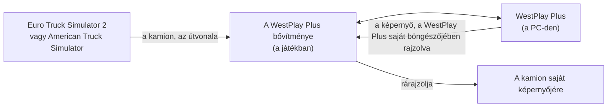

<p align="center"></p>

<h1 align="center">WestPlay Plus</h1>

<!-- languages:start -->
<p align="center">
  <a href="../../README.md">English</a> · <a href="README.zh-CN.md">简体中文</a> · <a href="README.zh-TW.md">繁體中文</a> · <a href="README.ja.md">日本語</a> · <a href="README.ko.md">한국어</a> · <a href="README.de.md">Deutsch</a> · <a href="README.fr.md">Français</a> · <a href="README.fr-CA.md">Français (Canada)</a> · <a href="README.es.md">Español</a> · <a href="README.es-419.md">Español (Latinoamérica)</a> · <a href="README.it.md">Italiano</a> · <a href="README.pt-BR.md">Português (Brasil)</a> · <a href="README.pt-PT.md">Português (Portugal)</a> · <a href="README.ru.md">Русский</a> · <a href="README.pl.md">Polski</a> · <a href="README.nl.md">Nederlands</a> · <a href="README.tr.md">Türkçe</a> · <a href="README.uk.md">Українська</a> · <a href="README.cs.md">Čeština</a> · <a href="README.sk.md">Slovenčina</a> · <b>Magyar</b> · <a href="README.ro.md">Română</a> · <a href="README.bg.md">Български</a> · <a href="README.hr.md">Hrvatski</a> · <a href="README.sr-Latn.md">Srpski (latinica)</a> · <a href="README.sr-Cyrl.md">Српски (ћирилица)</a> · <a href="README.sl.md">Slovenščina</a> · <a href="README.mk.md">Македонски</a> · <a href="README.el.md">Ελληνικά</a> · <a href="README.sv.md">Svenska</a> · <a href="README.da.md">Dansk</a> · <a href="README.no.md">Norsk</a> · <a href="README.fi.md">Suomi</a> · <a href="README.et.md">Eesti</a> · <a href="README.lt.md">Lietuvių</a> · <a href="README.lv.md">Latviešu</a> · <a href="README.ca.md">Català</a> · <a href="README.gl.md">Galego</a> · <a href="README.vi.md">Tiếng Việt</a>
</p>
<!-- languages:end -->

<!-- english-only:start -->
<p align="center"><sub>A sziléziai, a baszk és a grúz támogatott az alkalmazásban, de README-jük még nincs: nem volt, aki ellenőrizze a fordításukat. Minden tartalom a tároló gyökerében lévő angol változatban van.</sub></p>
<!-- english-only:end -->

<p align="center">
  <b>CarPlay-stílusú képernyő az Euro Truck Simulator 2 és az American Truck Simulator kamionjaihoz.</b><br>
  A térképed, a zenéd és a YouTube – a saját kamionod műszerfalán.
  <br>
  A <a href="https://github.com/enes-less/WestPlay">WestPlay</a> módosított ága, néhány optimalizációval és új funkcióval.
</p>

<p align="center">
  <a href="https://github.com/HandsomeTurtle0307/WestPlay-Plus/releases/latest"></a>
  
  
  
  <a href="../../LICENSE"></a>
</p>

A WestPlay Plus telefonos stílusú képernyőt tesz a saját kamionod műszerfalára, a játékon belül: Euro Truck Simulator 2 vagy American Truck Simulator, egy képernyő mindkettőhöz. Az útvonalad a saját játékodból rajzolt térképen, a zenéd, a YouTube, az út időjárása: pontosan ott, ahol egy igazi kamionnak képernyője van, egérrel kezelve, miközben lenyomva tartasz egy billentyűt.

<!-- why:start -->

## Miért csináltam ezt

Először egy CarPlay modot kerestem, aztán rátaláltam a WestPlayre, és láttam, hogy nagyon jól van megcsinálva (tényleg, nagyon-nagyon jól). Csak az optimalizálás volt gyenge, és lefagyasztotta a gépem. Ezért úgy döntöttem, magam javítom meg: rendbe teszem a teljesítményt, és hozzáadok pár új funkciót (egy óriás vállán állva, hehe~😊).

<!-- why:end -->

## Funkciók

**Térképek a saját játékodból.** A játékod térképéből rajzolva, térképmodokkal együtt (ProMods és mások), az útvonaladdal, kanyarról kanyarra haladó navigációval és olyan kereséssel, amely megállókat tesz a játék saját GPS-ébe.

**Műszerfal az útra.** A térkép mellett az, ami szól, és ahová tartasz, az út időjárása, mindez egy képernyőn.

**A zenéd.** Apple Music, Spotify és YouTube Music, Now Playinggel és dalszövegekkel. Egy dal klippje közvetlenül a Now Playingben játszik, a YouTube-nak pedig megvannak a csatornái, lejátszási listái, feliratai és minőségei. A lejátszó azokat a dalokat játssza, amelyeket a játék zenemappájába teszel.

**Világos és sötét, és a saját külsőd.** Éjszaka vagy amikor felkapcsolod a fényszórót, elsötétül, mint egy autó fényérzékelője. Saját háttereket és ikonokat hozhatsz magaddal.

**A társalkalmazás** a PC-den mindent beállít: megtalálja a játékaidat (ETS2, ATS vagy mindkettő), telepíti a WestPlay Plust mindegyikbe, felépíti a térképeiket, aztán már nem zavar.

## Hogyan működik



A WestPlay Plus a saját böngészőjében rajzolja a képernyőjét a PC-den, a bővítménye pedig minden képkockát a kamionod képernyőjére tesz, a játékon belül. A kamionok saját képernyője és információs sávja az övék marad: a WestPlay Plus átveszi a GPS helyét, a „Vehicle Bar” beállítás pedig eldönti, hogy a kamion sávja mellette marad-e.

## Kamionok

A WestPlay Plus kétféleképpen jelenik meg: a kamion saját képernyőjén vagy a WestPlay Plus táblagépen.

**A kamion saját képernyőjén.** Azokban a kamionokban, amelyeknek a valóságban is van CarPlayjük, a WestPlay Plus átveszi a GPS helyét a műszerfal képernyőjén, annak formájához igazodva. Nincs mit venni vagy felszerelni: beszállsz, és ott van. Az Euro Truck Simulator 2-ben:

- **DAF** XF és XG/XG+ 2021, XF Electric és XD (valamint Jasper DAF 2021-e)
- **Scania** S és R, a 7"-os képernyővel vagy a Smart Dashsel, és az S BEV
- **Iveco** S-Way
- **Renault** T (2024)
- **Volvo** FH (2021 és 2024)
- **Coaches DLC:** a Scania Touring és a MAN Lion's Coach (2024)
- **Az Oyuncuyusbis buszai:** a Mercedes-Benz Travego 16 SHD, a MAN Lion's Coach és a Setra S 531 DT a saját műszerfal-képernyőjükön
- **Setra S 516 HD/2** (az Oyuncuyusbistól): a busz saját GPS-képernyőjén, annak „Gps” részén, amelyet a kamionkereskedésben szerelsz fel: a busz saját képernyője, ahogy a játékosai kérték, de olyan, amelyet te adsz hozzá

**A WestPlay Plus táblagépen.** Minden más kamion, a játéké és a modoké is, egy táblagépen kapja a WestPlay Plust, amelyet a kamionkereskedésben szerelsz fel: a Tartozékok alatt, a függő tárgyak között vagy műszerfal-készletként. A kamion saját képernyője megtartja a játék navigációját. A táblagép minden függő tárgyas kamionban ott van, a később telepített kamionmodokban is (a következő játékindításnál megkapják).

**Az American Truck Simulatorban** egyelőre minden kamionban a táblagépen van a WestPlay Plus. Azok a kamionok, amelyek valós megfelelőinek van CarPlayjük, később a saját képernyőjükre kapják.

|                        | A kamion saját képernyője | WestPlay Plus táblagép |
| ---------------------- | ------------------------- | ---------------------- |
| Kamionok               | A fenti ETS2-kamionok     | Minden más, és egyelőre minden ATS-kamion |
| Így kapod meg          | Semmi: már ott van        | Szereld fel a kereskedésben |
| A játék navigációja    | A WestPlay Plus váltja fel | A kamion képernyőjén marad |

### Hang

Ezekben az Euro Truck Simulator 2-es kamionokban a zene a kamion saját hangszóróiból szól, mindegyik a fülkében elfoglalt helyén. A többi kamion, és egyelőre az American Truck Simulator kamionjai, egyszerű sztereóban szólnak.

- **Scania S és R (2016), S BEV** — ajtó-mélyhangszórók, A-oszlop magashangszórók, tetőbasszus
- **Scania R (2009), Streamline** — ajtó-mélyhangszórók, A-oszlop magashangszórók
- **DAF XF (105)** — A-oszlop magashangszórók; két pár a tetőpolcon a Super Space Cabban, egy tetőegység a többiben
- **DAF XF Euro 6** — ajtó-mélyhangszórók, A-oszlop magashangszórók; két pár a tetőpolcon a Super Space Cabban, egy tetőegység a többiben
- **DAF XF, XG, XG+ (2021), XF Electric és XD** — ajtó-mélyhangszórók, A-oszlop magashangszórók, egy pár fent, egy középegység
- **MAN TGX** — ajtó-mélyhangszórók; az XXL-ben emellett két kis egység magasan mindkét oldalfalban
- **MAN TGX Euro 6** — ajtó-mélyhangszórók; az XL-ben emellett egy kis egység minden tetősarokban
- **MAN TGX (2020)** — mély- és középhangszóró minden ajtóban, A-oszlop magashangszórók
- **Mercedes-Benz Actros (2014)** — ajtó-mélyhangszórók, egy pár fent, A-oszlop magashangszórók
- **Mercedes-Benz Actros (2009)** — ajtó-mélyhangszórók, egy pár a tetőpolc első sarkaiban
- **Volvo FH (2021, 2024), FH16 (2012)** — ajtó-mélyhangszórók, basszus a hátsó falban
- **Volvo FH16 (2009)** — egy egység minden ajtóban
- **Iveco Stralis** — egy egység a tetőkonzol mindkét végén, a magas tetőkben pedig egy kicsi az utas oldalán
- **Iveco Hi-Way** — egy egység a tetőkonzol mindkét végén, és egy-egy magasan mindkét oldalon
- **Iveco S-Way** — mély- és magashangszóró minden ajtóban
- **Renault Magnum** — egy egység minden tetősarokban, magashangszórók a tetőkonzolon
- **Renault Premium** — egy egység a tető mindkét oldalán, az alacsony tetőben lejjebb
- **Renault T** — A-oszlop magashangszórók, egy pár a hátsó falban; ajtó-mélyhangszórók a 2024-es belsőkben
- **Renault E-Tech T** — ajtó-mélyhangszórók, A-oszlop magashangszórók, egy pár a hátsó falban
- **A JuseeTV Scania PGR-je** — a felszerelt alkatrészek hangszórói: ajtók, A-oszlopok, felső konzol, hátsó fal

## Telepítés

1. Töltsd le a telepítőt a [legújabb verzióból](https://github.com/HandsomeTurtle0307/WestPlay-Plus/releases/latest), és futtasd.
2. Megnyílik a társalkalmazás, és végigvezet a többin: megtalálja a játékaidat (ETS2, ATS vagy mindkettő), telepíti mindegyikbe a WestPlay Plus bővítményét és képernyőmodját, és felépíti a térképeidet.
3. Indítsd el a játékot, és szállj be egy kamionba.

**Frissítések:** ez az ág nem frissíti magát. Ha újabb verzió van, a [kiadások oldalán](https://github.com/HandsomeTurtle0307/WestPlay-Plus/releases) nézheted meg. Ugyanez a hivatkozás a társalkalmazás „Névjegy” oldalán is megtalálható.

**Követelmények:** Windows 10 vagy 11 (64 bites), Euro Truck Simulator 2 1.62-es (vagy 1.61-es) verziója vagy American Truck Simulator 1.62-es verziója (más verziók is működhetnek; ha egy verzió tesztelés nélküli, a társalkalmazás szól), valamint Microsoft Edge WebView2 (a Windows 11 része; a telepítő hozzáadja, ahol hiányzik).

## Adatvédelem

A WestPlay Plusnak nincsenek szerverei, saját fiókjai és analitikája. Semmit nem gyűjt és nem küld rólad.

- Az Apple Musicba, a Spotifyba és a YouTube-ba a saját oldalaikon jelentkezel be, a WestPlay Plus saját böngészőprofiljával a PC-den, ahogy egy böngészőben tennéd. A WestPlay Plus maga nem tárol fiókadatokat.
- A térképed a PC-den, a játékodból épül fel, és ott is marad.
- A WestPlay Plus az általad használt szolgáltatásokkal beszél, a GitHubbal pedig csak akkor, amikor megnyitod a kiadások oldalát.

## Visszajelzés

Hibák, kérdések és ötletek: nyiss egy issue-t a [GitHubon](https://github.com/HandsomeTurtle0307/WestPlay-Plus/issues).

## Fordítás forráskódból

[Russra](https://rustup.rs) (stable) és [Node.js](https://nodejs.org) 24-re van szükséged, Windowson.

```sh
npm install      # a társalkalmazás eszközei és a felület csomagjai
npm run dev      # WestPlay Plus, élőben kiszolgált felülettel
```

A `cargo test --workspace` és a `npm test --prefix ui` futtatja a teszteket. A játék bővítménye a `cargo build --release -p westplay-plugin` paranccsal épül.

## Licenc

A WestPlay Plus szabad szoftver: a GNU General Public License 3. verziójának (vagy az általad választott későbbi verziónak) feltételei szerint terjesztheted és módosíthatod. Lásd: [LICENSE](../../LICENSE).

Copyright © 2026 HandsomeTurtle0307. A WestPlay Plusszal szállított könyvtárak megtartják saját licenceiket: lásd a [THIRD_PARTY_LICENSES.md](../../THIRD_PARTY_LICENSES.md) fájlt, és a [THIRD_PARTY_NOTICES.md](../../THIRD_PARTY_NOTICES.md) fájlt azokról a művekről, amelyeket követ.

## Honnan származik ez a projekt

A WestPlay Plus a [WestPlay](https://github.com/enes-less/WestPlay) módosított ága (fork), amely egy kiváló, CarPlay-stílusú képernyőmod az Euro Truck Simulator 2-höz és az American Truck Simulatorhoz, **enes-less** munkája. Szinte a teljes eredeti design, kód és anyag az ő munkája; ez az ág a saját változtatásait viszi tovább rajta, és hálás azért, amit épített. Ha tetszik ez a projekt, nézd meg az eredetit is.

Kérlek, támogasd az eredeti projektet is (és ha tudod, támogass engem is 😭😭😭 – nem könnyű szoftvert fejleszteni~).

<!-- translated:start -->
<sub>Ez a README az angol verzió fordítása. A szerző természetesen nem beszél mind a 43 nyelven 😭😭, ezért a fordítás helyenként hiányos lehet. Elnézést érte~ Ha a saját nyelveden hibát találsz, jelezd, nagyon hálás lennék~</sub>
<!-- translated:end -->

<sub>A WestPlay Plus független projekt, nem áll kapcsolatban az Apple-lel, az SCS Software-rel, a Spotifyjal, a Google-lel vagy a kamiongyártókkal, és azok nem hagyták jóvá. A CarPlay, az Apple Music, a Spotify, a YouTube, a YouTube Music, valamint a gyártók nevei és logói tulajdonosaik védjegyei, itt csak annak megnevezésére szolgálnak, amivel a WestPlay Plus működik.</sub>
