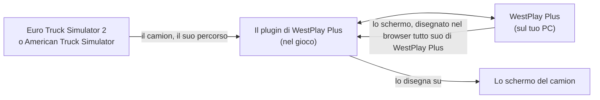

<p align="center"></p>

<h1 align="center">WestPlay Plus</h1>

<!-- languages:start -->
<p align="center">
  <a href="../../README.md">English</a> · <a href="README.zh-CN.md">简体中文</a> · <a href="README.zh-TW.md">繁體中文</a> · <a href="README.ja.md">日本語</a> · <a href="README.ko.md">한국어</a> · <a href="README.de.md">Deutsch</a> · <a href="README.fr.md">Français</a> · <a href="README.fr-CA.md">Français (Canada)</a> · <a href="README.es.md">Español</a> · <a href="README.es-419.md">Español (Latinoamérica)</a> · <b>Italiano</b> · <a href="README.pt-BR.md">Português (Brasil)</a> · <a href="README.pt-PT.md">Português (Portugal)</a> · <a href="README.ru.md">Русский</a> · <a href="README.pl.md">Polski</a> · <a href="README.szl.md">Ślōnsko godka</a> · <a href="README.nl.md">Nederlands</a> · <a href="README.tr.md">Türkçe</a> · <a href="README.uk.md">Українська</a> · <a href="README.cs.md">Čeština</a> · <a href="README.sk.md">Slovenčina</a> · <a href="README.hu.md">Magyar</a> · <a href="README.ro.md">Română</a> · <a href="README.bg.md">Български</a> · <a href="README.hr.md">Hrvatski</a> · <a href="README.sr-Latn.md">Srpski (latinica)</a> · <a href="README.sr-Cyrl.md">Српски (ћирилица)</a> · <a href="README.sl.md">Slovenščina</a> · <a href="README.mk.md">Македонски</a> · <a href="README.el.md">Ελληνικά</a> · <a href="README.sv.md">Svenska</a> · <a href="README.da.md">Dansk</a> · <a href="README.no.md">Norsk</a> · <a href="README.fi.md">Suomi</a> · <a href="README.et.md">Eesti</a> · <a href="README.lt.md">Lietuvių</a> · <a href="README.lv.md">Latviešu</a> · <a href="README.ca.md">Català</a> · <a href="README.gl.md">Galego</a> · <a href="README.eu.md">Euskara</a> · <a href="README.ka.md">ქართული</a> · <a href="README.vi.md">Tiếng Việt</a>
</p>
<!-- languages:end -->

<p align="center">
  <b>Uno schermo in stile CarPlay per i camion di Euro Truck Simulator 2 e American Truck Simulator.</b><br>
  La tua mappa, la tua musica e YouTube, sullo schermo del cruscotto del tuo camion.
  <br>
  Un ramo modificato di <a href="https://github.com/enes-less/WestPlay">WestPlay</a>, con alcune ottimizzazioni e nuove funzioni.
</p>

<p align="center">
  <a href="https://github.com/HandsomeTurtle0307/WestPlay-Plus/releases/latest"></a>
  
  
  
  <a href="../../LICENSE"></a>
</p>

WestPlay Plus mette uno schermo da telefono sullo schermo del cruscotto del tuo camion, dentro il gioco: Euro Truck Simulator 2 o American Truck Simulator, un solo schermo per entrambi. Il tuo percorso su una mappa disegnata dal tuo gioco, la tua musica, YouTube, il meteo del viaggio: proprio dove un camion vero ha il suo schermo, comandato col mouse mentre tieni premuto un tasto.

<!-- why:start -->

## Perché l'ho fatto

All'inizio cercavo una mod per CarPlay, poi mi sono imbattuto in WestPlay e ho visto che è fatto davvero bene (davvero, davvero bene). Solo che l'ottimizzazione lasciava a desiderare e mi ha freezato il PC. Così ho deciso di rimetterci mano io: prestazioni a posto e un paio di funzioni nuove (sulle spalle di un gigante, eh eh~😊).

<!-- why:end -->

## Funzioni

**Mappe dal tuo gioco.** Disegnate dalla mappa del tuo gioco, mod della mappa comprese (ProMods e altre), con il percorso, le indicazioni svolta per svolta e una ricerca che aggiunge tappe al GPS del gioco.

**Un cruscotto per la guida.** La mappa accanto a quello che sta suonando e a dove stai andando, il meteo lungo il viaggio, tutto su un solo schermo.

**La tua musica.** Apple Music, Spotify e YouTube Music, con Now Playing e i testi. Il videoclip di un brano si vede direttamente in Now Playing, e YouTube ha i suoi canali, playlist, sottotitoli e qualità. Il lettore riproduce i brani che metti nella cartella musicale del gioco.

**Chiaro e scuro, e il tuo aspetto.** Diventa scuro di notte o quando accendi i fari, come il sensore di luce di un'auto. Puoi portare i tuoi sfondi e le tue icone.

**L'app companion** sul tuo PC prepara tutto: trova i tuoi giochi (ETS2, ATS o entrambi), installa WestPlay Plus in ciascuno, costruisce le loro mappe e poi si fa da parte.

## Come funziona



WestPlay Plus disegna il suo schermo in un browser tutto suo, sul tuo PC, e il suo plugin mette ogni fotogramma sullo schermo del tuo camion, dentro il gioco. Gli schermi dei camion e le loro barre informative restano loro: WestPlay Plus prende il posto del GPS, e la sua impostazione «Vehicle Bar» dice se la barra del camion resta accanto.

## Camion

WestPlay Plus compare in due modi: sullo schermo del camion oppure sul tablet WestPlay Plus.

**Sullo schermo del camion.** Nei camion che nella realtà hanno CarPlay, WestPlay Plus prende il posto del GPS sullo schermo del cruscotto, adattandosi alla sua forma. Niente da comprare né da montare: sali e c'è. In Euro Truck Simulator 2:

- **DAF** XF e XG/XG+ 2021, XF Electric e XD (e il DAF 2021 di Jasper)
- **Scania** S e R, con lo schermo da 7" o lo Smart Dash, e la S BEV
- **Iveco** S-Way
- **Renault** T (2024)
- **Volvo** FH (2021 e 2024)
- **Coaches DLC:** la Scania Touring e il MAN Lion's Coach (2024)
- **Le corriere di Oyuncuyusbis:** il Mercedes-Benz Travego 16 SHD, il MAN Lion's Coach e il Setra S 531 DT sui loro schermi del cruscotto
- **Setra S 516 HD/2** (di Oyuncuyusbis): sullo schermo GPS della corriera, la sua parte «Gps», che monti all'officina: lo schermo della corriera, come hanno chiesto i suoi giocatori, ma uno che aggiungi tu

**Sul tablet WestPlay Plus.** Ogni altro camion, del gioco o moddato, riceve WestPlay Plus su un tablet che monti all'officina: in Accessori, tra gli oggetti appesi o come set da cruscotto. Lo schermo del camion mantiene la navigazione del gioco. Il tablet c'è in ogni camion con oggetti appesi, compresi i camion moddati che installi dopo (lo ricevono al successivo avvio del gioco).

**In American Truck Simulator**, per ora WestPlay Plus è sul tablet in ogni camion. I camion i cui equivalenti reali hanno CarPlay riceveranno WestPlay Plus sul loro schermo più avanti.

|                          | Schermo del camion        | Tablet WestPlay Plus |
| ------------------------ | ------------------------- | -------------------- |
| Camion                   | I camion ETS2 qui sopra   | Ogni altro camion, e per ora ogni camion ATS |
| Come averlo              | Niente: c'è già           | Montarlo all'officina |
| Navigazione del gioco    | Sostituita da WestPlay Plus | Resta sullo schermo del camion |

### Audio

In questi camion di Euro Truck Simulator 2 la musica esce dagli altoparlanti del camion, ognuno al suo posto in cabina. Gli altri camion, e per ora quelli di American Truck Simulator, suonano in semplice stereo.

- **Scania S e R (2016), S BEV** — woofer di portiera, tweeter del montante A, bassi sul tetto
- **Scania R (2009), Streamline** — woofer di portiera, tweeter del montante A
- **DAF XF (105)** — tweeter del montante A; due coppie sul ripiano del tetto nella Super Space Cab, un'unità sul tetto nelle altre
- **DAF XF Euro 6** — woofer di portiera, tweeter del montante A; due coppie sul ripiano del tetto nella Super Space Cab, un'unità sul tetto nelle altre
- **DAF XF, XG, XG+ (2021), XF Electric e XD** — woofer di portiera, tweeter del montante A, una coppia in alto, un'unità centrale
- **MAN TGX** — woofer di portiera; nella XXL anche due piccole unità in alto su ogni parete laterale
- **MAN TGX Euro 6** — woofer di portiera; nella XL anche una piccola unità in ogni angolo del tetto
- **MAN TGX (2020)** — un woofer e un medio in ogni portiera, tweeter del montante A
- **Mercedes-Benz Actros (2014)** — woofer di portiera, una coppia in alto, tweeter del montante A
- **Mercedes-Benz Actros (2009)** — woofer di portiera, una coppia agli angoli anteriori del ripiano del tetto
- **Volvo FH (2021, 2024), FH16 (2012)** — woofer di portiera, bassi sulla parete posteriore
- **Volvo FH16 (2009)** — un'unità in ogni portiera
- **Iveco Stralis** — un'unità a ogni estremità della consolle del tetto, e nei tetti alti una piccola dal lato passeggero
- **Iveco Hi-Way** — un'unità a ogni estremità della consolle del tetto, e una in alto su ogni lato
- **Iveco S-Way** — un woofer e un tweeter in ogni portiera
- **Renault Magnum** — un'unità in ogni angolo del tetto, tweeter sulla consolle del tetto
- **Renault Premium** — un'unità su ogni lato del tetto, più in basso nel tetto basso
- **Renault T** — tweeter del montante A, una coppia sulla parete posteriore; woofer di portiera negli interni 2024
- **Renault E-Tech T** — woofer di portiera, tweeter del montante A, una coppia sulla parete posteriore
- **Scania PGR di JuseeTV** — gli altoparlanti dei pezzi che monti: portiere, montanti A, consolle superiore, parete posteriore

## Installazione

1. Scarica l'installer dalla [versione più recente](https://github.com/HandsomeTurtle0307/WestPlay-Plus/releases/latest) ed eseguilo.
2. L'app companion si apre e ti guida nel resto: trova i tuoi giochi (ETS2, ATS o entrambi), installa in ciascuno il plugin di WestPlay Plus e la sua mod dello schermo, e costruisce le tue mappe.
3. Avvia il gioco e sali su un camion.

**Aggiornamenti:** questo ramo non si aggiorna da solo. Per controllare se esiste una versione più recente, visita la [pagina delle release](https://github.com/HandsomeTurtle0307/WestPlay-Plus/releases). La pagina «Informazioni» dell'app companion ha lo stesso link.

**Requisiti:** Windows 10 o 11 (64 bit), Euro Truck Simulator 2 versione 1.62 (o 1.61) oppure American Truck Simulator versione 1.62 (altre versioni possono funzionare; l'app companion avvisa quando una non è testata), e Microsoft Edge WebView2 (incluso in Windows 11; l'installer lo aggiunge dove manca).

## Privacy

WestPlay Plus non ha server, non ha account propri e non ha statistiche. Non raccoglie né invia nulla su di te.

- Accedi ad Apple Music, Spotify e YouTube sulle loro pagine, nel profilo del browser di WestPlay Plus sul tuo PC, come faresti in un browser. WestPlay Plus non conserva alcun dato dell'account.
- La tua mappa è costruita sul tuo PC dal tuo gioco e resta lì.
- WestPlay Plus parla con i servizi che usi, e con GitHub solo quando apri la sua pagina delle release.

## Feedback

Bug, domande e idee: apri una issue su [GitHub](https://github.com/HandsomeTurtle0307/WestPlay-Plus/issues).

## Compilare dai sorgenti

Ti servono [Rust](https://rustup.rs) (stable) e [Node.js](https://nodejs.org) 24, su Windows.

```sh
npm install      # gli strumenti dell'app companion e i pacchetti dell'interfaccia
npm run dev      # WestPlay Plus, con l'interfaccia servita dal vivo
```

`cargo test --workspace` e `npm test --prefix ui` eseguono i test. Il plugin del gioco si compila con `cargo build --release -p westplay-plugin`.

## Licenza

WestPlay Plus è software libero: puoi ridistribuirlo e modificarlo secondo i termini della GNU General Public License, versione 3 o (a tua scelta) qualsiasi versione successiva. Vedi [LICENSE](../../LICENSE).

Copyright © 2026 HandsomeTurtle0307. Le librerie distribuite con WestPlay Plus mantengono le proprie licenze: vedi [THIRD_PARTY_LICENSES.md](../../THIRD_PARTY_LICENSES.md), e [THIRD_PARTY_NOTICES.md](../../THIRD_PARTY_NOTICES.md) per le opere che segue.

## Da dove viene questo progetto

WestPlay Plus è un ramo modificato (fork) di [WestPlay](https://github.com/enes-less/WestPlay), un eccellente mod di schermo in stile CarPlay per Euro Truck Simulator 2 e American Truck Simulator, realizzato da **enes-less**. Quasi tutto il design, il codice e gli asset originali sono opera sua; questo ramo tiene sopra le proprie modifiche ed è grato per quello che ha costruito. Se il progetto ti piace, dai un'occhiata anche all'originale.

Sostieni anche il progetto originale (e se puoi, sostieni anche me 😭😭😭: sviluppare software non è facile~).

<!-- translated:start -->
<sub>Questo README è tradotto dalla versione inglese. L’autore non parla tutte e 43 le lingue, nemmeno lontanamente 😭😭, quindi la traduzione può essere incompleta qua e là. Perdonate~ Se noti qualcosa che non va nella tua lingua, segnalalo, è molto gradito~</sub>
<!-- translated:end -->

<sub>WestPlay Plus è un progetto indipendente, non affiliato né approvato da Apple, SCS Software, Spotify, Google o dai costruttori di camion. CarPlay, Apple Music, Spotify, YouTube, YouTube Music e i nomi e i loghi dei costruttori sono marchi dei rispettivi proprietari, usati qui solo per indicare ciò con cui WestPlay Plus funziona.</sub>
