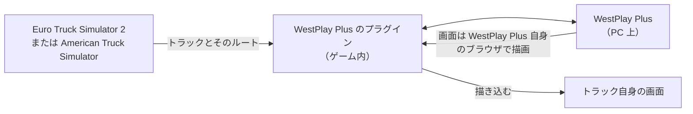

<p align="center"></p>

<h1 align="center">WestPlay Plus</h1>

<!-- languages:start -->
<p align="center">
  <a href="../../README.md">English</a> · <a href="README.zh-CN.md">简体中文</a> · <a href="README.zh-TW.md">繁體中文</a> · <b>日本語</b> · <a href="README.ko.md">한국어</a> · <a href="README.de.md">Deutsch</a> · <a href="README.fr.md">Français</a> · <a href="README.fr-CA.md">Français (Canada)</a> · <a href="README.es.md">Español</a> · <a href="README.es-419.md">Español (Latinoamérica)</a> · <a href="README.it.md">Italiano</a> · <a href="README.pt-BR.md">Português (Brasil)</a> · <a href="README.pt-PT.md">Português (Portugal)</a> · <a href="README.ru.md">Русский</a> · <a href="README.pl.md">Polski</a> · <a href="README.szl.md">Ślōnsko godka</a> · <a href="README.nl.md">Nederlands</a> · <a href="README.tr.md">Türkçe</a> · <a href="README.uk.md">Українська</a> · <a href="README.cs.md">Čeština</a> · <a href="README.sk.md">Slovenčina</a> · <a href="README.hu.md">Magyar</a> · <a href="README.ro.md">Română</a> · <a href="README.bg.md">Български</a> · <a href="README.hr.md">Hrvatski</a> · <a href="README.sr-Latn.md">Srpski (latinica)</a> · <a href="README.sr-Cyrl.md">Српски (ћирилица)</a> · <a href="README.sl.md">Slovenščina</a> · <a href="README.mk.md">Македонски</a> · <a href="README.el.md">Ελληνικά</a> · <a href="README.sv.md">Svenska</a> · <a href="README.da.md">Dansk</a> · <a href="README.no.md">Norsk</a> · <a href="README.fi.md">Suomi</a> · <a href="README.et.md">Eesti</a> · <a href="README.lt.md">Lietuvių</a> · <a href="README.lv.md">Latviešu</a> · <a href="README.ca.md">Català</a> · <a href="README.gl.md">Galego</a> · <a href="README.eu.md">Euskara</a> · <a href="README.ka.md">ქართული</a> · <a href="README.vi.md">Tiếng Việt</a>
</p>
<!-- languages:end -->

<p align="center">
  <b>Euro Truck Simulator 2 と American Truck Simulator のトラックのための、CarPlay 風スクリーン。</b><br>
  地図も音楽も YouTube も、トラック自身のダッシュボード画面に。
  <br>
  中国語話者のプレイヤー向けの、<a href="https://github.com/enes-less/WestPlay">WestPlay</a> の改変ブランチです。
</p>

<p align="center">
  <a href="https://github.com/HandsomeTurtle0307/WestPlay-Plus/releases/latest"></a>
  
  
  
  <a href="../../LICENSE"></a>
</p>

WestPlay Plus は、ゲーム内のトラック自身のダッシュボード画面に、スマートフォン風のカースクリーンを映します。Euro Truck Simulator 2 でも American Truck Simulator でも、同じ 1 つの画面で。自分のゲームから描いた地図の上の走行ルート、音楽、YouTube、走行中の天気 — 本物のトラックにスクリーンがある、まさにその場所に。キーを押しながらマウスで操作します。

## 機能

**地図は自分のゲームから。** ゲーム本体の地図から描画し、マップ MOD（ProMods など）にも対応。走行ルート、曲がり角ごとの案内、そして立ち寄り地点をゲーム本来の GPS に追加する検索も備えています。

**ドライブのためのダッシュボード。** 地図の隣に、再生中のものと向かう先、そして走行中の天気。すべてを 1 つの画面に。

**あなたの音楽。** Apple Music、Spotify、YouTube Music に対応し、Now Playing と歌詞も表示します。曲のミュージックビデオは Now Playing の中でそのまま再生でき、YouTube はチャンネル、プレイリスト、字幕、画質に対応します。プレイヤーは、ゲームの音楽フォルダに入れた曲を再生します。

**ライトとダーク、そして自分だけの見た目。** 夜になると、あるいはヘッドライトを点けると、車の光センサーのように暗くなります。壁紙とアプリアイコンは自分のものを持ち込めます。

**PC 側のコンパニオンアプリ**がすべてを整えます。ゲーム（ETS2、ATS、またはその両方）を見つけ、それぞれに WestPlay Plus をインストールし、地図を生成し、その後は静かにしています。

## 仕組み



WestPlay Plus は PC 上の専用ブラウザで画面を描き、プラグインがそのフレームをゲーム内のトラックの画面に映します。トラック自身の画面と情報バーはトラックのもののままです。WestPlay Plus は GPS の位置に入り、「Vehicle Bar」設定でトラックのバーを隣に残すかどうかを決められます。

## トラック

WestPlay Plus の表示方法は 2 つ。トラック自身の画面に出すか、WestPlay Plus タブレットに出すかです。

**トラック自身の画面に。** 現実でも CarPlay を備えるトラックでは、WestPlay Plus がダッシュボード画面の GPS の位置に入り、その形に合わせて表示されます。買うものも、取り付けるものもありません。乗り込めば、そこにあります。Euro Truck Simulator 2 の場合：

- **DAF** XF と XG/XG+ 2021、XF Electric、XD（および Jasper の DAF 2021）
- **Scania** S と R（7 インチ画面または Smart Dash）、S BEV
- **Iveco** S-Way
- **Renault** T（2024）
- **Volvo** FH（2021 と 2024）
- **Coaches DLC：** Scania Touring と MAN Lion's Coach（2024）
- **Oyuncuyusbis のコーチ：** Mercedes-Benz Travego 16 SHD、MAN Lion's Coach、Setra S 531 DT を各車自身のダッシュボード画面に
- **Setra S 516 HD/2**（Oyuncuyusbis）：コーチ自身の GPS 画面、つまり「Gps」パーツに表示されます。トラックショップで取り付ける必要があります。プレイヤーの要望どおりコーチ自身の画面を使いますが、追加するのは自分です

**WestPlay Plus タブレットに。** それ以外のすべてのトラック（ゲーム本物でも MOD でも）では、トラックショップで取り付けるタブレットに WestPlay Plus が出ます。アクセサリー内の吊り下げアイテム、またはダッシュボードセットとして。トラック自身の画面はゲームのナビを保ちます。タブレットは吊り下げアイテムのあるすべてのトラックに入り、後から導入したトラック MOD にも入ります（次回ゲーム起動時に付きます）。

**American Truck Simulator では**、今のところすべてのトラックでタブレットに表示されます。現実の対応車種が CarPlay を備えるトラックは、後に自身の画面に表示されるようになります。

|                      | トラック自身の画面   | WestPlay Plus タブレット |
| -------------------- | -------------------- | ------------------------ |
| トラック             | 上記の ETS2 トラック | それ以外のすべて、および今はすべての ATS トラック |
| 入手方法             | 何もしなくてよい     | トラックショップで取り付ける |
| ゲームのナビ         | WestPlay Plus に置き換わる | トラックの画面に残る |

### サウンド

次の Euro Truck Simulator 2 のトラックでは、音楽がトラック自身のスピーカーから、キャブ内のそれぞれの位置で鳴ります。それ以外のトラック、そして今は American Truck Simulator のトラックは、通常のステレオで再生されます。

- **Scania S / R（2016）、S BEV** — ドアウーファー、A ピラーツイーター、ルーフベース
- **Scania R（2009）、Streamline** — ドアウーファー、A ピラーツイーター
- **DAF XF（105）** — A ピラーツイーター。Super Space Cab はルーフシェルフに 2 対、それ以外はルーフ 1 基
- **DAF XF Euro 6** — ドアウーファー、A ピラーツイーター。Super Space Cab はルーフシェルフに 2 対、それ以外はルーフ 1 基
- **DAF XF / XG / XG+（2021）、XF Electric、XD** — ドアウーファー、A ピラーツイーター、頭上 1 対、センター 1 基
- **MAN TGX** — ドアウーファー。XXL は各側壁の高い位置に小さなユニットが 2 基ずつ
- **MAN TGX Euro 6** — ドアウーファー。XL はルーフの各コーナーに小さなユニットが 1 基ずつ
- **MAN TGX（2020）** — 各ドアにウーファーとミッドレンジ、A ピラーツイーター
- **Mercedes-Benz Actros（2014）** — ドアウーファー、頭上 1 対、A ピラーツイーター
- **Mercedes-Benz Actros（2009）** — ドアウーファー、ルーフシェルフ前端のコーナーに 1 対
- **Volvo FH（2021、2024）、FH16（2012）** — ドアウーファー、後壁ベース
- **Volvo FH16（2009）** — 各ドアに 1 基
- **Iveco Stralis** — ルーフコンソールの両端に 1 基ずつ、ハイルーフは助手席側に小さなものが 1 基
- **Iveco Hi-Way** — ルーフコンソールの両端に 1 基ずつ、両側の高い位置に 1 基ずつ
- **Iveco S-Way** — 各ドアにウーファーとツイーター
- **Renault Magnum** — ルーフの各コーナーに 1 基、ルーフコンソールにツイーター
- **Renault Premium** — ルーフの両側に 1 基ずつ、ロールーフでは低い位置に
- **Renault T** — A ピラーツイーター、後壁に 1 対。2024 のインテリアはドアウーファー付き
- **Renault E-Tech T** — ドアウーファー、A ピラーツイーター、後壁に 1 対
- **JuseeTV の Scania PGR** — 取り付けたパーツのスピーカー：ドア、A ピラー、トップコンソール、後壁

## インストール

1. [最新リリース](https://github.com/HandsomeTurtle0307/WestPlay-Plus/releases/latest)からインストーラーをダウンロードして実行します。
2. コンパニオンアプリが開き、残りの手順を案内します。ゲーム（ETS2、ATS、またはその両方）を見つけ、それぞれに WestPlay Plus のプラグインとスクリーン MOD をインストールし、地図を生成します。
3. ゲームを起動して、トラックに乗り込みます。

**アップデート：** このブランチは自動更新しません。新しいバージョンがあるかどうかは[リリースページ](https://github.com/HandsomeTurtle0307/WestPlay-Plus/releases)で確認してください。コンパニオンアプリの「About」ページにも同じリンクがあります。

**動作要件：** Windows 10 または 11（64 ビット）、Euro Truck Simulator 2 バージョン 1.62（または 1.61）あるいは American Truck Simulator バージョン 1.62（他のバージョンでも動く場合があります。未検証の場合はコンパニオンアプリが知らせます）、および Microsoft Edge WebView2（Windows 11 に含まれます。無い場合はインストーラーが追加します）。

## プライバシー

WestPlay Plus にはサーバーも、独自のアカウントも、解析もありません。あなたに関する情報を収集したり送信したりすることはありません。

- Apple Music、Spotify、YouTube へのログインは、それぞれのページで、PC 上の WestPlay Plus 専用のブラウザプロファイルを使って行います。ブラウザで行うのと同じです。WestPlay Plus 自身はアカウント情報を保存しません。
- 地図は PC 上でゲームから生成され、そこに留まります。
- WestPlay Plus が通信するのは、あなたが使うサービスと、リリースページを開いたときの GitHub だけです。

## フィードバック

不具合、質問、アイデアは [GitHub](https://github.com/HandsomeTurtle0307/WestPlay-Plus/issues) で issue を立ててください。

## ソースからビルド

Windows 上で [Rust](https://rustup.rs)（stable）と [Node.js](https://nodejs.org) 24 が必要です。

```sh
npm install      # コンパニオンアプリのツールと UI のパッケージ
npm run dev      # WestPlay Plus を起動（UI はライブ配信）
```

`cargo test --workspace` と `npm test --prefix ui` でテストを実行します。ゲームプラグインは `cargo build --release -p westplay-plugin` でビルドします。

## ライセンス

WestPlay Plus は自由ソフトウェアです。GNU General Public License 第 3 版（またはそれ以降の任意の版）の条件に従って、再配布および改変できます。[LICENSE](../../LICENSE) を参照してください。

Copyright © 2026 HandsomeTurtle0307. WestPlay Plus に同梱されるライブラリは、それぞれのライセンスを保ちます。[THIRD_PARTY_LICENSES.md](../../THIRD_PARTY_LICENSES.md)、および従っている作品については [THIRD_PARTY_NOTICES.md](../../THIRD_PARTY_NOTICES.md) を参照してください。

## このプロジェクトの由来

WestPlay Plus は [WestPlay](https://github.com/enes-less/WestPlay) の改変ブランチ（フォーク）です。WestPlay は **enes-less** による、Euro Truck Simulator 2 と American Truck Simulator 向けの非常に優れた CarPlay 風スクリーン MOD です。元のデザイン、コード、素材のほとんどは氏の仕事です。このブランチはその上に独自の変更を重ねており、氏が築いたものに感謝しています。このプロジェクトを気に入っていただけたら、オリジナルもぜひご覧ください。

ぜひオリジナルのプロジェクトも応援してください（できれば私も応援していただけると嬉しいです😭😭😭 ソフトウェア開発は楽じゃないんです~）。

<!-- translated:start -->
<sub>この README は英語版から翻訳したものです。作者は 43 言語すべてを話せるわけではもちろんなく😭😭、翻訳が不完全なところもあるかもしれません。ご容赦ください~ お使いの言語で不備を見つけたら、ぜひ教えてください~</sub>
<!-- translated:end -->

<sub>WestPlay Plus は独立したプロジェクトであり、Apple、SCS Software、Spotify、Google、各トラックメーカーとは提携しておらず、承認も受けていません。CarPlay、Apple Music、Spotify、YouTube、YouTube Music、および各トラックメーカーの名称・ロゴは、それぞれの所有者の商標であり、ここでは WestPlay Plus が対応する対象を示すためにのみ用いています。</sub>
