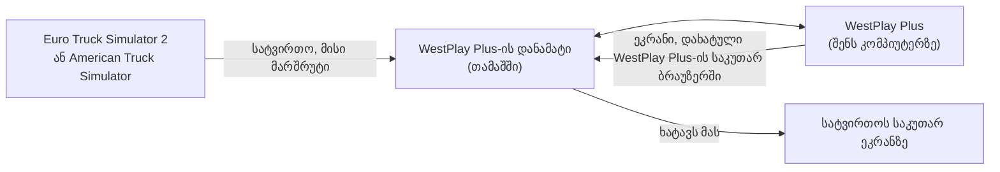

<p align="center"></p>

<h1 align="center">WestPlay Plus</h1>

<!-- languages:start -->
<p align="center">
  <a href="../../README.md">English</a> · <a href="README.zh-CN.md">简体中文</a> · <a href="README.zh-TW.md">繁體中文</a> · <a href="README.ja.md">日本語</a> · <a href="README.ko.md">한국어</a> · <a href="README.de.md">Deutsch</a> · <a href="README.fr.md">Français</a> · <a href="README.fr-CA.md">Français (Canada)</a> · <a href="README.es.md">Español</a> · <a href="README.es-419.md">Español (Latinoamérica)</a> · <a href="README.it.md">Italiano</a> · <a href="README.pt-BR.md">Português (Brasil)</a> · <a href="README.pt-PT.md">Português (Portugal)</a> · <a href="README.ru.md">Русский</a> · <a href="README.pl.md">Polski</a> · <a href="README.szl.md">Ślōnsko godka</a> · <a href="README.nl.md">Nederlands</a> · <a href="README.tr.md">Türkçe</a> · <a href="README.uk.md">Українська</a> · <a href="README.cs.md">Čeština</a> · <a href="README.sk.md">Slovenčina</a> · <a href="README.hu.md">Magyar</a> · <a href="README.ro.md">Română</a> · <a href="README.bg.md">Български</a> · <a href="README.hr.md">Hrvatski</a> · <a href="README.sr-Latn.md">Srpski (latinica)</a> · <a href="README.sr-Cyrl.md">Српски (ћирилица)</a> · <a href="README.sl.md">Slovenščina</a> · <a href="README.mk.md">Македонски</a> · <a href="README.el.md">Ελληνικά</a> · <a href="README.sv.md">Svenska</a> · <a href="README.da.md">Dansk</a> · <a href="README.no.md">Norsk</a> · <a href="README.fi.md">Suomi</a> · <a href="README.et.md">Eesti</a> · <a href="README.lt.md">Lietuvių</a> · <a href="README.lv.md">Latviešu</a> · <a href="README.ca.md">Català</a> · <a href="README.gl.md">Galego</a> · <a href="README.eu.md">Euskara</a> · <b>ქართული</b> · <a href="README.vi.md">Tiếng Việt</a>
</p>
<!-- languages:end -->

<p align="center">
  <b>CarPlay-ის სტილის ეკრანი Euro Truck Simulator 2-ისა და American Truck Simulator-ის სატვირთო მანქანებისთვის.</b><br>
  შენი რუკა, შენი მუსიკა და YouTube — შენივე სატვირთოს სამართავ პანელზე.
  <br>
  <a href="https://github.com/enes-less/WestPlay">WestPlay</a>-ის შეცვლილი შტო, ჩინურენოვანი მოთამაშეებისთვის.
</p>

<p align="center">
  <a href="https://github.com/HandsomeTurtle0307/WestPlay-Plus/releases/latest"></a>
  
  
  
  <a href="../../LICENSE"></a>
</p>

WestPlay Plus ტელეფონის სტილის ეკრანს ამაგრებს შენი სატვირთოს სამართავ პანელზე, თამაშის შიგნით: Euro Truck Simulator 2 ან American Truck Simulator, ერთი ეკრანი ორივესთვის. შენი მარშრუტი შენივე თამაშიდან დახატულ რუკაზე, შენი მუსიკა, YouTube, ამინდი გზაში: ზუსტად იქ, სადაც ნამდვილ სატვირთოს აქვს თავისი ეკრანი, მართული მაუსით, ღილაკის დაჭერისას.

## ფუნქციები

**რუკები შენივე თამაშიდან.** დახატულია შენი თამაშის რუკიდან, რუკის მოდების ჩათვლით (ProMods და სხვები), შენი მარშრუტით, ეტაპობრივი მითითებებით და ძებნით, რომელიც გაჩერებებს თავად თამაშის GPS-ში ამატებს.

**სამართავი პანელი გზისთვის.** რუკა იმის გვერდით, რაც უკრავს, და იმის გვერდით, საითაც მიდიხარ, ამინდი მარშრუტზე, ყველაფერი ერთ ეკრანზე.

**შენი მუსიკა.** Apple Music, Spotify და YouTube Music, Now Playing-ითა და ტექსტებით. სიმღერის კლიპი პირდაპირ Now Playing-ში ირთვება, ხოლო YouTube-ს აქვს თავისი არხები, დასაკრავი სიები, სუბტიტრები და ხარისხები. დამკვრელი უკრავს იმ სიმღერებს, რომლებსაც თამაშის მუსიკის საქაღალდეში დებ.

**ნათელი და მუქი, და შენი გარეგნობა.** ღამით ან ფარების ჩართვისას ბნელდება, მანქანის სინათლის სენსორივით. საკუთარი ფონები და ხატულები შენ თვითონ მოიტანე.

**თანმხლები პროგრამა** შენს კომპიუტერზე ყველაფერს ამზადებს: პოულობს შენს თამაშებს (ETS2, ATS ან ორივეს), აყენებს WestPlay Plus-ს თითოეულში, აშენებს მათ რუკებს და შემდეგ აღარ ერევა.

## როგორ მუშაობს



WestPlay Plus თავის ეკრანს საკუთარ ბრაუზერში ხატავს შენს კომპიუტერზე, ხოლო მისი დანამატი ყოველ კადრს შენი სატვირთოს ეკრანზე დებს, თამაშის შიგნით. თავად სატვირთოების ეკრანები და მათი ინფორმაციის ზოლები მათი რჩება: WestPlay Plus იკავებს GPS-ის ადგილს, ხოლო პარამეტრი „Vehicle Bar“ განსაზღვრავს, დარჩება თუ არა სატვირთოს ზოლი მის გვერდით.

## სატვირთო მანქანები

WestPlay Plus ორი გზით ჩანს: სატვირთოს საკუთარ ეკრანზე ან WestPlay Plus-ის პლანშეტზე.

**სატვირთოს საკუთარ ეკრანზე.** იმ სატვირთოებში, რომლებსაც რეალურადაც აქვთ CarPlay, WestPlay Plus იკავებს GPS-ის ადგილს სამართავ პანელის ეკრანზე და მის ფორმას ერგება. არაფერია საყიდი ან დასამაგრებელი: ჩაჯდები და ის უკვე იქ არის. Euro Truck Simulator 2-ში:

- **DAF** XF და XG/XG+ 2021, XF Electric და XD (და Jasper-ის DAF 2021)
- **Scania** S და R, 7" ეკრანით ან Smart Dash-ით, და S BEV
- **Iveco** S-Way
- **Renault** T (2024)
- **Volvo** FH (2021 და 2024)
- **Coaches DLC:** Scania Touring და MAN Lion's Coach (2024)
- **Oyuncuyusbis-ის ავტობუსები:** Mercedes-Benz Travego 16 SHD, MAN Lion's Coach და Setra S 531 DT საკუთარ სამართავ პანელებზე
- **Setra S 516 HD/2** (Oyuncuyusbis-ის): ავტობუსის საკუთარ GPS ეკრანზე, მის „Gps“ ნაწილში, რომელსაც სატვირთოების დილერთან ამაგრებ: ავტობუსის საკუთარი ეკრანი, როგორც მისი მოთამაშეები ითხოვდნენ, მაგრამ ის, რომელსაც შენ თვითონ ამატებ

**WestPlay Plus-ის პლანშეტზე.** ყველა სხვა სატვირთო, თამაშისაც და მოდებისაც, WestPlay Plus-ს იღებს პლანშეტზე, რომელსაც სატვირთოების დილერთან ამაგრებ: აქსესუარებში, ჩამოკიდებულ ნივთებს შორის ან სამართავი პანელის ნაკრებად. სატვირთოს საკუთარი ეკრანი თამაშის ნავიგაციას ინარჩუნებს. პლანშეტია ყოველ სატვირთოში, რომელსაც ჩამოკიდებული ნივთები აქვს, მოგვიანებით დაყენებულ სატვირთოს მოდებშიც (მას თამაშის შემდეგ გაშვებაზე მიიღებენ).

**American Truck Simulator-ში** ჯერჯერობით WestPlay Plus პლანშეტზეა ყველა სატვირთოში. სატვირთოები, რომელთა რეალურ ანალოგებსაც CarPlay აქვთ, WestPlay Plus-ს საკუთარ ეკრანზე მოგვიანებით მიიღებენ.

|                        | სატვირთოს საკუთარი ეკრანი | WestPlay Plus-ის პლანშეტი |
| ---------------------- | ------------------------- | -------------------------- |
| სატვირთოები            | ზემოთ ჩამოთვლილი ETS2 სატვირთოები | ყველა სხვა, და ჯერჯერობით ყველა ATS სატვირთო |
| როგორ მიიღებ           | არაფერი: უკვე იქ არის    | დილერთან უნდა დაამაგრო     |
| თამაშის ნავიგაცია      | WestPlay Plus ცვლის მას   | რჩება სატვირთოს ეკრანზე    |

### ხმა

ამ Euro Truck Simulator 2-ის სატვირთოებში მუსიკა სატვირთოს საკუთარი დინამიკებიდან მოდის, თითოეული თავის ადგილზე კაბინაში. სხვა სატვირთოები, და ჯერჯერობით American Truck Simulator-ის, ჩვეულებრივ სტერეოში უკრავს.

- **Scania S და R (2016), S BEV** — კარების ვუფერები, A-სვეტის ტვიტერები, ჭერის ბასი
- **Scania R (2009), Streamline** — კარების ვუფერები, A-სვეტის ტვიტერები
- **DAF XF (105)** — A-სვეტის ტვიტერები; ორი წყვილი ჭერის თაროზე Super Space Cab-ში, ერთი ჭერის ერთეული დანარჩენებში
- **DAF XF Euro 6** — კარების ვუფერები, A-სვეტის ტვიტერები; ორი წყვილი ჭერის თაროზე Super Space Cab-ში, ერთი ჭერის ერთეული დანარჩენებში
- **DAF XF, XG, XG+ (2021), XF Electric და XD** — კარების ვუფერები, A-სვეტის ტვიტერები, ერთი წყვილი ზემოთ, ერთი ცენტრალური ერთეული
- **MAN TGX** — კარების ვუფერები; XXL-ში დამატებით ორი პატარა ერთეული მაღლა თითოეულ გვერდითა კედელში
- **MAN TGX Euro 6** — კარების ვუფერები; XL-ში დამატებით პატარა ერთეული ჭერის თითოეულ კუთხეში
- **MAN TGX (2020)** — ვუფერი და საშუალო დინამიკი თითოეულ კარში, A-სვეტის ტვიტერები
- **Mercedes-Benz Actros (2014)** — კარების ვუფერები, ერთი წყვილი ზემოთ, A-სვეტის ტვიტერები
- **Mercedes-Benz Actros (2009)** — კარების ვუფერები, ერთი წყვილი ჭერის თაროს წინა კუთხეებში
- **Volvo FH (2021, 2024), FH16 (2012)** — კარების ვუფერები, ბასი უკანა კედელში
- **Volvo FH16 (2009)** — თითო ერთეული თითოეულ კარში
- **Iveco Stralis** — თითო ერთეული ჭერის კონსოლის ორივე ბოლოში, ხოლო მაღალ ჭერებში პატარა მგზავრის მხარეს
- **Iveco Hi-Way** — თითო ერთეული ჭერის კონსოლის ორივე ბოლოში და თითო მაღლა თითოეულ მხარეს
- **Iveco S-Way** — ვუფერი და ტვიტერი თითოეულ კარში
- **Renault Magnum** — თითო ერთეული ჭერის თითოეულ კუთხეში, ტვიტერები ჭერის კონსოლზე
- **Renault Premium** — თითო ერთეული ჭერის თითოეულ მხარეს, დაბალ ჭერში უფრო დაბლა
- **Renault T** — A-სვეტის ტვიტერები, ერთი წყვილი უკანა კედელში; კარების ვუფერები 2024 წლის ინტერიერებში
- **Renault E-Tech T** — კარების ვუფერები, A-სვეტის ტვიტერები, ერთი წყვილი უკანა კედელში
- **JuseeTV-ის Scania PGR** — დამაგრებული ნაწილების დინამიკები: კარები, A-სვეტები, ზედა კონსოლი, უკანა კედელი

## ინსტალაცია

1. ჩამოტვირთე ინსტალატორი [უახლესი ვერსიიდან](https://github.com/HandsomeTurtle0307/WestPlay-Plus/releases/latest) და გაუშვი.
2. იხსნება თანმხლები პროგრამა და დანარჩენში გიძღვება: პოულობს შენს თამაშებს (ETS2, ATS ან ორივეს), აყენებს თითოეულში WestPlay Plus-ის დანამატს და მისი ეკრანის მოდს, და აშენებს შენს რუკებს.
3. გაუშვი თამაში და ჩაჯექი სატვირთოში.

**განახლებები:** ეს შტო თავისით არ ახლდება. არის თუ არა უფრო ახალი ვერსია, ნახე [გამოშვებების გვერდზე](https://github.com/HandsomeTurtle0307/WestPlay-Plus/releases). იგივე ბმულია თანმხლები პროგრამის „შესახებ“ გვერდზეც.

**მოთხოვნები:** Windows 10 ან 11 (64 ბიტი), Euro Truck Simulator 2-ის 1.62 ვერსია (ან 1.61) ან American Truck Simulator-ის 1.62 ვერსია (სხვა ვერსიებიც შეიძლება მუშაობდეს; თუ რომელიმე არ არის გატესტილი, თანმხლები პროგრამა გეტყვის) და Microsoft Edge WebView2 (Windows 11-ის ნაწილი; ინსტალატორი ამატებს იქ, სადაც აკლია).

## კონფიდენციალურობა

WestPlay Plus-ს არ აქვს სერვერები, საკუთარი ანგარიშები და ანალიტიკა. ის შენზე არაფერს აგროვებს და არ აგზავნის.

- Apple Music-ში, Spotify-ში და YouTube-ში შედიხარ მათივე გვერდებზე, WestPlay Plus-ის საკუთარ ბრაუზერის პროფილში შენს კომპიუტერზე, როგორც ბრაუზერში. თავად WestPlay Plus ანგარიშის მონაცემებს არ ინახავს.
- შენი რუკა შენს კომპიუტერზე შენი თამაშიდან იგება და იქვე რჩება.
- WestPlay Plus ესაუბრება იმ სერვისებს, რომლებსაც იყენებ, ხოლო GitHub-ს მხოლოდ მაშინ, როცა მის გამოშვებების გვერდს ხსნი.

## გამოხმაურება

შეცდომები, კითხვები და იდეები: გახსენი issue [GitHub](https://github.com/HandsomeTurtle0307/WestPlay-Plus/issues)-ზე.

## აწყობა კოდიდან

დაგჭირდება [Rust](https://rustup.rs) (stable) და [Node.js](https://nodejs.org) 24, Windows-ზე.

```sh
npm install      # თანმხლები პროგრამის ხელსაწყოები და ინტერფეისის პაკეტები
npm run dev      # WestPlay Plus, ინტერფეისი ცოცხლად მიეწოდება
```

`cargo test --workspace` და `npm test --prefix ui` ტესტებს უშვებს. თამაშის დანამატი `cargo build --release -p westplay-plugin`-ით იწყობა.

## ლიცენზია

WestPlay Plus თავისუფალი პროგრამული უზრუნველყოფაა: შეგიძლია გაავრცელო და შეცვალო GNU General Public License-ის მე-3 ვერსიის (ან შენ მიერ არჩეული ნებისმიერი გვიანდელი ვერსიის) პირობებით. იხილე [LICENSE](../../LICENSE).

Copyright © 2026 HandsomeTurtle0307. WestPlay Plus-თან მოწოდებული ბიბლიოთეკები ინარჩუნებენ საკუთარ ლიცენზიებს: იხილე [THIRD_PARTY_LICENSES.md](../../THIRD_PARTY_LICENSES.md) და [THIRD_PARTY_NOTICES.md](../../THIRD_PARTY_NOTICES.md) იმ ნაწარმოებების შესახებ, რომლებსაც ის მიჰყვება.

## საიდან მოდის ეს პროექტი

WestPlay Plus არის [WestPlay](https://github.com/enes-less/WestPlay)-ის შეცვლილი შტო (fork) — ჩინებული CarPlay-ის სტილის ეკრანის მოდი Euro Truck Simulator 2-სა და American Truck Simulator-ისთვის, რომელიც შექმნა **enes-less**-მა. თითქმის მთელი საწყისი დიზაინი, კოდი და რესურსები მისი ნამუშევარია; ეს შტო თავის ცვლილებებს ზემოდან ინახავს და მადლიერია იმისთვის, რაც მან ააშენა. თუ პროექტი მოგწონს, გადახედე ორიგინალსაც.

მხარი დაუჭირე ორიგინალ პროექტსაც (და თუ შეგიძლია, მეც დამიჭირე მხარი 😭😭😭 — პროგრამის შექმნა ადვილი არ არის~).

<!-- translated:start -->
<sub>ეს README ინგლისური ვერსიიდან თარგმნილია. ავტორს, რა თქმა უნდა, 43-ვე ენა არ იცის 😭😭, ამიტომ თარგმანი ადგილ-ადგილ შეიძლება არასრული იყოს. ბოდიშს გიხდით~ თუ თქვენს ენაზე შეცდომას შეამჩნევთ, მაცნობეთ, ძალიან მადლიერი ვიქნები~</sub>
<!-- translated:end -->

<sub>WestPlay Plus დამოუკიდებელი პროექტია, არ არის დაკავშირებული Apple-თან, SCS Software-თან, Spotify-სთან, Google-თან ან სატვირთო მანქანების მწარმოებლებთან და მათგან არ არის დამტკიცებული. CarPlay, Apple Music, Spotify, YouTube, YouTube Music, ასევე მწარმოებლების სახელები და ლოგოები მათი მფლობელების სავაჭრო ნიშნებია და აქ მხოლოდ იმის აღსანიშნავად გამოიყენება, რასთან ერთადაც WestPlay Plus მუშაობს.</sub>
