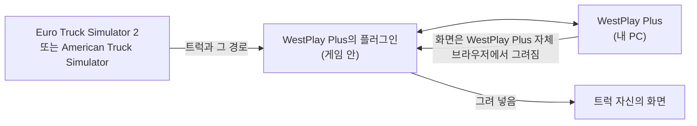

<p align="center"></p>

<h1 align="center">WestPlay Plus</h1>

<!-- languages:start -->
<p align="center">
  <a href="../../README.md">English</a> · <a href="README.zh-CN.md">简体中文</a> · <a href="README.zh-TW.md">繁體中文</a> · <a href="README.ja.md">日本語</a> · <b>한국어</b> · <a href="README.de.md">Deutsch</a> · <a href="README.fr.md">Français</a> · <a href="README.fr-CA.md">Français (Canada)</a> · <a href="README.es.md">Español</a> · <a href="README.es-419.md">Español (Latinoamérica)</a> · <a href="README.it.md">Italiano</a> · <a href="README.pt-BR.md">Português (Brasil)</a> · <a href="README.pt-PT.md">Português (Portugal)</a> · <a href="README.ru.md">Русский</a> · <a href="README.pl.md">Polski</a> · <a href="README.nl.md">Nederlands</a> · <a href="README.tr.md">Türkçe</a> · <a href="README.uk.md">Українська</a> · <a href="README.cs.md">Čeština</a> · <a href="README.sk.md">Slovenčina</a> · <a href="README.hu.md">Magyar</a> · <a href="README.ro.md">Română</a> · <a href="README.bg.md">Български</a> · <a href="README.hr.md">Hrvatski</a> · <a href="README.sr-Latn.md">Srpski (latinica)</a> · <a href="README.sr-Cyrl.md">Српски (ћирилица)</a> · <a href="README.sl.md">Slovenščina</a> · <a href="README.mk.md">Македонски</a> · <a href="README.el.md">Ελληνικά</a> · <a href="README.sv.md">Svenska</a> · <a href="README.da.md">Dansk</a> · <a href="README.no.md">Norsk</a> · <a href="README.fi.md">Suomi</a> · <a href="README.et.md">Eesti</a> · <a href="README.lt.md">Lietuvių</a> · <a href="README.lv.md">Latviešu</a> · <a href="README.ca.md">Català</a> · <a href="README.gl.md">Galego</a> · <a href="README.vi.md">Tiếng Việt</a>
</p>
<!-- languages:end -->

<!-- english-only:start -->
<p align="center"><sub>실레시아어, 바스크어, 조지아어는 앱에서 지원하지만 README는 아직 없습니다. 이 세 언어는 번역을 검토해 줄 사람이 없기 때문입니다. 전체 내용은 저장소 최상단의 영어판에 있습니다.</sub></p>
<!-- english-only:end -->

<p align="center">
  <b>Euro Truck Simulator 2와 American Truck Simulator의 트럭을 위한 CarPlay 스타일 화면.</b><br>
  지도도, 음악도, YouTube도 트럭 자신의 대시보드 화면 위에.
  <br>
  <a href="https://github.com/enes-less/WestPlay">WestPlay</a>의 수정 브랜치로, 몇 가지 최적화와 새 기능을 더했습니다.
</p>

<p align="center">
  <a href="https://github.com/HandsomeTurtle0307/WestPlay-Plus/releases/latest"></a>
  
  
  
  <a href="../../LICENSE"></a>
</p>

WestPlay Plus는 게임 속 트럭의 대시보드 화면에 휴대폰 스타일의 카 스크린을 띄웁니다. Euro Truck Simulator 2든 American Truck Simulator든 화면 하나로 둘 다 됩니다. 내 게임에서 그려 낸 지도 위의 경로, 내 음악, YouTube, 주행 중의 날씨까지 — 진짜 트럭에 화면이 있는 바로 그 자리에. 키를 누른 채 마우스로 조작합니다.

<!-- why:start -->

## 왜 이걸 만들었냐면

처음엔 CarPlay 모드를 찾다가 WestPlay를 발견했는데, 정말 잘 만들어져 있었어요(진짜, 아주아주 잘). 다만 최적화가 아쉬워서 컴퓨터가 뻗어버렸고, 그래서 제가 직접 다듬기로 했습니다. 성능을 손보고 새 기능도 좀 붙이고요(거인의 어깨에 올라탄 셈이죠, 히히~😊).

<!-- easter-egg:start -->
> 사실 이유가 하나 더 있어요. 예전에 제가 많이 흥분했을 때, 다른 사람들에게 영향을 준 일을 했어요(많이요). 특히 정말 상처 주고 싶지 않았던 사람에게요. 지금 생각하면 미안하고 너무 힘들고, 앞날도 막막해요(공부도, 계획도). 그래서 제가 통제할 수 있는 유일한 것, 그러니까 프로그래밍에 매달려서 다른 쪽의 아픔을 잠시 덮고 있는 거예요. 하🥲 앞으로 어떻게 해야 할지는 저도 모르겠어요. 그냥 한 걸음씩 가려고요 :)‍💨
<!-- easter-egg:end -->

<!-- why:end -->

## 기능

**지도는 내 게임에서.** 게임 본연의 지도에서 그려 내며 맵 모드(ProMods 등)도 지원합니다. 경로, 회전 지점 안내, 그리고 경유지를 게임 자체 GPS에 추가하는 검색까지.

**주행을 위한 대시보드.** 지도 옆에 지금 재생 중인 것과 가려는 곳, 주행 중의 날씨를 한 화면에.

**내 음악.** Apple Music, Spotify, YouTube Music을 지원하며 Now Playing과 가사가 있습니다. 곡의 뮤직비디오는 Now Playing 안에서 바로 재생되고, YouTube는 채널, 재생목록, 자막, 화질을 지원합니다. 플레이어는 게임의 음악 폴더에 넣은 곡을 재생합니다.

**라이트와 다크, 그리고 나만의 모습.** 밤이 되거나 헤드라이트를 켜면 자동차의 조도 센서처럼 어두워집니다. 배경화면과 앱 아이콘은 직접 가져다 쓸 수 있습니다.

**PC의 컴패니언 앱**이 모든 것을 준비합니다. 게임(ETS2, ATS 또는 둘 다)을 찾아 각각에 WestPlay Plus를 설치하고, 지도를 만들고, 그 뒤로는 조용히 물러납니다.

## 작동 방식



WestPlay Plus는 PC의 전용 브라우저에서 화면을 그리고, 플러그인이 그 프레임을 게임 속 트럭의 화면에 올립니다. 트럭 자신의 화면과 정보 바는 그대로 트럭의 것입니다. WestPlay Plus가 GPS 자리를 대신하며, 'Vehicle Bar' 설정이 트럭의 바를 옆에 남길지 정합니다.

## 트럭

WestPlay Plus는 두 가지로 나타납니다. 트럭 자신의 화면에, 또는 WestPlay Plus 태블릿에.

**트럭 자신의 화면에.** 실제로도 CarPlay가 있는 트럭에서는 WestPlay Plus가 대시보드 화면의 GPS 자리를 대신하며 그 모양에 맞춰집니다. 살 것도, 달 것도 없습니다. 타면 거기 있습니다. Euro Truck Simulator 2 기준:

- **DAF** XF와 XG/XG+ 2021, XF Electric, XD (그리고 Jasper의 DAF 2021)
- **Scania** S와 R (7인치 화면 또는 Smart Dash), S BEV
- **Iveco** S-Way
- **Renault** T (2024)
- **Volvo** FH (2021과 2024)
- **Coaches DLC:** Scania Touring과 MAN Lion's Coach (2024)
- **Oyuncuyusbis의 코치:** Mercedes-Benz Travego 16 SHD, MAN Lion's Coach, Setra S 531 DT를 각 차량 자신의 대시보드 화면에
- **Setra S 516 HD/2** (Oyuncuyusbis): 코치 자신의 GPS 화면, 즉 'Gps' 파트에 표시되며 트럭 상점에서 장착해야 합니다. 플레이어들의 요청대로 코치 자신의 화면을 쓰지만, 추가하는 것은 직접 해야 합니다

**WestPlay Plus 태블릿에.** 그 밖의 모든 트럭(게임 기본이든 모드든)은 트럭 상점에서 장착하는 태블릿에 WestPlay Plus가 나옵니다. 액세서리 안의 매달린 물건으로, 또는 대시보드 세트로. 트럭 자신의 화면은 게임 내비게이션을 그대로 유지합니다. 태블릿은 매달린 물건이 있는 모든 트럭에 들어가며, 나중에 설치한 트럭 모드에도 들어갑니다(다음 게임 실행 시 적용).

**American Truck Simulator에서는** 지금은 모든 트럭에서 태블릿으로 표시됩니다. 실제 대응 차종이 CarPlay를 갖춘 트럭은 나중에 자신의 화면에 나오게 됩니다.

|                    | 트럭 자신의 화면     | WestPlay Plus 태블릿 |
| ------------------ | -------------------- | -------------------- |
| 트럭               | 위의 ETS2 트럭들     | 그 밖의 모든 트럭, 그리고 지금은 모든 ATS 트럭 |
| 얻는 방법          | 아무것도 필요 없음   | 트럭 상점에서 장착 |
| 게임 내비게이션    | WestPlay Plus가 대체 | 트럭 화면에 그대로 남음 |

### 사운드

다음 Euro Truck Simulator 2 트럭에서는 음악이 트럭 자체의 스피커에서, 캐빈 안 각자의 위치에서 재생됩니다. 그 밖의 트럭과 지금의 American Truck Simulator 트럭은 일반 스테레오로 재생됩니다.

- **Scania S / R (2016), S BEV** — 도어 우퍼, A필러 트위터, 루프 베이스
- **Scania R (2009), Streamline** — 도어 우퍼, A필러 트위터
- **DAF XF (105)** — A필러 트위터. Super Space Cab은 루프 선반에 2쌍, 나머지는 루프 유닛 1개
- **DAF XF Euro 6** — 도어 우퍼, A필러 트위터. Super Space Cab은 루프 선반에 2쌍, 나머지는 루프 유닛 1개
- **DAF XF / XG / XG+ (2021), XF Electric, XD** — 도어 우퍼, A필러 트위터, 머리 위 1쌍, 센터 유닛 1개
- **MAN TGX** — 도어 우퍼. XXL은 양쪽 측벽 높은 곳에 작은 유닛이 2개씩 더
- **MAN TGX Euro 6** — 도어 우퍼. XL은 루프 모서리마다 작은 유닛 1개씩 더
- **MAN TGX (2020)** — 도어마다 우퍼와 미드레인지, A필러 트위터
- **Mercedes-Benz Actros (2014)** — 도어 우퍼, 머리 위 1쌍, A필러 트위터
- **Mercedes-Benz Actros (2009)** — 도어 우퍼, 루프 선반 앞쪽 모서리에 1쌍
- **Volvo FH (2021, 2024), FH16 (2012)** — 도어 우퍼, 뒷벽 베이스
- **Volvo FH16 (2009)** — 도어마다 유닛 1개
- **Iveco Stralis** — 루프 콘솔 양 끝에 1개씩, 하이 루프는 조수석 쪽에 작은 것 1개
- **Iveco Hi-Way** — 루프 콘솔 양 끝에 1개씩, 양쪽 높은 곳에 1개씩
- **Iveco S-Way** — 도어마다 우퍼와 트위터
- **Renault Magnum** — 루프 모서리마다 1개, 루프 콘솔에 트위터
- **Renault Premium** — 루프 양쪽에 1개씩, 로우 루프에서는 더 낮게
- **Renault T** — A필러 트위터, 뒷벽에 1쌍. 2024 인테리어는 도어 우퍼 포함
- **Renault E-Tech T** — 도어 우퍼, A필러 트위터, 뒷벽에 1쌍
- **JuseeTV의 Scania PGR** — 장착한 파트의 스피커: 도어, A필러, 상단 콘솔, 뒷벽

## 설치

1. [최신 릴리스](https://github.com/HandsomeTurtle0307/WestPlay-Plus/releases/latest)에서 설치 파일을 내려받아 실행합니다.
2. 컴패니언 앱이 열리고 나머지를 안내합니다. 게임(ETS2, ATS 또는 둘 다)을 찾아 각각에 WestPlay Plus의 플러그인과 화면 모드를 설치하고, 지도를 만듭니다.
3. 게임을 실행하고 트럭에 올라탑니다.

**업데이트:** 이 브랜치는 자동으로 업데이트되지 않습니다. 새 버전이 있는지 확인하려면 [릴리스 페이지](https://github.com/HandsomeTurtle0307/WestPlay-Plus/releases)를 방문하세요. 컴패니언 앱의 'About' 페이지에도 같은 링크가 있습니다.

**요구 사항:** Windows 10 또는 11(64비트), Euro Truck Simulator 2 버전 1.62(또는 1.61) 또는 American Truck Simulator 버전 1.62(다른 버전도 될 수 있으며, 검증되지 않은 버전이면 컴패니언 앱이 알려 줍니다), 그리고 Microsoft Edge WebView2(Windows 11에 포함. 없는 경우 설치 파일이 추가합니다).

## 개인정보

WestPlay Plus에는 서버도, 자체 계정도, 분석 도구도 없습니다. 당신에 대한 어떤 정보도 수집하거나 전송하지 않습니다.

- Apple Music, Spotify, YouTube 로그인은 각자의 페이지에서, PC의 WestPlay Plus 전용 브라우저 프로필로 브라우저에서 하듯이 진행합니다. WestPlay Plus 자체는 계정 데이터를 저장하지 않습니다.
- 지도는 PC에서 게임으로부터 만들어지고 그곳에 머뭅니다.
- WestPlay Plus는 사용하는 서비스와, 릴리스 페이지를 열 때만 GitHub와 통신합니다.

## 피드백

버그, 질문, 아이디어는 [GitHub](https://github.com/HandsomeTurtle0307/WestPlay-Plus/issues)에 이슈를 남겨 주세요.

## 소스에서 빌드하기

Windows에서 [Rust](https://rustup.rs)(stable)와 [Node.js](https://nodejs.org) 24가 필요합니다.

```sh
npm install      # 컴패니언 앱의 도구와 UI 패키지
npm run dev      # WestPlay Plus 실행 (UI는 실시간 제공)
```

`cargo test --workspace`와 `npm test --prefix ui`로 테스트를 실행합니다. 게임 플러그인은 `cargo build --release -p westplay-plugin`으로 빌드합니다.

## 라이선스

WestPlay Plus는 자유 소프트웨어입니다. GNU General Public License 버전 3(또는 그 이후의 원하는 버전)의 조건에 따라 재배포하고 수정할 수 있습니다. [LICENSE](../../LICENSE)를 참고하세요.

Copyright © 2026 HandsomeTurtle0307. WestPlay Plus에 포함된 라이브러리는 각자의 라이선스를 유지합니다. [THIRD_PARTY_LICENSES.md](../../THIRD_PARTY_LICENSES.md)와, 따르고 있는 저작물에 대해서는 [THIRD_PARTY_NOTICES.md](../../THIRD_PARTY_NOTICES.md)를 참고하세요.

## 이 프로젝트의 유래

WestPlay Plus는 [WestPlay](https://github.com/enes-less/WestPlay)의 수정 브랜치(포크)입니다. WestPlay는 **enes-less**가 만든, Euro Truck Simulator 2와 American Truck Simulator를 위한 매우 뛰어난 CarPlay 스타일 화면 모드입니다. 원래의 디자인, 코드, 에셋은 거의 모두 그의 작업입니다. 이 브랜치는 그 위에 자신의 변경을 얹고 있으며, 그가 쌓은 것에 감사하고 있습니다. 이 프로젝트가 마음에 드신다면 원본도 한번 살펴봐 주세요.

원본 프로젝트도 응원해 주세요(가능하다면 저도 응원해 주시면 😭😭😭 — 소프트웨어 개발은 쉽지 않거든요~).

<!-- translated:start -->
<sub>이 README는 영어판을 번역한 것입니다. 작성자가 43개 언어를 다 할 줄 아는 건 당연히 아니어서😭😭 번역이 미흡한 부분이 있을 수 있습니다. 양해 부탁드려요~ 사용하시는 언어에서 잘못된 점을 발견하시면 알려 주세요~</sub>
<!-- translated:end -->

<sub>WestPlay Plus는 독립 프로젝트이며 Apple, SCS Software, Spotify, Google 또는 트럭 제조사와 제휴하거나 그들의 승인을 받지 않았습니다. CarPlay, Apple Music, Spotify, YouTube, YouTube Music 및 각 트럭 제조사의 이름과 로고는 각 소유자의 상표이며, 이 문서에서는 WestPlay Plus가 호환되는 대상을 가리키는 용도로만 사용합니다.</sub>
