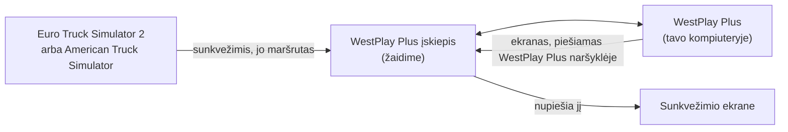

<p align="center"></p>

<h1 align="center">WestPlay Plus</h1>

<!-- languages:start -->
<p align="center">
  <a href="../../README.md">English</a> · <a href="README.zh-CN.md">简体中文</a> · <a href="README.zh-TW.md">繁體中文</a> · <a href="README.ja.md">日本語</a> · <a href="README.ko.md">한국어</a> · <a href="README.de.md">Deutsch</a> · <a href="README.fr.md">Français</a> · <a href="README.fr-CA.md">Français (Canada)</a> · <a href="README.es.md">Español</a> · <a href="README.es-419.md">Español (Latinoamérica)</a> · <a href="README.it.md">Italiano</a> · <a href="README.pt-BR.md">Português (Brasil)</a> · <a href="README.pt-PT.md">Português (Portugal)</a> · <a href="README.ru.md">Русский</a> · <a href="README.pl.md">Polski</a> · <a href="README.szl.md">Ślōnsko godka</a> · <a href="README.nl.md">Nederlands</a> · <a href="README.tr.md">Türkçe</a> · <a href="README.uk.md">Українська</a> · <a href="README.cs.md">Čeština</a> · <a href="README.sk.md">Slovenčina</a> · <a href="README.hu.md">Magyar</a> · <a href="README.ro.md">Română</a> · <a href="README.bg.md">Български</a> · <a href="README.hr.md">Hrvatski</a> · <a href="README.sr-Latn.md">Srpski (latinica)</a> · <a href="README.sr-Cyrl.md">Српски (ћирилица)</a> · <a href="README.sl.md">Slovenščina</a> · <a href="README.mk.md">Македонски</a> · <a href="README.el.md">Ελληνικά</a> · <a href="README.sv.md">Svenska</a> · <a href="README.da.md">Dansk</a> · <a href="README.no.md">Norsk</a> · <a href="README.fi.md">Suomi</a> · <a href="README.et.md">Eesti</a> · <b>Lietuvių</b> · <a href="README.lv.md">Latviešu</a> · <a href="README.ca.md">Català</a> · <a href="README.gl.md">Galego</a> · <a href="README.eu.md">Euskara</a> · <a href="README.ka.md">ქართული</a> · <a href="README.vi.md">Tiếng Việt</a>
</p>
<!-- languages:end -->

<p align="center">
  <b>CarPlay stiliaus ekranas Euro Truck Simulator 2 ir American Truck Simulator sunkvežimiams.</b><br>
  Tavo žemėlapis, tavo muzika ir YouTube – savo sunkvežimio prietaisų skydelyje.
  <br>
  Modifikuota <a href="https://github.com/enes-less/WestPlay">WestPlay</a> šaka, su kai kuriomis optimizacijomis ir naujomis funkcijomis.
</p>

<p align="center">
  <a href="https://github.com/HandsomeTurtle0307/WestPlay-Plus/releases/latest"></a>
  
  
  
  <a href="../../LICENSE"></a>
</p>

WestPlay Plus įdeda telefono stiliaus ekraną į tavo sunkvežimio prietaisų skydelį, pačioje žaidimo viduje: Euro Truck Simulator 2 arba American Truck Simulator, vienas ekranas abiem. Tavo maršrutas žemėlapyje, nubrėžtame iš tavo paties žaidimo, tavo muzika, YouTube, oras tavo kelionėje: būtent ten, kur tikras sunkvežimis turi savo ekraną, valdomas pele laikant nuspaustą klavišą.

<!-- why:start -->

## Kodėl aš tai padariau

Iš pradžių ieškojau CarPlay modifikacijos, kol užtikau WestPlay ir pamačiau, kad jis tikrai labai gerai padarytas (tikrai, labai labai gerai). Tik optimizacija buvo silpna ir užšaldė man kompiuterį. Todėl nusprendžiau pats jį patobulinti: pakoreguoti našumą ir pridėti kelias naujas funkcijas (stoviu ant milžino pečių, hi hi~😊).

<!-- why:end -->

## Funkcijos

**Žemėlapiai iš tavo paties žaidimo.** Brėžiami iš tavo žaidimo žemėlapio, įskaitant žemėlapių modus (ProMods ir kitus), su tavo maršrutu, posūkis po posūkio nurodymais ir paieška, kuri prideda sustojimus į paties žaidimo GPS.

**Prietaisų skydelis kelionei.** Žemėlapis šalia to, kas groja, ir to, kur vyksti, oras kelyje, viskas viename ekrane.

**Tavo muzika.** Apple Music, Spotify ir YouTube Music, su Now Playing ir dainų tekstais. Dainos klipas groja tiesiai Now Playing lange, o YouTube turi savo kanalus, grojaraščius, subtitrus ir kokybes. Grotuvas groja dainas, kurias įdedi į žaidimo muzikos aplanką.

**Šviesi ir tamsi tema, ir tavo išvaizda.** Naktį arba įjungus žibintus patamsėja, kaip automobilio šviesos jutiklis. Savo fonus ir piktogramas gali įsidėti pats.

**Palydovoji programa** tavo kompiuteryje viską paruošia: suranda tavo žaidimus (ETS2, ATS arba abu), įdiegia WestPlay Plus į kiekvieną, sukuria jų žemėlapius ir po to nebetrukdo.

## Kaip tai veikia



WestPlay Plus piešia savo ekraną savo naršyklėje tavo kompiuteryje, o jo įskiepis padeda kiekvieną kadrą ant tavo sunkvežimio ekrano, žaidimo viduje. Pačių sunkvežimių ekranai ir informacinės juostos lieka jų: WestPlay Plus užima GPS vietą, o nuostata „Vehicle Bar“ nusprendžia, ar sunkvežimio juosta lieka šalia.

## Sunkvežimiai

WestPlay Plus pasirodo dviem būdais: pačio sunkvežimio ekrane arba WestPlay Plus planšetėje.

**Pačio sunkvežimio ekrane.** Sunkvežimiuose, kurie iš tikrųjų turi CarPlay, WestPlay Plus užima GPS vietą prietaisų skydelio ekrane ir prisitaiko prie jo formos. Nieko pirkti ar montuoti nereikia: įsėdi ir jis jau ten. Euro Truck Simulator 2:

- **DAF** XF ir XG/XG+ 2021, XF Electric ir XD (bei Jaspero DAF 2021)
- **Scania** S ir R, su 7" ekranu arba Smart Dash, ir S BEV
- **Iveco** S-Way
- **Renault** T (2024)
- **Volvo** FH (2021 ir 2024)
- **Coaches DLC:** Scania Touring ir MAN Lion's Coach (2024)
- **Oyuncuyusbis autobusai:** Mercedes-Benz Travego 16 SHD, MAN Lion's Coach ir Setra S 531 DT savo prietaisų skydeliuose
- **Setra S 516 HD/2** (iš Oyuncuyusbis): autobuso GPS ekrane, jo dalyje „Gps“, kurią sumontuoji pas sunkvežimių pardavėją: paties autobuso ekranas, kaip prašė jo žaidėjai, bet toks, kurį pridedi pats

**WestPlay Plus planšetėje.** Visi kiti sunkvežimiai, tiek žaidimo, tiek modų, gauna WestPlay Plus planšetėje, kurią sumontuoji pas sunkvežimių pardavėją: skiltyje Priedai, tarp kabančių daiktų arba kaip prietaisų skydelio rinkinys. Pačio sunkvežimio ekranas išlaiko žaidimo navigaciją. Planšetė yra kiekviename sunkvežimyje su kabančiais daiktais, taip pat vėliau įdiegtuose sunkvežimių moduose (jie gauna ją kitą kartą paleidus žaidimą).

**American Truck Simulator** žaidime kol kas WestPlay Plus yra planšetėje kiekviename sunkvežimyje. Sunkvežimiai, kurių tikri atitikmenys turi CarPlay, vėliau gaus WestPlay Plus savo ekrane.

|                        | Pačio sunkvežimio ekranas | WestPlay Plus planšetė |
| ---------------------- | ------------------------- | ---------------------- |
| Sunkvežimiai           | Aukščiau išvardyti ETS2 sunkvežimiai | Visi kiti ir kol kas visi ATS sunkvežimiai |
| Kaip gauti             | Nieko: jis jau ten        | Sumontuoti pas pardavėją |
| Žaidimo navigacija     | Pakeičiama WestPlay Plus  | Lieka sunkvežimio ekrane |

### Garsas

Šiuose Euro Truck Simulator 2 sunkvežimiuose muzika skamba iš pačių sunkvežimio garsiakalbių, kiekvienas savo vietoje kabinoje. Kiti sunkvežimiai, ir kol kas American Truck Simulator sunkvežimiai, groja paprastu stereo.

- **Scania S ir R (2016), S BEV** — durų žemų dažnių garsiakalbiai, A statramsčio aukštų dažnių garsiakalbiai, stogo bosas
- **Scania R (2009), Streamline** — durų žemų dažnių garsiakalbiai, A statramsčio aukštų dažnių garsiakalbiai
- **DAF XF (105)** — A statramsčio aukštų dažnių garsiakalbiai; dvi poros stogo lentynoje Super Space Cab, vienas stogo blokas kituose
- **DAF XF Euro 6** — durų žemų dažnių garsiakalbiai, A statramsčio aukštų dažnių garsiakalbiai; dvi poros stogo lentynoje Super Space Cab, vienas stogo blokas kituose
- **DAF XF, XG, XG+ (2021), XF Electric ir XD** — durų žemų dažnių garsiakalbiai, A statramsčio aukštų dažnių garsiakalbiai, pora viršuje, centrinis blokas
- **MAN TGX** — durų žemų dažnių garsiakalbiai; XXL dar po du mažus blokus aukštai kiekvienoje šoninėje sienoje
- **MAN TGX Euro 6** — durų žemų dažnių garsiakalbiai; XL dar po mažą bloką kiekviename stogo kampe
- **MAN TGX (2020)** — žemų ir vidutinių dažnių garsiakalbiai kiekvienose duryse, A statramsčio aukštų dažnių garsiakalbiai
- **Mercedes-Benz Actros (2014)** — durų žemų dažnių garsiakalbiai, pora viršuje, A statramsčio aukštų dažnių garsiakalbiai
- **Mercedes-Benz Actros (2009)** — durų žemų dažnių garsiakalbiai, pora priekiniuose stogo lentynos kampuose
- **Volvo FH (2021, 2024), FH16 (2012)** — durų žemų dažnių garsiakalbiai, bosas galinėje sienoje
- **Volvo FH16 (2009)** — po vieną bloką kiekvienose duryse
- **Iveco Stralis** — po vieną bloką abiejuose stogo konsolės galuose, o aukštuose stoguose mažas keleivio pusėje
- **Iveco Hi-Way** — po vieną bloką abiejuose stogo konsolės galuose ir po vieną aukštai kiekvienoje pusėje
- **Iveco S-Way** — žemų ir aukštų dažnių garsiakalbiai kiekvienose duryse
- **Renault Magnum** — po vieną bloką kiekviename stogo kampe, aukštų dažnių garsiakalbiai stogo konsolėje
- **Renault Premium** — po vieną bloką kiekvienoje stogo pusėje, žemiau žemame stove
- **Renault T** — A statramsčio aukštų dažnių garsiakalbiai, pora galinėje sienoje; durų žemų dažnių garsiakalbiai 2024 metų salonuose
- **Renault E-Tech T** — durų žemų dažnių garsiakalbiai, A statramsčio aukštų dažnių garsiakalbiai, pora galinėje sienoje
- **JuseeTV Scania PGR** — sumontuotų dalių garsiakalbiai: durelės, A statramsčiai, viršutinė konsolė, galinė siena

## Įdiegimas

1. Atsisiųsk diegimo programą iš [naujausios versijos](https://github.com/HandsomeTurtle0307/WestPlay-Plus/releases/latest) ir paleisk ją.
2. Atsidaro palydovoji programa ir veda tave per likusią dalį: suranda tavo žaidimus (ETS2, ATS arba abu), įdiegia į kiekvieną WestPlay Plus įskiepį ir jo ekrano modą, ir sukuria tavo žemėlapius.
3. Paleisk žaidimą ir įsėsk į sunkvežimį.

**Atnaujinimai:** ši šaka pati neatsinaujina. Ar yra naujesnė versija, patikrink [leidimų puslapyje](https://github.com/HandsomeTurtle0307/WestPlay-Plus/releases). Ta pati nuoroda yra ir palydovosios programos puslapyje „Apie“.

**Reikalavimai:** Windows 10 arba 11 (64 bitų), Euro Truck Simulator 2 1.62 versija (arba 1.61) arba American Truck Simulator 1.62 versija (kitos versijos gali veikti; jei kuri nepateikta, palydovoji programa tai pasakys) ir Microsoft Edge WebView2 (Windows 11 dalis; diegimo programa jį prideda, kur jo trūksta).

## Privatumas

WestPlay Plus neturi serverių, savo paskyrų ir analitikos. Jis nerenka ir nesiunčia nieko apie tave.

- Į Apple Music, Spotify ir YouTube jungiesi jų pačių puslapiuose, savo WestPlay Plus naršyklės profilyje kompiuteryje, kaip naršyklėje. Pats WestPlay Plus nesaugo jokių paskyros duomenų.
- Tavo žemėlapis kuriamas tavo kompiuteryje iš tavo žaidimo ir ten lieka.
- WestPlay Plus bendrauja su paslaugomis, kuriomis naudojiesi, o su GitHub – tik kai atveri jo leidimų puslapį.

## Atsiliepimai

Klaidos, klausimai ir idėjos: atverk issue [GitHub](https://github.com/HandsomeTurtle0307/WestPlay-Plus/issues) platformoje.

## Kūrimas iš šaltinio kodo

Reikia [Rust](https://rustup.rs) (stable) ir [Node.js](https://nodejs.org) 24, Windows sistemoje.

```sh
npm install      # palydovosios programos įrankiai ir sąsajos paketai
npm run dev      # WestPlay Plus su gyvai teikiama sąsaja
```

`cargo test --workspace` ir `npm test --prefix ui` paleidžia testus. Žaidimo įskiepis sukuriamas su `cargo build --release -p westplay-plugin`.

## Licencija

WestPlay Plus yra laisva programinė įranga: gali ją platinti ir keisti pagal GNU General Public License 3 versijos (arba, jei pasirinksi, bet kurios vėlesnės versijos) sąlygas. Žr. [LICENSE](../../LICENSE).

Copyright © 2026 HandsomeTurtle0307. Su WestPlay Plus platinamos bibliotekos išlaiko savo licencijas: žr. [THIRD_PARTY_LICENSES.md](../../THIRD_PARTY_LICENSES.md) ir [THIRD_PARTY_NOTICES.md](../../THIRD_PARTY_NOTICES.md) apie kūrinius, kuriais jis seka.

## Iš kur kilo šis projektas

WestPlay Plus yra modifikuota (fork) [WestPlay](https://github.com/enes-less/WestPlay) šaka – puikus CarPlay stiliaus ekrano modas, skirtas Euro Truck Simulator 2 ir American Truck Simulator, kurį sukūrė **enes-less**. Beveik visas originalus dizainas, kodas ir ištekliai yra jo darbas; ši šaka laiko savo pakeitimus ant viršaus ir yra dėkinga už tai, ką jis sukūrė. Jei tau patinka šis projektas, pažiūrėk ir originalą.

Palaikyk ir originalų projektą (o jei gali, palaikyk ir mane 😭😭😭 – kurti programinę įrangą nėra lengva~).

<!-- translated:start -->
<sub>Šis README išverstas iš angliškos versijos. Autorius, žinoma, nekalba visomis 43 kalbomis 😭😭, todėl vertimas kai kur gali būti nepilnas. Atsiprašau~ Jei pastebėsite klaidą savo kalba, praneškite, būsiu labai dėkingas~</sub>
<!-- translated:end -->

<sub>WestPlay Plus yra nepriklausomas projektas, nesusijęs su Apple, SCS Software, Spotify, Google ar sunkvežimių gamintojais ir jų nepatvirtintas. CarPlay, Apple Music, Spotify, YouTube, YouTube Music bei gamintojų pavadinimai ir logotipai yra jų savininkų prekių ženklai ir čia naudojami tik tam, kad įvardytų, su kuo WestPlay Plus veikia.</sub>
