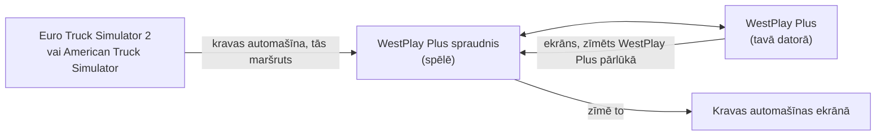

<p align="center"></p>

<h1 align="center">WestPlay Plus</h1>

<!-- languages:start -->
<p align="center">
  <a href="../../README.md">English</a> · <a href="README.zh-CN.md">简体中文</a> · <a href="README.zh-TW.md">繁體中文</a> · <a href="README.ja.md">日本語</a> · <a href="README.ko.md">한국어</a> · <a href="README.de.md">Deutsch</a> · <a href="README.fr.md">Français</a> · <a href="README.fr-CA.md">Français (Canada)</a> · <a href="README.es.md">Español</a> · <a href="README.es-419.md">Español (Latinoamérica)</a> · <a href="README.it.md">Italiano</a> · <a href="README.pt-BR.md">Português (Brasil)</a> · <a href="README.pt-PT.md">Português (Portugal)</a> · <a href="README.ru.md">Русский</a> · <a href="README.pl.md">Polski</a> · <a href="README.szl.md">Ślōnsko godka</a> · <a href="README.nl.md">Nederlands</a> · <a href="README.tr.md">Türkçe</a> · <a href="README.uk.md">Українська</a> · <a href="README.cs.md">Čeština</a> · <a href="README.sk.md">Slovenčina</a> · <a href="README.hu.md">Magyar</a> · <a href="README.ro.md">Română</a> · <a href="README.bg.md">Български</a> · <a href="README.hr.md">Hrvatski</a> · <a href="README.sr-Latn.md">Srpski (latinica)</a> · <a href="README.sr-Cyrl.md">Српски (ћирилица)</a> · <a href="README.sl.md">Slovenščina</a> · <a href="README.mk.md">Македонски</a> · <a href="README.el.md">Ελληνικά</a> · <a href="README.sv.md">Svenska</a> · <a href="README.da.md">Dansk</a> · <a href="README.no.md">Norsk</a> · <a href="README.fi.md">Suomi</a> · <a href="README.et.md">Eesti</a> · <a href="README.lt.md">Lietuvių</a> · <b>Latviešu</b> · <a href="README.ca.md">Català</a> · <a href="README.gl.md">Galego</a> · <a href="README.eu.md">Euskara</a> · <a href="README.ka.md">ქართული</a> · <a href="README.vi.md">Tiếng Việt</a>
</p>
<!-- languages:end -->

<p align="center">
  <b>CarPlay stila ekrāns kravas automašīnām no Euro Truck Simulator 2 un American Truck Simulator.</b><br>
  Tava karte, tava mūzika un YouTube – uz tavas kravas automašīnas armatūras paneļa.
  <br>
  Modificēts <a href="https://github.com/enes-less/WestPlay">WestPlay</a> atzars, spēlētājiem, kas runā ķīniski.
</p>

<p align="center">
  <a href="https://github.com/HandsomeTurtle0307/WestPlay-Plus/releases/latest"></a>
  
  
  
  <a href="../../LICENSE"></a>
</p>

WestPlay Plus liek telefona stila ekrānu uz tavas kravas automašīnas armatūras paneļa, pašā spēlē: Euro Truck Simulator 2 vai American Truck Simulator, viens ekrāns abiem. Tavs maršruts kartē, kas zīmēta no tavas paša spēles, tava mūzika, YouTube, laikapstākļi tavā braucienā: tieši tur, kur īstai kravas automašīnai ir savs ekrāns, vadāms ar peli, turot nospiestu taustiņu.

## Funkcijas

**Kartes no tavas pašas spēles.** Zīmētas no tavas spēles kartes, ieskaitot karšu modus (ProMods un citus), ar tavu maršrutu, norādēm pagrieziens pa pagriezienam un meklēšanu, kas pievieno pieturas pašas spēles GPS.

**Armatūras panelis braucienam.** Karte blakus tam, kas skan, un tam, kurp dodies, laikapstākļi ceļā, viss vienā ekrānā.

**Tava mūzika.** Apple Music, Spotify un YouTube Music, ar Now Playing un dziesmu tekstiem. Dziesmas videoklips atskaņojas tieši Now Playing, un YouTube ir savi kanāli, atskaņošanas saraksti, subtitri un kvalitātes. Atskaņotājs atskaņo dziesmas, ko ievieto spēles mūzikas mapē.

**Gaišs un tumšs, un tavs izskats.** Naktī vai ieslēdzot lukturus tas kļūst tumšs, kā gaismas sensors automašīnā. Savus fona attēlus un ikonas vari pievienot pats.

**Pavadošā lietotne** tavā datorā visu sagatavo: atrod tavas spēles (ETS2, ATS vai abas), instalē WestPlay Plus katrā no tām, izveido to kartes un pēc tam netraucē.

## Kā tas darbojas



WestPlay Plus zīmē savu ekrānu savā pārlūkā tavā datorā, un tā spraudnis liek katru kadru uz tavas kravas automašīnas ekrāna, spēles iekšienē. Pašu kravas automašīnu ekrāni un to informācijas joslas paliek viņu: WestPlay Plus ieņem GPS vietu, un iestatījums „Vehicle Bar“ nosaka, vai kravas automašīnas josla paliek blakus.

## Kravas automašīnas

WestPlay Plus parādās divos veidos: uz pašas kravas automašīnas ekrāna vai uz WestPlay Plus planšetdatora.

**Uz pašas kravas automašīnas ekrāna.** Kravas automašīnās, kurām CarPlay ir arī īstenībā, WestPlay Plus ieņem GPS vietu armatūras paneļa ekrānā un pielāgojas tā formai. Nekas nav jāpērk vai jāuzstāda: iekāp un tas jau ir tur. Euro Truck Simulator 2:

- **DAF** XF un XG/XG+ 2021, XF Electric un XD (un Jaspera DAF 2021)
- **Scania** S un R, ar 7" ekrānu vai ar Smart Dash, un S BEV
- **Iveco** S-Way
- **Renault** T (2024)
- **Volvo** FH (2021 un 2024)
- **Coaches DLC:** Scania Touring un MAN Lion's Coach (2024)
- **Oyuncuyusbis autobusi:** Mercedes-Benz Travego 16 SHD, MAN Lion's Coach un Setra S 531 DT savos armatūras paneļos
- **Setra S 516 HD/2** (no Oyuncuyusbis): uz autobusa paša GPS ekrāna, tā daļā „Gps“, kas jāuzstāda pie kravas auto tirgotāja: paša autobusa ekrāns, kā lūdza tā spēlētāji, bet tāds, ko pievieno pats

**Uz WestPlay Plus planšetdatora.** Visas pārējās kravas automašīnas, gan no spēles, gan no modiem, saņem WestPlay Plus uz planšetdatora, ko uzstāda pie kravas auto tirgotāja: sadaļā Piederumi, starp piekaramajiem priekšmetiem vai kā armatūras paneļa komplektu. Pašas kravas automašīnas ekrāns saglabā spēles navigāciju. Planšetdators ir katrā kravas automašīnā ar piekaramajiem priekšmetiem, arī vēlāk instalētos kravas automašīnu modos (tie to saņem nākamajā spēles palaišanā).

**American Truck Simulator** pagaidām WestPlay Plus ir uz planšetdatora katrā kravas automašīnā. Kravas automašīnas, kuru īstajiem analogiem ir CarPlay, vēlāk saņems WestPlay Plus savā ekrānā.

|                        | Pašas kravas automašīnas ekrāns | WestPlay Plus planšetdators |
| ---------------------- | ------------------------------- | --------------------------- |
| Kravas automašīnas     | Iepriekš minētās ETS2 kravas automašīnas | Visas pārējās, un pagaidām visas ATS kravas automašīnas |
| Kā iegūt               | Nekas: tas jau ir tur           | Uzstādīt pie tirgotāja      |
| Spēles navigācija      | Aizstāj WestPlay Plus           | Paliek uz kravas automašīnas ekrāna |

### Skaņa

Šajās Euro Truck Simulator 2 kravas automašīnās mūzika skan no pašas kravas automašīnas skaļruņiem, katrs savā vietā kabīnē. Pārējās kravas automašīnas, un pagaidām tās no American Truck Simulator, skan vienkāršā stereo.

- **Scania S un R (2016), S BEV** — durvju zemfrekvences skaļruņi, A statņa augstfrekvences skaļruņi, jumta bass
- **Scania R (2009), Streamline** — durvju zemfrekvences skaļruņi, A statņa augstfrekvences skaļruņi
- **DAF XF (105)** — A statņa augstfrekvences skaļruņi; divi pāri uz jumta plaukta Super Space Cab, viena jumta vienība pārējās
- **DAF XF Euro 6** — durvju zemfrekvences skaļruņi, A statņa augstfrekvences skaļruņi; divi pāri uz jumta plaukta Super Space Cab, viena jumta vienība pārējās
- **DAF XF, XG, XG+ (2021), XF Electric un XD** — durvju zemfrekvences skaļruņi, A statņa augstfrekvences skaļruņi, viens pāris augšā, viena centrālā vienība
- **MAN TGX** — durvju zemfrekvences skaļruņi; XXL vēl divas mazas vienības augstu katrā sānu sienā
- **MAN TGX Euro 6** — durvju zemfrekvences skaļruņi; XL vēl viena maza vienība katrā jumta stūrī
- **MAN TGX (2020)** — zemfrekvences un vidējo frekvenču skaļrunis katrās durvīs, A statņa augstfrekvences skaļruņi
- **Mercedes-Benz Actros (2014)** — durvju zemfrekvences skaļruņi, viens pāris augšā, A statņa augstfrekvences skaļruņi
- **Mercedes-Benz Actros (2009)** — durvju zemfrekvences skaļruņi, viens pāris jumta plaukta priekšējos stūros
- **Volvo FH (2021, 2024), FH16 (2012)** — durvju zemfrekvences skaļruņi, bass aizmugurējā sienā
- **Volvo FH16 (2009)** — viena vienība katrās durvīs
- **Iveco Stralis** — viena vienība abos jumta konsoles galos, un augstajos jumtos maza pasažiera pusē
- **Iveco Hi-Way** — viena vienība abos jumta konsoles galos un viena augstu katrā pusē
- **Iveco S-Way** — zemfrekvences un augstfrekvences skaļrunis katrās durvīs
- **Renault Magnum** — viena vienība katrā jumta stūrī, augstfrekvences skaļruņi uz jumta konsoles
- **Renault Premium** — viena vienība katrā jumta pusē, zemāk zemajā jumtā
- **Renault T** — A statņa augstfrekvences skaļruņi, viens pāris aizmugurējā sienā; durvju zemfrekvences skaļruņi 2024. gada salonos
- **Renault E-Tech T** — durvju zemfrekvences skaļruņi, A statņa augstfrekvences skaļruņi, viens pāris aizmugurējā sienā
- **JuseeTV Scania PGR** — uzstādīto detaļu skaļruņi: durvis, A statņi, augšējā konsole, aizmugurējā siena

## Instalēšana

1. Lejupielādē instalētāju no [jaunākās versijas](https://github.com/HandsomeTurtle0307/WestPlay-Plus/releases/latest) un palaid to.
2. Atveras pavadošā lietotne un vada tevi cauri pārējam: atrod tavas spēles (ETS2, ATS vai abas), instalē katrā WestPlay Plus spraudni un tā ekrāna modu, un izveido tavas kartes.
3. Palaid spēli un iekāp kravas automašīnā.

**Atjauninājumi:** šis atzars neatjauninās pats. Vai ir jaunāka versija, pārbaudi [izlaidumu lapā](https://github.com/HandsomeTurtle0307/WestPlay-Plus/releases). Tā pati saite ir arī pavadošās lietotnes lapā „Par programmu“.

**Prasības:** Windows 10 vai 11 (64 bitu), Euro Truck Simulator 2 versija 1.62 (vai 1.61) vai American Truck Simulator versija 1.62 (citas versijas var darboties; ja kāda nav pārbaudīta, pavadošā lietotne to pateiks) un Microsoft Edge WebView2 (Windows 11 daļa; instalētājs to pievieno, kur tā trūkst).

## Privātums

WestPlay Plus nav serveru, savu kontu un analītikas. Tas neapkopo un nesūta neko par tevi.

- Apple Music, Spotify un YouTube piesakies viņu pašu lapās, savā WestPlay Plus pārlūka profilā datorā, kā pārlūkā. Pats WestPlay Plus neglabā konta datus.
- Tava karte tiek veidota tavā datorā no tavas spēles un paliek tur.
- WestPlay Plus sazinās ar pakalpojumiem, ko izmanto, un ar GitHub tikai tad, kad atver tā izlaidumu lapu.

## Atsauksmes

Kļūdas, jautājumi un idejas: atver issue [GitHub](https://github.com/HandsomeTurtle0307/WestPlay-Plus/issues).

## Būvēšana no pirmkoda

Vajag [Rust](https://rustup.rs) (stable) un [Node.js](https://nodejs.org) 24, uz Windows.

```sh
npm install      # pavadošās lietotnes rīki un saskarnes pakotnes
npm run dev      # WestPlay Plus ar tiešsaistē pasniegtu saskarni
```

`cargo test --workspace` un `npm test --prefix ui` palaiž testus. Spēles spraudnis tiek būvēts ar `cargo build --release -p westplay-plugin`.

## Licence

WestPlay Plus ir brīva programmatūra: to var izplatīt un mainīt saskaņā ar GNU General Public License 3. versijas (vai pēc tavas izvēles jebkuras vēlākas versijas) noteikumiem. Skatīt [LICENSE](../../LICENSE).

Copyright © 2026 HandsomeTurtle0307. Kopā ar WestPlay Plus piegādātās bibliotēkas saglabā savas licences: skatīt [THIRD_PARTY_LICENSES.md](../../THIRD_PARTY_LICENSES.md) un [THIRD_PARTY_NOTICES.md](../../THIRD_PARTY_NOTICES.md) par darbiem, kuriem tas seko.

## No kurienes nāk šis projekts

WestPlay Plus ir modificēts (fork) [WestPlay](https://github.com/enes-less/WestPlay) atzars – izcils CarPlay stila ekrāna mods priekš Euro Truck Simulator 2 un American Truck Simulator, ko veidojis **enes-less**. Gandrīz viss oriģinālais dizains, kods un resursi ir viņa darbs; šis atzars tur savas izmaiņas virsū un ir pateicīgs par to, ko viņš uzbūvēja. Ja tev patīk šis projekts, ieskaties arī oriģinālā.

Atbalsti arī oriģinālo projektu (un ja vari, atbalsti arī mani 😭😭😭 – veidot programmatūru nav viegli~).

<!-- translated:start -->
<sub>Šis README ir tulkots no angļu versijas. Autors, protams, nezina visas 43 valodas 😭😭, tāpēc tulkojums vietām var būt nepilnīgs. Atvainojos~ Ja pamanāt kļūdu savā valodā, dodiet ziņu, būšu ļoti pateicīgs~</sub>
<!-- translated:end -->

<sub>WestPlay Plus ir neatkarīgs projekts, kas nav saistīts ar Apple, SCS Software, Spotify, Google vai kravas automašīnu ražotājiem un nav to apstiprināts. CarPlay, Apple Music, Spotify, YouTube, YouTube Music, kā arī ražotāju nosaukumi un logotipi ir to īpašnieku preču zīmes un šeit izmantotas tikai, lai nosauktu to, ar ko WestPlay Plus darbojas.</sub>
