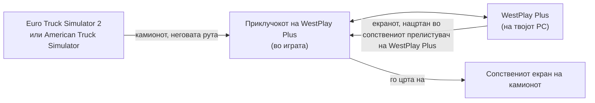

<p align="center"></p>

<h1 align="center">WestPlay Plus</h1>

<!-- languages:start -->
<p align="center">
  <a href="../../README.md">English</a> · <a href="README.zh-CN.md">简体中文</a> · <a href="README.zh-TW.md">繁體中文</a> · <a href="README.ja.md">日本語</a> · <a href="README.ko.md">한국어</a> · <a href="README.de.md">Deutsch</a> · <a href="README.fr.md">Français</a> · <a href="README.fr-CA.md">Français (Canada)</a> · <a href="README.es.md">Español</a> · <a href="README.es-419.md">Español (Latinoamérica)</a> · <a href="README.it.md">Italiano</a> · <a href="README.pt-BR.md">Português (Brasil)</a> · <a href="README.pt-PT.md">Português (Portugal)</a> · <a href="README.ru.md">Русский</a> · <a href="README.pl.md">Polski</a> · <a href="README.szl.md">Ślōnsko godka</a> · <a href="README.nl.md">Nederlands</a> · <a href="README.tr.md">Türkçe</a> · <a href="README.uk.md">Українська</a> · <a href="README.cs.md">Čeština</a> · <a href="README.sk.md">Slovenčina</a> · <a href="README.hu.md">Magyar</a> · <a href="README.ro.md">Română</a> · <a href="README.bg.md">Български</a> · <a href="README.hr.md">Hrvatski</a> · <a href="README.sr-Latn.md">Srpski (latinica)</a> · <a href="README.sr-Cyrl.md">Српски (ћирилица)</a> · <a href="README.sl.md">Slovenščina</a> · <b>Македонски</b> · <a href="README.el.md">Ελληνικά</a> · <a href="README.sv.md">Svenska</a> · <a href="README.da.md">Dansk</a> · <a href="README.no.md">Norsk</a> · <a href="README.fi.md">Suomi</a> · <a href="README.et.md">Eesti</a> · <a href="README.lt.md">Lietuvių</a> · <a href="README.lv.md">Latviešu</a> · <a href="README.ca.md">Català</a> · <a href="README.gl.md">Galego</a> · <a href="README.eu.md">Euskara</a> · <a href="README.ka.md">ქართული</a> · <a href="README.vi.md">Tiếng Việt</a>
</p>
<!-- languages:end -->

<p align="center">
  <b>Екран во стил на CarPlay за камионите од Euro Truck Simulator 2 и American Truck Simulator.</b><br>
  Твојата карта, твојата музика и YouTube, на арматурната табла на твојот камион.
  <br>
  Изменета гранка на <a href="https://github.com/enes-less/WestPlay">WestPlay</a>, со неколку оптимизации и нови функции.
</p>

<p align="center">
  <a href="https://github.com/HandsomeTurtle0307/WestPlay-Plus/releases/latest"></a>
  
  
  
  <a href="../../LICENSE"></a>
</p>

WestPlay Plus става екран како на телефон на арматурната табла на твојот камион, внатре во играта: Euro Truck Simulator 2 или American Truck Simulator, еден екран за двата. Твојата рута на карта нацртана од твојата сопствена игра, твојата музика, YouTube, времето на твоето патување: точно таму каде што вистински камион ја има својата табла, управуван со глувчето додека држиш копче.

<!-- why:start -->

## Зошто го направив ова

Најпрво барав мод за CarPlay, па налетав на WestPlay и видов дека е навистина добро направен (навистина, многу многу добро). Само оптимизацијата беше слаба и ми го замрзна компјутерот. Затоа решив сам да го дотерам: да ја подобрам брзината и да додадам неколку нови функции (стојам на рамениците на џин, хехе~😊).

<!-- why:end -->

## Функции

**Карти од твојата сопствена игра.** Нацртани од картата на твојата игра, вклучително модови за карти (ProMods и други), со твојата рута, упатства вртење по вртење и пребарување што додава застанувања во GPS-от на самата игра.

**Арматурна табла за патот.** Картата покрај тоа што свири и покрај тоа каде одиш, времето на патот, сè на еден екран.

**Твојата музика.** Apple Music, Spotify и YouTube Music, со Now Playing и текстови. Спот на песна се пушта директно во Now Playing, а YouTube ги има своите канали, плејлисти, титлови и квалитети. Плеерот ги пушта песните што ги ставаш во музичката папка на играта.

**Светла и темна тема, и твој сопствен изглед.** Се затемнува ноќе или кога ќе ги вклучиш светлата, како сензор за светлина во автомобил. Сопствени позадини и икони можеш да додадеш сам.

**Придружната апликација** на твојот PC подготвува сè: ги наоѓа твоите игри (ETS2, ATS или двете), го инсталира WestPlay Plus во секоја од нив, ги гради нивните карти и потоа не се меша.

## Како работи



WestPlay Plus го црта својот екран во сопствен прелистувач на твојот PC, а неговиот приклучок ја става секоја слика на екранот на твојот камион, внатре во играта. Сопствените екрани на камионите и нивните информациски ленти остануваат нивни: WestPlay Plus го зазема местото на GPS-от, а поставката „Vehicle Bar“ одлучува дали лентата на камионот останува до него.

## Камиони

WestPlay Plus се појавува на два начина: на сопствениот екран на камионот или на таблетот WestPlay Plus.

**На сопствениот екран на камионот.** Во камионите што имаат CarPlay и во реалноста, WestPlay Plus го зазема местото на GPS-от на екранот на таблата, прилагоден на неговата форма. Нема што да се купува или монтира: се качуваш и е таму. Во Euro Truck Simulator 2:

- **DAF** XF и XG/XG+ 2021, XF Electric и XD (и DAF 2021 на Jasper)
- **Scania** S и R, со 7" екран или со Smart Dash, и S BEV
- **Iveco** S-Way
- **Renault** T (2024)
- **Volvo** FH (2021 и 2024)
- **Coaches DLC:** Scania Touring и MAN Lion's Coach (2024)
- **Автобусите на Oyuncuyusbis:** Mercedes-Benz Travego 16 SHD, MAN Lion's Coach и Setra S 531 DT на нивните сопствени арматурни табли
- **Setra S 516 HD/2** (од Oyuncuyusbis): на сопствениот GPS-екран на автобусот, неговиот дел „Gps“, што го монтираш кај продавачот на камиони: сопствениот екран на автобусот, како што побараа неговите играчи, но таков што ти го додаваш

**На таблетот WestPlay Plus.** Сите други камиони, од играта и од модовите, го добиваат WestPlay Plus на таблет што го монтираш кај продавачот на камиони: во Додатоци, меѓу висечките предмети или како комплет за арматурна табла. Сопствениот екран на камионот ја задржува навигацијата на играта. Таблетот е во секој камион со висечки предмети, вклучително модовите за камиони што ќе ги инсталираш подоцна (го добиваат при следното стартување на играта).

**Во American Truck Simulator** засега WestPlay Plus е на таблетот во секој камион. Камионите чии вистински пандани имаат CarPlay ќе го добијат WestPlay Plus на сопствениот екран подоцна.

|                        | Сопствен екран на камионот | Таблет WestPlay Plus |
| ---------------------- | -------------------------- | -------------------- |
| Камиони                | Камионите ETS2 погоре     | Сите други, и засега сите камиони ATS |
| Како се добива         | Ништо: веќе е таму        | Да се монтира кај продавачот |
| Навигацијата на играта | Ја заменува WestPlay Plus | Останува на екранот на камионот |

### Звук

Во овие камиони од Euro Truck Simulator 2 музиката излегува од сопствените звучници на камионот, секој на своето место во кабината. Другите камиони, и засега тие од American Truck Simulator, свират обичен стерео.

- **Scania S и R (2016), S BEV** — вуфери во вратите, високотонци во A-столбовите, бас на плафонот
- **Scania R (2009), Streamline** — вуфери во вратите, високотонци во A-столбовите
- **DAF XF (105)** — високотонци во A-столбовите; две пара на полицата на плафонот кај Super Space Cab, една плафонска единица кај останатите
- **DAF XF Euro 6** — вуфери во вратите, високотонци во A-столбовите; две пара на полицата на плафонот кај Super Space Cab, една плафонска единица кај останатите
- **DAF XF, XG, XG+ (2021), XF Electric и XD** — вуфери во вратите, високотонци во A-столбовите, еден пар горе, една централна единица
- **MAN TGX** — вуфери во вратите; кај XXL и по две мали единици високо во секој страничен ѕид
- **MAN TGX Euro 6** — вуфери во вратите; кај XL и по една мала единица во секој агол на плафонот
- **MAN TGX (2020)** — вуфер и среднотонец во секоја врата, високотонци во A-столбовите
- **Mercedes-Benz Actros (2014)** — вуфери во вратите, еден пар горе, високотонци во A-столбовите
- **Mercedes-Benz Actros (2009)** — вуфери во вратите, еден пар во предните агли на плафонската полица
- **Volvo FH (2021, 2024), FH16 (2012)** — вуфери во вратите, бас во задниот ѕид
- **Volvo FH16 (2009)** — по една единица во секоја врата
- **Iveco Stralis** — по една единица на двата краја од плафонската конзола, а кај високите плафони една мала од страната на совозачот
- **Iveco Hi-Way** — по една единица на двата краја од плафонската конзола и по една високо од секоја страна
- **Iveco S-Way** — вуфер и високотонец во секоја врата
- **Renault Magnum** — по една единица во секој агол на плафонот, високотонци на плафонската конзола
- **Renault Premium** — по една единица од секоја страна на плафонот, пониско кај нискиот плафон
- **Renault T** — високотонци во A-столбовите, еден пар во задниот ѕид; вуфери во вратите кај ентериерите од 2024
- **Renault E-Tech T** — вуфери во вратите, високотонци во A-столбовите, еден пар во задниот ѕид
- **Scania PGR на JuseeTV** — звучниците на деловите што ги монтираш: врати, A-столбови, горна конзола, заден ѕид

## Инсталирање

1. Симни го инсталатерот од [најновата верзија](https://github.com/HandsomeTurtle0307/WestPlay-Plus/releases/latest) и стартувај го.
2. Се отвора придружната апликација и те води низ останатото: ги наоѓа твоите игри (ETS2, ATS или двете), го инсталира во секоја приклучокот на WestPlay Plus и неговиот мод за екран, и ги гради твоите карти.
3. Стартувај ја играта и качи се во камион.

**Ажурирања:** оваа гранка не се ажурира сама. Провери дали има понова верзија на [страницата со изданија](https://github.com/HandsomeTurtle0307/WestPlay-Plus/releases). Истата врска е и на страницата „За апликацијата“ во придружната апликација.

**Барања:** Windows 10 или 11 (64 бита), Euro Truck Simulator 2 верзија 1.62 (или 1.61) или American Truck Simulator верзија 1.62 (други верзии може да работат; придружната апликација кажува кога некоја не е тестирана) и Microsoft Edge WebView2 (дел од Windows 11; инсталатерот го додава каде што недостасува).

## Приватност

WestPlay Plus нема сервери, сопствени сметки и аналитика. Не собира и не праќа ништо за тебе.

- На Apple Music, Spotify и YouTube се најавуваш на нивните сопствени страници, во сопствениот профил на прелистувачот на WestPlay Plus на твојот PC, како во прелистувач. WestPlay Plus сам не чува податоци за сметки.
- Твојата карта се гради на твојот PC од твојата игра и останува таму.
- WestPlay Plus разговара со услугите што ги користиш, а со GitHub само кога ќе ја отвориш неговата страница со изданија.

## Повратни информации

Грешки, прашања и идеи: отвори issue на [GitHub](https://github.com/HandsomeTurtle0307/WestPlay-Plus/issues).

## Компилирање од изворниот код

Ти требаат [Rust](https://rustup.rs) (stable) и [Node.js](https://nodejs.org) 24, на Windows.

```sh
npm install      # алатките на придружната апликација и пакетите на интерфејсот
npm run dev      # WestPlay Plus, со интерфејс што се служи во живо
```

`cargo test --workspace` и `npm test --prefix ui` ги пуштаат тестовите. Приклучокот на играта се компилира со `cargo build --release -p westplay-plugin`.

## Лиценца

WestPlay Plus е слободен софтвер: можеш да го распространуваш и менуваш под условите на GNU General Public License, верзија 3 или (по твој избор) која било подоцнежна верзија. Види [LICENSE](../../LICENSE).

Copyright © 2026 HandsomeTurtle0307. Библиотеките што се доставуваат со WestPlay Plus ги задржуваат своите лиценци: види [THIRD_PARTY_LICENSES.md](../../THIRD_PARTY_LICENSES.md) и [THIRD_PARTY_NOTICES.md](../../THIRD_PARTY_NOTICES.md) за делата што ги следи.

## Од каде доаѓа овој проект

WestPlay Plus е изменета гранка (fork) на [WestPlay](https://github.com/enes-less/WestPlay), извонреден мод со екран во стил на CarPlay за Euro Truck Simulator 2 и American Truck Simulator, направен од **enes-less**. Речиси целиот оригинален дизајн, код и ресурси се негова работа; оваа гранка ги држи своите измени одозгора и му е благодарна за тоа што го изгради. Ако ти се допаѓа проектот, погледни го и оригиналот.

Поддржи го и оригиналниот проект (а ако можеш, поддржи и мене 😭😭😭 — не е лесно да се прави софтвер~).

<!-- translated:start -->
<sub>Овој README е превод на англиската верзија. Авторот, се разбира, не ги говори сите 43 јазици 😭😭, па преводот на места може да е нецелосен. Извинете~ Ако забележите грешка на вашиот јазик, кажете ми, ќе бидам многу благодарен~</sub>
<!-- translated:end -->

<sub>WestPlay Plus е независен проект, без врска со Apple, SCS Software, Spotify, Google или производителите на камиони и без нивно одобрување. CarPlay, Apple Music, Spotify, YouTube, YouTube Music, како и имињата и логоата на производителите, се трговски марки на своите сопственици и овде се користат само за да се именува тоа со што работи WestPlay Plus.</sub>
