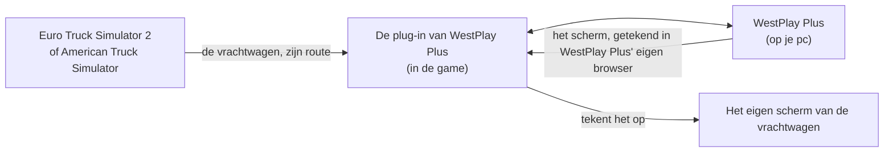

<p align="center"></p>

<h1 align="center">WestPlay Plus</h1>

<!-- languages:start -->
<p align="center">
  <a href="../../README.md">English</a> · <a href="README.zh-CN.md">简体中文</a> · <a href="README.zh-TW.md">繁體中文</a> · <a href="README.ja.md">日本語</a> · <a href="README.ko.md">한국어</a> · <a href="README.de.md">Deutsch</a> · <a href="README.fr.md">Français</a> · <a href="README.fr-CA.md">Français (Canada)</a> · <a href="README.es.md">Español</a> · <a href="README.es-419.md">Español (Latinoamérica)</a> · <a href="README.it.md">Italiano</a> · <a href="README.pt-BR.md">Português (Brasil)</a> · <a href="README.pt-PT.md">Português (Portugal)</a> · <a href="README.ru.md">Русский</a> · <a href="README.pl.md">Polski</a> · <a href="README.szl.md">Ślōnsko godka</a> · <b>Nederlands</b> · <a href="README.tr.md">Türkçe</a> · <a href="README.uk.md">Українська</a> · <a href="README.cs.md">Čeština</a> · <a href="README.sk.md">Slovenčina</a> · <a href="README.hu.md">Magyar</a> · <a href="README.ro.md">Română</a> · <a href="README.bg.md">Български</a> · <a href="README.hr.md">Hrvatski</a> · <a href="README.sr-Latn.md">Srpski (latinica)</a> · <a href="README.sr-Cyrl.md">Српски (ћирилица)</a> · <a href="README.sl.md">Slovenščina</a> · <a href="README.mk.md">Македонски</a> · <a href="README.el.md">Ελληνικά</a> · <a href="README.sv.md">Svenska</a> · <a href="README.da.md">Dansk</a> · <a href="README.no.md">Norsk</a> · <a href="README.fi.md">Suomi</a> · <a href="README.et.md">Eesti</a> · <a href="README.lt.md">Lietuvių</a> · <a href="README.lv.md">Latviešu</a> · <a href="README.ca.md">Català</a> · <a href="README.gl.md">Galego</a> · <a href="README.eu.md">Euskara</a> · <a href="README.ka.md">ქართული</a> · <a href="README.vi.md">Tiếng Việt</a>
</p>
<!-- languages:end -->

<p align="center">
  <b>Een scherm in CarPlay-stijl voor de vrachtwagens van Euro Truck Simulator 2 en American Truck Simulator.</b><br>
  Je kaart, je muziek en YouTube, op het dashboardscherm van je eigen vrachtwagen.
  <br>
  Een aangepaste tak van <a href="https://github.com/enes-less/WestPlay">WestPlay</a>, voor Chineestalige spelers.
</p>

<p align="center">
  <a href="https://github.com/HandsomeTurtle0307/WestPlay-Plus/releases/latest"></a>
  
  
  
  <a href="../../LICENSE"></a>
</p>

WestPlay Plus zet een telefoonachtig scherm op het dashboardscherm van je eigen vrachtwagen, in de game: Euro Truck Simulator 2 of American Truck Simulator, één scherm voor allebei. Je route op een kaart die uit je eigen game is getekend, je muziek, YouTube, het weer op je rit: precies waar een echte vrachtwagen zijn scherm heeft, bediend met de muis terwijl je een toets ingedrukt houdt.

<!-- why:start -->

## Waarom ik dit heb gemaakt

Eerst was ik op zoek naar een CarPlay-mod, tot ik WestPlay tegenkwam. Dat is echt heel goed gemaakt (echt, heel erg goed), alleen de optimalisatie was matig en daar liep mijn pc vast. Dus besloot ik het zelf te verbeteren: prestaties oppoetsen en een paar nieuwe functies erbij (op de schouders van een reus, hihi~😊).

<!-- why:end -->

## Functies

**Kaarten uit je eigen game.** Getekend uit de kaart van je game, inclusief kaartmods (ProMods en andere), met je route, aanwijzingen bocht voor bocht en een zoekfunctie die tussenstops aan de GPS van de game zelf toevoegt.

**Een dashboard voor onderweg.** De kaart naast wat er speelt en waar je naartoe gaat, het weer op je rit, alles op één scherm.

**Je muziek.** Apple Music, Spotify en YouTube Music, met Now Playing en songteksten. De videoclip van een nummer speelt direct in Now Playing, en YouTube heeft zijn kanalen, afspeellijsten, ondertitels en kwaliteiten. De speler speelt de nummers die je in de muziekmap van de game zet.

**Licht en donker, en je eigen look.** Het wordt donker bij nacht of wanneer je je koplampen aanzet, als een lichtsensor in een auto. Eigen achtergronden en app-pictogrammen kun je zelf meenemen.

**De bijbehorende app** op je pc regelt alles: hij vindt je games (ETS2, ATS of beide), installeert WestPlay Plus in elk daarvan, bouwt hun kaarten en houdt zich daarna afzijdig.

## Hoe het werkt



WestPlay Plus tekent zijn scherm in een eigen browser op je pc, en zijn plug-in zet elk beeld op het scherm van je vrachtwagen, in de game. De eigen schermen van de vrachtwagens en hun infobalken blijven van hen: WestPlay Plus neemt de plaats van de GPS in, en de instelling 'Vehicle Bar' bepaalt of de balk van de vrachtwagen ernaast blijft.

## Vrachtwagens

WestPlay Plus verschijnt op twee manieren: op het eigen scherm van de vrachtwagen, of op de WestPlay Plus-tablet.

**Op het eigen scherm van de vrachtwagen.** In de vrachtwagens die in het echt CarPlay hebben, neemt WestPlay Plus de plaats van de GPS op het dashboardscherm in, in de vorm daarvan. Niets te kopen of te monteren: instappen en het staat er. In Euro Truck Simulator 2:

- **DAF** XF en XG/XG+ 2021, XF Electric en XD (en Jaspers DAF 2021)
- **Scania** S en R, met het 7"-scherm of de Smart Dash, en de S BEV
- **Iveco** S-Way
- **Renault** T (2024)
- **Volvo** FH (2021 en 2024)
- **Coaches DLC:** de Scania Touring en de MAN Lion's Coach (2024)
- **De bussen van Oyuncuyusbis:** de Mercedes-Benz Travego 16 SHD, de MAN Lion's Coach en de Setra S 531 DT op hun eigen dashboardschermen
- **Setra S 516 HD/2** (van Oyuncuyusbis): op het eigen GPS-scherm van de bus, zijn 'Gps'-deel, dat je in de truckwinkel monteert: het eigen scherm van de bus, zoals zijn spelers vroegen, maar een dat je zelf toevoegt

**Op de WestPlay Plus-tablet.** Elke andere vrachtwagen, die van de game en gemodde allebei, krijgt WestPlay Plus op een tablet die je in de truckwinkel monteert: onder Accessoires, bij de hangende voorwerpen of als dashboardset. Het eigen scherm van de vrachtwagen houdt de navigatie van de game. De tablet zit in elke vrachtwagen met hangende voorwerpen, ook in vrachtwagenmods die je later installeert (die krijgen hem bij de volgende start van de game).

**In American Truck Simulator** staat WestPlay Plus voorlopig op de tablet in elke vrachtwagen. De vrachtwagens waarvan de echte tegenhangers CarPlay hebben, krijgen WestPlay Plus later op hun eigen scherm.

|                       | Eigen scherm van de vrachtwagen | WestPlay Plus-tablet |
| --------------------- | ------------------------------- | -------------------- |
| Vrachtwagens          | De ETS2-vrachtwagens hierboven  | Elke andere, en voorlopig elke ATS-vrachtwagen |
| Hoe je het krijgt     | Niets: het staat er al          | Monteren in de truckwinkel |
| Navigatie van de game | Vervangen door WestPlay Plus    | Blijft op het scherm van de vrachtwagen |

### Geluid

In deze vrachtwagens van Euro Truck Simulator 2 komt de muziek uit de eigen speakers van de vrachtwagen, elk op zijn plek in de cabine. Andere vrachtwagens, en voorlopig die van American Truck Simulator, spelen gewoon stereo.

- **Scania S en R (2016), S BEV** — deurwoofers, A-stijl-tweeters, dakbas
- **Scania R (2009), Streamline** — deurwoofers, A-stijl-tweeters
- **DAF XF (105)** — A-stijl-tweeters; twee paar op de dakplank in de Super Space Cab, één dakeenheid in de andere
- **DAF XF Euro 6** — deurwoofers, A-stijl-tweeters; twee paar op de dakplank in de Super Space Cab, één dakeenheid in de andere
- **DAF XF, XG, XG+ (2021), XF Electric en XD** — deurwoofers, A-stijl-tweeters, een paar boven, een middenunit
- **MAN TGX** — deurwoofers; in de XXL ook twee kleine eenheden hoog in elke zijwand
- **MAN TGX Euro 6** — deurwoofers; in de XL ook een kleine eenheid in elke dakkhoek
- **MAN TGX (2020)** — een woofer en een midrange in elke deur, A-stijl-tweeters
- **Mercedes-Benz Actros (2014)** — deurwoofers, een paar boven, A-stijl-tweeters
- **Mercedes-Benz Actros (2009)** — deurwoofers, een paar op de voorste hoeken van de dakplank
- **Volvo FH (2021, 2024), FH16 (2012)** — deurwoofers, bas in de achterwand
- **Volvo FH16 (2009)** — een eenheid in elke deur
- **Iveco Stralis** — een eenheid aan elk uiteinde van de dakconsole, en in de hoge daken een kleine aan de passagierskant
- **Iveco Hi-Way** — een eenheid aan elk uiteinde van de dakconsole, en een hoog aan elke kant
- **Iveco S-Way** — een woofer en een tweeter in elke deur
- **Renault Magnum** — een eenheid in elke dakkhoek, tweeters op de dakconsole
- **Renault Premium** — een eenheid aan elke kant van het dak, lager in het lage dak
- **Renault T** — A-stijl-tweeters, een paar in de achterwand; deurwoofers in de interieurs van 2024
- **Renault E-Tech T** — deurwoofers, A-stijl-tweeters, een paar in de achterwand
- **JuseeTV's Scania PGR** — de speakers van de onderdelen die je monteert: deuren, A-stijlen, bovenconsole, achterwand

## Installatie

1. Download de installer van de [nieuwste release](https://github.com/HandsomeTurtle0307/WestPlay-Plus/releases/latest) en voer hem uit.
2. De bijbehorende app opent en leidt je door de rest: hij vindt je games (ETS2, ATS of beide), installeert in elk de plug-in van WestPlay Plus en de schermmod, en bouwt je kaarten.
3. Start de game en stap in een vrachtwagen.

**Updates:** deze tak werkt zichzelf niet bij. Om te kijken of er een nieuwere versie is, ga je naar de [releases-pagina](https://github.com/HandsomeTurtle0307/WestPlay-Plus/releases). De pagina 'Over' van de bijbehorende app heeft dezelfde link.

**Vereisten:** Windows 10 of 11 (64-bits), Euro Truck Simulator 2 versie 1.62 (of 1.61) of American Truck Simulator versie 1.62 (andere versies kunnen werken; de app zegt het wanneer een versie niet is getest), en Microsoft Edge WebView2 (onderdeel van Windows 11; de installer voegt het toe waar het ontbreekt).

## Privacy

WestPlay Plus heeft geen servers, geen eigen accounts en geen analytics. Het verzamelt of verstuurt niets over jou.

- Je logt in bij Apple Music, Spotify en YouTube op hun eigen pagina's, in het eigen browserprofiel van WestPlay Plus op je pc, zoals in een browser. WestPlay Plus bewaart zelf geen accountgegevens.
- Je kaart wordt op je pc uit je game gebouwd en blijft daar.
- WestPlay Plus praat met de diensten die je gebruikt, en met GitHub alleen wanneer je de releases-pagina opent.

## Feedback

Bugs, vragen en ideeën: open een issue op [GitHub](https://github.com/HandsomeTurtle0307/WestPlay-Plus/issues).

## Bouwen vanaf de broncode

Je hebt [Rust](https://rustup.rs) (stable) en [Node.js](https://nodejs.org) 24 nodig, op Windows.

```sh
npm install      # de gereedschappen van de app en de pakketten van de interface
npm run dev      # WestPlay Plus, met de interface live geserveerd
```

`cargo test --workspace` en `npm test --prefix ui` draaien de tests. De plug-in van de game bouw je met `cargo build --release -p westplay-plugin`.

## Licentie

WestPlay Plus is vrije software: je mag het verspreiden en aanpassen onder de voorwaarden van de GNU General Public License, versie 3 of (naar jouw keuze) een latere versie. Zie [LICENSE](../../LICENSE).

Copyright © 2026 HandsomeTurtle0307. De bibliotheken die met WestPlay Plus meekomen houden hun eigen licenties: zie [THIRD_PARTY_LICENSES.md](../../THIRD_PARTY_LICENSES.md), en [THIRD_PARTY_NOTICES.md](../../THIRD_PARTY_NOTICES.md) voor de werken die het volgt.

## Waar dit project vandaan komt

WestPlay Plus is een aangepaste tak (fork) van [WestPlay](https://github.com/enes-less/WestPlay), een voortreffelijke schermmod in CarPlay-stijl voor Euro Truck Simulator 2 en American Truck Simulator, gemaakt door **enes-less**. Vrijwel al het oorspronkelijke ontwerp, de code en de assets zijn zijn werk; deze tak houdt zijn eigen wijzigingen erbovenop en is hem dankbaar voor wat hij heeft gebouwd. Als je dit project mooi vindt, kijk dan ook eens naar het origineel.

Steun ook het originele project (en als je kunt, steun mij dan ook 😭😭😭 — software maken is niet makkelijk~).

<!-- translated:start -->
<sub>Deze README is vertaald uit de Engelse versie. De auteur spreekt natuurlijk niet alle 43 talen 😭😭, dus de vertaling kan hier en daar onvolledig zijn. Sorry daarvoor~ Zie je iets raars in jouw taal, laat het weten, dat wordt zeer gewaardeerd~</sub>
<!-- translated:end -->

<sub>WestPlay Plus is een onafhankelijk project, niet verbonden aan of goedgekeurd door Apple, SCS Software, Spotify, Google of de vrachtwagenfabrikanten. CarPlay, Apple Music, Spotify, YouTube, YouTube Music en de namen en logo's van de fabrikanten zijn handelsmerken van hun eigenaren, hier alleen gebruikt om te benoemen waar WestPlay Plus mee werkt.</sub>
