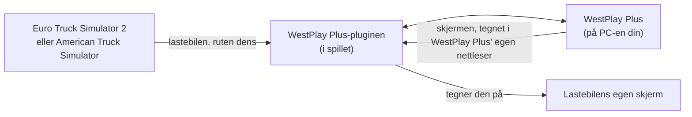

<p align="center"></p>

<h1 align="center">WestPlay Plus</h1>

<!-- languages:start -->
<p align="center">
  <a href="../../README.md">English</a> · <a href="README.zh-CN.md">简体中文</a> · <a href="README.zh-TW.md">繁體中文</a> · <a href="README.ja.md">日本語</a> · <a href="README.ko.md">한국어</a> · <a href="README.de.md">Deutsch</a> · <a href="README.fr.md">Français</a> · <a href="README.fr-CA.md">Français (Canada)</a> · <a href="README.es.md">Español</a> · <a href="README.es-419.md">Español (Latinoamérica)</a> · <a href="README.it.md">Italiano</a> · <a href="README.pt-BR.md">Português (Brasil)</a> · <a href="README.pt-PT.md">Português (Portugal)</a> · <a href="README.ru.md">Русский</a> · <a href="README.pl.md">Polski</a> · <a href="README.nl.md">Nederlands</a> · <a href="README.tr.md">Türkçe</a> · <a href="README.uk.md">Українська</a> · <a href="README.cs.md">Čeština</a> · <a href="README.sk.md">Slovenčina</a> · <a href="README.hu.md">Magyar</a> · <a href="README.ro.md">Română</a> · <a href="README.bg.md">Български</a> · <a href="README.hr.md">Hrvatski</a> · <a href="README.sr-Latn.md">Srpski (latinica)</a> · <a href="README.sr-Cyrl.md">Српски (ћирилица)</a> · <a href="README.sl.md">Slovenščina</a> · <a href="README.mk.md">Македонски</a> · <a href="README.el.md">Ελληνικά</a> · <a href="README.sv.md">Svenska</a> · <a href="README.da.md">Dansk</a> · <b>Norsk</b> · <a href="README.fi.md">Suomi</a> · <a href="README.et.md">Eesti</a> · <a href="README.lt.md">Lietuvių</a> · <a href="README.lv.md">Latviešu</a> · <a href="README.ca.md">Català</a> · <a href="README.gl.md">Galego</a> · <a href="README.vi.md">Tiếng Việt</a>
</p>
<!-- languages:end -->

<!-- english-only:start -->
<p align="center"><sub>Schlesisk, baskisk og georgisk støttes av appen, men har ennå ingen README: det har ikke vært noen som kunne gå gjennom en oversettelse til disse språkene. Alt innholdet finnes i den engelske versjonen i repoets rot.</sub></p>
<!-- english-only:end -->

<p align="center">
  <b>En CarPlay-lignende skjerm for lastebilene i Euro Truck Simulator 2 og American Truck Simulator.</b><br>
  Kartet ditt, musikken din og YouTube, på din egen lastebils dashbord.
  <br>
  En modifisert gren av <a href="https://github.com/enes-less/WestPlay">WestPlay</a>, med noen optimaliseringer og nye funksjoner.
</p>

<p align="center">
  <a href="https://github.com/HandsomeTurtle0307/WestPlay-Plus/releases/latest"></a>
  
  
  
  <a href="../../LICENSE"></a>
</p>

WestPlay Plus setter en telefonskjerm på dashbordet i din egen lastebil, inne i spillet: Euro Truck Simulator 2 eller American Truck Simulator, én skjerm for begge. Ruten din på et kart tegnet fra ditt eget spill, musikken din, YouTube, været på turen: akkurat der en ekte lastebil har skjermen sin, styrt med musa mens du holder en tast.

<!-- why:start -->

## Hvorfor jeg lagde dette

Først lette jeg etter en CarPlay-mod, så snublet jeg over WestPlay og så at det er skikkelig godt laget (helt sant, veldig veldig bra). Det var bare optimaliseringen som var dårlig, og den fikk PC-en min til å fryse. Så jeg bestemte meg for å forbedre det selv: fikse ytelsen og legge til noen nye funksjoner (står på skuldrene til en kjempe, hihi~😊).

<!-- why:end -->

## Funksjoner

**Kart fra ditt eget spill.** Tegnet fra spillets kart, med kartmods inkludert (ProMods og andre), med ruten din, sving-for-sving-veiledning og et søk som legger stopp inn i spillets egen GPS.

**Et dashbord for turen.** Kartet ved siden av det som spiller og dit du skal, været på turen, alt på én skjerm.

**Musikken din.** Apple Music, Spotify og YouTube Music, med Now Playing og sangtekster. Musikkvideoen til en sang spilles rett i Now Playing, og YouTube har sine kanaler, spillelister, undertekster og kvaliteter. Spilleren spiller sangene du legger i spillets musikkmappe.

**Lyst og mørkt, og ditt eget utseende.** Det blir mørkt om natten eller når du slår på lysene, som en lyssensor i en bil. Egne bakgrunner og appikoner tar du med selv.

**Følgeprogrammet** på PC-en setter opp alt: det finner spillene dine (ETS2, ATS eller begge), installerer WestPlay Plus i hvert av dem, bygger kartene deres og holder seg unna etterpå.

## Slik fungerer det



WestPlay Plus tegner skjermen sin i en egen nettleser på PC-en din, og pluginen legger hvert bilde på skjermen til lastebilen din, inne i spillet. Lastebilenes egne skjermer og informasjonslinjer forblir deres: WestPlay Plus tar GPS-ens plass, og innstillingen «Vehicle Bar» avgjør om lastebilens linje blir stående ved siden av.

## Lastebiler

WestPlay Plus vises på to måter: på lastebilens egen skjerm, eller på WestPlay Plus-nettbrettet.

**På lastebilens egen skjerm.** I lastebilene som har CarPlay i virkeligheten, tar WestPlay Plus GPS-ens plass på dashbordskjermen og former seg etter den. Ingenting å kjøpe eller montere: sett deg inn, og den er der. I Euro Truck Simulator 2:

- **DAF** XF og XG/XG+ 2021, XF Electric og XD (samt Jaspers DAF 2021)
- **Scania** S og R, med 7"-skjermen eller Smart Dash, og S BEV
- **Iveco** S-Way
- **Renault** T (2024)
- **Volvo** FH (2021 og 2024)
- **Coaches DLC:** Scania Touring og MAN Lion's Coach (2024)
- **Oyuncuyusbis-bussene:** Mercedes-Benz Travego 16 SHD, MAN Lion's Coach og Setra S 531 DT på sine egne dashbord
- **Setra S 516 HD/2** (fra Oyuncuyusbis): på bussens egen GPS-skjerm, «Gps»-delen, som du monterer hos lastebilforhandleren: bussens egen skjerm, slik spillerne ba om, men en du legger til selv

**På WestPlay Plus-nettbrettet.** Alle andre lastebiler, både spillets og moddenes, får WestPlay Plus på et nettbrett du monterer hos lastebilforhandleren: under Tilbehør, blant hengende gjenstander eller som dashboardsett. Lastebilens egen skjerm beholder spillets navigasjon. Nettbrettet sitter i hver lastebil med hengende gjenstander, også i lastebilmods du installerer senere (de får det neste gang du starter spillet).

**I American Truck Simulator** sitter WestPlay Plus foreløpig på nettbrettet i alle lastebiler. Lastebilene der de virkelige motstykkene har CarPlay, får WestPlay Plus på sin egen skjerm senere.

|                        | Lastebilens egen skjerm | WestPlay Plus-nettbrett |
| ---------------------- | ----------------------- | ----------------------- |
| Lastebiler             | ETS2-lastebilene over   | Alle andre, og foreløpig alle ATS-lastebiler |
| Slik får du den        | Ingenting: den er der   | Monter den hos forhandleren |
| Spillets navigasjon    | Erstattes av WestPlay Plus | Blir på lastebilens skjerm |

### Lyd

I disse lastebilene i Euro Truck Simulator 2 kommer musikken fra lastebilens egne høyttalere, hver på sin plass i førerhuset. Andre lastebiler, og foreløpig de i American Truck Simulator, spiller vanlig stereo.

- **Scania S og R (2016), S BEV** — dørwoofere, A-stolpe-diskanter, takbass
- **Scania R (2009), Streamline** — dørwoofere, A-stolpe-diskanter
- **DAF XF (105)** — A-stolpe-diskanter; to par på takhyllen i Super Space Cab, én takenhet i de andre
- **DAF XF Euro 6** — dørwoofere, A-stolpe-diskanter; to par på takhyllen i Super Space Cab, én takenhet i de andre
- **DAF XF, XG, XG+ (2021), XF Electric og XD** — dørwoofere, A-stolpe-diskanter, ett par oppe, én midtenhet
- **MAN TGX** — dørwoofere; i XXL også to små enheter høyt i hver sidevegg
- **MAN TGX Euro 6** — dørwoofere; i XL også én liten enhet i hvert takhjørne
- **MAN TGX (2020)** — en woofer og en mellomtone i hver dør, A-stolpe-diskanter
- **Mercedes-Benz Actros (2014)** — dørwoofere, ett par oppe, A-stolpe-diskanter
- **Mercedes-Benz Actros (2009)** — dørwoofere, ett par i takhyllens fremre hjørner
- **Volvo FH (2021, 2024), FH16 (2012)** — dørwoofere, bass i bakveggen
- **Volvo FH16 (2009)** — én enhet i hver dør
- **Iveco Stralis** — én enhet i hver ende av takkonsollen, og i de høye takene en liten på passasjersiden
- **Iveco Hi-Way** — én enhet i hver ende av takkonsollen, og én høyt på hver side
- **Iveco S-Way** — en woofer og en diskant i hver dør
- **Renault Magnum** — én enhet i hvert takhjørne, diskanter på takkonsollen
- **Renault Premium** — én enhet på hver side av taket, lavere i det lave taket
- **Renault T** — A-stolpe-diskanter, ett par i bakveggen; dørwoofere i 2024-interiørene
- **Renault E-Tech T** — dørwoofere, A-stolpe-diskanter, ett par i bakveggen
- **JuseeTVs Scania PGR** — høyttalerne i delene du monterer: dører, A-stolper, toppkonsoll, bakvegg

## Installasjon

1. Last ned installasjonsprogrammet fra [nyeste versjon](https://github.com/HandsomeTurtle0307/WestPlay-Plus/releases/latest) og kjør det.
2. Følgeprogrammet åpnes og leder deg gjennom resten: det finner spillene dine (ETS2, ATS eller begge), installerer WestPlay Plus-pluginen og skjermmoden i hvert av dem, og bygger kartene dine.
3. Start spillet og sett deg i en lastebil.

**Oppdateringer:** denne grenen oppdaterer seg ikke selv. Vil du se om det finnes en nyere versjon, gå til [utgivelsessiden](https://github.com/HandsomeTurtle0307/WestPlay-Plus/releases). Samme lenke ligger på «Om»-siden i følgeprogrammet.

**Krav:** Windows 10 eller 11 (64-bit), Euro Truck Simulator 2 versjon 1.62 (eller 1.61) eller American Truck Simulator versjon 1.62 (andre versjoner kan fungere; følgeprogrammet sier fra når en ikke er testet), og Microsoft Edge WebView2 (en del av Windows 11; installasjonsprogrammet legger det til der det mangler).

## Personvern

WestPlay Plus har ingen servere, ingen egne kontoer og ingen analyse. Det samler ikke inn eller sender noe om deg.

- Du logger inn på Apple Music, Spotify og YouTube på deres egne sider, i WestPlay Plus' egen nettleserprofil på PC-en din, som i en nettleser. WestPlay Plus lagrer selv ingen kontodata.
- Kartet ditt bygges på PC-en din fra spillet ditt og blir der.
- WestPlay Plus snakker med tjenestene du bruker, og med GitHub bare når du åpner utgivelsessiden.

## Tilbakemelding

Feil, spørsmål og idéer: åpne en issue på [GitHub](https://github.com/HandsomeTurtle0307/WestPlay-Plus/issues).

## Bygge fra kildekoden

Du trenger [Rust](https://rustup.rs) (stable) og [Node.js](https://nodejs.org) 24, på Windows.

```sh
npm install      # verktøyene til følgeprogrammet og pakkene til grensesnittet
npm run dev      # WestPlay Plus, med grensesnittet servert live
```

`cargo test --workspace` og `npm test --prefix ui` kjører testene. Spillets plugin bygges med `cargo build --release -p westplay-plugin`.

## Lisens

WestPlay Plus er fri programvare: du kan videredistribuere og endre det under vilkårene i GNU General Public License, versjon 3 eller (om du velger det) en senere versjon. Se [LICENSE](../../LICENSE).

Copyright © 2026 HandsomeTurtle0307. Bibliotekene som følger med WestPlay Plus beholder sine egne lisenser: se [THIRD_PARTY_LICENSES.md](../../THIRD_PARTY_LICENSES.md), og [THIRD_PARTY_NOTICES.md](../../THIRD_PARTY_NOTICES.md) for verkene det følger.

## Hvor prosjektet kommer fra

WestPlay Plus er en modifisert gren (fork) av [WestPlay](https://github.com/enes-less/WestPlay), en glimrende skjermmod i CarPlay-stil for Euro Truck Simulator 2 og American Truck Simulator, laget av **enes-less**. Nesten all den opprinnelige designen, koden og ressursene er hans arbeid; denne grenen har sine egne endringer oppå og er takknemlig for det han bygde. Liker du prosjektet, ta en titt på originalen også.

Støtt gjerne originalprosjektet også (og hvis du kan, støtt meg også 😭😭😭 — det er ikke lett å lage programvare~).

<!-- translated:start -->
<sub>Denne README-en er oversatt fra den engelske versjonen. Forfatteren snakker selvsagt ikke alle 43 språk 😭😭, så oversettelsen kan være ufullstendig enkelte steder. Beklager~ Hvis du finner en feil på ditt språk, si fra, det settes stor pris på~</sub>
<!-- translated:end -->

<sub>WestPlay Plus er et uavhengig prosjekt, uten tilknytning til eller godkjenning fra Apple, SCS Software, Spotify, Google eller lastebilprodusentene. CarPlay, Apple Music, Spotify, YouTube, YouTube Music og produsentenes navn og logoer er varemerker som tilhører sine eiere, og brukes her bare for å navngi det WestPlay Plus virker med.</sub>
