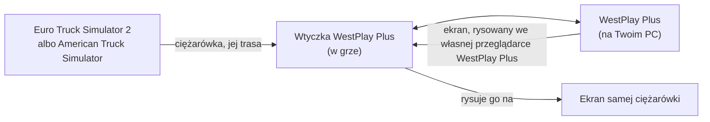

<p align="center"></p>

<h1 align="center">WestPlay Plus</h1>

<!-- languages:start -->
<p align="center">
  <a href="../../README.md">English</a> · <a href="README.zh-CN.md">简体中文</a> · <a href="README.zh-TW.md">繁體中文</a> · <a href="README.ja.md">日本語</a> · <a href="README.ko.md">한국어</a> · <a href="README.de.md">Deutsch</a> · <a href="README.fr.md">Français</a> · <a href="README.fr-CA.md">Français (Canada)</a> · <a href="README.es.md">Español</a> · <a href="README.es-419.md">Español (Latinoamérica)</a> · <a href="README.it.md">Italiano</a> · <a href="README.pt-BR.md">Português (Brasil)</a> · <a href="README.pt-PT.md">Português (Portugal)</a> · <a href="README.ru.md">Русский</a> · <b>Polski</b> · <a href="README.szl.md">Ślōnsko godka</a> · <a href="README.nl.md">Nederlands</a> · <a href="README.tr.md">Türkçe</a> · <a href="README.uk.md">Українська</a> · <a href="README.cs.md">Čeština</a> · <a href="README.sk.md">Slovenčina</a> · <a href="README.hu.md">Magyar</a> · <a href="README.ro.md">Română</a> · <a href="README.bg.md">Български</a> · <a href="README.hr.md">Hrvatski</a> · <a href="README.sr-Latn.md">Srpski (latinica)</a> · <a href="README.sr-Cyrl.md">Српски (ћирилица)</a> · <a href="README.sl.md">Slovenščina</a> · <a href="README.mk.md">Македонски</a> · <a href="README.el.md">Ελληνικά</a> · <a href="README.sv.md">Svenska</a> · <a href="README.da.md">Dansk</a> · <a href="README.no.md">Norsk</a> · <a href="README.fi.md">Suomi</a> · <a href="README.et.md">Eesti</a> · <a href="README.lt.md">Lietuvių</a> · <a href="README.lv.md">Latviešu</a> · <a href="README.ca.md">Català</a> · <a href="README.gl.md">Galego</a> · <a href="README.eu.md">Euskara</a> · <a href="README.ka.md">ქართული</a> · <a href="README.vi.md">Tiếng Việt</a>
</p>
<!-- languages:end -->

<p align="center">
  <b>Ekran w stylu CarPlay dla ciężarówek z Euro Truck Simulator 2 i American Truck Simulator.</b><br>
  Twoja mapa, Twoja muzyka i YouTube — na ekranie deski rozdzielczej Twojej ciężarówki.
  <br>
  Zmodyfikowana gałąź <a href="https://github.com/enes-less/WestPlay">WestPlay</a>, z kilkoma optymalizacjami i nowymi funkcjami.
</p>

<p align="center">
  <a href="https://github.com/HandsomeTurtle0307/WestPlay-Plus/releases/latest"></a>
  
  
  
  <a href="../../LICENSE"></a>
</p>

WestPlay Plus kładzie ekran w stylu telefonu na ekran deski rozdzielczej Twojej ciężarówki, w grze: Euro Truck Simulator 2 albo American Truck Simulator, jeden ekran dla obu. Twoja trasa na mapie narysowanej z Twojej własnej gry, Twoja muzyka, YouTube, pogoda na trasie: dokładnie tam, gdzie prawdziwa ciężarówka ma swój ekran, obsługiwany myszą przy trzymanym klawiszu.

<!-- why:start -->

## Po co to zrobiłem

Na początku szukałem moda do CarPlay, aż trafiłem na WestPlay i zobaczyłem, że jest zrobiony naprawdę dobrze (serio, bardzo bardzo dobrze). Tylko optymalizacja była słaba i zawiesiła mi komputer. Więc postanowiłem sam go dopieścić: poprawić wydajność i dodać kilka nowych funkcji (stoję na ramionach olbrzyma, hi hi~😊).

<!-- why:end -->

## Funkcje

**Mapy z Twojej własnej gry.** Rysowane z mapy Twojej gry, wraz z modami map (ProMods i inne), z trasą, wskazówkami zakręt po zakręcie i wyszukiwaniem, które dodaje przystanki do GPS-u samej gry.

**Deska rozdzielcza na drogę.** Mapa obok tego, co gra, i tego, dokąd jedziesz, pogoda na trasie, wszystko na jednym ekranie.

**Twoja muzyka.** Apple Music, Spotify i YouTube Music, z Now Playing i tekstami. Teledysk utworu odtwarza się prosto w Now Playing, a YouTube ma swoje kanały, playlisty, napisy i jakości. Odtwarzacz gra utwory, które wrzucisz do folderu muzyki w grze.

**Jasny i ciemny motyw, i Twój własny wygląd.** Ciemnieje w nocy albo gdy włączysz światła, jak czujnik światła w samochodzie. Własne tapety i ikony aplikacji możesz dodać sam.

**Aplikacja towarzysząca** na Twoim PC przygotowuje wszystko: znajduje Twoje gry (ETS2, ATS albo obie), instaluje WestPlay Plus w każdej z nich, buduje ich mapy, a potem się nie wtrąca.

## Jak to działa



WestPlay Plus rysuje swój ekran we własnej przeglądarce na Twoim PC, a jego wtyczka kładzie każdą klatkę na ekranie Twojej ciężarówki, w grze. Ekrany samych ciężarówek i ich paski informacyjne pozostają ich: WestPlay Plus zajmuje miejsce GPS-u, a ustawienie „Vehicle Bar” mówi, czy pasek ciężarówki zostaje obok.

## Ciężarówki

WestPlay Plus pojawia się na dwa sposoby: na ekranie samej ciężarówki albo na tablecie WestPlay Plus.

**Na ekranie samej ciężarówki.** W ciężarówkach, które w rzeczywistości mają CarPlay, WestPlay Plus zajmuje miejsce GPS-u na ekranie deski rozdzielczej, dopasowany do jego kształtu. Niczego nie trzeba kupować ani montować: wsiadasz i już jest. W Euro Truck Simulator 2:

- **DAF** XF i XG/XG+ 2021, XF Electric i XD (oraz DAF 2021 Jaspersa)
- **Scania** S i R, z ekranem 7" lub Smart Dash, oraz S BEV
- **Iveco** S-Way
- **Renault** T (2024)
- **Volvo** FH (2021 i 2024)
- **Coaches DLC:** Scania Touring i MAN Lion's Coach (2024)
- **Autokary Oyuncuyusbis:** Mercedes-Benz Travego 16 SHD, MAN Lion's Coach i Setra S 531 DT na własnych ekranach deski rozdzielczej
- **Setra S 516 HD/2** (od Oyuncuyusbis): na własnym ekranie GPS autokaru, czyli jego części „Gps”, którą montujesz w warsztacie: własny ekran autokaru, tak jak prosili jego gracze, ale taki, który dodajesz sam

**Na tablecie WestPlay Plus.** Każda inna ciężarówka, zarówno z gry, jak i z modów, dostaje WestPlay Plus na tablecie, który montujesz w warsztacie: w Akcesoriach, wśród przedmiotów wiszących albo jako zestaw na deskę rozdzielczą. Ekran samej ciężarówki zachowuje nawigację gry. Tablet jest w każdej ciężarówce z przedmiotami wiszącymi, także w modach ciężarówek zainstalowanych później (dostaną go przy następnym uruchomieniu gry).

**W American Truck Simulator** na razie WestPlay Plus jest na tablecie w każdej ciężarówce. Ciężarówki, których rzeczywiste odpowiedniki mają CarPlay, dostaną WestPlay Plus na własnym ekranie później.

|                       | Ekran samej ciężarówki | Tablet WestPlay Plus |
| --------------------- | ---------------------- | -------------------- |
| Ciężarówki            | Ciężarówki ETS2 powyżej | Każda inna, i na razie każda z ATS |
| Jak go zdobyć         | Nic: już tam jest      | Zamontować w warsztacie |
| Nawigacja gry         | Zastąpiona przez WestPlay Plus | Zostaje na ekranie ciężarówki |

### Dźwięk

W tych ciężarówkach z Euro Truck Simulator 2 muzyka gra z własnych głośników ciężarówki, każdy na swoim miejscu w kabinie. Inne ciężarówki, a na razie także te z American Truck Simulator, grają zwykłym stereo.

- **Scania S i R (2016), S BEV** — głośniki niskotonowe w drzwiach, wysokotonowe w słupkach A, bas w dachu
- **Scania R (2009), Streamline** — głośniki niskotonowe w drzwiach, wysokotonowe w słupkach A
- **DAF XF (105)** — głośniki wysokotonowe w słupkach A; dwie pary na półce dachowej w Super Space Cab, jeden moduł dachowy w pozostałych
- **DAF XF Euro 6** — głośniki niskotonowe w drzwiach, wysokotonowe w słupkach A; dwie pary na półce dachowej w Super Space Cab, jeden moduł dachowy w pozostałych
- **DAF XF, XG, XG+ (2021), XF Electric i XD** — głośniki niskotonowe w drzwiach, wysokotonowe w słupkach A, para u góry, moduł centralny
- **MAN TGX** — głośniki niskotonowe w drzwiach; w XXL dodatkowo po dwa małe moduły wysoko w każdej ścianie bocznej
- **MAN TGX Euro 6** — głośniki niskotonowe w drzwiach; w XL dodatkowo mały moduł w każdym narożniku dachu
- **MAN TGX (2020)** — głośnik niskotonowy i średniotonowy w każdych drzwiach, wysokotonowe w słupkach A
- **Mercedes-Benz Actros (2014)** — głośniki niskotonowe w drzwiach, para u góry, wysokotonowe w słupkach A
- **Mercedes-Benz Actros (2009)** — głośniki niskotonowe w drzwiach, para w przednich narożnikach półki dachowej
- **Volvo FH (2021, 2024), FH16 (2012)** — głośniki niskotonowe w drzwiach, bas w tylnej ścianie
- **Volvo FH16 (2009)** — po jednym module w każdych drzwiach
- **Iveco Stralis** — po jednym module na każdym końcu konsoli dachowej, a w wysokich dachach mały po stronie pasażera
- **Iveco Hi-Way** — po jednym module na każdym końcu konsoli dachowej i po jednym wysoko z każdej strony
- **Iveco S-Way** — głośnik niskotonowy i wysokotonowy w każdych drzwiach
- **Renault Magnum** — po jednym module w każdym narożniku dachu, głośniki wysokotonowe na konsoli dachowej
- **Renault Premium** — po jednym module z każdej strony dachu, niżej w niskim dachu
- **Renault T** — głośniki wysokotonowe w słupkach A, para w tylnej ścianie; głośniki niskotonowe w drzwiach w wnętrzach 2024
- **Renault E-Tech T** — głośniki niskotonowe w drzwiach, wysokotonowe w słupkach A, para w tylnej ścianie
- **Scania PGR od JuseeTV** — głośniki montowanych części: drzwi, słupki A, konsola górna, tylna ściana

## Instalacja

1. Pobierz instalator z [najnowszego wydania](https://github.com/HandsomeTurtle0307/WestPlay-Plus/releases/latest) i uruchom go.
2. Otworzy się aplikacja towarzysząca i poprowadzi Cię przez resztę: znajdzie Twoje gry (ETS2, ATS albo obie), zainstaluje w każdej wtyczkę WestPlay Plus i jej mod ekranu oraz zbuduje Twoje mapy.
3. Uruchom grę i wsiądź do ciężarówki.

**Aktualizacje:** ta gałąź nie aktualizuje się sama. Aby sprawdzić, czy jest nowsza wersja, wejdź na [stronę wydań](https://github.com/HandsomeTurtle0307/WestPlay-Plus/releases). Ten sam link jest na stronie „O programie” w aplikacji towarzyszącej.

**Wymagania:** Windows 10 lub 11 (64 bity), Euro Truck Simulator 2 w wersji 1.62 (lub 1.61) albo American Truck Simulator w wersji 1.62 (inne wersje mogą działać; aplikacja towarzysząca powie, gdy któraś nie była testowana) oraz Microsoft Edge WebView2 (część Windows 11; instalator doda go tam, gdzie go brak).

## Prywatność

WestPlay Plus nie ma serwerów, własnych kont ani analityki. Nie zbiera i nie wysyła niczego o Tobie.

- Do Apple Music, Spotify i YouTube logujesz się na ich własnych stronach, w osobnym profilu przeglądarki WestPlay Plus na swoim PC, tak jak w przeglądarce. Sam WestPlay Plus nie przechowuje żadnych danych konta.
- Twoja mapa jest budowana na Twoim PC z Twojej gry i tam zostaje.
- WestPlay Plus rozmawia z usługami, których używasz, a z GitHubem tylko wtedy, gdy otworzysz jego stronę wydań.

## Opinie

Błędy, pytania i pomysły: otwórz zgłoszenie na [GitHubie](https://github.com/HandsomeTurtle0307/WestPlay-Plus/issues).

## Budowanie ze źródeł

Potrzebujesz [Rusta](https://rustup.rs) (stable) i [Node.js](https://nodejs.org) 24, na Windows.

```sh
npm install      # narzędzia aplikacji towarzyszącej i pakiety interfejsu
npm run dev      # WestPlay Plus z interfejsem serwowanym na żywo
```

`cargo test --workspace` i `npm test --prefix ui` uruchamiają testy. Wtyczkę gry buduje się przez `cargo build --release -p westplay-plugin`.

## Licencja

WestPlay Plus jest wolnym oprogramowaniem: możesz je rozprowadzać i modyfikować na warunkach GNU General Public License, wersja 3 lub (według Twojego wyboru) dowolna późniejsza. Zobacz [LICENSE](../../LICENSE).

Copyright © 2026 HandsomeTurtle0307. Biblioteki dostarczane z WestPlay Plus zachowują własne licencje: zobacz [THIRD_PARTY_LICENSES.md](../../THIRD_PARTY_LICENSES.md), a w [THIRD_PARTY_NOTICES.md](../../THIRD_PARTY_NOTICES.md) — dzieła, za którymi podąża.

## Skąd pochodzi ten projekt

WestPlay Plus to zmodyfikowana gałąź (fork) projektu [WestPlay](https://github.com/enes-less/WestPlay), znakomitego moda z ekranem w stylu CarPlay do Euro Truck Simulator 2 i American Truck Simulator, stworzonego przez **enes-less**. Niemal cały pierwotny projekt, kod i zasoby to jego praca; ta gałąź trzyma na tym własne zmiany i jest wdzięczna za to, co zbudował. Jeśli podoba Ci się ten projekt, zajrzyj też do oryginału.

Wesprzyj też oryginalny projekt (a jeśli możesz, wesprzyj i mnie 😭😭😭 — tworzenie oprogramowania nie jest łatwe~).

<!-- translated:start -->
<sub>Ten README jest tłumaczeniem wersji angielskiej. Autor oczywiście nie zna wszystkich 43 języków 😭😭, więc tłumaczenie może być miejscami niepełne. Przepraszam~ Jeśli zauważysz błąd w swoim języku, daj znać — będę wdzięczny~</sub>
<!-- translated:end -->

<sub>WestPlay Plus jest niezależnym projektem, niepowiązanym z Apple, SCS Software, Spotify, Google ani producentami ciężarówek i przez nich niepopieranym. CarPlay, Apple Music, Spotify, YouTube, YouTube Music oraz nazwy i logotypy producentów ciężarówek są znakami towarowymi ich właścicieli i są tu używane wyłącznie do nazwania tego, z czym współpracuje WestPlay Plus.</sub>
