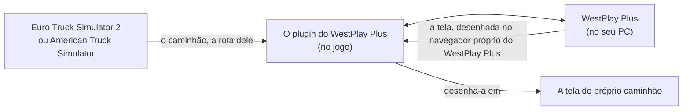

<p align="center"></p>

<h1 align="center">WestPlay Plus</h1>

<!-- languages:start -->
<p align="center">
  <a href="../../README.md">English</a> · <a href="README.zh-CN.md">简体中文</a> · <a href="README.zh-TW.md">繁體中文</a> · <a href="README.ja.md">日本語</a> · <a href="README.ko.md">한국어</a> · <a href="README.de.md">Deutsch</a> · <a href="README.fr.md">Français</a> · <a href="README.fr-CA.md">Français (Canada)</a> · <a href="README.es.md">Español</a> · <a href="README.es-419.md">Español (Latinoamérica)</a> · <a href="README.it.md">Italiano</a> · <b>Português (Brasil)</b> · <a href="README.pt-PT.md">Português (Portugal)</a> · <a href="README.ru.md">Русский</a> · <a href="README.pl.md">Polski</a> · <a href="README.szl.md">Ślōnsko godka</a> · <a href="README.nl.md">Nederlands</a> · <a href="README.tr.md">Türkçe</a> · <a href="README.uk.md">Українська</a> · <a href="README.cs.md">Čeština</a> · <a href="README.sk.md">Slovenčina</a> · <a href="README.hu.md">Magyar</a> · <a href="README.ro.md">Română</a> · <a href="README.bg.md">Български</a> · <a href="README.hr.md">Hrvatski</a> · <a href="README.sr-Latn.md">Srpski (latinica)</a> · <a href="README.sr-Cyrl.md">Српски (ћирилица)</a> · <a href="README.sl.md">Slovenščina</a> · <a href="README.mk.md">Македонски</a> · <a href="README.el.md">Ελληνικά</a> · <a href="README.sv.md">Svenska</a> · <a href="README.da.md">Dansk</a> · <a href="README.no.md">Norsk</a> · <a href="README.fi.md">Suomi</a> · <a href="README.et.md">Eesti</a> · <a href="README.lt.md">Lietuvių</a> · <a href="README.lv.md">Latviešu</a> · <a href="README.ca.md">Català</a> · <a href="README.gl.md">Galego</a> · <a href="README.eu.md">Euskara</a> · <a href="README.ka.md">ქართული</a> · <a href="README.vi.md">Tiếng Việt</a>
</p>
<!-- languages:end -->

<p align="center">
  <b>Uma tela no estilo CarPlay para os caminhões de Euro Truck Simulator 2 e American Truck Simulator.</b><br>
  Seu mapa, sua música e o YouTube, na tela do painel do seu próprio caminhão.
  <br>
  Uma ramificação modificada do <a href="https://github.com/enes-less/WestPlay">WestPlay</a>, para jogadores de língua chinesa.
</p>

<p align="center">
  <a href="https://github.com/HandsomeTurtle0307/WestPlay-Plus/releases/latest"></a>
  
  
  
  <a href="../../LICENSE"></a>
</p>

O WestPlay Plus coloca uma tela de celular na tela do painel do seu próprio caminhão, dentro do jogo: Euro Truck Simulator 2 ou American Truck Simulator, uma tela só para os dois. Sua rota num mapa desenhado a partir do seu próprio jogo, sua música, o YouTube, o tempo que vai fazer na sua viagem: bem onde um caminhão de verdade tem a sua tela, controlada com o mouse enquanto você segura uma tecla.

## Recursos

**Mapas do seu próprio jogo.** Desenhados a partir do mapa do seu jogo, com os mods de mapa incluídos (ProMods e outros), com sua rota, as instruções curva a curva e uma busca que adiciona paradas ao GPS do próprio jogo.

**Um painel para a estrada.** O mapa ao lado do que está tocando e de para onde você vai, o tempo da sua viagem, tudo numa tela só.

**Sua música.** Apple Music, Spotify e YouTube Music, com Now Playing e letras. O clipe de uma música toca direto no Now Playing, e o YouTube tem seus canais, playlists, legendas e qualidades. O player toca as músicas que você coloca na pasta de músicas do próprio jogo.

**Claro e escuro, e o seu jeito.** Ele escurece à noite ou quando você acende os faróis, como o sensor de luz de um carro. Você pode trazer seus próprios papéis de parede e ícones.

**O aplicativo companheiro** no seu PC prepara tudo: encontra seus jogos (ETS2, ATS ou os dois), instala o WestPlay Plus em cada um, monta os mapas deles e depois sai do caminho.

## Como funciona



O WestPlay Plus desenha sua tela num navegador próprio, no seu PC, e o plugin dele põe cada quadro na tela do seu caminhão, dentro do jogo. As telas dos próprios caminhões e suas barras de informação continuam sendo deles: o WestPlay Plus ocupa o lugar do GPS, e o ajuste “Vehicle Bar” diz se a barra do caminhão fica ao lado.

## Caminhões

O WestPlay Plus aparece de duas formas: na tela do próprio caminhão ou no tablet WestPlay Plus.

**Na tela do próprio caminhão.** Nos caminhões que na vida real têm CarPlay, o WestPlay Plus ocupa o lugar do GPS na tela do painel, no formato dela. Não há nada para comprar nem instalar: você entra e ele está lá. No Euro Truck Simulator 2:

- **DAF** XF e XG/XG+ 2021, XF Electric e XD (e o DAF 2021 do Jasper)
- **Scania** S e R, com a tela de 7" ou o Smart Dash, e o S BEV
- **Iveco** S-Way
- **Renault** T (2024)
- **Volvo** FH (2021 e 2024)
- **Coaches DLC:** o Scania Touring e o MAN Lion's Coach (2024)
- **Os ônibus da Oyuncuyusbis:** o Mercedes-Benz Travego 16 SHD, o MAN Lion's Coach e o Setra S 531 DT nas próprias telas do painel
- **Setra S 516 HD/2** (da Oyuncuyusbis): na tela de GPS do próprio ônibus, a parte “Gps” dele, que você instala na oficina: a tela do próprio ônibus, como os jogadores dele pediram, mas uma que você adiciona

**No tablet WestPlay Plus.** Todos os outros caminhões, tanto os do jogo quanto os de mod, recebem o WestPlay Plus num tablet que você instala na oficina: em Acessórios, nos itens de pendurar ou como conjunto de painel. A tela do próprio caminhão mantém a navegação do jogo. O tablet está em todo caminhão com itens de pendurar, inclusive nos caminhões de mod que você instalar depois (eles o recebem na próxima vez que você abrir o jogo).

**No American Truck Simulator**, por enquanto o WestPlay Plus fica no tablet em todos os caminhões. Os caminhões cujos equivalentes reais têm CarPlay receberão o WestPlay Plus na própria tela mais adiante.

|                          | Tela do próprio caminhão | Tablet WestPlay Plus |
| ------------------------ | ------------------------ | -------------------- |
| Caminhões                | Os caminhões de ETS2 acima | Todos os outros, e todos os de ATS por enquanto |
| Como conseguir           | Nada: já está lá         | Instalar na oficina  |
| Navegação do jogo        | Substituída pelo WestPlay Plus | Fica na tela do caminhão |

### Som

Nestes caminhões do Euro Truck Simulator 2, a música sai pelos alto-falantes do próprio caminhão, cada um no seu lugar na cabine. Os outros caminhões, e os do American Truck Simulator por enquanto, tocam em estéreo simples.

- **Scania S e R (2016), S BEV** — woofers de porta, tweeters da coluna A, graves no teto
- **Scania R (2009), Streamline** — woofers de porta, tweeters da coluna A
- **DAF XF (105)** — tweeters da coluna A; dois pares na prateleira do teto no Super Space Cab, uma unidade no teto nos demais
- **DAF XF Euro 6** — woofers de porta, tweeters da coluna A; dois pares na prateleira do teto no Super Space Cab, uma unidade no teto nos demais
- **DAF XF, XG, XG+ (2021), XF Electric e XD** — woofers de porta, tweeters da coluna A, um par em cima, uma unidade central
- **MAN TGX** — woofers de porta; no XXL, também duas unidades pequenas no alto de cada parede lateral
- **MAN TGX Euro 6** — woofers de porta; no XL, também uma unidade pequena em cada canto do teto
- **MAN TGX (2020)** — um woofer e um médio em cada porta, tweeters da coluna A
- **Mercedes-Benz Actros (2014)** — woofers de porta, um par em cima, tweeters da coluna A
- **Mercedes-Benz Actros (2009)** — woofers de porta, um par nos cantos dianteiros da prateleira do teto
- **Volvo FH (2021, 2024), FH16 (2012)** — woofers de porta, graves na parede traseira
- **Volvo FH16 (2009)** — uma unidade em cada porta
- **Iveco Stralis** — uma unidade em cada ponta do console do teto, e nos tetos altos uma pequena do lado do passageiro
- **Iveco Hi-Way** — uma unidade em cada ponta do console do teto, e uma no alto de cada lado
- **Iveco S-Way** — um woofer e um tweeter em cada porta
- **Renault Magnum** — uma unidade em cada canto do teto, tweeters no console do teto
- **Renault Premium** — uma unidade em cada lado do teto, mais embaixo no teto baixo
- **Renault T** — tweeters da coluna A, um par na parede traseira; woofers de porta nos interiores de 2024
- **Renault E-Tech T** — woofers de porta, tweeters da coluna A, um par na parede traseira
- **Scania PGR do JuseeTV** — os alto-falantes das peças que você instala: portas, colunas A, console superior, parede traseira

## Instalação

1. Baixe o instalador da [versão mais recente](https://github.com/HandsomeTurtle0307/WestPlay-Plus/releases/latest) e execute-o.
2. O aplicativo companheiro abre e guia você pelo resto: encontra seus jogos (ETS2, ATS ou os dois), instala em cada um o plugin do WestPlay Plus e o mod de tela dele, e monta seus mapas.
3. Abra o jogo e entre num caminhão.

**Atualizações:** esta ramificação não se atualiza sozinha. Para ver se há uma versão mais nova, visite a [página de releases](https://github.com/HandsomeTurtle0307/WestPlay-Plus/releases). A página “Sobre” do aplicativo companheiro tem o mesmo link.

**Requisitos:** Windows 10 ou 11 (64 bits), Euro Truck Simulator 2 versão 1.62 (ou 1.61) ou American Truck Simulator versão 1.62 (outras versões podem funcionar; o aplicativo companheiro avisa quando uma não foi testada), e o Microsoft Edge WebView2 (faz parte do Windows 11; o instalador o adiciona onde falta).

## Privacidade

O WestPlay Plus não tem servidores, não tem contas próprias e não tem análise de dados. Ele não coleta nem envia nada sobre você.

- Você entra no Apple Music, no Spotify e no YouTube pelas páginas deles, no perfil de navegador próprio do WestPlay Plus no seu PC, como faria num navegador. O WestPlay Plus não guarda nenhum dado de conta.
- Seu mapa é montado no seu PC a partir do seu jogo e fica lá.
- O WestPlay Plus conversa com os serviços que você usa, e com o GitHub só quando você abre a página de releases dele.

## Comentários

Erros, dúvidas e ideias: abra uma issue no [GitHub](https://github.com/HandsomeTurtle0307/WestPlay-Plus/issues).

## Compilar a partir do código-fonte

Você precisa de [Rust](https://rustup.rs) (stable) e [Node.js](https://nodejs.org) 24, no Windows.

```sh
npm install      # as ferramentas do aplicativo companheiro e os pacotes da interface
npm run dev      # o WestPlay Plus, com a interface servida ao vivo
```

`cargo test --workspace` e `npm test --prefix ui` rodam os testes. O plugin do jogo é compilado com `cargo build --release -p westplay-plugin`.

## Licença

O WestPlay Plus é software livre: você pode redistribuí-lo e modificá-lo sob os termos da GNU General Public License, versão 3 ou (a seu critério) qualquer versão posterior. Veja [LICENSE](../../LICENSE).

Copyright © 2026 HandsomeTurtle0307. As bibliotecas distribuídas com o WestPlay Plus mantêm as próprias licenças: veja [THIRD_PARTY_LICENSES.md](../../THIRD_PARTY_LICENSES.md), e [THIRD_PARTY_NOTICES.md](../../THIRD_PARTY_NOTICES.md) para as obras que ele segue.

## De onde vem este projeto

O WestPlay Plus é uma ramificação modificada (fork) do [WestPlay](https://github.com/enes-less/WestPlay), um excelente mod de tela no estilo CarPlay para Euro Truck Simulator 2 e American Truck Simulator, feito por **enes-less**. Quase todo o design, o código e os recursos originais são trabalho dele; esta ramificação mantém suas próprias mudanças por cima e agradece pelo que ele construiu. Se você gosta deste projeto, dê uma olhada também no original.

Apoie também o projeto original (e, se puder, me apoie também 😭😭😭 — desenvolver software não é fácil~).

<!-- translated:start -->
<sub>Este README é uma tradução da versão em inglês. O autor não fala as 43 línguas, nem de longe 😭😭, então a tradução pode estar incompleta em alguns pontos. Desculpe~ Se você encontrar algo errado no seu idioma, avise, é muito bem-vindo~</sub>
<!-- translated:end -->

<sub>O WestPlay Plus é um projeto independente, sem vínculo nem endosso da Apple, da SCS Software, do Spotify, do Google ou dos fabricantes de caminhões. CarPlay, Apple Music, Spotify, YouTube, YouTube Music e os nomes e logotipos dos fabricantes são marcas de seus respectivos donos, usadas aqui apenas para nomear aquilo com que o WestPlay Plus funciona.</sub>
