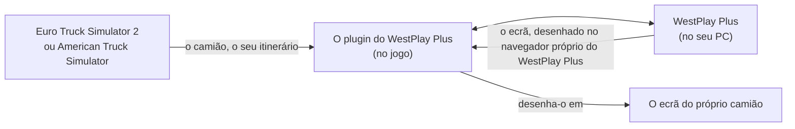

<p align="center"></p>

<h1 align="center">WestPlay Plus</h1>

<!-- languages:start -->
<p align="center">
  <a href="../../README.md">English</a> · <a href="README.zh-CN.md">简体中文</a> · <a href="README.zh-TW.md">繁體中文</a> · <a href="README.ja.md">日本語</a> · <a href="README.ko.md">한국어</a> · <a href="README.de.md">Deutsch</a> · <a href="README.fr.md">Français</a> · <a href="README.fr-CA.md">Français (Canada)</a> · <a href="README.es.md">Español</a> · <a href="README.es-419.md">Español (Latinoamérica)</a> · <a href="README.it.md">Italiano</a> · <a href="README.pt-BR.md">Português (Brasil)</a> · <b>Português (Portugal)</b> · <a href="README.ru.md">Русский</a> · <a href="README.pl.md">Polski</a> · <a href="README.szl.md">Ślōnsko godka</a> · <a href="README.nl.md">Nederlands</a> · <a href="README.tr.md">Türkçe</a> · <a href="README.uk.md">Українська</a> · <a href="README.cs.md">Čeština</a> · <a href="README.sk.md">Slovenčina</a> · <a href="README.hu.md">Magyar</a> · <a href="README.ro.md">Română</a> · <a href="README.bg.md">Български</a> · <a href="README.hr.md">Hrvatski</a> · <a href="README.sr-Latn.md">Srpski (latinica)</a> · <a href="README.sr-Cyrl.md">Српски (ћирилица)</a> · <a href="README.sl.md">Slovenščina</a> · <a href="README.mk.md">Македонски</a> · <a href="README.el.md">Ελληνικά</a> · <a href="README.sv.md">Svenska</a> · <a href="README.da.md">Dansk</a> · <a href="README.no.md">Norsk</a> · <a href="README.fi.md">Suomi</a> · <a href="README.et.md">Eesti</a> · <a href="README.lt.md">Lietuvių</a> · <a href="README.lv.md">Latviešu</a> · <a href="README.ca.md">Català</a> · <a href="README.gl.md">Galego</a> · <a href="README.eu.md">Euskara</a> · <a href="README.ka.md">ქართული</a> · <a href="README.vi.md">Tiếng Việt</a>
</p>
<!-- languages:end -->

<p align="center">
  <b>Um ecrã ao estilo CarPlay para os camiões do Euro Truck Simulator 2 e do American Truck Simulator.</b><br>
  O seu mapa, a sua música e o YouTube, no ecrã do painel do seu próprio camião.
  <br>
  Um ramo modificado do <a href="https://github.com/enes-less/WestPlay">WestPlay</a>, para jogadores de língua chinesa.
</p>

<p align="center">
  <a href="https://github.com/HandsomeTurtle0307/WestPlay-Plus/releases/latest"></a>
  
  
  
  <a href="../../LICENSE"></a>
</p>

O WestPlay Plus põe um ecrã de telemóvel no ecrã do painel do seu próprio camião, dentro do jogo: Euro Truck Simulator 2 ou American Truck Simulator, um só ecrã para os dois. O seu itinerário num mapa desenhado a partir do seu próprio jogo, a sua música, o YouTube, o tempo que vai fazer na sua viagem: exatamente onde um camião a sério tem o seu ecrã, comandado com o rato enquanto mantém uma tecla carregada.

## Funcionalidades

**Mapas a partir do seu próprio jogo.** Desenhados a partir do mapa do seu jogo, com os mods de mapa incluídos (ProMods e outros), com o seu itinerário, as indicações curva a curva e uma pesquisa que acrescenta paragens ao GPS do próprio jogo.

**Um painel para a estrada.** O mapa ao lado do que está a tocar e de onde vai, o tempo da sua viagem, tudo num só ecrã.

**A sua música.** Apple Music, Spotify e YouTube Music, com Now Playing e letras. O videoclipe de uma música passa diretamente no Now Playing, e o YouTube tem os seus canais, listas de reprodução, legendas e qualidades. O leitor toca as músicas que colocar na pasta de música do próprio jogo.

**Claro e escuro, e o seu próprio aspeto.** Fica escuro à noite ou quando acende os faróis, como o sensor de luz de um automóvel. Pode trazer os seus próprios papéis de parede e ícones.

**A aplicação companheira** no seu PC prepara tudo: encontra os seus jogos (ETS2, ATS ou os dois), instala o WestPlay Plus em cada um, constrói os respetivos mapas e depois sai da frente.

## Como funciona



O WestPlay Plus desenha o seu ecrã num navegador próprio, no seu PC, e o plugin dele coloca cada fotograma no ecrã do seu camião, dentro do jogo. Os ecrãs dos próprios camiões e as suas barras de informação continuam a ser deles: o WestPlay Plus ocupa o lugar do GPS, e a definição «Vehicle Bar» diz se a barra do camião fica ao lado.

## Camiões

O WestPlay Plus aparece de duas formas: no ecrã do próprio camião ou no tablet WestPlay Plus.

**No ecrã do próprio camião.** Nos camiões que na realidade têm CarPlay, o WestPlay Plus ocupa o lugar do GPS no ecrã do painel, adaptado à forma dele. Não há nada para comprar nem para montar: entra e ele está lá. No Euro Truck Simulator 2:

- **DAF** XF e XG/XG+ 2021, XF Electric e XD (e o DAF 2021 do Jasper)
- **Scania** S e R, com o ecrã de 7" ou o Smart Dash, e o S BEV
- **Iveco** S-Way
- **Renault** T (2024)
- **Volvo** FH (2021 e 2024)
- **Coaches DLC:** o Scania Touring e o MAN Lion's Coach (2024)
- **Os autocarros da Oyuncuyusbis:** o Mercedes-Benz Travego 16 SHD, o MAN Lion's Coach e o Setra S 531 DT nos seus próprios ecrãs do painel
- **Setra S 516 HD/2** (da Oyuncuyusbis): no ecrã de GPS do próprio autocarro, a parte «Gps» dele, que monta na oficina: o ecrã do próprio autocarro, como os jogadores dele pediram, mas um que acrescenta

**No tablet WestPlay Plus.** Todos os outros camiões, tanto os do jogo como os de mod, recebem o WestPlay Plus num tablet que monta na oficina: em Acessórios, nos itens suspensos ou como conjunto de painel. O ecrã do próprio camião mantém a navegação do jogo. O tablet está em todos os camiões com itens suspensos, incluindo os camiões de mod que instalar mais tarde (recebem-no na próxima vez que iniciar o jogo).

**No American Truck Simulator**, por agora o WestPlay Plus fica no tablet em todos os camiões. Os camiões cujos equivalentes reais têm CarPlay receberão o WestPlay Plus no próprio ecrã mais adiante.

|                          | Ecrã do próprio camião   | Tablet WestPlay Plus |
| ------------------------ | ------------------------ | -------------------- |
| Camiões                  | Os camiões ETS2 acima    | Todos os outros, e todos os de ATS por agora |
| Como o obter             | Nada: já está lá         | Montá-lo na oficina  |
| Navegação do jogo        | Substituída pelo WestPlay Plus | Fica no ecrã do camião |

### Som

Nestes camiões do Euro Truck Simulator 2, a música sai pelas colunas do próprio camião, cada uma no seu lugar na cabina. Os outros camiões, e os do American Truck Simulator por agora, tocam em estéreo simples.

- **Scania S e R (2016), S BEV** — woofers de porta, tweeters do pilar A, graves no teto
- **Scania R (2009), Streamline** — woofers de porta, tweeters do pilar A
- **DAF XF (105)** — tweeters do pilar A; dois pares na prateleira do teto no Super Space Cab, uma unidade no teto nos restantes
- **DAF XF Euro 6** — woofers de porta, tweeters do pilar A; dois pares na prateleira do teto no Super Space Cab, uma unidade no teto nos restantes
- **DAF XF, XG, XG+ (2021), XF Electric e XD** — woofers de porta, tweeters do pilar A, um par em cima, uma unidade central
- **MAN TGX** — woofers de porta; no XXL, também duas unidades pequenas no alto de cada parede lateral
- **MAN TGX Euro 6** — woofers de porta; no XL, também uma unidade pequena em cada canto do teto
- **MAN TGX (2020)** — um woofer e um médio em cada porta, tweeters do pilar A
- **Mercedes-Benz Actros (2014)** — woofers de porta, um par em cima, tweeters do pilar A
- **Mercedes-Benz Actros (2009)** — woofers de porta, um par nos cantos da frente da prateleira do teto
- **Volvo FH (2021, 2024), FH16 (2012)** — woofers de porta, graves na parede traseira
- **Volvo FH16 (2009)** — uma unidade em cada porta
- **Iveco Stralis** — uma unidade em cada extremidade da consola do teto, e nos tetos altos uma pequena do lado do passageiro
- **Iveco Hi-Way** — uma unidade em cada extremidade da consola do teto, e uma no alto de cada lado
- **Iveco S-Way** — um woofer e um tweeter em cada porta
- **Renault Magnum** — uma unidade em cada canto do teto, tweeters na consola do teto
- **Renault Premium** — uma unidade em cada lado do teto, mais em baixo no teto baixo
- **Renault T** — tweeters do pilar A, um par na parede traseira; woofers de porta nos interiores de 2024
- **Renault E-Tech T** — woofers de porta, tweeters do pilar A, um par na parede traseira
- **Scania PGR da JuseeTV** — as colunas das peças que monta: portas, pilares A, consola superior, parede traseira

## Instalação

1. Transfira o instalador a partir da [versão mais recente](https://github.com/HandsomeTurtle0307/WestPlay-Plus/releases/latest) e execute-o.
2. A aplicação companheira abre-se e guia-o pelo resto: encontra os seus jogos (ETS2, ATS ou os dois), instala em cada um o plugin do WestPlay Plus e o mod do ecrã, e constrói os seus mapas.
3. Inicie o jogo e entre num camião.

**Atualizações:** este ramo não se atualiza sozinho. Para ver se há uma versão mais recente, visite a [página de versões](https://github.com/HandsomeTurtle0307/WestPlay-Plus/releases). A página «Acerca de» da aplicação companheira tem a mesma ligação.

**Requisitos:** Windows 10 ou 11 (64 bits), Euro Truck Simulator 2 versão 1.62 (ou 1.61) ou American Truck Simulator versão 1.62 (outras versões podem funcionar; a aplicação companheira avisa quando uma não foi testada), e o Microsoft Edge WebView2 (faz parte do Windows 11; o instalador acrescenta-o onde falta).

## Privacidade

O WestPlay Plus não tem servidores, não tem contas próprias e não tem estatísticas. Não recolhe nem envia nada sobre si.

- Inicia sessão no Apple Music, no Spotify e no YouTube nas páginas deles, no perfil de navegador próprio do WestPlay Plus no seu PC, como faria num navegador. O WestPlay Plus não guarda quaisquer dados de conta.
- O seu mapa é construído no seu PC a partir do seu jogo e fica lá.
- O WestPlay Plus fala com os serviços que utiliza, e com o GitHub apenas quando abre a página de versões dele.

## Comentários

Erros, dúvidas e ideias: abra uma issue no [GitHub](https://github.com/HandsomeTurtle0307/WestPlay-Plus/issues).

## Compilar a partir do código-fonte

Precisa de [Rust](https://rustup.rs) (stable) e de [Node.js](https://nodejs.org) 24, no Windows.

```sh
npm install      # as ferramentas da aplicação companheira e os pacotes da interface
npm run dev      # o WestPlay Plus, com a interface servida ao vivo
```

`cargo test --workspace` e `npm test --prefix ui` correm os testes. O plugin do jogo é compilado com `cargo build --release -p westplay-plugin`.

## Licença

O WestPlay Plus é software livre: pode redistribuí-lo e modificá-lo nos termos da GNU General Public License, versão 3 ou (se preferir) qualquer versão posterior. Ver [LICENSE](../../LICENSE).

Copyright © 2026 HandsomeTurtle0307. As bibliotecas distribuídas com o WestPlay Plus mantêm as suas próprias licenças: ver [THIRD_PARTY_LICENSES.md](../../THIRD_PARTY_LICENSES.md), e [THIRD_PARTY_NOTICES.md](../../THIRD_PARTY_NOTICES.md) para as obras que segue.

## De onde vem este projeto

O WestPlay Plus é um ramo modificado (fork) do [WestPlay](https://github.com/enes-less/WestPlay), um excelente mod de ecrã ao estilo CarPlay para Euro Truck Simulator 2 e American Truck Simulator, feito pelo **enes-less**. Quase todo o design, o código e os recursos originais são trabalho dele; este ramo mantém as suas próprias alterações por cima e agradece o que ele construiu. Se gostar deste projeto, veja também o original.

Apoie também o projeto original (e, se puder, apoie-me também 😭😭😭 — desenvolver software não é fácil~).

<!-- translated:start -->
<sub>Este README é uma tradução da versão em inglês. O autor não fala as 43 línguas, nem de perto 😭😭, por isso a tradução pode estar incompleta em alguns pontos. Desculpe~ Se encontrar algo errado no seu idioma, avise, é muito bem-vindo~</sub>
<!-- translated:end -->

<sub>O WestPlay Plus é um projeto independente, sem ligação nem aprovação da Apple, da SCS Software, do Spotify, do Google ou dos fabricantes de camiões. CarPlay, Apple Music, Spotify, YouTube, YouTube Music e os nomes e logótipos dos fabricantes são marcas dos respetivos proprietários, usadas aqui apenas para nomear aquilo com que o WestPlay Plus funciona.</sub>
