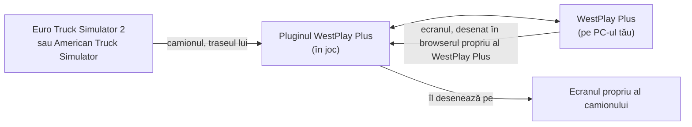

<p align="center"></p>

<h1 align="center">WestPlay Plus</h1>

<!-- languages:start -->
<p align="center">
  <a href="../../README.md">English</a> · <a href="README.zh-CN.md">简体中文</a> · <a href="README.zh-TW.md">繁體中文</a> · <a href="README.ja.md">日本語</a> · <a href="README.ko.md">한국어</a> · <a href="README.de.md">Deutsch</a> · <a href="README.fr.md">Français</a> · <a href="README.fr-CA.md">Français (Canada)</a> · <a href="README.es.md">Español</a> · <a href="README.es-419.md">Español (Latinoamérica)</a> · <a href="README.it.md">Italiano</a> · <a href="README.pt-BR.md">Português (Brasil)</a> · <a href="README.pt-PT.md">Português (Portugal)</a> · <a href="README.ru.md">Русский</a> · <a href="README.pl.md">Polski</a> · <a href="README.szl.md">Ślōnsko godka</a> · <a href="README.nl.md">Nederlands</a> · <a href="README.tr.md">Türkçe</a> · <a href="README.uk.md">Українська</a> · <a href="README.cs.md">Čeština</a> · <a href="README.sk.md">Slovenčina</a> · <a href="README.hu.md">Magyar</a> · <b>Română</b> · <a href="README.bg.md">Български</a> · <a href="README.hr.md">Hrvatski</a> · <a href="README.sr-Latn.md">Srpski (latinica)</a> · <a href="README.sr-Cyrl.md">Српски (ћирилица)</a> · <a href="README.sl.md">Slovenščina</a> · <a href="README.mk.md">Македонски</a> · <a href="README.el.md">Ελληνικά</a> · <a href="README.sv.md">Svenska</a> · <a href="README.da.md">Dansk</a> · <a href="README.no.md">Norsk</a> · <a href="README.fi.md">Suomi</a> · <a href="README.et.md">Eesti</a> · <a href="README.lt.md">Lietuvių</a> · <a href="README.lv.md">Latviešu</a> · <a href="README.ca.md">Català</a> · <a href="README.gl.md">Galego</a> · <a href="README.eu.md">Euskara</a> · <a href="README.ka.md">ქართული</a> · <a href="README.vi.md">Tiếng Việt</a>
</p>
<!-- languages:end -->

<p align="center">
  <b>Un ecran în stil CarPlay pentru camioanele din Euro Truck Simulator 2 și American Truck Simulator.</b><br>
  Harta ta, muzica ta și YouTube, pe bordul propriului tău camion.
  <br>
  O ramură modificată a <a href="https://github.com/enes-less/WestPlay">WestPlay</a>, cu câteva optimizări și funcții noi.
</p>

<p align="center">
  <a href="https://github.com/HandsomeTurtle0307/WestPlay-Plus/releases/latest"></a>
  
  
  
  <a href="../../LICENSE"></a>
</p>

WestPlay Plus pune un ecran ca de telefon pe bordul propriului tău camion, în joc: Euro Truck Simulator 2 sau American Truck Simulator, un singur ecran pentru amândouă. Traseul tău pe o hartă desenată din propriul joc, muzica ta, YouTube, vremea de pe drum: exact acolo unde un camion adevărat are ecranul, manevrat cu mouse-ul ținând o tastă apăsată.

<!-- why:start -->

## De ce am făcut asta

La început căutam un mod de CarPlay, apoi am dat peste WestPlay și am văzut că e foarte bine făcut (serios, foarte foarte bine). Doar că optimizarea nu era bună și mi-a blocat calculatorul. Așa că am decis să-l îmbunătățesc singur: am lucrat la performanță și am adăugat câteva funcții noi (stau pe umerii unui uriaș, hihi~😊).

<!-- why:end -->

## Funcții

**Hărți din propriul joc.** Desenate din harta jocului tău, cu modurile de hartă incluse (ProMods și altele), cu traseul tău, indicații viraj cu viraj și o căutare care adaugă opriri în GPS-ul jocului.

**Un bord pentru drum.** Harta lângă ce se aude și lângă unde mergi, vremea de pe traseu, toate pe un singur ecran.

**Muzica ta.** Apple Music, Spotify și YouTube Music, cu Now Playing și versuri. Videoclipul unei piese rulează direct în Now Playing, iar YouTube are canalele, listele de redare, subtitrările și calitățile sale. Playerul redă piesele pe care le pui în folderul de muzică al jocului.

**Luminos și întunecat, și aspectul tău.** Se întunecă noaptea sau când aprinzi farurile, ca un senzor de lumină de mașină. Fundalurile și pictogramele proprii le aduci tu.

**Aplicația companion** de pe PC pregătește totul: îți găsește jocurile (ETS2, ATS sau amândouă), instalează WestPlay Plus în fiecare, le construiește hărțile și apoi se ține deoparte.

## Cum funcționează



WestPlay Plus își desenează ecranul într-un browser propriu pe PC-ul tău, iar pluginul său pune fiecare cadru pe ecranul camionului tău, în joc. Ecranele proprii ale camioanelor și barele lor de informații rămân ale lor: WestPlay Plus ia locul GPS-ului, iar setarea „Vehicle Bar” spune dacă bara camionului rămâne alături.

## Camioane

WestPlay Plus apare în două feluri: pe ecranul propriu al camionului sau pe tableta WestPlay Plus.

**Pe ecranul propriu al camionului.** În camioanele care au CarPlay în realitate, WestPlay Plus ia locul GPS-ului pe ecranul bordului, potrivit formei acestuia. Nimic de cumpărat sau montat: te urci și e acolo. În Euro Truck Simulator 2:

- **DAF** XF și XG/XG+ 2021, XF Electric și XD (și DAF 2021 al lui Jasper)
- **Scania** S și R, cu ecranul de 7" sau cu Smart Dash, și S BEV
- **Iveco** S-Way
- **Renault** T (2024)
- **Volvo** FH (2021 și 2024)
- **Coaches DLC:** Scania Touring și MAN Lion's Coach (2024)
- **Autocarele Oyuncuyusbis:** Mercedes-Benz Travego 16 SHD, MAN Lion's Coach și Setra S 531 DT pe propriile ecrane de bord
- **Setra S 516 HD/2** (de la Oyuncuyusbis): pe ecranul GPS propriu al autocarului, partea lui „Gps”, pe care o montezi la dealerul de camioane: ecranul propriu al autocarului, cum au cerut jucătorii lui, dar unul pe care îl adaugi tu

**Pe tableta WestPlay Plus.** Toate celelalte camioane, atât cele din joc, cât și cele din moduri, primesc WestPlay Plus pe o tabletă pe care o montezi la dealerul de camioane: la Accesorii, printre obiectele atârnate sau ca set de bord. Ecranul propriu al camionului păstrează navigația jocului. Tableta există în fiecare camion cu obiecte atârnate, inclusiv în modurile de camioane instalate mai târziu (le-o dau la următoarea pornire a jocului).

**În American Truck Simulator**, deocamdată WestPlay Plus este pe tabletă în toate camioanele. Camioanele ale căror echivalente reale au CarPlay vor primi WestPlay Plus pe propriul ecran mai târziu.

|                        | Ecranul propriu al camionului | Tableta WestPlay Plus |
| ---------------------- | ----------------------------- | --------------------- |
| Camioane               | Camioanele ETS2 de mai sus    | Toate celelalte, și deocamdată toate camioanele ATS |
| Cum îl obții           | Nimic: e deja acolo           | Montează-l la dealer   |
| Navigația jocului      | Înlocuită de WestPlay Plus    | Rămâne pe ecranul camionului |

### Sunet

În aceste camioane din Euro Truck Simulator 2, muzica iese din difuzoarele proprii ale camionului, fiecare la locul lui în cabină. Celelalte camioane, și deocamdată cele din American Truck Simulator, cântă în stereo simplu.

- **Scania S și R (2016), S BEV** — wooferi în uși, tweetere în stâlpii A, bas în plafon
- **Scania R (2009), Streamline** — wooferi în uși, tweetere în stâlpii A
- **DAF XF (105)** — tweetere în stâlpii A; două perechi pe polița de plafon la Super Space Cab, o unitate de plafon la celelalte
- **DAF XF Euro 6** — wooferi în uși, tweetere în stâlpii A; două perechi pe polița de plafon la Super Space Cab, o unitate de plafon la celelalte
- **DAF XF, XG, XG+ (2021), XF Electric și XD** — wooferi în uși, tweetere în stâlpii A, o pereche sus, o unitate centrală
- **MAN TGX** — wooferi în uși; la XXL, în plus, două unități mici sus în fiecare perete lateral
- **MAN TGX Euro 6** — wooferi în uși; la XL, în plus, o unitate mică în fiecare colț de plafon
- **MAN TGX (2020)** — un woofer și un mediu în fiecare ușă, tweetere în stâlpii A
- **Mercedes-Benz Actros (2014)** — wooferi în uși, o pereche sus, tweetere în stâlpii A
- **Mercedes-Benz Actros (2009)** — wooferi în uși, o pereche în colțurile din față ale poliței de plafon
- **Volvo FH (2021, 2024), FH16 (2012)** — wooferi în uși, bas în peretele din spate
- **Volvo FH16 (2009)** — o unitate în fiecare ușă
- **Iveco Stralis** — o unitate la fiecare capăt al consolei de plafon, iar la plafoanele înalte una mică pe partea pasagerului
- **Iveco Hi-Way** — o unitate la fiecare capăt al consolei de plafon și una sus pe fiecare parte
- **Iveco S-Way** — un woofer și un tweeter în fiecare ușă
- **Renault Magnum** — o unitate în fiecare colț de plafon, tweetere pe consola de plafon
- **Renault Premium** — o unitate pe fiecare parte a plafonului, mai jos la plafonul jos
- **Renault T** — tweetere în stâlpii A, o pereche în peretele din spate; wooferi în uși la interioarele din 2024
- **Renault E-Tech T** — wooferi în uși, tweetere în stâlpii A, o pereche în peretele din spate
- **Scania PGR de la JuseeTV** — difuzoarele pieselor pe care le montezi: uși, stâlpi A, consola superioară, peretele din spate

## Instalare

1. Descarcă programul de instalare din [cea mai recentă versiune](https://github.com/HandsomeTurtle0307/WestPlay-Plus/releases/latest) și rulează-l.
2. Aplicația companion se deschide și te ghidează prin restul: îți găsește jocurile (ETS2, ATS sau amândouă), instalează în fiecare pluginul WestPlay Plus și modul de ecran, și îți construiește hărțile.
3. Pornește jocul și urcă într-un camion.

**Actualizări:** această ramură nu se actualizează singură. Ca să vezi dacă există o versiune mai nouă, intră pe [pagina de versiuni](https://github.com/HandsomeTurtle0307/WestPlay-Plus/releases). Același link este și pe pagina „Despre” a aplicației companion.

**Cerințe:** Windows 10 sau 11 (64 de biți), Euro Truck Simulator 2 versiunea 1.62 (sau 1.61) ori American Truck Simulator versiunea 1.62 (alte versiuni pot funcționa; aplicația companion te anunță când una nu a fost testată) și Microsoft Edge WebView2 (parte din Windows 11; programul de instalare îl adaugă acolo unde lipsește).

## Confidențialitate

WestPlay Plus nu are servere, conturi proprii și analitice. Nu colectează și nu trimite nimic despre tine.

- Te conectezi la Apple Music, Spotify și YouTube pe paginile lor, în profilul de browser propriu al WestPlay Plus de pe PC-ul tău, ca într-un browser. WestPlay Plus nu păstrează el însuși date de cont.
- Harta ta este construită pe PC-ul tău din jocul tău și rămâne acolo.
- WestPlay Plus vorbește cu serviciile pe care le folosești și cu GitHub doar când deschizi pagina lui de versiuni.

## Feedback

Erori, întrebări și idei: deschide un issue pe [GitHub](https://github.com/HandsomeTurtle0307/WestPlay-Plus/issues).

## Compilarea din surse

Ai nevoie de [Rust](https://rustup.rs) (stable) și [Node.js](https://nodejs.org) 24, pe Windows.

```sh
npm install      # uneltele aplicației companion și pachetele interfeței
npm run dev      # WestPlay Plus, cu interfața servită live
```

`cargo test --workspace` și `npm test --prefix ui` rulează testele. Pluginul jocului se compilează cu `cargo build --release -p westplay-plugin`.

## Licență

WestPlay Plus este software liber: îl poți redistribui și modifica în termenii GNU General Public License, versiunea 3 sau (la alegerea ta) orice versiune ulterioară. Vezi [LICENSE](../../LICENSE).

Copyright © 2026 HandsomeTurtle0307. Bibliotecile livrate cu WestPlay Plus își păstrează propriile licențe: vezi [THIRD_PARTY_LICENSES.md](../../THIRD_PARTY_LICENSES.md) și [THIRD_PARTY_NOTICES.md](../../THIRD_PARTY_NOTICES.md) pentru lucrările pe care le urmează.

## De unde vine acest proiect

WestPlay Plus este o ramură modificată (fork) a [WestPlay](https://github.com/enes-less/WestPlay), un mod de ecran în stil CarPlay excelent pentru Euro Truck Simulator 2 și American Truck Simulator, făcut de **enes-less**. Aproape tot designul, codul și resursele originale sunt munca lui; această ramură păstrează modificările proprii peste ele și îi este recunoscătoare pentru ce a construit. Dacă îți place proiectul, aruncă o privire și la original.

Susține și proiectul original (și, dacă poți, susține-mă și pe mine 😭😭😭 — să faci software nu e ușor~).

<!-- translated:start -->
<sub>Acest README este o traducere a versiunii în engleză. Autorul nu vorbește, desigur, toate cele 43 de limbi 😭😭, așa că traducerea poate fi incompletă pe alocuri. Vă rog să mă iertați~ Dacă observați o greșeală în limba dumneavoastră, spuneți-mi, voi fi recunoscător~</sub>
<!-- translated:end -->

<sub>WestPlay Plus este un proiect independent, fără legătură cu Apple, SCS Software, Spotify, Google sau producătorii de camioane și fără aprobarea lor. CarPlay, Apple Music, Spotify, YouTube, YouTube Music, precum și numele și logourile producătorilor sunt mărci ale proprietarilor lor, folosite aici doar pentru a numi ceea ce susține WestPlay Plus.</sub>
