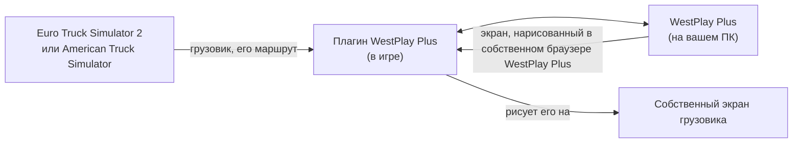

<p align="center"></p>

<h1 align="center">WestPlay Plus</h1>

<!-- languages:start -->
<p align="center">
  <a href="../../README.md">English</a> · <a href="README.zh-CN.md">简体中文</a> · <a href="README.zh-TW.md">繁體中文</a> · <a href="README.ja.md">日本語</a> · <a href="README.ko.md">한국어</a> · <a href="README.de.md">Deutsch</a> · <a href="README.fr.md">Français</a> · <a href="README.fr-CA.md">Français (Canada)</a> · <a href="README.es.md">Español</a> · <a href="README.es-419.md">Español (Latinoamérica)</a> · <a href="README.it.md">Italiano</a> · <a href="README.pt-BR.md">Português (Brasil)</a> · <a href="README.pt-PT.md">Português (Portugal)</a> · <b>Русский</b> · <a href="README.pl.md">Polski</a> · <a href="README.szl.md">Ślōnsko godka</a> · <a href="README.nl.md">Nederlands</a> · <a href="README.tr.md">Türkçe</a> · <a href="README.uk.md">Українська</a> · <a href="README.cs.md">Čeština</a> · <a href="README.sk.md">Slovenčina</a> · <a href="README.hu.md">Magyar</a> · <a href="README.ro.md">Română</a> · <a href="README.bg.md">Български</a> · <a href="README.hr.md">Hrvatski</a> · <a href="README.sr-Latn.md">Srpski (latinica)</a> · <a href="README.sr-Cyrl.md">Српски (ћирилица)</a> · <a href="README.sl.md">Slovenščina</a> · <a href="README.mk.md">Македонски</a> · <a href="README.el.md">Ελληνικά</a> · <a href="README.sv.md">Svenska</a> · <a href="README.da.md">Dansk</a> · <a href="README.no.md">Norsk</a> · <a href="README.fi.md">Suomi</a> · <a href="README.et.md">Eesti</a> · <a href="README.lt.md">Lietuvių</a> · <a href="README.lv.md">Latviešu</a> · <a href="README.ca.md">Català</a> · <a href="README.gl.md">Galego</a> · <a href="README.eu.md">Euskara</a> · <a href="README.ka.md">ქართული</a> · <a href="README.vi.md">Tiếng Việt</a>
</p>
<!-- languages:end -->

<p align="center">
  <b>Экран в стиле CarPlay для грузовиков Euro Truck Simulator 2 и American Truck Simulator.</b><br>
  Ваша карта, ваша музыка и YouTube — на собственном экране вашего грузовика.
  <br>
  Изменённая ветка <a href="https://github.com/enes-less/WestPlay">WestPlay</a>, для игроков, говорящих по-китайски.
</p>

<p align="center">
  <a href="https://github.com/HandsomeTurtle0307/WestPlay-Plus/releases/latest"></a>
  
  
  
  <a href="../../LICENSE"></a>
</p>

WestPlay Plus ставит экран в стиле телефона на собственную приборную панель вашего грузовика, прямо в игре: Euro Truck Simulator 2 или American Truck Simulator, один экран для обеих. Ваш маршрут на карте, нарисованной из вашей же игры, ваша музыка, YouTube, погода на вашем пути: ровно там, где у настоящего грузовика стоит экран, с управлением мышью при зажатой клавише.

## Возможности

**Карты из вашей собственной игры.** Рисуются из карты вашей игры, включая картомоды (ProMods и другие), с вашим маршрутом, пошаговыми подсказками и поиском, который добавляет остановки в собственный GPS игры.

**Панель для дороги.** Карта рядом с тем, что играет, и с тем, куда вы едете, погода на вашем пути — всё на одном экране.

**Ваша музыка.** Apple Music, Spotify и YouTube Music, с Now Playing и текстами песен. Клип песни играет прямо в Now Playing, а в YouTube есть каналы, плейлисты, субтитры и качество. Плеер играет песни, которые вы кладёте в музыкальную папку игры.

**Светлая и тёмная тема, и свой вид.** Ночью или когда вы включаете фары экран темнеет, как датчик света в автомобиле. Свои обои и значки приложений можно поставить самому.

**Приложение-компаньон** на вашем ПК всё настраивает: находит ваши игры (ETS2, ATS или обе), устанавливает WestPlay Plus в каждую, строит их карты, а потом не мешает.

## Как это работает



WestPlay Plus рисует свой экран в собственном браузере на вашем ПК, а его плагин выводит каждый кадр на экран вашего грузовика, внутри игры. Собственные экраны грузовиков и их информационные панели остаются их: WestPlay Plus занимает место GPS, а настройка «Vehicle Bar» решает, останется ли панель грузовика рядом.

## Грузовики

WestPlay Plus появляется двумя способами: на собственном экране грузовика или на планшете WestPlay Plus.

**На собственном экране грузовика.** В грузовиках, у которых в реальности есть CarPlay, WestPlay Plus занимает место GPS на приборном экране и подстраивается под его форму. Покупать и устанавливать ничего не нужно: садитесь, и он уже там. В Euro Truck Simulator 2:

- **DAF** XF и XG/XG+ 2021, XF Electric и XD (а также DAF 2021 от Jasper)
- **Scania** S и R, с экраном 7" или со Smart Dash, и S BEV
- **Iveco** S-Way
- **Renault** T (2024)
- **Volvo** FH (2021 и 2024)
- **Coaches DLC:** Scania Touring и MAN Lion's Coach (2024)
- **Автобусы Oyuncuyusbis:** Mercedes-Benz Travego 16 SHD, MAN Lion's Coach и Setra S 531 DT на их собственных приборных экранах
- **Setra S 516 HD/2** (от Oyuncuyusbis): на собственном GPS-экране автобуса, его части «Gps», которую вы ставите в грузовой мастерской: собственный экран автобуса, как просили его игроки, но тот, который добавляете вы

**На планшете WestPlay Plus.** У всех остальных грузовиков, что из игры, что из модов, WestPlay Plus живёт на планшете, который вы ставите в грузовой мастерской: в разделе «Аксессуары», среди подвесных предметов или как набор для приборной панели. Собственный экран грузовика сохраняет навигацию игры. Планшет есть в каждом грузовике с подвесными предметами, включая моды грузовиков, которые вы установите позже (они получат его при следующем запуске игры).

**В American Truck Simulator** пока что WestPlay Plus стоит на планшете в каждом грузовике. Грузовики, у прототипов которых есть CarPlay, позже получат WestPlay Plus на собственный экран.

|                          | Собственный экран грузовика | Планшет WestPlay Plus |
| ------------------------ | --------------------------- | --------------------- |
| Грузовики                | Грузовики ETS2 выше         | Все остальные, и пока все грузовики ATS |
| Как получить             | Ничего: он уже там          | Поставить в мастерской |
| Навигация игры           | Заменяется WestPlay Plus    | Остаётся на экране грузовика |

### Звук

В этих грузовиках Euro Truck Simulator 2 музыка играет из собственных динамиков грузовика, каждый — на своём месте в кабине. В остальных грузовиках, и пока в грузовиках American Truck Simulator, звук обычный стерео.

- **Scania S и R (2016), S BEV** — вуферы в дверях, твитеры в стойках A, бас в потолке
- **Scania R (2009), Streamline** — вуферы в дверях, твитеры в стойках A
- **DAF XF (105)** — твитеры в стойках A; две пары на потолочной полке в Super Space Cab, один потолочный блок в остальных
- **DAF XF Euro 6** — вуферы в дверях, твитеры в стойках A; две пары на потолочной полке в Super Space Cab, один потолочный блок в остальных
- **DAF XF, XG, XG+ (2021), XF Electric и XD** — вуферы в дверях, твитеры в стойках A, пара на потолке, центральный блок
- **MAN TGX** — вуферы в дверях; в XXL ещё по два небольших блока высоко в каждой боковой стенке
- **MAN TGX Euro 6** — вуферы в дверях; в XL ещё по небольшому блоку в каждом углу потолка
- **MAN TGX (2020)** — вуфер и среднечастотник в каждой двери, твитеры в стойках A
- **Mercedes-Benz Actros (2014)** — вуферы в дверях, пара на потолке, твитеры в стойках A
- **Mercedes-Benz Actros (2009)** — вуферы в дверях, пара в передних углах потолочной полки
- **Volvo FH (2021, 2024), FH16 (2012)** — вуферы в дверях, бас в задней стенке
- **Volvo FH16 (2009)** — по блоку в каждой двери
- **Iveco Stralis** — по блоку с каждого края потолочной консоли, а в высоких крышах ещё небольшой со стороны пассажира
- **Iveco Hi-Way** — по блоку с каждого края потолочной консоли и по одному высоко с каждой стороны
- **Iveco S-Way** — вуфер и твитер в каждой двери
- **Renault Magnum** — по блоку в каждом углу потолка, твитеры на потолочной консоли
- **Renault Premium** — по блоку с каждой стороны потолка, ниже в низкой крыше
- **Renault T** — твитеры в стойках A, пара в задней стенке; вуферы в дверях в интерьерах 2024 года
- **Renault E-Tech T** — вуферы в дверях, твитеры в стойках A, пара в задней стенке
- **Scania PGR от JuseeTV** — динамики тех деталей, которые вы ставите: двери, стойки A, верхняя консоль, задняя стенка

## Установка

1. Скачайте установщик из [последней версии](https://github.com/HandsomeTurtle0307/WestPlay-Plus/releases/latest) и запустите его.
2. Откроется приложение-компаньон и проведёт вас через остальное: найдёт ваши игры (ETS2, ATS или обе), установит в каждую плагин WestPlay Plus и его мод экрана, а затем построит ваши карты.
3. Запустите игру и сядьте в грузовик.

**Обновления:** эта ветка не обновляется сама. Чтобы проверить, нет ли более новой версии, зайдите на [страницу релизов](https://github.com/HandsomeTurtle0307/WestPlay-Plus/releases). Та же ссылка есть на странице «О программе» в приложении-компаньоне.

**Требования:** Windows 10 или 11 (64 бита), Euro Truck Simulator 2 версии 1.62 (или 1.61) либо American Truck Simulator версии 1.62 (другие версии могут работать; если версия не проверена, приложение-компаньон об этом скажет) и Microsoft Edge WebView2 (входит в Windows 11; установщик добавит его, если его нет).

## Конфиденциальность

У WestPlay Plus нет серверов, своих аккаунтов и аналитики. Он ничего о вас не собирает и не отправляет.

- Вы входите в Apple Music, Spotify и YouTube на их собственных страницах, в отдельном профиле браузера WestPlay Plus на вашем ПК, как в обычном браузере. Сам WestPlay Plus не хранит никаких данных аккаунтов.
- Ваша карта строится на вашем ПК из вашей игры и остаётся там.
- WestPlay Plus общается с сервисами, которыми вы пользуетесь, и с GitHub — только когда вы открываете его страницу релизов.

## Обратная связь

Ошибки, вопросы и идеи: откройте issue на [GitHub](https://github.com/HandsomeTurtle0307/WestPlay-Plus/issues).

## Сборка из исходного кода

Вам понадобятся [Rust](https://rustup.rs) (stable) и [Node.js](https://nodejs.org) 24, на Windows.

```sh
npm install      # инструменты приложения-компаньона и пакеты интерфейса
npm run dev      # WestPlay Plus с живой раздачей интерфейса
```

`cargo test --workspace` и `npm test --prefix ui` запускают тесты. Плагин игры собирается командой `cargo build --release -p westplay-plugin`.

## Лицензия

WestPlay Plus — свободное программное обеспечение: вы можете распространять и изменять его на условиях GNU General Public License версии 3 или (на ваш выбор) любой более поздней версии. См. [LICENSE](../../LICENSE).

Copyright © 2026 HandsomeTurtle0307. Библиотеки, поставляемые с WestPlay Plus, сохраняют свои лицензии: см. [THIRD_PARTY_LICENSES.md](../../THIRD_PARTY_LICENSES.md) и [THIRD_PARTY_NOTICES.md](../../THIRD_PARTY_NOTICES.md) — о работах, которым он следует.

## Откуда этот проект

WestPlay Plus — изменённая ветка (форк) [WestPlay](https://github.com/enes-less/WestPlay), превосходного мода с экраном в стиле CarPlay для Euro Truck Simulator 2 и American Truck Simulator, созданного **enes-less**. Почти весь исходный дизайн, код и материалы — его работа; эта ветка держит свои изменения поверх и благодарна ему за то, что он построил. Если вам нравится этот проект, загляните и в оригинал.

Поддержите и оригинальный проект (а если сможете — поддержите и меня 😭😭😭, разрабатывать программы совсем не просто~).

<!-- translated:start -->
<sub>Этот README переведён с английской версии. Автор, конечно, не владеет всеми 43 языками 😭😭, поэтому перевод местами может быть неполным. Прошу прощения~ Если вы заметите ошибку в своём языке, напишите — буду очень благодарен~</sub>
<!-- translated:end -->

<sub>WestPlay Plus — независимый проект, не связанный с Apple, SCS Software, Spotify, Google и производителями грузовиков и не одобренный ими. CarPlay, Apple Music, Spotify, YouTube, YouTube Music, а также названия и логотипы производителей грузовиков являются товарными знаками их владельцев и используются здесь только для обозначения того, с чем работает WestPlay Plus.</sub>
