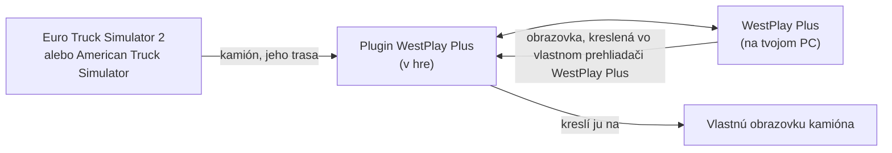

<p align="center"></p>

<h1 align="center">WestPlay Plus</h1>

<!-- languages:start -->
<p align="center">
  <a href="../../README.md">English</a> · <a href="README.zh-CN.md">简体中文</a> · <a href="README.zh-TW.md">繁體中文</a> · <a href="README.ja.md">日本語</a> · <a href="README.ko.md">한국어</a> · <a href="README.de.md">Deutsch</a> · <a href="README.fr.md">Français</a> · <a href="README.fr-CA.md">Français (Canada)</a> · <a href="README.es.md">Español</a> · <a href="README.es-419.md">Español (Latinoamérica)</a> · <a href="README.it.md">Italiano</a> · <a href="README.pt-BR.md">Português (Brasil)</a> · <a href="README.pt-PT.md">Português (Portugal)</a> · <a href="README.ru.md">Русский</a> · <a href="README.pl.md">Polski</a> · <a href="README.nl.md">Nederlands</a> · <a href="README.tr.md">Türkçe</a> · <a href="README.uk.md">Українська</a> · <a href="README.cs.md">Čeština</a> · <b>Slovenčina</b> · <a href="README.hu.md">Magyar</a> · <a href="README.ro.md">Română</a> · <a href="README.bg.md">Български</a> · <a href="README.hr.md">Hrvatski</a> · <a href="README.sr-Latn.md">Srpski (latinica)</a> · <a href="README.sr-Cyrl.md">Српски (ћирилица)</a> · <a href="README.sl.md">Slovenščina</a> · <a href="README.mk.md">Македонски</a> · <a href="README.el.md">Ελληνικά</a> · <a href="README.sv.md">Svenska</a> · <a href="README.da.md">Dansk</a> · <a href="README.no.md">Norsk</a> · <a href="README.fi.md">Suomi</a> · <a href="README.et.md">Eesti</a> · <a href="README.lt.md">Lietuvių</a> · <a href="README.lv.md">Latviešu</a> · <a href="README.ca.md">Català</a> · <a href="README.gl.md">Galego</a> · <a href="README.vi.md">Tiếng Việt</a>
</p>
<!-- languages:end -->

<!-- english-only:start -->
<p align="center"><sub>Sliezštinu, baskičtinu a gruzínčinu aplikácia podporuje, ale README zatiaľ nemajú: na kontrolu prekladu do týchto jazykov nebol nikto. Všetko je v anglickej verzii v koreni repozitára.</sub></p>
<!-- english-only:end -->

<p align="center">
  <b>Obrazovka v štýle CarPlay pre kamióny z Euro Truck Simulator 2 a American Truck Simulator.</b><br>
  Tvoja mapa, tvoja hudba a YouTube, na palubnej doske tvojho kamióna.
  <br>
  Upravená vetva <a href="https://github.com/enes-less/WestPlay">WestPlay</a>, s niekoľkými optimalizáciami a novými funkciami.
</p>

<p align="center">
  <a href="https://github.com/HandsomeTurtle0307/WestPlay-Plus/releases/latest"></a>
  
  
  
  <a href="../../LICENSE"></a>
</p>

WestPlay Plus dáva obrazovku ako z telefónu na palubnú dosku tvojho kamióna, priamo v hre: Euro Truck Simulator 2 alebo American Truck Simulator, jedna obrazovka pre oba. Tvoja trasa na mape nakreslenej z tvojej vlastnej hry, tvoja hudba, YouTube, počasie na ceste: presne tam, kde má opravdový kamión svoju obrazovku, ovládaná myšou pri držanej klávese.

<!-- why:start -->

## Prečo som to urobil

Najprv som hľadal mod na CarPlay, až som natrafil na WestPlay a zistil, že je fakt veľmi dobre urobený (vážne, veľmi veľmi dobre). Len optimalizácia bola slabá a zamrzla mi pri tom celá mašina. Tak som sa rozhodol doladiť ho sám: vyladiť výkon a pridať pár nových funkcií (stojím na ramenách obra, hi hi~😊).

<!-- why:end -->

## Funkcie

**Mapy z tvojej vlastnej hry.** Kreslené z mapy tvojej hry, vrátane mapových módov (ProMods a ďalšie), s tvojou trasou, navigačnými pokynmi zákruta po zákrute a hľadaním, ktoré pridáva zastávky do GPS samotnej hry.

**Palubná doska na cestu.** Mapa vedľa toho, čo práve hrá, a toho, kam ideš, počasie na ceste, to všetko na jednej obrazovke.

**Tvoja hudba.** Apple Music, Spotify a YouTube Music, s Now Playing a textami piesní. Klip k piesni sa prehrá priamo v Now Playing a YouTube má svoje kanály, playlisty, titulky a kvality. Prehrávač hrá piesne, ktoré dáš do hudobného priečinka hry.

**Svetlý a tmavý režim a tvoj vlastný vzhľad.** V noci alebo keď rozsvietiš svetlá stmavne, ako svetelný senzor v aute. Vlastné tapety a ikony aplikácií si prinesieš sám.

**Sprievodná aplikácia** na tvojom PC všetko pripraví: nájde tvoje hry (ETS2, ATS alebo obe), nainštaluje WestPlay Plus do každej z nich, postaví ich mapy a potom už neprekáža.

## Ako to funguje



WestPlay Plus kreslí svoju obrazovku vo vlastnom prehliadači na tvojom PC a jeho plugin ukladá každý snímok na obrazovku tvojho kamióna, v hre. Vlastné obrazovky kamiónov a ich informačné lišty zostávajú ich: WestPlay Plus zaujíma miesto GPS a nastavenie „Vehicle Bar“ hovorí, či lišta kamióna zostane vedľa.

## Kamióny

WestPlay Plus sa objavuje dvoma spôsobmi: na vlastnej obrazovke kamióna alebo na tablete WestPlay Plus.

**Na vlastnej obrazovke kamióna.** V kamiónoch, ktoré majú CarPlay aj v skutočnosti, WestPlay Plus zaujíma miesto GPS na obrazovke palubnej dosky a prispôsobí sa jej tvaru. Nie je čo kupovať ani montovať: nastúpiš a je tam. V Euro Truck Simulator 2:

- **DAF** XF a XG/XG+ 2021, XF Electric a XD (a DAF 2021 od Jaspera)
- **Scania** S a R, so 7" obrazovkou alebo so Smart Dash, a S BEV
- **Iveco** S-Way
- **Renault** T (2024)
- **Volvo** FH (2021 a 2024)
- **Coaches DLC:** Scania Touring a MAN Lion's Coach (2024)
- **Autobusy Oyuncuyusbis:** Mercedes-Benz Travego 16 SHD, MAN Lion's Coach a Setra S 531 DT na ich vlastných palubných doskách
- **Setra S 516 HD/2** (od Oyuncuyusbis): na vlastnej GPS obrazovke autobusu, jeho časti „Gps“, ktorú namontuješ u predajcu kamiónov: vlastná obrazovka autobusu, ako si jeho hráči želali, ale taká, ktorú pridáš ty

**Na tablete WestPlay Plus.** Všetky ostatné kamióny, z hry aj z módov, dostávajú WestPlay Plus na tablete, ktorý namontuješ u predajcu kamiónov: v Príslušenstve, medzi visiacimi predmetmi alebo ako súpravu na palubnú dosku. Vlastná obrazovka kamióna si ponechá navigáciu hry. Tablet je v každom kamióne s visiacimi predmetmi, vrátane módov kamiónov, ktoré nainštaluješ neskôr (dostanú ho pri najbližšom spustení hry).

**V American Truck Simulator** je WestPlay Plus zatiaľ na tablete v každom kamióne. Kamióny, ktorých skutočné náprotivky majú CarPlay, dostanú WestPlay Plus na vlastnú obrazovku neskôr.

|                        | Vlastná obrazovka kamióna | Tablet WestPlay Plus |
| ---------------------- | ------------------------- | -------------------- |
| Kamióny                | Kamióny ETS2 vyššie       | Všetky ostatné a zatiaľ všetky kamióny ATS |
| Ako ho získaš          | Nič: už tam je            | Namontovať u predajcu |
| Navigácia hry          | Nahradená WestPlay Plus   | Zostáva na obrazovke kamióna |

### Zvuk

V týchto kamiónoch z Euro Truck Simulator 2 hrá hudba z vlastných reproduktorov kamióna, každý na svojom mieste v kabíne. Ostatné kamióny a zatiaľ aj tie z American Truck Simulator hrajú obyčajné stereo.

- **Scania S a R (2016), S BEV** — basové reproduktory v dverách, výškové v A stĺpikoch, bas v strope
- **Scania R (2009), Streamline** — basové reproduktory v dverách, výškové v A stĺpikoch
- **DAF XF (105)** — výškové reproduktory v A stĺpikoch; dva páry na stropnej poličke v Super Space Cab, jedna stropná jednotka v ostatných
- **DAF XF Euro 6** — basové reproduktory v dverách, výškové v A stĺpikoch; dva páry na stropnej poličke v Super Space Cab, jedna stropná jednotka v ostatných
- **DAF XF, XG, XG+ (2021), XF Electric a XD** — basové reproduktory v dverách, výškové v A stĺpikoch, pár hore, stredová jednotka
- **MAN TGX** — basové reproduktory v dverách; v XXL navyše dve malé jednotky vysoko v každej bočnej stene
- **MAN TGX Euro 6** — basové reproduktory v dverách; v XL navyše malá jednotka v každom rohu stropu
- **MAN TGX (2020)** — basový a stredový reproduktor v každých dverách, výškové v A stĺpikoch
- **Mercedes-Benz Actros (2014)** — basové reproduktory v dverách, pár hore, výškové v A stĺpikoch
- **Mercedes-Benz Actros (2009)** — basové reproduktory v dverách, pár v predných rohoch stropnej poličky
- **Volvo FH (2021, 2024), FH16 (2012)** — basové reproduktory v dverách, bas v zadnej stene
- **Volvo FH16 (2009)** — jedna jednotka v každých dverách
- **Iveco Stralis** — jedna jednotka na každom konci stropnej konzoly a vo vysokých strechách malá na strane spolujazdca
- **Iveco Hi-Way** — jedna jednotka na každom konci stropnej konzoly a jedna vysoko na každej strane
- **Iveco S-Way** — basový a výškový reproduktor v každých dverách
- **Renault Magnum** — jedna jednotka v každom rohu stropu, výškové na stropnej konzole
- **Renault Premium** — jedna jednotka na každej strane stropu, nižšie v nízkej streche
- **Renault T** — výškové reproduktory v A stĺpikoch, pár v zadnej stene; basové v dverách v interiéroch 2024
- **Renault E-Tech T** — basové reproduktory v dverách, výškové v A stĺpikoch, pár v zadnej stene
- **Scania PGR od JuseeTV** — reproduktory dielov, ktoré namontuješ: dvere, A stĺpiky, horná konzola, zadná stena

## Inštalácia

1. Stiahni inštalátor z [najnovšej verzie](https://github.com/HandsomeTurtle0307/WestPlay-Plus/releases/latest) a spusti ho.
2. Otvorí sa sprievodná aplikácia a prevedie ťa zvyškom: nájde tvoje hry (ETS2, ATS alebo obe), nainštaluje do každej plugin WestPlay Plus a jeho mód obrazovky a postaví tvoje mapy.
3. Spusti hru a nasadni do kamióna.

**Aktualizácie:** táto vetva sa neaktualizuje sama. Či existuje novšia verzia, zistíš na [stránke vydaní](https://github.com/HandsomeTurtle0307/WestPlay-Plus/releases). Rovnaký odkaz je aj na stránke „O aplikácii“ v sprievodnej aplikácii.

**Požiadavky:** Windows 10 alebo 11 (64 bitov), Euro Truck Simulator 2 verzia 1.62 (alebo 1.61) alebo American Truck Simulator verzia 1.62 (iné verzie môžu fungovať; keď niektorá nie je otestovaná, sprievodná aplikácia to povie) a Microsoft Edge WebView2 (súčasť Windows 11; inštalátor ho pridá tam, kde chýba).

## Súkromie

WestPlay Plus nemá servery, vlastné účty ani analytiku. Nezhromažďuje a neodosiela o tebe nič.

- Do Apple Music, Spotify a YouTube sa prihlasuješ na ich vlastných stránkach, vo vlastnom profile prehliadača WestPlay Plus na svojom PC, ako v prehliadači. WestPlay Plus sám neukladá žiadne údaje o účtoch.
- Tvoja mapa sa stavia na tvojom PC z tvojej hry a zostáva tam.
- WestPlay Plus hovorí so službami, ktoré používaš, a s GitHubom len keď otvoríš jeho stránku vydaní.

## Spätná väzba

Chyby, otázky a nápady: otvor issue na [GitHube](https://github.com/HandsomeTurtle0307/WestPlay-Plus/issues).

## Zostavenie zo zdrojového kódu

Potrebuješ [Rust](https://rustup.rs) (stable) a [Node.js](https://nodejs.org) 24, na Windows.

```sh
npm install      # nástroje sprievodnej aplikácie a balíky rozhrania
npm run dev      # WestPlay Plus s rozhraním servírovaným naživo
```

`cargo test --workspace` a `npm test --prefix ui` spúšťajú testy. Plugin hry sa zostaví pomocou `cargo build --release -p westplay-plugin`.

## Licencia

WestPlay Plus je slobodný softvér: môžeš ho šíriť a upravovať za podmienok GNU General Public License, verzia 3 alebo (podľa tvojej voľby) akejkoľvek neskoršej verzie. Pozri [LICENSE](../../LICENSE).

Copyright © 2026 HandsomeTurtle0307. Knižnice dodávané s WestPlay Plus si zachovávajú vlastné licencie: pozri [THIRD_PARTY_LICENSES.md](../../THIRD_PARTY_LICENSES.md) a [THIRD_PARTY_NOTICES.md](../../THIRD_PARTY_NOTICES.md) pre diela, ktoré nasleduje.

## Odkiaľ tento projekt pochádza

WestPlay Plus je upravená vetva (fork) projektu [WestPlay](https://github.com/enes-less/WestPlay), vynikajúceho módu s obrazovkou v štýle CarPlay pre Euro Truck Simulator 2 a American Truck Simulator, ktorý vytvoril **enes-less**. Takmer celý pôvodný dizajn, kód a podklady sú jeho práca; táto vetva na nich drží svoje vlastné zmeny a je mu vďačná za to, čo postavil. Ak sa ti projekt páči, pozri sa aj na originál.

Podpor aj pôvodný projekt (a ak môžeš, podpor aj mňa 😭😭😭 — vyvíjať softvér nie je ľahké~).

<!-- translated:start -->
<sub>Tento README je prekladom anglickej verzie. Autor samozrejme nevie všetkých 43 jazykov 😭😭, takže preklad môže byť miestami neúplný. Ospravedlňujem sa~ Ak vo svojom jazyku natrafíte na chybu, dajte vedieť, budem rád~</sub>
<!-- translated:end -->

<sub>WestPlay Plus je nezávislý projekt, nespojený s Apple, SCS Software, Spotify, Google ani výrobcami kamiónov a nimi neschválený. CarPlay, Apple Music, Spotify, YouTube, YouTube Music a názvy a logá výrobcov sú ochranné známky ich vlastníkov a sú tu použité len na pomenovanie toho, s čím WestPlay Plus spolupracuje.</sub>
