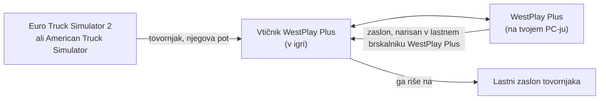

<p align="center"></p>

<h1 align="center">WestPlay Plus</h1>

<!-- languages:start -->
<p align="center">
  <a href="../../README.md">English</a> · <a href="README.zh-CN.md">简体中文</a> · <a href="README.zh-TW.md">繁體中文</a> · <a href="README.ja.md">日本語</a> · <a href="README.ko.md">한국어</a> · <a href="README.de.md">Deutsch</a> · <a href="README.fr.md">Français</a> · <a href="README.fr-CA.md">Français (Canada)</a> · <a href="README.es.md">Español</a> · <a href="README.es-419.md">Español (Latinoamérica)</a> · <a href="README.it.md">Italiano</a> · <a href="README.pt-BR.md">Português (Brasil)</a> · <a href="README.pt-PT.md">Português (Portugal)</a> · <a href="README.ru.md">Русский</a> · <a href="README.pl.md">Polski</a> · <a href="README.szl.md">Ślōnsko godka</a> · <a href="README.nl.md">Nederlands</a> · <a href="README.tr.md">Türkçe</a> · <a href="README.uk.md">Українська</a> · <a href="README.cs.md">Čeština</a> · <a href="README.sk.md">Slovenčina</a> · <a href="README.hu.md">Magyar</a> · <a href="README.ro.md">Română</a> · <a href="README.bg.md">Български</a> · <a href="README.hr.md">Hrvatski</a> · <a href="README.sr-Latn.md">Srpski (latinica)</a> · <a href="README.sr-Cyrl.md">Српски (ћирилица)</a> · <b>Slovenščina</b> · <a href="README.mk.md">Македонски</a> · <a href="README.el.md">Ελληνικά</a> · <a href="README.sv.md">Svenska</a> · <a href="README.da.md">Dansk</a> · <a href="README.no.md">Norsk</a> · <a href="README.fi.md">Suomi</a> · <a href="README.et.md">Eesti</a> · <a href="README.lt.md">Lietuvių</a> · <a href="README.lv.md">Latviešu</a> · <a href="README.ca.md">Català</a> · <a href="README.gl.md">Galego</a> · <a href="README.eu.md">Euskara</a> · <a href="README.ka.md">ქართული</a> · <a href="README.vi.md">Tiếng Việt</a>
</p>
<!-- languages:end -->

<p align="center">
  <b>Zaslon v slogu CarPlaya za tovornjake iz Euro Truck Simulator 2 in American Truck Simulator.</b><br>
  Tvoj zemljevid, tvoja glasba in YouTube, na armaturni plošči tvojega tovornjaka.
  <br>
  Spremenjena veja <a href="https://github.com/enes-less/WestPlay">WestPlaya</a>, za igralce, ki govorijo kitajsko.
</p>

<p align="center">
  <a href="https://github.com/HandsomeTurtle0307/WestPlay-Plus/releases/latest"></a>
  
  
  
  <a href="../../LICENSE"></a>
</p>

WestPlay Plus postavi zaslon, kot je na telefonu, na armaturno ploščo tvojega tovornjaka, znotraj igre: Euro Truck Simulator 2 ali American Truck Simulator, en zaslon za oba. Tvoja pot na zemljevidu, narisanem iz tvoje lastne igre, tvoja glasba, YouTube, vreme na tvoji vožnji: točno tam, kjer ima pravi tovornjak svoj zaslon, upravljan z miško, medtem ko držiš tipko.

## Funkcije

**Zemljevidi iz tvoje lastne igre.** Narisani iz zemljevida tvoje igre, vključno z modi zemljevidov (ProMods in drugi), s tvojo potjo, navodili ovinek za ovinkom in iskanjem, ki doda postanke v GPS same igre.

**Armaturna plošča za vožnjo.** Zemljevid ob tem, kar igra, in ob tem, kam greš, vreme na poti, vse na enem zaslonu.

**Tvoja glasba.** Apple Music, Spotify in YouTube Music, z Now Playing in besedili. Videospot skladbe se predvaja neposredno v Now Playingu, YouTube pa ima svoje kanale, sezname predvajanja, podnapise in kakovosti. Predvajalnik predvaja skladbe, ki jih daš v glasbeno mapo igre.

**Svetlo in temno ter tvoj videz.** Ponoči ali ko prižgeš luči potemni, kot senzor svetlobe v avtu. Lastna ozadja in ikone prineseš sam.

**Spremljevalna aplikacija** na tvojem PC-ju vse pripravi: najde tvoje igre (ETS2, ATS ali obe), namesti WestPlay Plus v vsako od njih, zgradi njihove zemljevide in se nato ne vmešava.

## Kako deluje



WestPlay Plus riše svoj zaslon v lastnem brskalniku na tvojem PC-ju, njegov vtičnik pa položi vsako sličico na zaslon tvojega tovornjaka, znotraj igre. Lastni zasloni tovornjakov in njihove informacijske vrstice ostajajo njihovi: WestPlay Plus zavzame mesto GPS-a, nastavitev »Vehicle Bar« pa pove, ali vrstica tovornjaka ostane ob njem.

## Tovornjaki

WestPlay Plus se pojavi na dva načina: na lastnem zaslonu tovornjaka ali na tablici WestPlay Plus.

**Na lastnem zaslonu tovornjaka.** V tovornjakih, ki imajo CarPlay tudi v resnici, WestPlay Plus zavzame mesto GPS-a na zaslonu armaturne plošče in se prilagodi njeni obliki. Ničesar ni treba kupiti ali montirati: vstopiš in je tam. V Euro Truck Simulator 2:

- **DAF** XF in XG/XG+ 2021, XF Electric in XD (ter Jasperjev DAF 2021)
- **Scania** S in R, s 7" zaslonom ali Smart Dashom, in S BEV
- **Iveco** S-Way
- **Renault** T (2024)
- **Volvo** FH (2021 in 2024)
- **Coaches DLC:** Scania Touring in MAN Lion's Coach (2024)
- **Avtobusi Oyuncuyusbisa:** Mercedes-Benz Travego 16 SHD, MAN Lion's Coach in Setra S 531 DT na svojih armaturnih ploščah
- **Setra S 516 HD/2** (od Oyuncuyusbisa): na lastnem GPS-zaslonu avtobusa, njegovem delu »Gps«, ki ga vgradiš pri prodajalcu tovornjakov: lastni zaslon avtobusa, kot so želeli njegovi igralci, a tak, ki ga dodaš sam

**Na tablici WestPlay Plus.** Vsi drugi tovornjaki, iz igre in iz modov, dobijo WestPlay Plus na tablici, ki jo vgradiš pri prodajalcu tovornjakov: v Dodatki, med visečimi predmeti ali kot komplet za armaturno ploščo. Lastni zaslon tovornjaka obdrži navigacijo igre. Tablica je v vsakem tovornjaku z visečimi predmeti, tudi v modih tovornjakov, ki jih namestiš pozneje (dobijo jo ob naslednjem zagonu igre).

**V American Truck Simulator** je WestPlay Plus za zdaj na tablici v vsakem tovornjaku. Tovornjaki, katerih resnični dvojniki imajo CarPlay, bodo WestPlay Plus na lastnem zaslonu dobili pozneje.

|                        | Lastni zaslon tovornjaka | Tablica WestPlay Plus |
| ---------------------- | ------------------------ | --------------------- |
| Tovornjaki             | Zgoraj navedeni ETS2 tovornjaki | Vsi drugi in za zdaj vsi tovornjaki ATS |
| Kako ga dobiš          | Nič: že je tam           | Vgraditi pri prodajalcu |
| Navigacija igre        | Zamenja jo WestPlay Plus | Ostane na zaslonu tovornjaka |

### Zvok

V teh tovornjakih iz Euro Truck Simulator 2 glasba prihaja iz lastnih zvočnikov tovornjaka, vsak na svojem mestu v kabini. Drugi tovornjaki in za zdaj tisti iz American Truck Simulator predvajajo običajen stereo.

- **Scania S in R (2016), S BEV** — nizkotonci v vratih, visokotonci v A-stebrih, bas na strehi
- **Scania R (2009), Streamline** — nizkotonci v vratih, visokotonci v A-stebrih
- **DAF XF (105)** — visokotonci v A-stebrih; dva para na strešni polici v Super Space Cabu, ena strešna enota v ostalih
- **DAF XF Euro 6** — nizkotonci v vratih, visokotonci v A-stebrih; dva para na strešni polici v Super Space Cabu, ena strešna enota v ostalih
- **DAF XF, XG, XG+ (2021), XF Electric in XD** — nizkotonci v vratih, visokotonci v A-stebrih, par zgoraj, osrednja enota
- **MAN TGX** — nizkotonci v vratih; v XXL še dve majhni enoti visoko v vsaki stranski steni
- **MAN TGX Euro 6** — nizkotonci v vratih; v XL še majhna enota v vsakem kotu strehe
- **MAN TGX (2020)** — nizkotonec in srednjetonec v vsakih vratih, visokotonci v A-stebrih
- **Mercedes-Benz Actros (2014)** — nizkotonci v vratih, par zgoraj, visokotonci v A-stebrih
- **Mercedes-Benz Actros (2009)** — nizkotonci v vratih, par v sprednjih kotih strešne police
- **Volvo FH (2021, 2024), FH16 (2012)** — nizkotonci v vratih, bas v zadnji steni
- **Volvo FH16 (2009)** — ena enota v vsakih vratih
- **Iveco Stralis** — ena enota na vsakem koncu strešne konzole, v visokih strehah pa majhna na sovoznikovi strani
- **Iveco Hi-Way** — ena enota na vsakem koncu strešne konzole in ena visoko na vsaki strani
- **Iveco S-Way** — nizkotonec in visokotonec v vsakih vratih
- **Renault Magnum** — ena enota v vsakem kotu strehe, visokotonci na strešni konzoli
- **Renault Premium** — ena enota na vsaki strani strehe, nižje v nizki strehi
- **Renault T** — visokotonci v A-stebrih, par v zadnji steni; nizkotonci v vratih v notranjostih iz leta 2024
- **Renault E-Tech T** — nizkotonci v vratih, visokotonci v A-stebrih, par v zadnji steni
- **Scania PGR od JuseeTV** — zvočniki delov, ki jih vgradiš: vrata, A-stebri, zgornja konzola, zadnja stena

## Namestitev

1. Prenesi namestitveni program z [najnovejše različice](https://github.com/HandsomeTurtle0307/WestPlay-Plus/releases/latest) in ga zaženi.
2. Odpre se spremljevalna aplikacija in te vodi skozi ostalo: najde tvoje igre (ETS2, ATS ali obe), v vsako namesti vtičnik WestPlay Plus in njegov mod zaslona ter zgradi tvoje zemljevide.
3. Zaženi igro in se usedi v tovornjak.

**Posodobitve:** ta veja se ne posodablja sama. Ali je na voljo novejša različica, preveri na [strani izdaj](https://github.com/HandsomeTurtle0307/WestPlay-Plus/releases). Ista povezava je tudi na strani »O programu« v spremljevalni aplikaciji.

**Zahteve:** Windows 10 ali 11 (64-bit), Euro Truck Simulator 2 različica 1.62 (ali 1.61) ali American Truck Simulator različica 1.62 (druge različice lahko delujejo; ko katera ni preizkušena, spremljevalna aplikacija to pove) in Microsoft Edge WebView2 (del sistema Windows 11; namestitveni program ga doda, kjer manjka).

## Zasebnost

WestPlay Plus nima strežnikov, lastnih računov in analitike. Ne zbira in ne pošilja ničesar o tebi.

- V Apple Music, Spotify in YouTube se prijaviš na njihovih straneh, v lastnem profilu brskalnika WestPlay Plus na svojem PC-ju, kot v brskalniku. WestPlay Plus sam ne shranjuje podatkov o računu.
- Tvoj zemljevid se zgradi na tvojem PC-ju iz tvoje igre in ostane tam.
- WestPlay Plus govori s storitvami, ki jih uporabljaš, z GitHubom pa le, ko odpreš njegovo stran izdaj.

## Povratne informacije

Napake, vprašanja in ideje: odpri issue na [GitHubu](https://github.com/HandsomeTurtle0307/WestPlay-Plus/issues).

## Gradnja iz izvorne kode

Potrebuješ [Rust](https://rustup.rs) (stable) in [Node.js](https://nodejs.org) 24, v sistemu Windows.

```sh
npm install      # orodja spremljevalne aplikacije in paketi vmesnika
npm run dev      # WestPlay Plus z vmesnikom, streženim v živo
```

`cargo test --workspace` in `npm test --prefix ui` poženeta teste. Vtičnik igre se zgradi z `cargo build --release -p westplay-plugin`.

## Licenca

WestPlay Plus je prosto programje: lahko ga razširjaš in spreminjaš pod pogoji GNU General Public License, različica 3 ali (po tvoji izbiri) katera koli poznejša različica. Glej [LICENSE](../../LICENSE).

Copyright © 2026 HandsomeTurtle0307. Knjižnice, ki se dobavljajo z WestPlay Plus, ohranijo svoje licence: glej [THIRD_PARTY_LICENSES.md](../../THIRD_PARTY_LICENSES.md) in [THIRD_PARTY_NOTICES.md](../../THIRD_PARTY_NOTICES.md) za dela, ki jim sledi.

## Od kod izhaja ta projekt

WestPlay Plus je spremenjena veja (fork) projekta [WestPlay](https://github.com/enes-less/WestPlay), odličnega moda z zaslonom v slogu CarPlaya za Euro Truck Simulator 2 in American Truck Simulator, ki ga je naredil **enes-less**. Skoraj vsa izvirna zasnova, koda in sredstva so njegovo delo; ta veja ima svoje spremembe na vrhu in je hvaležna za to, kar je zgradil. Če ti je projekt všeč, poglej tudi izvirnik.

Podpri tudi izvirni projekt (in če lahko, podpri tudi mene 😭😭😭 — razvijati programje ni lahko~).

<!-- translated:start -->
<sub>Ta README je prevod angleške različice. Avtor seveda ne govori vseh 43 jezikov 😭😭, zato je prevod mestoma lahko nepopoln. Oprostite~ Če opazite napako v svojem jeziku, mi sporočite, zelo bom hvaležen~</sub>
<!-- translated:end -->

<sub>WestPlay Plus je neodvisen projekt, nepovezan z Applem, SCS Software, Spotifyjem, Googlom ali proizvajalci tovornjakov in brez njihove odobritve. CarPlay, Apple Music, Spotify, YouTube, YouTube Music ter imena in logotipi proizvajalcev so blagovne znamke svojih lastnikov in so tu uporabljeni le za poimenovanje tega, s čimer WestPlay Plus deluje.</sub>
