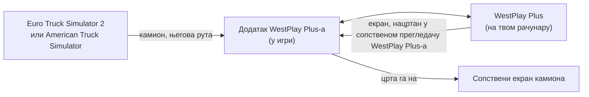

<p align="center"></p>

<h1 align="center">WestPlay Plus</h1>

<!-- languages:start -->
<p align="center">
  <a href="../../README.md">English</a> · <a href="README.zh-CN.md">简体中文</a> · <a href="README.zh-TW.md">繁體中文</a> · <a href="README.ja.md">日本語</a> · <a href="README.ko.md">한국어</a> · <a href="README.de.md">Deutsch</a> · <a href="README.fr.md">Français</a> · <a href="README.fr-CA.md">Français (Canada)</a> · <a href="README.es.md">Español</a> · <a href="README.es-419.md">Español (Latinoamérica)</a> · <a href="README.it.md">Italiano</a> · <a href="README.pt-BR.md">Português (Brasil)</a> · <a href="README.pt-PT.md">Português (Portugal)</a> · <a href="README.ru.md">Русский</a> · <a href="README.pl.md">Polski</a> · <a href="README.szl.md">Ślōnsko godka</a> · <a href="README.nl.md">Nederlands</a> · <a href="README.tr.md">Türkçe</a> · <a href="README.uk.md">Українська</a> · <a href="README.cs.md">Čeština</a> · <a href="README.sk.md">Slovenčina</a> · <a href="README.hu.md">Magyar</a> · <a href="README.ro.md">Română</a> · <a href="README.bg.md">Български</a> · <a href="README.hr.md">Hrvatski</a> · <a href="README.sr-Latn.md">Srpski (latinica)</a> · <b>Српски (ћирилица)</b> · <a href="README.sl.md">Slovenščina</a> · <a href="README.mk.md">Македонски</a> · <a href="README.el.md">Ελληνικά</a> · <a href="README.sv.md">Svenska</a> · <a href="README.da.md">Dansk</a> · <a href="README.no.md">Norsk</a> · <a href="README.fi.md">Suomi</a> · <a href="README.et.md">Eesti</a> · <a href="README.lt.md">Lietuvių</a> · <a href="README.lv.md">Latviešu</a> · <a href="README.ca.md">Català</a> · <a href="README.gl.md">Galego</a> · <a href="README.eu.md">Euskara</a> · <a href="README.ka.md">ქართული</a> · <a href="README.vi.md">Tiếng Việt</a>
</p>
<!-- languages:end -->

<p align="center">
  <b>Екран у стилу CarPlay-а за камионе из Euro Truck Simulator 2 и American Truck Simulator.</b><br>
  Твоја мапа, твоја музика и YouTube, на арматурној табли твог камиона.
  <br>
  Измењена грана <a href="https://github.com/enes-less/WestPlay">WestPlay-а</a>, са неколико оптимизација и нових функција.
</p>

<p align="center">
  <a href="https://github.com/HandsomeTurtle0307/WestPlay-Plus/releases/latest"></a>
  
  
  
  <a href="../../LICENSE"></a>
</p>

WestPlay Plus ставља екран попут оног на телефону на арматурну таблу твог камиона, унутар игре: Euro Truck Simulator 2 или American Truck Simulator, један екран за оба. Твоја рута на мапи нацртаној из твоје сопствене игре, твоја музика, YouTube, време на твом путу: тачно тамо где прави камион има свој екран, управљан мишем док држиш тастер.

<!-- why:start -->

## Зашто сам ово направио

Прво сам тражио мод за CarPlay, а онда налетео на WestPlay и видео да је стварно добро направљен (стварно, јако јако добро). Само је оптимизација била слаба и замрзла ми је рачунар. Зато сам одлучио сам да га дорадим: посложим перформансе и додам неколико нових функција (стојећи на раменима дива, хехе~😊).

<!-- why:end -->

## Функције

**Мапе из твоје сопствене игре.** Цртане из мапе твоје игре, укључујући модове за мапе (ProMods и други), са твојом рутом, упутствима скретање по скретање и претрагом која додаје стајалишта у GPS саме игре.

**Арматурна табла за вожњу.** Мапа поред онога што свира и поред онога куда идеш, време на путу, све на једном екрану.

**Твоја музика.** Apple Music, Spotify и YouTube Music, са Now Playing-ом и текстовима. Спот песме се пушта директно у Now Playing-у, а YouTube има своје канале, плејлисте, титлове и квалитете. Плејер пушта песме које ставиш у музичку фасциклу игре.

**Светла и тамна тема, и твој сопствени изглед.** Постаје тамно ноћу или када упалиш светла, као сензор за светло у аутомобилу. Сопствене позадине и иконе можеш да додаш сам.

**Пратећа апликација** на твом рачунару све припрема: проналази твоје игре (ETS2, ATS или обе), инсталира WestPlay Plus у сваку од њих, гради њихове мапе и након тога се не меша.

## Како ради



WestPlay Plus црта свој екран у сопственом прегледачу на твом рачунару, а његов додатак ставља сваки кадар на екран твог камиона, унутар игре. Сопствени екрани камиона и њихове информационе траке остају њихови: WestPlay Plus заузима место GPS-а, а подешавање „Vehicle Bar“ одлучује да ли трака камиона остаје поред.

## Камиони

WestPlay Plus се појављује на два начина: на сопственом екрану камиона или на таблету WestPlay Plus.

**На сопственом екрану камиона.** У камионима који имају CarPlay и у стварности, WestPlay Plus заузима место GPS-а на екрану арматурне табле, прилагођен њеном облику. Ништа се не купује ни монтира: уђеш и већ је тамо. У Euro Truck Simulator 2:

- **DAF** XF и XG/XG+ 2021, XF Electric и XD (и Jasper-ов DAF 2021)
- **Scania** S и R, са 7" екраном или са Smart Dash-ом, и S BEV
- **Iveco** S-Way
- **Renault** T (2024)
- **Volvo** FH (2021 и 2024)
- **Coaches DLC:** Scania Touring и MAN Lion's Coach (2024)
- **Аутобуси Oyuncuyusbis-а:** Mercedes-Benz Travego 16 SHD, MAN Lion's Coach и Setra S 531 DT на својим арматурним таблама
- **Setra S 516 HD/2** (од Oyuncuyusbis-а): на сопственом GPS-екрану аутобуса, његовом делу „Gps“, који монтираш код продавца камиона: сопствени екран аутобуса, како су његови играчи тражили, али онај који сам додајеш

**На таблету WestPlay Plus.** Сви остали камиони, из игре и из модова, добијају WestPlay Plus на таблету који монтираш код продавца камиона: у Прибору, међу висећим предметима или као комплет за арматурну таблу. Сопствени екран камиона задржава навигацију игре. Таблет је у сваком камиону са висећим предметима, укључујући модове камиона које инсталираш касније (добијају га при следећем покретању игре).

**У American Truck Simulator-у** за сада је WestPlay Plus на таблету у сваком камиону. Камиони чији стварни пандани имају CarPlay добиће WestPlay Plus на сопствени екран касније.

|                        | Сопствени екран камиона | Таблет WestPlay Plus |
| ---------------------- | ----------------------- | -------------------- |
| Камиони                | Горе наведени ETS2 камиони | Сви остали, и за сада сви ATS камиони |
| Како га добијаш        | Ништа: већ је тамо      | Монтирати код продавца |
| Навигација игре        | Замењује је WestPlay Plus | Остаје на екрану камиона |

### Звук

У овим камионима из Euro Truck Simulator 2 музика излази из сопствених звучника камиона, сваки на свом месту у кабини. Остали камиони, и за сада они из American Truck Simulator-а, свирају обичан стерео.

- **Scania S и R (2016), S BEV** — вуфери у вратима, високотонци у A-стубовима, бас на плафону
- **Scania R (2009), Streamline** — вуфери у вратима, високотонци у A-стубовима
- **DAF XF (105)** — високотонци у A-стубовима; два пара на полици плафона код Super Space Cab-а, једна плафонска јединица код осталих
- **DAF XF Euro 6** — вуфери у вратима, високотонци у A-стубовима; два пара на полици плафона код Super Space Cab-а, једна плафонска јединица код осталих
- **DAF XF, XG, XG+ (2021), XF Electric и XD** — вуфери у вратима, високотонци у A-стубовима, један пар горе, једна централна јединица
- **MAN TGX** — вуфери у вратима; код XXL-а и по две мале јединице високо у сваком бочном зиду
- **MAN TGX Euro 6** — вуфери у вратима; код XL-а и по једна мала јединица у сваком углу плафона
- **MAN TGX (2020)** — вуфер и средњотонац у сваким вратима, високотонци у A-стубовима
- **Mercedes-Benz Actros (2014)** — вуфери у вратима, један пар горе, високотонци у A-стубовима
- **Mercedes-Benz Actros (2009)** — вуфери у вратима, један пар у предњим угловима плафонске полице
- **Volvo FH (2021, 2024), FH16 (2012)** — вуфери у вратима, бас у задњем зиду
- **Volvo FH16 (2009)** — по једна јединица у сваким вратима
- **Iveco Stralis** — по једна јединица на оба краја плафонске конзоле, а код високих плафона једна мала са стране сувозача
- **Iveco Hi-Way** — по једна јединица на оба краја плафонске конзоле и по једна високо са сваке стране
- **Iveco S-Way** — вуфер и високотонац у сваким вратима
- **Renault Magnum** — по једна јединица у сваком углу плафона, високотонци на плафонској конзоли
- **Renault Premium** — по једна јединица са сваке стране плафона, ниже код ниског плафона
- **Renault T** — високотонци у A-стубовима, један пар у задњем зиду; вуфери у вратима код ентеријера из 2024.
- **Renault E-Tech T** — вуфери у вратима, високотонци у A-стубовима, један пар у задњем зиду
- **Scania PGR од JuseeTV-а** — звучници делова које монтираш: врата, A-стубови, горња конзола, задњи зид

## Инсталација

1. Преузми инсталатер са [најновије верзије](https://github.com/HandsomeTurtle0307/WestPlay-Plus/releases/latest) и покрени га.
2. Отвара се пратећа апликација и води те кроз остало: проналази твоје игре (ETS2, ATS или обе), инсталира у сваку додатак WestPlay Plus-а и његов мод екрана, и гради твоје мапе.
3. Покрени игру и седи у камион.

**Ажурирања:** ова грана се не ажурира сама. Да провериш има ли новије верзије, посети [страницу издања](https://github.com/HandsomeTurtle0307/WestPlay-Plus/releases). Исти линк је и на страници „О програму“ у пратећој апликацији.

**Захтеви:** Windows 10 или 11 (64 бита), Euro Truck Simulator 2 верзија 1.62 (или 1.61) или American Truck Simulator верзија 1.62 (друге верзије могу да раде; када нека није тестирана, пратећа апликација то каже) и Microsoft Edge WebView2 (део Windows-а 11; инсталатер га додаје где недостаје).

## Приватност

WestPlay Plus нема сервере, сопствене налоге ни аналитику. Не прикупља и не шаље ништа о теби.

- На Apple Music, Spotify и YouTube пријављујеш се на њиховим сопственим страницама, у сопственом профилу прегледача WestPlay Plus-а на твом рачунару, као у прегледачу. Сам WestPlay Plus не чува податке о налогу.
- Твоја мапа се гради на твом рачунару из твоје игре и остаје тамо.
- WestPlay Plus разговара са услугама које користиш, а са GitHub-ом само када отвориш његову страницу издања.

## Повратне информације

Грешке, питања и идеје: отвори issue на [GitHub-у](https://github.com/HandsomeTurtle0307/WestPlay-Plus/issues).

## Изградња из изворног кода

Потребни су ти [Rust](https://rustup.rs) (stable) и [Node.js](https://nodejs.org) 24, на Windows-у.

```sh
npm install      # алати пратеће апликације и пакети интерфејса
npm run dev      # WestPlay Plus, са интерфејсом који се служи уживо
```

`cargo test --workspace` и `npm test --prefix ui` покрећу тестове. Додатак игре се гради са `cargo build --release -p westplay-plugin`.

## Лиценца

WestPlay Plus је слободан софтвер: можеш га дистрибуирати и мењати под условима GNU General Public License, верзија 3 или (по твом избору) било које касније верзије. Види [LICENSE](../../LICENSE).

Copyright © 2026 HandsomeTurtle0307. Библиотеке које се достављају уз WestPlay Plus задржавају своје лиценце: види [THIRD_PARTY_LICENSES.md](../../THIRD_PARTY_LICENSES.md) и [THIRD_PARTY_NOTICES.md](../../THIRD_PARTY_NOTICES.md) за дела која следи.

## Одакле долази овај пројекат

WestPlay Plus је измењена грана (fork) пројекта [WestPlay](https://github.com/enes-less/WestPlay), изврсног мода са екраном у стилу CarPlay-а за Euro Truck Simulator 2 и American Truck Simulator, који је направио **enes-less**. Готово цео оригинални дизајн, код и ресурси су његов рад; ова грана држи своје измене поврх тога и захвална му је на ономе што је изградио. Ако ти се пројекат свиђа, погледај и оригинал.

Подржи и оригинални пројекат (а ако можеш, подржи и мене 😭😭😭 — није лако правити софтвер~).

<!-- translated:start -->
<sub>Овај README је превод енглеске верзије. Аутор, наравно, не говори сва 43 језика 😭😭, па превод местимично може бити непотпун. Извињавам се~ Ако приметите грешку на свом језику, јавите ми, бићу захвалан~</sub>
<!-- translated:end -->

<sub>WestPlay Plus је независан пројекат, без везе са Apple-ом, SCS Software-ом, Spotify-ем, Google-ом или произвођачима камиона и без њихове потврде. CarPlay, Apple Music, Spotify, YouTube, YouTube Music, као и имена и логотипи произвођача, заштитни су знакови њихових власника и овде се користе само да именују оно са чим WestPlay Plus ради.</sub>
