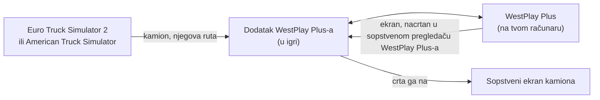

<p align="center"></p>

<h1 align="center">WestPlay Plus</h1>

<!-- languages:start -->
<p align="center">
  <a href="../../README.md">English</a> · <a href="README.zh-CN.md">简体中文</a> · <a href="README.zh-TW.md">繁體中文</a> · <a href="README.ja.md">日本語</a> · <a href="README.ko.md">한국어</a> · <a href="README.de.md">Deutsch</a> · <a href="README.fr.md">Français</a> · <a href="README.fr-CA.md">Français (Canada)</a> · <a href="README.es.md">Español</a> · <a href="README.es-419.md">Español (Latinoamérica)</a> · <a href="README.it.md">Italiano</a> · <a href="README.pt-BR.md">Português (Brasil)</a> · <a href="README.pt-PT.md">Português (Portugal)</a> · <a href="README.ru.md">Русский</a> · <a href="README.pl.md">Polski</a> · <a href="README.szl.md">Ślōnsko godka</a> · <a href="README.nl.md">Nederlands</a> · <a href="README.tr.md">Türkçe</a> · <a href="README.uk.md">Українська</a> · <a href="README.cs.md">Čeština</a> · <a href="README.sk.md">Slovenčina</a> · <a href="README.hu.md">Magyar</a> · <a href="README.ro.md">Română</a> · <a href="README.bg.md">Български</a> · <a href="README.hr.md">Hrvatski</a> · <b>Srpski (latinica)</b> · <a href="README.sr-Cyrl.md">Српски (ћирилица)</a> · <a href="README.sl.md">Slovenščina</a> · <a href="README.mk.md">Македонски</a> · <a href="README.el.md">Ελληνικά</a> · <a href="README.sv.md">Svenska</a> · <a href="README.da.md">Dansk</a> · <a href="README.no.md">Norsk</a> · <a href="README.fi.md">Suomi</a> · <a href="README.et.md">Eesti</a> · <a href="README.lt.md">Lietuvių</a> · <a href="README.lv.md">Latviešu</a> · <a href="README.ca.md">Català</a> · <a href="README.gl.md">Galego</a> · <a href="README.eu.md">Euskara</a> · <a href="README.ka.md">ქართული</a> · <a href="README.vi.md">Tiếng Việt</a>
</p>
<!-- languages:end -->

<p align="center">
  <b>Ekran u stilu CarPlay-a za kamione iz Euro Truck Simulator 2 i American Truck Simulator.</b><br>
  Tvoja mapa, tvoja muzika i YouTube, na armaturnoj tabli tvog kamiona.
  <br>
  Izmenjena grana <a href="https://github.com/enes-less/WestPlay">WestPlay-a</a>, sa nekoliko optimizacija i novih funkcija.
</p>

<p align="center">
  <a href="https://github.com/HandsomeTurtle0307/WestPlay-Plus/releases/latest"></a>
  
  
  
  <a href="../../LICENSE"></a>
</p>

WestPlay Plus stavlja ekran poput onog na telefonu na armaturnu tablu tvog kamiona, unutar igre: Euro Truck Simulator 2 ili American Truck Simulator, jedan ekran za oba. Tvoja ruta na mapi nacrtanoj iz tvoje sopstvene igre, tvoja muzika, YouTube, vreme na tvom putu: tačno tamo gde pravi kamion ima svoj ekran, upravljan mišem dok držiš taster.

<!-- why:start -->

## Zašto sam ovo napravio

Prvo sam tražio mod za CarPlay, a onda naleteo na WestPlay i video da je stvarno dobro napravljen (stvarno, jako jako dobro). Samo je optimizacija bila slaba i zamrzla mi je računar. Zato sam odlučio sam da ga doradim: posložim performanse i dodam nekoliko novih funkcija (stojeći na ramenima diva, hehe~😊).

<!-- why:end -->

## Funkcije

**Mape iz tvoje sopstvene igre.** Crtane iz mape tvoje igre, uključujući modove za mape (ProMods i drugi), sa tvojom rutom, uputstvima skretanje po skretanje i pretragom koja dodaje stajališta u GPS same igre.

**Armaturna tabla za vožnju.** Mapa pored onoga što svira i pored onoga kuda ideš, vreme na putu, sve na jednom ekranu.

**Tvoja muzika.** Apple Music, Spotify i YouTube Music, sa Now Playing-om i tekstovima. Spot pesme se pušta direktno u Now Playing-u, a YouTube ima svoje kanale, plejliste, titlove i kvalitete. Plejer pušta pesme koje staviš u muzičku fasciklu igre.

**Svetla i tamna tema, i tvoj sopstveni izgled.** Postaje tamno noću ili kada upališ svetla, kao senzor za svetlo u automobilu. Sopstvene pozadine i ikone možeš da dodaš sam.

**Prateća aplikacija** na tvom računaru sve priprema: pronalazi tvoje igre (ETS2, ATS ili obe), instalira WestPlay Plus u svaku od njih, gradi njihove mape i nakon toga se ne meša.

## Kako radi



WestPlay Plus crta svoj ekran u sopstvenom pregledaču na tvom računaru, a njegov dodatak stavlja svaki kadar na ekran tvog kamiona, unutar igre. Sopstveni ekrani kamiona i njihove informacione trake ostaju njihovi: WestPlay Plus zauzima mesto GPS-a, a podešavanje „Vehicle Bar“ odlučuje da li traka kamiona ostaje pored.

## Kamioni

WestPlay Plus se pojavljuje na dva načina: na sopstvenom ekranu kamiona ili na tabletu WestPlay Plus.

**Na sopstvenom ekranu kamiona.** U kamionima koji imaju CarPlay i u stvarnosti, WestPlay Plus zauzima mesto GPS-a na ekranu armaturne table, prilagođen njenom obliku. Ništa se ne kupuje ni montira: uđeš i već je tamo. U Euro Truck Simulator 2:

- **DAF** XF i XG/XG+ 2021, XF Electric i XD (i Jasper-ov DAF 2021)
- **Scania** S i R, sa 7" ekranom ili sa Smart Dash-om, i S BEV
- **Iveco** S-Way
- **Renault** T (2024)
- **Volvo** FH (2021 i 2024)
- **Coaches DLC:** Scania Touring i MAN Lion's Coach (2024)
- **Autobusi Oyuncuyusbis-a:** Mercedes-Benz Travego 16 SHD, MAN Lion's Coach i Setra S 531 DT na svojim armaturnim tablama
- **Setra S 516 HD/2** (od Oyuncuyusbis-a): na sopstvenom GPS-ekranu autobusa, njegovom delu „Gps“, koji montiraš kod prodavca kamiona: sopstveni ekran autobusa, kako su njegovi igrači tražili, ali onaj koji sam dodaješ

**Na tabletu WestPlay Plus.** Svi ostali kamioni, iz igre i iz modova, dobijaju WestPlay Plus na tabletu koji montiraš kod prodavca kamiona: u Priboru, među visećim predmetima ili kao komplet za armaturnu tablu. Sopstveni ekran kamiona zadržava navigaciju igre. Tablet je u svakom kamionu sa visećim predmetima, uključujući modove kamiona koje instaliraš kasnije (dobijaju ga pri sledećem pokretanju igre).

**U American Truck Simulator-u** za sada je WestPlay Plus na tabletu u svakom kamionu. Kamioni čiji stvarni pandani imaju CarPlay dobiće WestPlay Plus na sopstveni ekran kasnije.

|                        | Sopstveni ekran kamiona | Tablet WestPlay Plus |
| ---------------------- | ----------------------- | -------------------- |
| Kamioni                | Gore navedeni ETS2 kamioni | Svi ostali, i za sada svi ATS kamioni |
| Kako ga dobijaš        | Ništa: već je tamo      | Montirati kod prodavca |
| Navigacija igre        | Zamenjuje je WestPlay Plus | Ostaje na ekranu kamiona |

### Zvuk

U ovim kamionima iz Euro Truck Simulator 2 muzika izlazi iz sopstvenih zvučnika kamiona, svaki na svom mestu u kabini. Ostali kamioni, i za sada oni iz American Truck Simulator-a, sviraju običan stereo.

- **Scania S i R (2016), S BEV** — vuferi u vratima, visokotonci u A-stubovima, bas na plafonu
- **Scania R (2009), Streamline** — vuferi u vratima, visokotonci u A-stubovima
- **DAF XF (105)** — visokotonci u A-stubovima; dva para na polici plafona kod Super Space Cab-a, jedna plafonska jedinica kod ostalih
- **DAF XF Euro 6** — vuferi u vratima, visokotonci u A-stubovima; dva para na polici plafona kod Super Space Cab-a, jedna plafonska jedinica kod ostalih
- **DAF XF, XG, XG+ (2021), XF Electric i XD** — vuferi u vratima, visokotonci u A-stubovima, jedan par gore, jedna centralna jedinica
- **MAN TGX** — vuferi u vratima; kod XXL-a i po dve male jedinice visoko u svakom bočnom zidu
- **MAN TGX Euro 6** — vuferi u vratima; kod XL-a i po jedna mala jedinica u svakom uglu plafona
- **MAN TGX (2020)** — vufer i srednjotonac u svakim vratima, visokotonci u A-stubovima
- **Mercedes-Benz Actros (2014)** — vuferi u vratima, jedan par gore, visokotonci u A-stubovima
- **Mercedes-Benz Actros (2009)** — vuferi u vratima, jedan par u prednjim uglovima plafonske police
- **Volvo FH (2021, 2024), FH16 (2012)** — vuferi u vratima, bas u zadnjem zidu
- **Volvo FH16 (2009)** — po jedna jedinica u svakim vratima
- **Iveco Stralis** — po jedna jedinica na oba kraja plafonske konzole, a kod visokih plafona jedna mala sa strane suvozača
- **Iveco Hi-Way** — po jedna jedinica na oba kraja plafonske konzole i po jedna visoko sa svake strane
- **Iveco S-Way** — vufer i visokotonac u svakim vratima
- **Renault Magnum** — po jedna jedinica u svakom uglu plafona, visokotonci na plafonskoj konzoli
- **Renault Premium** — po jedna jedinica sa svake strane plafona, niže kod niskog plafona
- **Renault T** — visokotonci u A-stubovima, jedan par u zadnjem zidu; vuferi u vratima kod enterijera iz 2024.
- **Renault E-Tech T** — vuferi u vratima, visokotonci u A-stubovima, jedan par u zadnjem zidu
- **Scania PGR od JuseeTV-a** — zvučnici delova koje montiraš: vrata, A-stubovi, gornja konzola, zadnji zid

## Instalacija

1. Preuzmi instalater sa [najnove verzije](https://github.com/HandsomeTurtle0307/WestPlay-Plus/releases/latest) i pokreni ga.
2. Otvara se prateća aplikacija i vodi te kroz ostalo: pronalazi tvoje igre (ETS2, ATS ili obe), instalira u svaku dodatak WestPlay Plus-a i njegov mod ekrana, i gradi tvoje mape.
3. Pokreni igru i sedi u kamion.

**Ažuriranja:** ova grana se ne ažurira sama. Da proveriš ima li novije verzije, poseti [stranicu izdanja](https://github.com/HandsomeTurtle0307/WestPlay-Plus/releases). Isti link je i na stranici „O programu“ u pratećoj aplikaciji.

**Zahtevi:** Windows 10 ili 11 (64 bita), Euro Truck Simulator 2 verzija 1.62 (ili 1.61) ili American Truck Simulator verzija 1.62 (druge verzije mogu da rade; kada neka nije testirana, prateća aplikacija to kaže) i Microsoft Edge WebView2 (deo Windows-a 11; instalater ga dodaje gde nedostaje).

## Privatnost

WestPlay Plus nema servere, sopstvene naloge ni analitiku. Ne prikuplja i ne šalje ništa o tebi.

- Na Apple Music, Spotify i YouTube prijavljuješ se na njihovim sopstvenim stranicama, u sopstvenom profilu pregledača WestPlay Plus-a na tvom računaru, kao u pregledaču. Sam WestPlay Plus ne čuva podatke o nalogu.
- Tvoja mapa se gradi na tvom računaru iz tvoje igre i ostaje tamo.
- WestPlay Plus razgovara sa uslugama koje koristiš, a sa GitHub-om samo kada otvoriš njegovu stranicu izdanja.

## Povratne informacije

Greške, pitanja i ideje: otvori issue na [GitHub-u](https://github.com/HandsomeTurtle0307/WestPlay-Plus/issues).

## Izgradnja iz izvornog koda

Potrebni su ti [Rust](https://rustup.rs) (stable) i [Node.js](https://nodejs.org) 24, na Windows-u.

```sh
npm install      # alati prateće aplikacije i paketi interfejsa
npm run dev      # WestPlay Plus, sa interfejsom koji se servira uživo
```

`cargo test --workspace` i `npm test --prefix ui` pokreću testove. Dodatak igre se gradi sa `cargo build --release -p westplay-plugin`.

## Licenca

WestPlay Plus je slobodan softver: možeš ga distribuirati i menjati pod uslovima GNU General Public License, verzija 3 ili (po tvom izboru) bilo koje kasnije verzije. Vidi [LICENSE](../../LICENSE).

Copyright © 2026 HandsomeTurtle0307. Biblioteke koje se dostavljaju uz WestPlay Plus zadržavaju svoje licence: vidi [THIRD_PARTY_LICENSES.md](../../THIRD_PARTY_LICENSES.md) i [THIRD_PARTY_NOTICES.md](../../THIRD_PARTY_NOTICES.md) za dela koja sledi.

## Odakle dolazi ovaj projekat

WestPlay Plus je izmenjena grana (fork) projekta [WestPlay](https://github.com/enes-less/WestPlay), izvrsnog moda sa ekranom u stilu CarPlay-a za Euro Truck Simulator 2 i American Truck Simulator, koji je napravio **enes-less**. Gotovo ceo originalni dizajn, kod i resursi su njegov rad; ova grana drži svoje izmene povrh toga i zahvalna mu je na onome što je izgradio. Ako ti se projekat sviđa, pogledaj i original.

Podrži i originalni projekat (a ako možeš, podrži i mene 😭😭😭 — nije lako praviti softver~).

<!-- translated:start -->
<sub>Ovaj README je prevod engleske verzije. Autor, naravno, ne govori sva 43 jezika 😭😭, pa prevod mestimično može biti nepotpun. Izvinjavam se~ Ako primetite grešku na svom jeziku, javite mi, biću zahvalan~</sub>
<!-- translated:end -->

<sub>WestPlay Plus je nezavisan projekat, bez veze sa Apple-om, SCS Software-om, Spotify-em, Google-om ili proizvođačima kamiona i bez njihove potvrde. CarPlay, Apple Music, Spotify, YouTube, YouTube Music, kao i imena i logotipi proizvođača, zaštitni su znakovi njihovih vlasnika i ovde se koriste samo da imenuju ono sa čim WestPlay Plus radi.</sub>
