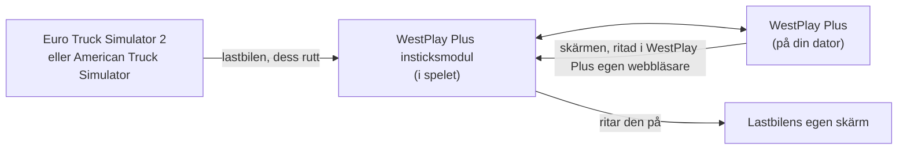

<p align="center"></p>

<h1 align="center">WestPlay Plus</h1>

<!-- languages:start -->
<p align="center">
  <a href="../../README.md">English</a> · <a href="README.zh-CN.md">简体中文</a> · <a href="README.zh-TW.md">繁體中文</a> · <a href="README.ja.md">日本語</a> · <a href="README.ko.md">한국어</a> · <a href="README.de.md">Deutsch</a> · <a href="README.fr.md">Français</a> · <a href="README.fr-CA.md">Français (Canada)</a> · <a href="README.es.md">Español</a> · <a href="README.es-419.md">Español (Latinoamérica)</a> · <a href="README.it.md">Italiano</a> · <a href="README.pt-BR.md">Português (Brasil)</a> · <a href="README.pt-PT.md">Português (Portugal)</a> · <a href="README.ru.md">Русский</a> · <a href="README.pl.md">Polski</a> · <a href="README.nl.md">Nederlands</a> · <a href="README.tr.md">Türkçe</a> · <a href="README.uk.md">Українська</a> · <a href="README.cs.md">Čeština</a> · <a href="README.sk.md">Slovenčina</a> · <a href="README.hu.md">Magyar</a> · <a href="README.ro.md">Română</a> · <a href="README.bg.md">Български</a> · <a href="README.hr.md">Hrvatski</a> · <a href="README.sr-Latn.md">Srpski (latinica)</a> · <a href="README.sr-Cyrl.md">Српски (ћирилица)</a> · <a href="README.sl.md">Slovenščina</a> · <a href="README.mk.md">Македонски</a> · <a href="README.el.md">Ελληνικά</a> · <b>Svenska</b> · <a href="README.da.md">Dansk</a> · <a href="README.no.md">Norsk</a> · <a href="README.fi.md">Suomi</a> · <a href="README.et.md">Eesti</a> · <a href="README.lt.md">Lietuvių</a> · <a href="README.lv.md">Latviešu</a> · <a href="README.ca.md">Català</a> · <a href="README.gl.md">Galego</a> · <a href="README.vi.md">Tiếng Việt</a>
</p>
<!-- languages:end -->

<!-- english-only:start -->
<p align="center"><sub>Schlesiska, baskiska och georgiska stöds av appen men har ännu ingen README: det har inte funnits någon som kunnat granska en översättning till de språken. Allt innehåll finns i den engelska versionen i repots rot.</sub></p>
<!-- english-only:end -->

<p align="center">
  <b>En CarPlay-lik skärm för lastbilarna i Euro Truck Simulator 2 och American Truck Simulator.</b><br>
  Din karta, din musik och YouTube, på din egen lastbils instrumentbräda.
  <br>
  En modifierad gren av <a href="https://github.com/enes-less/WestPlay">WestPlay</a>, med en del optimeringar och nya funktioner.
</p>

<p align="center">
  <a href="https://github.com/HandsomeTurtle0307/WestPlay-Plus/releases/latest"></a>
  
  
  
  <a href="../../LICENSE"></a>
</p>

WestPlay Plus sätter en telefonskärm på instrumentbrädan i din egen lastbil, inne i spelet: Euro Truck Simulator 2 eller American Truck Simulator, en skärm för båda. Din rutt på en karta ritad från ditt eget spel, din musik, YouTube, vädret längs vägen: precis där en riktig lastbil har sin skärm, styrd med musen medan du håller en tangent.

<!-- why:start -->

## Varför jag byggde det här

Först letade jag efter en CarPlay-mod, sedan snubblade jag över WestPlay och såg att den är riktigt bra gjord (verkligen, väldigt väldigt bra). Det var bara optimeringen som var dålig och fick min dator att hänga sig. Så jag bestämde mig för att förbättra den själv: fixa prestandan och lägga till några nya funktioner (står på en jättes axlar, hihi~😊).

<!-- why:end -->

## Funktioner

**Kartor från ditt eget spel.** Ritade från spelets karta, kartmoddar inräknade (ProMods och andra), med din rutt, sväng för sväng-anvisningar och en sökning som lägger till stopp i spelets egen GPS.

**En instrumentpanel för färden.** Kartan bredvid det som spelas och vart du är på väg, vädret längs vägen, allt på en skärm.

**Din musik.** Apple Music, Spotify och YouTube Music, med Now Playing och låttexter. En låts musikvideo spelas direkt i Now Playing, och YouTube har sina kanaler, spellistor, undertexter och kvaliteter. Spelaren spelar låtarna du lägger i spelets musikmapp.

**Ljust och mörkt, och ditt eget utseende.** Det blir mörkt på natten eller när du slår på strålkastarna, som en ljussensor i en bil. Egna bakgrunder och appikoner får du ta med själv.

**Följeprogrammet** på din dator ställer in allt: det hittar dina spel (ETS2, ATS eller båda), installerar WestPlay Plus i var och en, bygger deras kartor och håller sig sedan undan.

## Så fungerar det



WestPlay Plus ritar sin skärm i en egen webbläsare på din dator, och dess insticksmodul lägger varje bildruta på din lastbils skärm, inne i spelet. Lastbilarnas egna skärmar och informationsfält förblir deras: WestPlay Plus tar GPS:ens plats, och inställningen ”Vehicle Bar” avgör om lastbilens fält stannar bredvid.

## Lastbilar

WestPlay Plus visas på två sätt: på lastbilens egen skärm, eller på WestPlay Plus-plattan.

**På lastbilens egen skärm.** I de lastbilar som har CarPlay på riktigt tar WestPlay Plus GPS:ens plats på instrumentbrädans skärm, formad efter den. Inget att köpa eller montera: sätt dig, och den finns där. I Euro Truck Simulator 2:

- **DAF** XF och XG/XG+ 2021, XF Electric och XD (samt Jaspers DAF 2021)
- **Scania** S och R, med 7"-skärmen eller Smart Dash, och S BEV
- **Iveco** S-Way
- **Renault** T (2024)
- **Volvo** FH (2021 och 2024)
- **Coaches DLC:** Scania Touring och MAN Lion's Coach (2024)
- **Oyuncuyusbis bussar:** Mercedes-Benz Travego 16 SHD, MAN Lion's Coach och Setra S 531 DT på deras egna instrumentbrädor
- **Setra S 516 HD/2** (från Oyuncuyusbis): på bussens egen GPS-skärm, dess ”Gps”-del, som du monterar i truckverkstaden: bussens egen skärm, som dess spelare bad om, men en du lägger till

**På WestPlay Plus-plattan.** Alla andra lastbilar, spelets och moddarnas, får WestPlay Plus på en platta som du monterar i truckverkstaden: under Tillbehör, bland hängande föremål eller som instrumentbrädesats. Lastbilens egen skärm behåller spelets navigering. Plattan finns i varje lastbil med hängande föremål, även i lastbilsmoddar du installerar senare (de får den nästa gång du startar spelet).

**I American Truck Simulator** sitter WestPlay Plus för närvarande på plattan i alla lastbilar. De lastbilar vars verkliga motsvarigheter har CarPlay får WestPlay Plus på sin egen skärm senare.

|                        | Lastbilens egen skärm | WestPlay Plus-platta |
| ---------------------- | --------------------- | -------------------- |
| Lastbilar              | ETS2-lastbilarna ovan | Alla andra, och för närvarande alla ATS-lastbilar |
| Så får du den          | Inget: den finns där  | Montera den i verkstaden |
| Spelets navigering     | Ersätts av WestPlay Plus | Stannar på lastbilens skärm |

### Ljud

I dessa lastbilar i Euro Truck Simulator 2 kommer musiken från lastbilens egna högtalare, var och en på sin plats i hytten. Andra lastbilar, och för närvarande de i American Truck Simulator, spelar vanlig stereo.

- **Scania S och R (2016), S BEV** — dörrwoofers, A-stolpstweeters, takbas
- **Scania R (2009), Streamline** — dörrwoofers, A-stolpstweeters
- **DAF XF (105)** — A-stolpstweeters; två par på takhyllan i Super Space Cab, en takenhet i de andra
- **DAF XF Euro 6** — dörrwoofers, A-stolpstweeters; två par på takhyllan i Super Space Cab, en takenhet i de andra
- **DAF XF, XG, XG+ (2021), XF Electric och XD** — dörrwoofers, A-stolpstweeters, ett par uppe, en mittensenhet
- **MAN TGX** — dörrwoofers; i XXL också två små enheter högt i varje sidovägg
- **MAN TGX Euro 6** — dörrwoofers; i XL också en liten enhet i varje takhörn
- **MAN TGX (2020)** — en woofer och en mellanregister i varje dörr, A-stolpstweeters
- **Mercedes-Benz Actros (2014)** — dörrwoofers, ett par uppe, A-stolpstweeters
- **Mercedes-Benz Actros (2009)** — dörrwoofers, ett par vid takhyllans främre hörn
- **Volvo FH (2021, 2024), FH16 (2012)** — dörrwoofers, bas i bakväggen
- **Volvo FH16 (2009)** — en enhet i varje dörr
- **Iveco Stralis** — en enhet i varje ände av takkonsolen, och i de höga taken en liten på passagerarsidan
- **Iveco Hi-Way** — en enhet i varje ände av takkonsolen, och en högt på varje sida
- **Iveco S-Way** — en woofer och en tweeter i varje dörr
- **Renault Magnum** — en enhet i varje takhörn, tweeters på takkonsolen
- **Renault Premium** — en enhet på varje sida av taket, lägre i det låga taket
- **Renault T** — A-stolpstweeters, ett par i bakväggen; dörrwoofers i 2024 års interiörer
- **Renault E-Tech T** — dörrwoofers, A-stolpstweeters, ett par i bakväggen
- **JuseeTV:s Scania PGR** — högtalarna i de delar du monterar: dörrar, A-stolpar, toppkonsol, bakvägg

## Installation

1. Ladda ner installationsprogrammet från [senaste versionen](https://github.com/HandsomeTurtle0307/WestPlay-Plus/releases/latest) och kör det.
2. Följeprogrammet öppnas och guidar dig genom resten: det hittar dina spel (ETS2, ATS eller båda), installerar WestPlay Plus insticksmodul och dess skärmmodd i var och en, och bygger dina kartor.
3. Starta spelet och sätt dig i en lastbil.

**Uppdateringar:** den här grenen uppdaterar sig inte själv. För att se om det finns en nyare version, besök [utgåvesidan](https://github.com/HandsomeTurtle0307/WestPlay-Plus/releases). Samma länk finns på följeprogrammets ”Om”-sida.

**Krav:** Windows 10 eller 11 (64 bitar), Euro Truck Simulator 2 version 1.62 (eller 1.61) eller American Truck Simulator version 1.62 (andra versioner kan fungera; följeprogrammet säger till när en är otestad) och Microsoft Edge WebView2 (en del av Windows 11; installationsprogrammet lägger till det där det saknas).

## Integritet

WestPlay Plus har inga servrar, inga egna konton och ingen analys. Det samlar inte in och skickar inget om dig.

- Du loggar in på Apple Music, Spotify och YouTube på deras egna sidor, i WestPlay Plus egen webbläsarprofil på din dator, som i en webbläsare. WestPlay Plus sparar själv inga kontouppgifter.
- Din karta byggs på din dator från ditt spel och stannar där.
- WestPlay Plus pratar med de tjänster du använder, och med GitHub bara när du öppnar dess utgåvesida.

## Återkoppling

Buggar, frågor och idéer: öppna ett ärende på [GitHub](https://github.com/HandsomeTurtle0307/WestPlay-Plus/issues).

## Bygga från källkoden

Du behöver [Rust](https://rustup.rs) (stable) och [Node.js](https://nodejs.org) 24, på Windows.

```sh
npm install      # följeprogrammets verktyg och gränssnittets paket
npm run dev      # WestPlay Plus, med gränssnittet serverat live
```

`cargo test --workspace` och `npm test --prefix ui` kör testerna. Spelets insticksmodul byggs med `cargo build --release -p westplay-plugin`.

## Licens

WestPlay Plus är fri programvara: du får sprida och ändra det enligt villkoren i GNU General Public License, version 3 eller (om du väljer det) någon senare version. Se [LICENSE](../../LICENSE).

Copyright © 2026 HandsomeTurtle0307. Biblioteken som följer med WestPlay Plus behåller sina egna licenser: se [THIRD_PARTY_LICENSES.md](../../THIRD_PARTY_LICENSES.md), och [THIRD_PARTY_NOTICES.md](../../THIRD_PARTY_NOTICES.md) för de verk det följer.

## Var projektet kommer ifrån

WestPlay Plus är en modifierad gren (fork) av [WestPlay](https://github.com/enes-less/WestPlay), en utmärkt skärmmodd i CarPlay-stil för Euro Truck Simulator 2 och American Truck Simulator, gjord av **enes-less**. Nästan allt originalets formgivning, kod och tillgångar är hans arbete; den här grenen har sina egna ändringar ovanpå och är tacksam för det han byggde. Om du gillar projektet, titta gärna på originalet också.

Stötta gärna originalprojektet också (och om du kan, stötta mig med 😭😭😭 — det är inte lätt att göra programvara~).

<!-- translated:start -->
<sub>Den här README-filen är översatt från den engelska versionen. Författaren talar förstås inte alla 43 språk 😭😭, så översättningen kan vara ofullständig på sina håll. Ursäkta det~ Om du hittar något fel på ditt språk, säg till, det uppskattas mycket~</sub>
<!-- translated:end -->

<sub>WestPlay Plus är ett oberoende projekt, utan koppling till eller godkännande från Apple, SCS Software, Spotify, Google eller lastbilstillverkarna. CarPlay, Apple Music, Spotify, YouTube, YouTube Music samt tillverkarnas namn och logotyper är varumärken som tillhör sina ägare och används här bara för att benämna det WestPlay Plus fungerar med.</sub>
