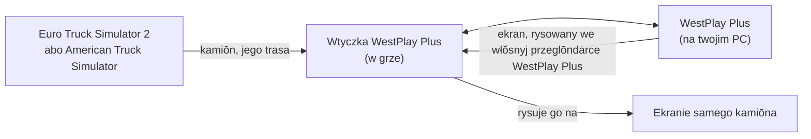

<p align="center"></p>

<h1 align="center">WestPlay Plus</h1>

<!-- languages:start -->
<p align="center">
  <a href="../../README.md">English</a> · <a href="README.zh-CN.md">简体中文</a> · <a href="README.zh-TW.md">繁體中文</a> · <a href="README.ja.md">日本語</a> · <a href="README.ko.md">한국어</a> · <a href="README.de.md">Deutsch</a> · <a href="README.fr.md">Français</a> · <a href="README.fr-CA.md">Français (Canada)</a> · <a href="README.es.md">Español</a> · <a href="README.es-419.md">Español (Latinoamérica)</a> · <a href="README.it.md">Italiano</a> · <a href="README.pt-BR.md">Português (Brasil)</a> · <a href="README.pt-PT.md">Português (Portugal)</a> · <a href="README.ru.md">Русский</a> · <a href="README.pl.md">Polski</a> · <b>Ślōnsko godka</b> · <a href="README.nl.md">Nederlands</a> · <a href="README.tr.md">Türkçe</a> · <a href="README.uk.md">Українська</a> · <a href="README.cs.md">Čeština</a> · <a href="README.sk.md">Slovenčina</a> · <a href="README.hu.md">Magyar</a> · <a href="README.ro.md">Română</a> · <a href="README.bg.md">Български</a> · <a href="README.hr.md">Hrvatski</a> · <a href="README.sr-Latn.md">Srpski (latinica)</a> · <a href="README.sr-Cyrl.md">Српски (ћирилица)</a> · <a href="README.sl.md">Slovenščina</a> · <a href="README.mk.md">Македонски</a> · <a href="README.el.md">Ελληνικά</a> · <a href="README.sv.md">Svenska</a> · <a href="README.da.md">Dansk</a> · <a href="README.no.md">Norsk</a> · <a href="README.fi.md">Suomi</a> · <a href="README.et.md">Eesti</a> · <a href="README.lt.md">Lietuvių</a> · <a href="README.lv.md">Latviešu</a> · <a href="README.ca.md">Català</a> · <a href="README.gl.md">Galego</a> · <a href="README.eu.md">Euskara</a> · <a href="README.ka.md">ქართული</a> · <a href="README.vi.md">Tiếng Việt</a>
</p>
<!-- languages:end -->

<p align="center">
  <b>Ekran w stylu CarPlay dlo kamiōnōw z Euro Truck Simulator 2 a American Truck Simulator.</b><br>
  Twoja mapa, twoja muzyka a YouTube, na panelu twojigo kamiōna.
  <br>
  Zmodyfikowanŏ gałōń <a href="https://github.com/enes-less/WestPlay">WestPlay</a>, dlo grŏczy, kerzy gŏdajōm po chińsku.
</p>

<p align="center">
  <a href="https://github.com/HandsomeTurtle0307/WestPlay-Plus/releases/latest"></a>
  
  
  
  <a href="../../LICENSE"></a>
</p>

WestPlay Plus stawiŏ ekran jak z telefōnu na panelu twojigo kamiōna, w grze: Euro Truck Simulator 2 abo American Truck Simulator, jedyn ekran dlo ôbōch. Twoja trasa na mapie narysowanyj z twojij włŏsnyj gry, twoja muzyka, YouTube, pogoda na twojij drōdze: dokładnie tam, kaj prawdziwy kamiōn mŏ swōj ekran, ôbsugowany myszōm, kej trzimiesz klawisz.

## Funkcyje

**Mapy z twojij włŏsnyj gry.** Rysowane z mapy twojij gry, ze modami map (ProMods a inksze), z twojōm trasōm, wskazōwkami zakrãt za zakrãtym a szukaniym, kere dodŏwŏ przistanki do GPS-u samyj gry.

**Panel na drōga.** Mapa ôbok tego, co leci, a tego, kaj jadziesz, pogoda na trasie, wszystko na jednym ekranie.

**Twoja muzyka.** Apple Music, Spotify a YouTube Music, z Now Playing a tekstami. Klip śpiywki leci prosto w Now Playing, a YouTube mŏ swoje kanały, playlisty, napisy a jakości. Ôdtwarzŏcz leci śpiywki, kere wrzucisz do muzycznego knifla w grze.

**Jasny a ciemny, a twōj włŏsny wyglōnd.** Ciemnieje w nocy abo kej włączisz światła, jak czujnik światła w aucie. Włŏsne tapety a ikony aplikacyji możesz dodać sōm.

**Towarzyszōncŏ aplikacyjŏ** na twojim PC wszystko przigotowuje: nojduje twoje gry (ETS2, ATS abo ôbje), instaluje WestPlay Plus w kożdyj z nich, buduje jejich mapy, a potym już nie przeszkadzŏ.

## Jak to działa



WestPlay Plus rysuje swōj ekran we włŏsnyj przeglōndarce na twojim PC, a jego wtyczka kładzie kożdōm klatkã na ekranie twojigo kamiōna, w grze. Ekrany samych kamiōnōw a jejich infopaski pozostajōm jejich: WestPlay Plus zajmuje miejsce GPS-u, a sztelōnek „Vehicle Bar” gŏdŏ, czy paska kamiōna ôstŏwŏ ôbok.

## Kamiōny

WestPlay Plus pokazujōwŏ sie na dwa sposoby: na ekranie samego kamiōna abo na tablycie WestPlay Plus.

**Na ekranie samego kamiōna.** W kamiōnach, kere naprowdã majōm CarPlay, WestPlay Plus zajmuje miejsce GPS-u na ekranie panelu, dopasowany do jego kształtu. Nic niy ma do kupiyniŏ ani do mōntażu: wsiadŏsz a już tam je. W Euro Truck Simulator 2:

- **DAF** XF a XG/XG+ 2021, XF Electric a XD (a tyż DAF 2021 ôd Jaspera)
- **Scania** S a R, z ekranym 7" abo ze Smart Dash, a tyż S BEV
- **Iveco** S-Way
- **Renault** T (2024)
- **Volvo** FH (2021 a 2024)
- **Coaches DLC:** Scania Touring a MAN Lion's Coach (2024)
- **Autokary ôd Oyuncuyusbis:** Mercedes-Benz Travego 16 SHD, MAN Lion's Coach a Setra S 531 DT na ich włŏsnych panelach
- **Setra S 516 HD/2** (ôd Oyuncuyusbis): na włŏsnym GPS-ekranie autokaru, w jego czãści „Gps”, kerōm mōntujesz u handlyrza kamiōnōw: włŏsny ekran autokaru, jak tego chcieli jego grŏcze, ale taki, kery sam dodŏwŏsz

**Na tablycie WestPlay Plus.** Kożdy inkszy kamiōn, ze gry a z modōw, dostŏwŏ WestPlay Plus na tablycie, kerōm mōntujesz u handlyrza kamiōnōw: w Akcesoriach, miyndzy wieszōncymi rzeczami abo jako zestŏw na panel. Ekran samego kamiōna zachowuje nawigacyjŏ gry. Tablyt je w kożdym kamiōnie z wieszōncymi rzeczami, tyż w modach kamiōnōw, kere zainstalujesz poźnij (dostanōm go przi nastympnym sztarcie gry).

**W American Truck Simulator** narŏzki WestPlay Plus je na tablycie w kożdym kamiōnie. Kamiōny, kerych prawdziwe ôdpowiedniki majōm CarPlay, dostanōm WestPlay Plus na włŏsnym ekranie poźnij.

|                        | Ekran samego kamiōna | Tablyt WestPlay Plus |
| ---------------------- | -------------------- | -------------------- |
| Kamiōny                | Kamiōny ETS2 wyżyj   | Kożdy inkszy, a narŏzki kożdy z ATS |
| Jak go dostać          | Nic: już tam je      | Mōntować u handlyrza |
| Nawigacyjŏ gry         | Zastōmpionŏ bez WestPlay Plus | Ôstŏwŏ na ekranie kamiōna |

### Zwiãk

W tych kamiōnach z Euro Truck Simulator 2 muzyka leci z włŏsnych głośnikōw kamiōna, kożdy na swojim miejscu w kabinie. Inksze kamiōny, a narŏzki tyż te z American Truck Simulator, lecōm zwykłym stereo.

- **Scania S a R (2016), S BEV** — głośniki niskotonowe w drzwiach, wysokotonowe w słupkach A, bas w dachu
- **Scania R (2009), Streamline** — głośniki niskotonowe w drzwiach, wysokotonowe w słupkach A
- **DAF XF (105)** — głośniki wysokotonowe w słupkach A; dwie pary na dachowyj pōłce w Super Space Cab, jedna dachowŏ jednostka w inkszych
- **DAF XF Euro 6** — głośniki niskotonowe w drzwiach, wysokotonowe w słupkach A; dwie pary na dachowyj pōłce w Super Space Cab, jedna dachowŏ jednostka w inkszych
- **DAF XF, XG, XG+ (2021), XF Electric a XD** — głośniki niskotonowe w drzwiach, wysokotonowe w słupkach A, para na gōrze, jedna strzodkowŏ jednostka
- **MAN TGX** — głośniki niskotonowe w drzwiach; w XXL dodŏtkowo dwa małe jednostki wysoko w kożdyj bocznyj ścianie
- **MAN TGX Euro 6** — głośniki niskotonowe w drzwiach; w XL dodŏtkowo jedna małŏ jednostka w kożdym winklu dachu
- **MAN TGX (2020)** — głośnik niskotonowy a strzodkowy w kożdych drzwiach, wysokotonowe w słupkach A
- **Mercedes-Benz Actros (2014)** — głośniki niskotonowe w drzwiach, para na gōrze, wysokotonowe w słupkach A
- **Mercedes-Benz Actros (2009)** — głośniki niskotonowe w drzwiach, para w przednich winklach dachowyj pōłki
- **Volvo FH (2021, 2024), FH16 (2012)** — głośniki niskotonowe w drzwiach, bas w zadnyj ścianie
- **Volvo FH16 (2009)** — po jednyj jednostce w kożdych drzwiach
- **Iveco Stralis** — po jednyj jednostce na kożdym kōńcu dachowyj kōnsoli, a w wysokich dachach małŏ po stronie pasażera
- **Iveco Hi-Way** — po jednyj jednostce na kożdym kōńcu dachowyj kōnsoli a po jednyj wysoko z kożdyj strōny
- **Iveco S-Way** — głośnik niskotonowy a wysokotonowy w kożdych drzwiach
- **Renault Magnum** — po jednyj jednostce w kożdym winklu dachu, wysokotonowe na dachowyj kōnsoli
- **Renault Premium** — po jednyj jednostce z kożdyj strōny dachu, niżyj w niskim dachu
- **Renault T** — głośniki wysokotonowe w słupkach A, para w zadnyj ścianie; głośniki niskotonowe w drzwiach w interiōrach 2024
- **Renault E-Tech T** — głośniki niskotonowe w drzwiach, wysokotonowe w słupkach A, para w zadnyj ścianie
- **Scania PGR ôd JuseeTV** — głośniki mōntowanych czãści: drzwi, słupki A, gōrnŏ kōnsola, zadnŏ ściana

## Instalacyjŏ

1. Ściōngnij instalatōr z [nojnowszego wydaniŏ](https://github.com/HandsomeTurtle0307/WestPlay-Plus/releases/latest) a sztartnij go.
2. Ôtwiyry sie towarzyszōncŏ aplikacyjŏ a prowadzi cie bez resztã: nojduje twoje gry (ETS2, ATS abo ôbje), instaluje w kożdyj wtyczkã WestPlay Plus a jego mod ekranu, a buduje twoje mapy.
3. Sztartnij grã a wsiadnij do kamiōna.

**Aktualizacyje:** ta gałōń sie sama niy aktualizuje. Czy je nowszŏ wersyjŏ, sprŏwdź na [strōnie wydań](https://github.com/HandsomeTurtle0307/WestPlay-Plus/releases). Tyn sam link je tyż na strōnie „Ô programie” w towarzyszōncyj aplikacyji.

**Wymaganiŏ:** Windows 10 abo 11 (64 bity), Euro Truck Simulator 2 wersyjŏ 1.62 (abo 1.61) abo American Truck Simulator wersyjŏ 1.62 (inksze wersyje mogōm działać; kej kkerŏ niy była testowanŏ, towarzyszōncŏ aplikacyjŏ to gŏdŏ) a Microsoft Edge WebView2 (czãść Windows 11; instalatōr dodo je tam, kaj brakuje).

## Prywatność

WestPlay Plus niy mŏ serwerōw, włŏsnych kōnt ani analytiki. Niy zbirŏ a niy wysyłŏ nic ô tobie.

- Do Apple Music, Spotify a YouTube logujesz sie na ich włŏsnych strōnach, we włŏsnym profilu przeglōndarki WestPlay Plus na swojim PC, jak w przeglōndarce. Sam WestPlay Plus niy przechowuje żadnych danych kōnta.
- Twoja mapa je budowanŏ na twojim PC z twojij gry a ôstŏwŏ tam.
- WestPlay Plus gŏdŏ ze usugami, kerych używasz, a z GitHubym ino wtynczŏs, kej ôtworzysz jego strōnã wydań.

## Ôpinije

Błãdy, pytaniŏ a pōmysły: ôtwōrz issue na [GitHubie](https://github.com/HandsomeTurtle0307/WestPlay-Plus/issues).

## Budowanie ze zdrzōdłowego kodu

Potrzebujesz [Rusta](https://rustup.rs) (stable) a [Node.js](https://nodejs.org) 24, na Windows.

```sh
npm install      # nŏczynia towarzyszōncyj aplikacyji a pakiety interfejsu
npm run dev      # WestPlay Plus z interfejsym serwowanym na żywo
```

`cargo test --workspace` a `npm test --prefix ui` sztartujōm testy. Wtyczkã gry buduje sie bez `cargo build --release -p westplay-plugin`.

## Licyncyjŏ

WestPlay Plus je swobodne ôprogramowanie: możesz go rozprzestrzyniać a zmyniać na warōnkach GNU General Public License, wersyjŏ 3 abo (podle twojigo wyboru) kkerŏkolwiek poźniejszŏ. Ôbŏcz [LICENSE](../../LICENSE).

Copyright © 2026 HandsomeTurtle0307. Bibliotyki dostarczane z WestPlay Plus zachowujōm swoje włŏsne licyncyje: ôbŏcz [THIRD_PARTY_LICENSES.md](../../THIRD_PARTY_LICENSES.md) a [THIRD_PARTY_NOTICES.md](../../THIRD_PARTY_NOTICES.md) dlo dzieł, za kerrymi idzie.

## Skōnd pochodzi tyn projekt

WestPlay Plus to zmodyfikowanŏ gałōń (fork) projektu [WestPlay](https://github.com/enes-less/WestPlay), znŏmienitego moda z ekranym w stylu CarPlay dlo Euro Truck Simulator 2 a American Truck Simulator, kery zrobiōł **enes-less**. Prawie cołki piyrszy dizajn, kod a resursy to jego robota; ta gałōń trzimŏ swoje zmiany na wierzchu a je mu wdziyncznŏ za to, co zbudowoł. Kej ci sie projekt podŏbŏ, ôbŏcz tyż original.

Wesprzij tyż originalny projekt (a kej możesz, wesprzij tyż mie 😭😭😭 — robiynie ôprogramowaniŏ niy je łacne~).

<!-- translated:start -->
<sub>Ta README je przekładym z angelskij wersyje. Autōr zicher niy gŏdŏ we wszyjskich 43 gŏdkach 😭😭, wiync przekład może być miejscami niycołki. Przepraszōm~ Kej zobŏczysz feler w swojij gŏdce, dej znać — bãdã wdziynczny~</sub>
<!-- translated:end -->

<sub>WestPlay Plus je niypodległym projektym, niyzwiōnzanym z Apple, SCS Software, Spotify, Google ani producentami kamiōnōw a bez jejich przwolyniŏ. CarPlay, Apple Music, Spotify, YouTube, YouTube Music a miana a loga producentōw sōm znakami jejich włŏścicieli a sōm tu użyte ino dlo ôkreślyniŏ tego, z czym WestPlay Plus działa.</sub>
