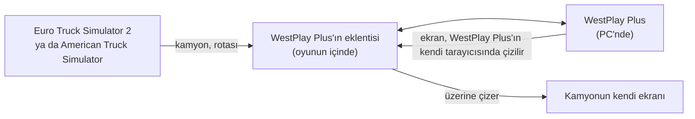

<p align="center"></p>

<h1 align="center">WestPlay Plus</h1>

<!-- languages:start -->
<p align="center">
  <a href="../../README.md">English</a> · <a href="README.zh-CN.md">简体中文</a> · <a href="README.zh-TW.md">繁體中文</a> · <a href="README.ja.md">日本語</a> · <a href="README.ko.md">한국어</a> · <a href="README.de.md">Deutsch</a> · <a href="README.fr.md">Français</a> · <a href="README.fr-CA.md">Français (Canada)</a> · <a href="README.es.md">Español</a> · <a href="README.es-419.md">Español (Latinoamérica)</a> · <a href="README.it.md">Italiano</a> · <a href="README.pt-BR.md">Português (Brasil)</a> · <a href="README.pt-PT.md">Português (Portugal)</a> · <a href="README.ru.md">Русский</a> · <a href="README.pl.md">Polski</a> · <a href="README.szl.md">Ślōnsko godka</a> · <a href="README.nl.md">Nederlands</a> · <b>Türkçe</b> · <a href="README.uk.md">Українська</a> · <a href="README.cs.md">Čeština</a> · <a href="README.sk.md">Slovenčina</a> · <a href="README.hu.md">Magyar</a> · <a href="README.ro.md">Română</a> · <a href="README.bg.md">Български</a> · <a href="README.hr.md">Hrvatski</a> · <a href="README.sr-Latn.md">Srpski (latinica)</a> · <a href="README.sr-Cyrl.md">Српски (ћирилица)</a> · <a href="README.sl.md">Slovenščina</a> · <a href="README.mk.md">Македонски</a> · <a href="README.el.md">Ελληνικά</a> · <a href="README.sv.md">Svenska</a> · <a href="README.da.md">Dansk</a> · <a href="README.no.md">Norsk</a> · <a href="README.fi.md">Suomi</a> · <a href="README.et.md">Eesti</a> · <a href="README.lt.md">Lietuvių</a> · <a href="README.lv.md">Latviešu</a> · <a href="README.ca.md">Català</a> · <a href="README.gl.md">Galego</a> · <a href="README.eu.md">Euskara</a> · <a href="README.ka.md">ქართული</a> · <a href="README.vi.md">Tiếng Việt</a>
</p>
<!-- languages:end -->

<p align="center">
  <b>Euro Truck Simulator 2 ve American Truck Simulator kamyonları için CarPlay tarzı bir ekran.</b><br>
  Haritan, müziğin ve YouTube, kamyonunun kendi gösterge ekranında.
  <br>
  <a href="https://github.com/enes-less/WestPlay">WestPlay</a> projesinin, Çince konuşan oyuncular için değiştirilmiş bir dalı.
</p>

<p align="center">
  <a href="https://github.com/HandsomeTurtle0307/WestPlay-Plus/releases/latest"></a>
  
  
  
  <a href="../../LICENSE"></a>
</p>

WestPlay Plus, oyunun içinde kamyonunun kendi gösterge ekranına telefon tarzı bir ekran koyar: Euro Truck Simulator 2 ya da American Truck Simulator, ikisi için tek ekran. Kendi oyunundan çizilmiş bir harita üzerinde rotan, müziğin, YouTube, yol boyunca hava durumu: gerçek bir kamyonun ekranının olduğu tam o yerde, bir tuşu basılı tutarken fareyle kullanılır.

<!-- why:start -->

## Bunu neden yaptım

Başta bir CarPlay modu arıyordum, sonra WestPlay'e denk geldim ve gerçekten çok iyi yapılmış olduğunu gördüm (cidden, çok çok iyi). Sadece optimizasyonu kötüydü ve bilgisayarımı dondurdu. Ben de kendim elden geçirmeye karar verdim: performansı toparladım, birkaç yeni özellik ekledim (bir devin omuzlarında duruyorum işte, hihi~😊).

<!-- why:end -->

## Özellikler

**Haritalar kendi oyunundan.** Oyununun haritasından çizilir, harita modları dahil (ProMods ve diğerleri), rotan, dönüş dönüş yönlendirme ve oyunun kendi GPS'ine durak ekleyen bir arama ile.

**Yol için bir gösterge paneli.** Haritanın yanında ne çaldığı ve nereye gittiğin, yol boyunca hava durumu, hepsi tek ekranda.

**Müziğin.** Apple Music, Spotify ve YouTube Music, Now Playing ve şarkı sözleriyle. Bir şarkının klibi doğrudan Now Playing içinde oynar; YouTube'un kanalları, çalma listeleri, altyazıları ve kaliteleri vardır. Oynatıcı ise oyunun kendi müzik klasörüne koyduğun şarkıları çalar.

**Açık ve koyu, bir de kendi görünümün.** Gece ya da farlarını açtığında, bir arabanın ışık sensörü gibi kararır. Kendi duvar kağıtlarını ve uygulama simgelerini getirebilirsin.

**PC'deki yardımcı uygulama** her şeyi hazırlar: oyunlarını bulur (ETS2, ATS ya da ikisi), her birine WestPlay Plus'ı kurar, haritalarını oluşturur ve sonrasında ortadan çekilir.

## Nasıl çalışır



WestPlay Plus ekranını PC'nde kendi tarayıcısında çizer, eklentisi de her kareyi oyunun içinde kamyonunun ekranına koyar. Kamyonların kendi ekranları ve bilgi çubukları onlara aittir: WestPlay Plus GPS'in yerini alır, "Vehicle Bar" ayarı ise kamyonun çubuğunun yanında kalıp kalmayacağını söyler.

## Kamyonlar

WestPlay Plus iki şekilde görünür: kamyonun kendi ekranında ya da WestPlay Plus tabletinde.

**Kamyonun kendi ekranında.** Gerçekte CarPlay olan kamyonlarda WestPlay Plus, gösterge ekranındaki GPS'in yerini alır ve o ekranın biçimine uyar. Alınacak ya da takılacak bir şey yok: bin, işte orada. Euro Truck Simulator 2'de:

- **DAF** XF ve XG/XG+ 2021, XF Electric ve XD (ve Jasper'ın DAF 2021'i)
- **Scania** S ve R, 7" ekranla veya Smart Dash ile, ve S BEV
- **Iveco** S-Way
- **Renault** T (2024)
- **Volvo** FH (2021 ve 2024)
- **Coaches DLC:** Scania Touring ve MAN Lion's Coach (2024)
- **Oyuncuyusbis otobüsleri:** Mercedes-Benz Travego 16 SHD, MAN Lion's Coach ve Setra S 531 DT, kendi gösterge ekranlarında
- **Setra S 516 HD/2** (Oyuncuyusbis'in): otobüsün kendi GPS ekranında, yani "Gps" parçasında görünür; bunu kamyon atölyesinde takman gerekir: otobüsün kendi ekranı, oyuncularının istediği gibi, ama ekleyen sensin

**WestPlay Plus tabletinde.** Diğer bütün kamyonlar, oyunun kendi kamyonları da mod kamyonlar da, WestPlay Plus'ı kamyon atölyesinde taktığın bir tablette alır: Aksesuarlar altında, asılı eşyalar arasında ya da gösterge paneli seti olarak. Kamyonun kendi ekranı oyunun navigasyonunu korur. Tablet, asılı eşyası olan her kamyonda vardır; sonradan kurduğun kamyon modları dahil (onu oyunu bir sonraki açışında alırlar).

**American Truck Simulator'da** şimdilik WestPlay Plus her kamyonda tablette. Gerçek karşılıkları CarPlay olan kamyonlar WestPlay Plus'ı ileride kendi ekranlarında alacak.

|                        | Kamyonun kendi ekranı | WestPlay Plus tableti |
| ---------------------- | --------------------- | --------------------- |
| Kamyonlar              | Yukarıdaki ETS2 kamyonları | Diğer bütün kamyonlar, ve şimdilik bütün ATS kamyonları |
| Nasıl alınır           | Hiçbir şey: zaten orada | Kamyon atölyesinde takılır |
| Oyunun navigasyonu     | WestPlay Plus ile değiştirilir | Kamyonun ekranında kalır |

### Ses

Bu Euro Truck Simulator 2 kamyonlarında müzik, kamyonun kendi hoparlörlerinden, her biri kabindeki yerinden çalar. Diğer kamyonlar ve şimdilik American Truck Simulator'ınkiler düz stereo çalar.

- **Scania S ve R (2016), S BEV** — kapı woofer'ları, A sütunu tweeter'ları, tavan bası
- **Scania R (2009), Streamline** — kapı woofer'ları, A sütunu tweeter'ları
- **DAF XF (105)** — A sütunu tweeter'ları; Super Space Cab'da tavan rafında iki çift, diğerlerinde bir tavan ünitesi
- **DAF XF Euro 6** — kapı woofer'ları, A sütunu tweeter'ları; Super Space Cab'da tavan rafında iki çift, diğerlerinde bir tavan ünitesi
- **DAF XF, XG, XG+ (2021), XF Electric ve XD** — kapı woofer'ları, A sütunu tweeter'ları, yukarıda bir çift, bir orta ünite
- **MAN TGX** — kapı woofer'ları; XXL'de ayrıca her yan duvarın yükseğinde iki küçük ünite
- **MAN TGX Euro 6** — kapı woofer'ları; XL'de ayrıca her tavan köşesinde bir küçük ünite
- **MAN TGX (2020)** — her kapıda bir woofer ve bir orta ses, A sütunu tweeter'ları
- **Mercedes-Benz Actros (2014)** — kapı woofer'ları, yukarıda bir çift, A sütunu tweeter'ları
- **Mercedes-Benz Actros (2009)** — kapı woofer'ları, tavan rafının ön köşelerinde bir çift
- **Volvo FH (2021, 2024), FH16 (2012)** — kapı woofer'ları, arka duvar bası
- **Volvo FH16 (2009)** — her kapıda bir ünite
- **Iveco Stralis** — tavan konsolunun her iki ucunda birer ünite, yüksek tavanlarda yolcu tarafında bir küçük ünite
- **Iveco Hi-Way** — tavan konsolunun her iki ucunda birer ünite, her yanda yüksekte birer ünite
- **Iveco S-Way** — her kapıda bir woofer ve bir tweeter
- **Renault Magnum** — her tavan köşesinde bir ünite, tavan konsolunda tweeter'lar
- **Renault Premium** — tavanın her yanında bir ünite, alçak tavanda daha aşağıda
- **Renault T** — A sütunu tweeter'ları, arka duvarda bir çift; 2024 iç mekanlarında kapı woofer'ları
- **Renault E-Tech T** — kapı woofer'ları, A sütunu tweeter'ları, arka duvarda bir çift
- **JuseeTV'nin Scania PGR'ı** — taktığın parçaların hoparlörleri: kapılar, A sütunları, üst konsol, arka duvar

## Kurulum

1. [En son sürümden](https://github.com/HandsomeTurtle0307/WestPlay-Plus/releases/latest) kurulum dosyasını indir ve çalıştır.
2. Yardımcı uygulama açılır ve geri kalanında sana yol gösterir: oyunlarını bulur (ETS2, ATS ya da ikisi), her birine WestPlay Plus'ın eklentisini ve ekran modunu kurar, haritalarını oluşturur.
3. Oyunu başlat ve bir kamyona bin.

**Güncellemeler:** bu dal kendini güncellemez. Daha yeni bir sürüm olup olmadığını görmek için [sürümler sayfasına](https://github.com/HandsomeTurtle0307/WestPlay-Plus/releases) bak. Yardımcı uygulamanın "Hakkında" sayfasında da aynı bağlantı var.

**Gereksinimler:** Windows 10 veya 11 (64 bit), Euro Truck Simulator 2 sürüm 1.62 (veya 1.61) ya da American Truck Simulator sürüm 1.62 (diğer sürümler de çalışabilir; bir sürüm denenmemişse yardımcı uygulama söyler) ve Microsoft Edge WebView2 (Windows 11'in parçası; eksikse kurulum ekler).

## Gizlilik

WestPlay Plus'ın sunucusu, kendi hesabı ve analitiği yoktur. Seninle ilgili hiçbir şeyi toplamaz veya göndermez.

- Apple Music, Spotify ve YouTube'a kendi sayfalarında, PC'ndeki WestPlay Plus'ın kendi tarayıcı profilinde, bir tarayıcıdaki gibi giriş yaparsın. WestPlay Plus kendi hiçbir hesap verisi saklamaz.
- Haritan PC'nde oyunundan oluşturulur ve orada kalır.
- WestPlay Plus kullandığın servislerle konuşur; GitHub ile yalnızca onun sürümler sayfasını açtığında.

## Geri bildirim

Hatalar, sorular ve fikirler: [GitHub'da](https://github.com/HandsomeTurtle0307/WestPlay-Plus/issues) bir issue aç.

## Kaynaktan derleme

Windows'ta [Rust](https://rustup.rs) (stable) ve [Node.js](https://nodejs.org) 24 gerekir.

```sh
npm install      # yardımcı uygulamanın araçları ve arayüzün paketleri
npm run dev      # WestPlay Plus, arayüz canlı sunulurken
```

`cargo test --workspace` ve `npm test --prefix ui` testleri çalıştırır. Oyun eklentisi `cargo build --release -p westplay-plugin` ile derlenir.

## Lisans

WestPlay Plus özgür yazılımdır: GNU General Public License'ın 3. sürümünün (ya da senin seçeceğin daha sonraki bir sürümün) koşulları altında yeniden dağıtabilir ve değiştirebilirsin. Bkz. [LICENSE](../../LICENSE).

Copyright © 2026 HandsomeTurtle0307. WestPlay Plus ile gelen kütüphaneler kendi lisanslarını korur: bkz. [THIRD_PARTY_LICENSES.md](../../THIRD_PARTY_LICENSES.md) ve izlediği çalışmalar için [THIRD_PARTY_NOTICES.md](../../THIRD_PARTY_NOTICES.md).

## Bu proje nereden geliyor

WestPlay Plus, **enes-less** tarafından yapılan, Euro Truck Simulator 2 ve American Truck Simulator için son derece başarılı bir CarPlay tarzı ekran modu olan [WestPlay](https://github.com/enes-less/WestPlay) projesinin değiştirilmiş bir dalıdır (fork). Özgün tasarımın, kodun ve varlıkların neredeyse tamamı onun işidir; bu dal kendi değişikliklerini onun üzerine tutar ve kurduğu şey için minnettardır. Bu projeyi beğendiysen, orijinaline de bir göz at.

Lütfen orijinal projeyi de destekle (yapabilirsen beni de destekle 😭😭😭 — yazılım geliştirmek kolay değil~).

<!-- translated:start -->
<sub>Bu README İngilizce sürümden çevrildi. Yazar elbette 43 dilin hepsini bilmiyor 😭😭, bu yüzden çeviri yer yer eksik olabilir. Kusura bakmayın~ Kendi dilinizde bir hata görürseniz haber verin, çok sevinirim~</sub>
<!-- translated:end -->

<sub>WestPlay Plus bağımsız bir projedir; Apple, SCS Software, Spotify, Google veya kamyon üreticileriyle bağlantılı değildir ve onlar tarafından onaylanmamıştır. CarPlay, Apple Music, Spotify, YouTube, YouTube Music ile kamyon üreticilerinin adları ve logoları sahiplerinin ticari markalarıdır; burada yalnızca WestPlay Plus'ın nelerle çalıştığını adlandırmak için kullanılmıştır.</sub>
