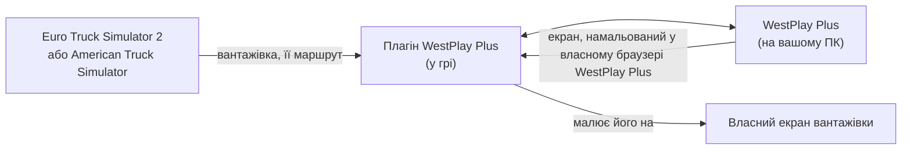

<p align="center"></p>

<h1 align="center">WestPlay Plus</h1>

<!-- languages:start -->
<p align="center">
  <a href="../../README.md">English</a> · <a href="README.zh-CN.md">简体中文</a> · <a href="README.zh-TW.md">繁體中文</a> · <a href="README.ja.md">日本語</a> · <a href="README.ko.md">한국어</a> · <a href="README.de.md">Deutsch</a> · <a href="README.fr.md">Français</a> · <a href="README.fr-CA.md">Français (Canada)</a> · <a href="README.es.md">Español</a> · <a href="README.es-419.md">Español (Latinoamérica)</a> · <a href="README.it.md">Italiano</a> · <a href="README.pt-BR.md">Português (Brasil)</a> · <a href="README.pt-PT.md">Português (Portugal)</a> · <a href="README.ru.md">Русский</a> · <a href="README.pl.md">Polski</a> · <a href="README.szl.md">Ślōnsko godka</a> · <a href="README.nl.md">Nederlands</a> · <a href="README.tr.md">Türkçe</a> · <b>Українська</b> · <a href="README.cs.md">Čeština</a> · <a href="README.sk.md">Slovenčina</a> · <a href="README.hu.md">Magyar</a> · <a href="README.ro.md">Română</a> · <a href="README.bg.md">Български</a> · <a href="README.hr.md">Hrvatski</a> · <a href="README.sr-Latn.md">Srpski (latinica)</a> · <a href="README.sr-Cyrl.md">Српски (ћирилица)</a> · <a href="README.sl.md">Slovenščina</a> · <a href="README.mk.md">Македонски</a> · <a href="README.el.md">Ελληνικά</a> · <a href="README.sv.md">Svenska</a> · <a href="README.da.md">Dansk</a> · <a href="README.no.md">Norsk</a> · <a href="README.fi.md">Suomi</a> · <a href="README.et.md">Eesti</a> · <a href="README.lt.md">Lietuvių</a> · <a href="README.lv.md">Latviešu</a> · <a href="README.ca.md">Català</a> · <a href="README.gl.md">Galego</a> · <a href="README.eu.md">Euskara</a> · <a href="README.ka.md">ქართული</a> · <a href="README.vi.md">Tiếng Việt</a>
</p>
<!-- languages:end -->

<p align="center">
  <b>Екран у стилі CarPlay для вантажівок Euro Truck Simulator 2 і American Truck Simulator.</b><br>
  Ваша карта, ваша музика та YouTube — на власному екрані вашої вантажівки.
  <br>
  Змінена гілка <a href="https://github.com/enes-less/WestPlay">WestPlay</a>, для гравців, які розмовляють китайською.
</p>

<p align="center">
  <a href="https://github.com/HandsomeTurtle0307/WestPlay-Plus/releases/latest"></a>
  
  
  
  <a href="../../LICENSE"></a>
</p>

WestPlay Plus ставить екран у стилі телефона на власну приладову панель вашої вантажівки, просто в грі: Euro Truck Simulator 2 або American Truck Simulator, один екран для обох. Ваш маршрут на карті, намальованій з вашої ж гри, ваша музика, YouTube, погода на вашому шляху: рівно там, де у справжньої вантажівки стоїть екран, з керуванням мишею при затиснутій клавіші.

<!-- why:start -->

## Навіщо я це зробив

Спочатку я шукав мод на CarPlay, аж натрапив на WestPlay і побачив, що він зроблений дуже добре (справді, дуже-дуже добре). От тільки оптимізація підводила — комп'ютер у мене зависав. Тож я вирішив сам його доопрацювати: підтягнути продуктивність і додати кілька нових функцій (стою на плечах велетня, хе~😊).

<!-- why:end -->

## Можливості

**Карти з вашої власної гри.** Малюються з карти вашої гри, разом з карт-модами (ProMods та інші), з вашим маршрутом, покроковими підказками та пошуком, який додає зупинки до власного GPS гри.

**Панель для дороги.** Карта поруч із тим, що грає, і тим, куди ви їдете, погода на вашому шляху, усе на одному екрані.

**Ваша музика.** Apple Music, Spotify і YouTube Music, з Now Playing і текстами пісень. Кліп пісні відтворюється просто в Now Playing, а в YouTube є канали, плейлисти, субтитри й якість. Плеєр грає пісні, які ви кладете в музичну теку гри.

**Світла й темна теми, і ваш власний вигляд.** Уночі або коли ви вмикаєте фари екран темнішає, як датчик світла в автомобілі. Свої шпалери та значки застосунків можна поставити самому.

**Застосунок-компаньйон** на вашому ПК усе налаштовує: знаходить ваші ігри (ETS2, ATS або обидві), встановлює WestPlay Plus у кожну, будує їхні карти, а потім не заважає.

## Як це працює



WestPlay Plus малює свій екран у власному браузері на вашому ПК, а його плагін виводить кожен кадр на екран вашої вантажівки, всередині гри. Власні екрани вантажівок та їхні інформаційні панелі залишаються їхніми: WestPlay Plus займає місце GPS, а налаштування «Vehicle Bar» вирішує, чи залишиться панель вантажівки поруч.

## Вантажівки

WestPlay Plus з'являється двома способами: на власному екрані вантажівки або на планшеті WestPlay Plus.

**На власному екрані вантажівки.** У вантажівках, які насправді мають CarPlay, WestPlay Plus займає місце GPS на приладовому екрані й підлаштовується під його форму. Купувати й ставити нічого не треба: сідаєте, і він уже там. У Euro Truck Simulator 2:

- **DAF** XF і XG/XG+ 2021, XF Electric і XD (а також DAF 2021 від Jasper)
- **Scania** S і R, з екраном 7" або зі Smart Dash, і S BEV
- **Iveco** S-Way
- **Renault** T (2024)
- **Volvo** FH (2021 і 2024)
- **Coaches DLC:** Scania Touring і MAN Lion's Coach (2024)
- **Автобуси Oyuncuyusbis:** Mercedes-Benz Travego 16 SHD, MAN Lion's Coach і Setra S 531 DT на їхніх власних приладових екранах
- **Setra S 516 HD/2** (від Oyuncuyusbis): на власному GPS-екрані автобуса, його частині «Gps», яку ви ставите в майстерні: власний екран автобуса, як просили його гравці, але той, який додаєте ви

**На планшеті WestPlay Plus.** Усі інші вантажівки, і з гри, і з модів, отримують WestPlay Plus на планшеті, який ви ставите в майстерні: у розділі «Аксесуари», серед підвісних предметів або як набір для приладової панелі. Власний екран вантажівки зберігає навігацію гри. Планшет є в кожній вантажівці з підвісними предметами, включно з модами вантажівок, які ви встановите пізніше (вони отримають його при наступному запуску гри).

**В American Truck Simulator** поки що WestPlay Plus стоїть на планшеті в кожній вантажівці. Вантажівки, чиї реальні аналоги мають CarPlay, пізніше отримають WestPlay Plus на власний екран.

|                        | Власний екран вантажівки | Планшет WestPlay Plus |
| ---------------------- | ------------------------ | --------------------- |
| Вантажівки             | Вантажівки ETS2 вище     | Усі інші, і поки всі вантажівки ATS |
| Як отримати            | Нічого: він уже там      | Поставити в майстерні |
| Навігація гри          | Замінюється WestPlay Plus | Залишається на екрані вантажівки |

### Звук

У цих вантажівках Euro Truck Simulator 2 музика грає з власних динаміків вантажівки, кожен на своєму місці в кабіні. В інших вантажівках, і поки що у вантажівках American Truck Simulator, звук звичайний стерео.

- **Scania S і R (2016), S BEV** — вуфери в дверях, твітери в стійках A, бас у стелі
- **Scania R (2009), Streamline** — вуфери в дверях, твітери в стійках A
- **DAF XF (105)** — твітери в стійках A; дві пари на стельовій полиці в Super Space Cab, один стельовий блок в інших
- **DAF XF Euro 6** — вуфери в дверях, твітери в стійках A; дві пари на стельовій полиці в Super Space Cab, один стельовий блок в інших
- **DAF XF, XG, XG+ (2021), XF Electric і XD** — вуфери в дверях, твітери в стійках A, пара на стелі, центральний блок
- **MAN TGX** — вуфери в дверях; у XXL ще по два невеликі блоки високо в кожній бічній стінці
- **MAN TGX Euro 6** — вуфери в дверях; у XL ще по невеликому блоку в кожному куті стелі
- **MAN TGX (2020)** — вуфер і середньочастотник у кожних дверях, твітери в стійках A
- **Mercedes-Benz Actros (2014)** — вуфери в дверях, пара на стелі, твітери в стійках A
- **Mercedes-Benz Actros (2009)** — вуфери в дверях, пара в передніх кутах стельової полиці
- **Volvo FH (2021, 2024), FH16 (2012)** — вуфери в дверях, бас у задній стінці
- **Volvo FH16 (2009)** — по блоку в кожних дверях
- **Iveco Stralis** — по блоку з кожного краю стельової консолі, а у високих дахах ще невеликий з боку пасажира
- **Iveco Hi-Way** — по блоку з кожного краю стельової консолі й по одному високо з кожного боку
- **Iveco S-Way** — вуфер і твітер у кожних дверях
- **Renault Magnum** — по блоку в кожному куті стелі, твітери на стельовій консолі
- **Renault Premium** — по блоку з кожного боку стелі, нижче в низькому даху
- **Renault T** — твітери в стійках A, пара в задній стінці; вуфери в дверях в інтер'єрах 2024 року
- **Renault E-Tech T** — вуфери в дверях, твітери в стійках A, пара в задній стінці
- **Scania PGR від JuseeTV** — динаміки тих деталей, які ви ставите: двері, стійки A, верхня консоль, задня стінка

## Встановлення

1. Завантажте інсталятор з [останньої версії](https://github.com/HandsomeTurtle0307/WestPlay-Plus/releases/latest) і запустіть його.
2. Відкриється застосунок-компаньйон і проведе вас через решту: знайде ваші ігри (ETS2, ATS або обидві), встановить у кожну плагін WestPlay Plus і його мод екрана, а потім збудує ваші карти.
3. Запустіть гру й сядьте у вантажівку.

**Оновлення:** ця гілка не оновлюється сама. Щоб перевірити, чи є новіша версія, зайдіть на [сторінку релізів](https://github.com/HandsomeTurtle0307/WestPlay-Plus/releases). Те саме посилання є на сторінці «Про програму» в застосунку-компаньйоні.

**Вимоги:** Windows 10 або 11 (64 біти), Euro Truck Simulator 2 версії 1.62 (або 1.61) чи American Truck Simulator версії 1.62 (інші версії можуть працювати; якщо версія не перевірена, застосунок-компаньйон про це скаже) і Microsoft Edge WebView2 (входить до Windows 11; інсталятор додасть його, якщо його немає).

## Конфіденційність

У WestPlay Plus немає серверів, власних акаунтів і аналітики. Він нічого про вас не збирає й не надсилає.

- Ви входите в Apple Music, Spotify і YouTube на їхніх власних сторінках, у окремому профілі браузера WestPlay Plus на вашому ПК, як у звичайному браузері. Сам WestPlay Plus не зберігає жодних даних акаунтів.
- Ваша карта будується на вашому ПК з вашої гри й залишається там.
- WestPlay Plus спілкується із сервісами, якими ви користуєтеся, і з GitHub — лише коли ви відкриваєте його сторінку релізів.

## Відгуки

Помилки, запитання та ідеї: відкрийте issue на [GitHub](https://github.com/HandsomeTurtle0307/WestPlay-Plus/issues).

## Збірка з вихідного коду

Вам знадобляться [Rust](https://rustup.rs) (stable) і [Node.js](https://nodejs.org) 24, на Windows.

```sh
npm install      # інструменти застосунку-компаньйона й пакети інтерфейсу
npm run dev      # WestPlay Plus із живою роздачею інтерфейсу
```

`cargo test --workspace` і `npm test --prefix ui` запускають тести. Плагін гри збирається командою `cargo build --release -p westplay-plugin`.

## Ліцензія

WestPlay Plus — вільне програмне забезпечення: ви можете поширювати й змінювати його на умовах GNU General Public License версії 3 або (на ваш вибір) будь-якої пізнішої версії. Див. [LICENSE](../../LICENSE).

Copyright © 2026 HandsomeTurtle0307. Бібліотеки, що постачаються з WestPlay Plus, зберігають свої ліцензії: див. [THIRD_PARTY_LICENSES.md](../../THIRD_PARTY_LICENSES.md) і [THIRD_PARTY_NOTICES.md](../../THIRD_PARTY_NOTICES.md) — про роботи, яким він слідує.

## Звідки цей проєкт

WestPlay Plus — змінена гілка (форк) [WestPlay](https://github.com/enes-less/WestPlay), чудового мода з екраном у стилі CarPlay для Euro Truck Simulator 2 і American Truck Simulator, створеного **enes-less**. Майже весь початковий дизайн, код і матеріали — його робота; ця гілка тримає свої зміни поверх і вдячна йому за те, що він збудував. Якщо вам подобається цей проєкт, зазирніть і в оригінал.

Будь ласка, підтримайте також оригінальний проєкт (а якщо зможете — підтримайте і мене 😭😭😭, розробляти програми зовсім не просто~).

<!-- translated:start -->
<sub>Цей README перекладено з англійської версії. Автор, звісно, не володіє всіма 43 мовами 😭😭, тож переклад місцями може бути неповним. Прошу вибачення~ Якщо помітите помилку у своїй мові, напишіть — буду дуже вдячний~</sub>
<!-- translated:end -->

<sub>WestPlay Plus — незалежний проєкт, не пов'язаний з Apple, SCS Software, Spotify, Google чи виробниками вантажівок і не схвалений ними. CarPlay, Apple Music, Spotify, YouTube, YouTube Music, а також назви й логотипи виробників вантажівок є торговельними марками їхніх власників і використані тут лише для позначення того, з чим працює WestPlay Plus.</sub>
