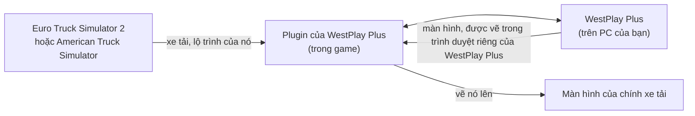

<p align="center"></p>

<h1 align="center">WestPlay Plus</h1>

<!-- languages:start -->
<p align="center">
  <a href="../../README.md">English</a> · <a href="README.zh-CN.md">简体中文</a> · <a href="README.zh-TW.md">繁體中文</a> · <a href="README.ja.md">日本語</a> · <a href="README.ko.md">한국어</a> · <a href="README.de.md">Deutsch</a> · <a href="README.fr.md">Français</a> · <a href="README.fr-CA.md">Français (Canada)</a> · <a href="README.es.md">Español</a> · <a href="README.es-419.md">Español (Latinoamérica)</a> · <a href="README.it.md">Italiano</a> · <a href="README.pt-BR.md">Português (Brasil)</a> · <a href="README.pt-PT.md">Português (Portugal)</a> · <a href="README.ru.md">Русский</a> · <a href="README.pl.md">Polski</a> · <a href="README.nl.md">Nederlands</a> · <a href="README.tr.md">Türkçe</a> · <a href="README.uk.md">Українська</a> · <a href="README.cs.md">Čeština</a> · <a href="README.sk.md">Slovenčina</a> · <a href="README.hu.md">Magyar</a> · <a href="README.ro.md">Română</a> · <a href="README.bg.md">Български</a> · <a href="README.hr.md">Hrvatski</a> · <a href="README.sr-Latn.md">Srpski (latinica)</a> · <a href="README.sr-Cyrl.md">Српски (ћирилица)</a> · <a href="README.sl.md">Slovenščina</a> · <a href="README.mk.md">Македонски</a> · <a href="README.el.md">Ελληνικά</a> · <a href="README.sv.md">Svenska</a> · <a href="README.da.md">Dansk</a> · <a href="README.no.md">Norsk</a> · <a href="README.fi.md">Suomi</a> · <a href="README.et.md">Eesti</a> · <a href="README.lt.md">Lietuvių</a> · <a href="README.lv.md">Latviešu</a> · <a href="README.ca.md">Català</a> · <a href="README.gl.md">Galego</a> · <b>Tiếng Việt</b>
</p>
<!-- languages:end -->

<!-- english-only:start -->
<p align="center"><sub>Tiếng Silesia, tiếng Basque và tiếng Gruzia được ứng dụng hỗ trợ nhưng chưa có README: chưa có ai kiểm tra bản dịch sang các ngôn ngữ này. Toàn bộ nội dung nằm trong bản tiếng Anh ở thư mục gốc của kho lưu trữ.</sub></p>
<!-- english-only:end -->

<p align="center">
  <b>Một màn hình kiểu CarPlay cho xe tải trong Euro Truck Simulator 2 và American Truck Simulator.</b><br>
  Bản đồ, nhạc và YouTube của bạn, ngay trên bảng điều khiển của chính chiếc xe tải bạn lái.
  <br>
  Một nhánh sửa đổi của <a href="https://github.com/enes-less/WestPlay">WestPlay</a>, có thêm một số tối ưu và tính năng mới.
</p>

<p align="center">
  <a href="https://github.com/HandsomeTurtle0307/WestPlay-Plus/releases/latest"></a>
  
  
  
  <a href="../../LICENSE"></a>
</p>

WestPlay Plus đặt một màn hình kiểu điện thoại lên bảng điều khiển của chính chiếc xe tải bạn lái, ngay trong game: Euro Truck Simulator 2 hay American Truck Simulator, một màn hình dùng cho cả hai. Lộ trình của bạn trên bản đồ được vẽ từ chính game của bạn, nhạc của bạn, YouTube, thời tiết trên đường: đúng chỗ mà một chiếc xe tải thật có màn hình, điều khiển bằng chuột trong khi giữ một phím.

<!-- why:start -->

## Vì sao mình làm cái này

Ban đầu mình chỉ tìm một mod CarPlay, rồi tình cờ thấy WestPlay và nhận ra nó được làm rất tốt (thật đấy, rất rất tốt). Chỉ có điều phần tối ưu chưa ổn nên làm máy mình đơ luôn. Thế là mình quyết định tự hoàn thiện nó: chỉnh lại hiệu năng và thêm vài tính năng mới (đứng trên vai người khổng lồ mà, hehe~😊).

<!-- why:end -->

## Tính năng

**Bản đồ từ chính game của bạn.** Vẽ từ bản đồ trong game, bao gồm cả mod bản đồ (ProMods và các mod khác), với lộ trình, hướng dẫn rẽ từng chặng và tìm kiếm có thể thêm điểm dừng vào GPS của chính game.

**Bảng điều khiển cho chuyến đi.** Bản đồ bên cạnh thứ đang phát và nơi bạn đang tới, thời tiết trên đường, tất cả trên một màn hình.

**Nhạc của bạn.** Apple Music, Spotify và YouTube Music, có Now Playing và lời bài hát. Video của bài hát phát ngay trong Now Playing, còn YouTube có kênh, danh sách phát, phụ đề và chất lượng. Trình phát phát những bài bạn đặt vào thư mục nhạc của game.

**Sáng và tối, và giao diện của riêng bạn.** Màn hình tối lại vào ban đêm hoặc khi bạn bật đèn pha, như cảm biến ánh sáng trên ô tô. Bạn có thể tự đưa hình nền và biểu tượng ứng dụng của mình vào.

**Ứng dụng đồng hành** trên PC lo mọi thứ: tìm game của bạn (ETS2, ATS hoặc cả hai), cài WestPlay Plus vào từng game, dựng bản đồ cho chúng, rồi sau đó không làm phiền nữa.

## Cách hoạt động



WestPlay Plus vẽ màn hình của mình trong một trình duyệt riêng trên PC của bạn, còn plugin của nó đưa từng khung hình lên màn hình chiếc xe tải của bạn, trong game. Màn hình và thanh thông tin của chính xe tải vẫn thuộc về xe tải: WestPlay Plus chiếm chỗ của GPS, và tùy chọn “Vehicle Bar” quyết định thanh của xe tải có nằm bên cạnh hay không.

## Xe tải

WestPlay Plus xuất hiện theo hai cách: trên màn hình của chính xe tải, hoặc trên máy tính bảng WestPlay Plus.

**Trên màn hình của chính xe tải.** Ở những xe tải ngoài đời có CarPlay, WestPlay Plus chiếm chỗ của GPS trên màn hình bảng điều khiển, uốn theo hình dạng của màn hình đó. Không phải mua hay lắp gì: bước lên xe là đã có. Trong Euro Truck Simulator 2:

- **DAF** XF và XG/XG+ 2021, XF Electric và XD (và DAF 2021 của Jasper)
- **Scania** S và R, với màn hình 7" hoặc Smart Dash, và S BEV
- **Iveco** S-Way
- **Renault** T (2024)
- **Volvo** FH (2021 và 2024)
- **Coaches DLC:** Scania Touring và MAN Lion's Coach (2024)
- **Xe khách của Oyuncuyusbis:** Mercedes-Benz Travego 16 SHD, MAN Lion's Coach và Setra S 531 DT trên bảng điều khiển của chính chúng
- **Setra S 516 HD/2** (của Oyuncuyusbis): trên màn hình GPS của chính xe khách, phần “Gps” của nó, mà bạn lắp ở đại lý xe tải: màn hình của chính xe khách, đúng như người chơi của nó yêu cầu, nhưng là thứ do bạn thêm vào

**Trên máy tính bảng WestPlay Plus.** Mọi xe tải khác, cả xe trong game lẫn xe mod, nhận WestPlay Plus trên một máy tính bảng mà bạn lắp ở đại lý xe tải: trong Phụ kiện, ở nhóm vật treo hoặc dưới dạng bộ bảng điều khiển. Màn hình của chính xe tải vẫn giữ điều hướng của game. Máy tính bảng có ở mọi xe tải có vật treo, kể cả xe mod bạn cài sau này (chúng nhận được ở lần khởi động game tiếp theo).

**Trong American Truck Simulator**, hiện tại WestPlay Plus nằm trên máy tính bảng ở mọi xe tải. Những xe tải mà bản thật có CarPlay sẽ nhận WestPlay Plus trên màn hình của chính chúng về sau.

|                        | Màn hình của chính xe tải | Máy tính bảng WestPlay Plus |
| ---------------------- | ------------------------- | --------------------------- |
| Xe tải                 | Những xe ETS2 ở trên      | Mọi xe khác, và hiện là mọi xe ATS |
| Cách có được           | Không cần gì: đã có sẵn   | Lắp ở đại lý                |
| Điều hướng của game    | WestPlay Plus thay thế    | Vẫn ở trên màn hình xe tải  |

### Âm thanh

Ở những xe tải Euro Truck Simulator 2 này, nhạc phát ra từ loa của chính xe, mỗi loa ở đúng vị trí của nó trong cabin. Các xe tải khác, và hiện là xe của American Truck Simulator, phát stereo thường.

- **Scania S và R (2016), S BEV** — loa bass cửa, loa treble trụ A, bass trần
- **Scania R (2009), Streamline** — loa bass cửa, loa treble trụ A
- **DAF XF (105)** — loa treble trụ A; hai cặp trên giá trần ở Super Space Cab, một cụm trần ở các bản khác
- **DAF XF Euro 6** — loa bass cửa, loa treble trụ A; hai cặp trên giá trần ở Super Space Cab, một cụm trần ở các bản khác
- **DAF XF, XG, XG+ (2021), XF Electric và XD** — loa bass cửa, loa treble trụ A, một cặp trên cao, một cụm giữa
- **MAN TGX** — loa bass cửa; ở XXL còn hai cụm nhỏ trên cao ở mỗi vách bên
- **MAN TGX Euro 6** — loa bass cửa; ở XL còn một cụm nhỏ ở mỗi góc trần
- **MAN TGX (2020)** — một loa bass và một loa trung ở mỗi cửa, loa treble trụ A
- **Mercedes-Benz Actros (2014)** — loa bass cửa, một cặp trên cao, loa treble trụ A
- **Mercedes-Benz Actros (2009)** — loa bass cửa, một cặp ở góc trước của giá trần
- **Volvo FH (2021, 2024), FH16 (2012)** — loa bass cửa, bass ở vách sau
- **Volvo FH16 (2009)** — một cụm ở mỗi cửa
- **Iveco Stralis** — một cụm ở mỗi đầu bảng điều khiển trần, và ở bản trần cao có một cụm nhỏ phía ghế phụ
- **Iveco Hi-Way** — một cụm ở mỗi đầu bảng điều khiển trần, và một cụm trên cao ở mỗi bên
- **Iveco S-Way** — một loa bass và một loa treble ở mỗi cửa
- **Renault Magnum** — một cụm ở mỗi góc trần, loa treble trên bảng điều khiển trần
- **Renault Premium** — một cụm ở mỗi bên trần, thấp hơn ở bản trần thấp
- **Renault T** — loa treble trụ A, một cặp ở vách sau; loa bass cửa ở nội thất năm 2024
- **Renault E-Tech T** — loa bass cửa, loa treble trụ A, một cặp ở vách sau
- **Scania PGR của JuseeTV** — loa của những bộ phận bạn lắp: cửa, trụ A, bảng điều khiển trên, vách sau

## Cài đặt

1. Tải bộ cài từ [bản mới nhất](https://github.com/HandsomeTurtle0307/WestPlay-Plus/releases/latest) và chạy nó.
2. Ứng dụng đồng hành mở ra và dẫn bạn qua phần còn lại: tìm game của bạn (ETS2, ATS hoặc cả hai), cài plugin của WestPlay Plus và mod màn hình vào từng game, và dựng bản đồ cho bạn.
3. Khởi động game và lên một chiếc xe tải.

**Cập nhật:** nhánh này không tự cập nhật. Muốn xem có bản mới hơn không, hãy vào [trang phát hành](https://github.com/HandsomeTurtle0307/WestPlay-Plus/releases). Trang “Giới thiệu” của ứng dụng đồng hành cũng có liên kết đó.

**Yêu cầu:** Windows 10 hoặc 11 (64-bit), Euro Truck Simulator 2 phiên bản 1.62 (hoặc 1.61) hoặc American Truck Simulator phiên bản 1.62 (các phiên bản khác có thể vẫn chạy; ứng dụng đồng hành sẽ báo khi một phiên bản chưa được kiểm tra), và Microsoft Edge WebView2 (có sẵn trong Windows 11; bộ cài sẽ thêm vào nếu thiếu).

## Quyền riêng tư

WestPlay Plus không có máy chủ, không có tài khoản riêng và không có phân tích. Nó không thu thập hay gửi bất cứ điều gì về bạn.

- Bạn đăng nhập Apple Music, Spotify và YouTube trên chính trang của họ, trong hồ sơ trình duyệt riêng của WestPlay Plus trên PC, như trong một trình duyệt. Bản thân WestPlay Plus không lưu dữ liệu tài khoản nào.
- Bản đồ của bạn được dựng trên PC từ game của bạn và ở lại đó.
- WestPlay Plus chỉ nói chuyện với những dịch vụ bạn dùng, và với GitHub chỉ khi bạn mở trang phát hành của nó.

## Phản hồi

Lỗi, câu hỏi và ý tưởng: mở issue trên [GitHub](https://github.com/HandsomeTurtle0307/WestPlay-Plus/issues).

## Biên dịch từ mã nguồn

Bạn cần [Rust](https://rustup.rs) (stable) và [Node.js](https://nodejs.org) 24, trên Windows.

```sh
npm install      # công cụ của ứng dụng đồng hành và các gói của giao diện
npm run dev      # WestPlay Plus, giao diện được phục vụ trực tiếp
```

`cargo test --workspace` và `npm test --prefix ui` chạy các bài kiểm thử. Plugin của game được biên dịch bằng `cargo build --release -p westplay-plugin`.

## Giấy phép

WestPlay Plus là phần mềm tự do: bạn có thể phân phối lại và sửa đổi nó theo các điều khoản của GNU General Public License, phiên bản 3 hoặc (nếu bạn chọn) bất kỳ phiên bản nào sau đó. Xem [LICENSE](../../LICENSE).

Copyright © 2026 HandsomeTurtle0307. Các thư viện đi kèm WestPlay Plus giữ giấy phép riêng của chúng: xem [THIRD_PARTY_LICENSES.md](../../THIRD_PARTY_LICENSES.md), và [THIRD_PARTY_NOTICES.md](../../THIRD_PARTY_NOTICES.md) cho những tác phẩm mà nó theo.

## Dự án này đến từ đâu

WestPlay Plus là một nhánh sửa đổi (fork) của [WestPlay](https://github.com/enes-less/WestPlay), một mod màn hình kiểu CarPlay xuất sắc cho Euro Truck Simulator 2 và American Truck Simulator, do **enes-less** làm. Gần như toàn bộ thiết kế, mã và tài nguyên gốc là công sức của anh ấy; nhánh này giữ những thay đổi riêng ở trên và biết ơn vì những gì anh ấy đã dựng nên. Nếu bạn thích dự án này, hãy xem cả bản gốc.

Hãy ủng hộ cả dự án gốc nữa (và nếu có thể, ủng hộ cả mình 😭😭😭 — làm phần mềm không dễ đâu~).

<!-- translated:start -->
<sub>README này được dịch từ bản tiếng Anh. Tác giả tất nhiên không biết đủ 43 ngôn ngữ 😭😭, nên bản dịch có thể chưa đầy đủ ở vài chỗ. Mong mọi người thông cảm~ Nếu bạn thấy chỗ nào chưa ổn trong ngôn ngữ của mình, hãy cho mình biết nhé, rất cảm ơn~</sub>
<!-- translated:end -->

<sub>WestPlay Plus là một dự án độc lập, không liên kết và không được Apple, SCS Software, Spotify, Google hay các hãng xe tải chứng thực. CarPlay, Apple Music, Spotify, YouTube, YouTube Music cùng tên và logo của các hãng là nhãn hiệu của chủ sở hữu tương ứng, ở đây chỉ dùng để gọi tên những gì WestPlay Plus hoạt động cùng.</sub>
