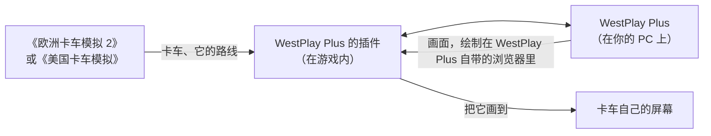

<p align="center"></p>

<h1 align="center">WestPlay Plus</h1>

<!-- languages:start -->
<p align="center">
  <a href="../../README.md">English</a> · <b>简体中文</b> · <a href="README.zh-TW.md">繁體中文</a> · <a href="README.ja.md">日本語</a> · <a href="README.ko.md">한국어</a> · <a href="README.de.md">Deutsch</a> · <a href="README.fr.md">Français</a> · <a href="README.fr-CA.md">Français (Canada)</a> · <a href="README.es.md">Español</a> · <a href="README.es-419.md">Español (Latinoamérica)</a> · <a href="README.it.md">Italiano</a> · <a href="README.pt-BR.md">Português (Brasil)</a> · <a href="README.pt-PT.md">Português (Portugal)</a> · <a href="README.ru.md">Русский</a> · <a href="README.pl.md">Polski</a> · <a href="README.nl.md">Nederlands</a> · <a href="README.tr.md">Türkçe</a> · <a href="README.uk.md">Українська</a> · <a href="README.cs.md">Čeština</a> · <a href="README.sk.md">Slovenčina</a> · <a href="README.hu.md">Magyar</a> · <a href="README.ro.md">Română</a> · <a href="README.bg.md">Български</a> · <a href="README.hr.md">Hrvatski</a> · <a href="README.sr-Latn.md">Srpski (latinica)</a> · <a href="README.sr-Cyrl.md">Српски (ћирилица)</a> · <a href="README.sl.md">Slovenščina</a> · <a href="README.mk.md">Македонски</a> · <a href="README.el.md">Ελληνικά</a> · <a href="README.sv.md">Svenska</a> · <a href="README.da.md">Dansk</a> · <a href="README.no.md">Norsk</a> · <a href="README.fi.md">Suomi</a> · <a href="README.et.md">Eesti</a> · <a href="README.lt.md">Lietuvių</a> · <a href="README.lv.md">Latviešu</a> · <a href="README.ca.md">Català</a> · <a href="README.gl.md">Galego</a> · <a href="README.vi.md">Tiếng Việt</a>
</p>
<!-- languages:end -->

<!-- english-only:start -->
<p align="center"><sub>西里西亚语、巴斯克语、格鲁吉亚语在软件里都支持，但暂时没有 README：这三种语言的译文还没人校对过。仓库首页的英文版内容是全的。</sub></p>
<!-- english-only:end -->

<p align="center">
  <b>为《欧洲卡车模拟 2》与《美国卡车模拟》的卡车打造的车机屏，风格如同 CarPlay。</b><br>
  你的地图、你的音乐和 YouTube，就在卡车自己的仪表屏上。
  <br>
  <a href="https://github.com/enes-less/WestPlay">WestPlay</a> 的修改版分支，进行一些优化和功能添加。
</p>

<p align="center">
  <a href="https://github.com/HandsomeTurtle0307/WestPlay-Plus/releases/latest"></a>
  
  
  
  <a href="../../LICENSE"></a>
</p>

WestPlay Plus 把一块手机风格的车机屏装到游戏里卡车自己的仪表显示屏上：《欧洲卡车模拟 2》和《美国卡车模拟》，一块屏通用。你的路线画在一张用你自己的游戏生成的地图上，你的音乐、YouTube、沿途的天气，全都在真卡车装屏幕的那个位置；按住一个键，用鼠标就能操作。

<!-- why:start -->

## 为什么要做这玩意

本来我想找一个 CarPlay 的 mod，然后就翻到了 WestPlay，发现这个做得非常好（真的非常非常好），就是优化不太好，给我电脑卡崩了，所以我决定自己完善一下，优化优化性能，加点新功能啥的（也算是站在巨人的肩膀上啦，嘿嘿~😊）

<!-- easter-egg:start -->
> 其实还有一点原因，就是我之前情绪激动时做了一些（可以说是很多）影响到别人（特别是我本来并不想伤害的人）的事，现在想想很内疚很难受，并且对未来很迷茫（包括学习和将来的规划），所以只能抓住这一点我可以掌握的东西（没错，就是编程），来暂时盖住我在别的方面的痛苦，唉🥲之后我也不知道该怎么办，反正走一步看一步吧 :)‍💨
<!-- easter-egg:end -->

<!-- why:end -->

## 功能

**地图来自你自己的游戏。** 直接绘制自游戏本体地图，支持地图模组（ProMods 及其他），带路线、逐向导航，以及能把途经点加进游戏自带 GPS 的搜索。

**为行车准备的仪表盘。** 地图旁边是正在播放的内容和你要去的地方，还有沿途天气，全都在一块屏上。

**你的音乐。** Apple Music、Spotify 与 YouTube Music，带 Now Playing 与歌词。歌曲的音乐视频可以直接在 Now Playing 里播放；YouTube 部分支持频道、播放列表、字幕和画质。播放器应用则播放你放进游戏自带音乐文件夹里的歌曲。

**明暗主题，还能换成你自己的样子。** 入夜时、或者你打开大灯时，它会自动变暗，像车上的光线传感器。壁纸和应用图标可以换成你自己的。

**PC 上的配套程序**负责把一切准备好：找到你的游戏（ETS2、ATS 或两个都有），把 WestPlay Plus 装进每一个游戏，生成它们的地图，之后就不再打扰你。

## 工作原理



WestPlay Plus 在自己的浏览器里绘制画面（就在你的 PC 上），再由插件把每一帧放到游戏内卡车的显示屏上。卡车自己的屏幕和信息栏仍然归卡车所有：WestPlay Plus 顶替 GPS 的位置，而“车辆信息栏”（Vehicle Bar）设置决定卡车的信息栏是否留在它旁边。

## 卡车

WestPlay Plus 有两种出场方式：出现在卡车自己的屏幕上，或者出现在 WestPlay Plus 平板上。

**在卡车自己的屏幕上。** 在现实中就带 CarPlay 的车型里，WestPlay Plus 顶替 GPS 的位置，出现在仪表屏上，并贴合屏幕的形状。不用买、不用装：上车就在那儿。以下为《欧洲卡车模拟 2》：

- **DAF** XF 与 XG/XG+ 2021、XF Electric 与 XD（以及 Jasper 的 DAF 2021）
- **Scania** S 与 R，配 7 英寸屏或 Smart Dash，以及 S BEV
- **Iveco** S-Way
- **Renault** T（2024）
- **Volvo** FH（2021 与 2024）
- **客车 DLC：** Scania Touring 与 MAN Lion's Coach（2024）
- **Oyuncuyusbis 的客车：** Mercedes-Benz Travego 16 SHD、MAN Lion's Coach 与 Setra S 531 DT，画面在它们自己的仪表屏上
- **Setra S 516 HD/2**（Oyuncuyusbis 的）：在客车自己的 GPS 屏幕上，也就是它的 “Gps” 部件，需要你在卡车商店里装上去：按玩家们的要求，用的是客车自己的屏幕，但要你自己添加

**在 WestPlay Plus 平板上。** 其他所有卡车，不论游戏自带还是模组卡车，都通过一块平板使用 WestPlay Plus，平板在卡车商店里安装：在配件（Accessories）下的悬挂物品里，或者作为仪表台套装。卡车自己的屏幕则保留游戏的导航。每一辆有悬挂物品的卡车都有这块平板，包括你之后才装的模组卡车（下次启动游戏时它们就会得到它）。

**在《美国卡车模拟》里**，目前所有卡车都是通过平板使用 WestPlay Plus。现实中有 CarPlay 对应车型的卡车，之后会让 WestPlay Plus 出现在它们自己的屏幕上。

|            | 卡车自己的屏幕         | WestPlay Plus 平板                  |
| ---------- | ---------------------- | ----------------------------------- |
| 卡车       | 上面那些 ETS2 卡车     | 其他所有卡车，以及目前所有 ATS 卡车 |
| 怎么得到   | 什么都不用做，本来就在 | 在卡车商店里安装                    |
| 游戏的导航 | 被 WestPlay Plus 取代  | 留在卡车的屏幕上                    |

### 声音

在以下《欧洲卡车模拟 2》卡车里，音乐从卡车自己的喇叭播出，每个喇叭都在驾驶室里的实际位置发声。其他卡车，以及目前《美国卡车模拟》的卡车，都是普通立体声。

- **Scania S 与 R（2016）、S BEV** — 车门低音、A 柱高音、车顶低音
- **Scania R（2009）、Streamline** — 车门低音、A 柱高音
- **DAF XF（105）** — A 柱高音；Super Space Cab 车型在头顶置物架上有两对，其他车型一个头顶单元
- **DAF XF Euro 6** — 车门低音、A 柱高音；Super Space Cab 车型在头顶置物架上有两对，其他车型一个头顶单元
- **DAF XF、XG、XG+（2021）、XF Electric 与 XD** — 车门低音、A 柱高音、头顶一对、一个中置单元
- **MAN TGX** — 车门低音；XXL 车型在两侧内壁高处还各有两只小单元
- **MAN TGX Euro 6** — 车门低音；XL 车型在每个车顶角落还有一只小单元
- **MAN TGX（2020）** — 每扇门一个低音加一个中音，A 柱高音
- **Mercedes-Benz Actros（2014）** — 车门低音、头顶一对、A 柱高音
- **Mercedes-Benz Actros（2009）** — 车门低音、头顶置物架前角一对
- **Volvo FH（2021、2024）、FH16（2012）** — 车门低音、后墙低音
- **Volvo FH16（2009）** — 每扇门一个单元
- **Iveco Stralis** — 头顶控制台两端各一个单元；高顶车型在副驾驶一侧还有一个小的
- **Iveco Hi-Way** — 头顶控制台两端各一个单元，两侧高处各一个
- **Iveco S-Way** — 每扇门一个低音加一个高音
- **Renault Magnum** — 每个车顶角落一个单元，头顶控制台上有高音
- **Renault Premium** — 车顶两侧各一个单元，低顶车型位置更低
- **Renault T** — A 柱高音、后墙一对；2024 款内饰有车门低音
- **Renault E-Tech T** — 车门低音、A 柱高音、后墙一对
- **JuseeTV 的 Scania PGR** — 你安装的部件自带的喇叭：车门、A 柱、顶部控制台、后墙

## 安装

1. 从[最新版本](https://github.com/HandsomeTurtle0307/WestPlay-Plus/releases/latest)下载安装程序并运行。
2. 配套程序会打开，带你走完剩下的步骤：找到你的游戏（ETS2、ATS 或两个都有），为每个游戏安装 WestPlay Plus 的插件和它的屏幕模组，并生成你的地图。
3. 启动游戏，坐上卡车。

**更新：** 本分支不会自动更新。要检查是否有新版本，请访问[发布页面](https://github.com/HandsomeTurtle0307/WestPlay-Plus/releases)。配套程序的“关于”页面上有同一个链接。

**系统要求：** Windows 10 或 11（64 位）、《欧洲卡车模拟 2》1.62 版本（或 1.61），或《美国卡车模拟》1.62 版本（其他版本可能也能用；遇到未测试的版本时配套程序会提示），以及 Microsoft Edge WebView2（Windows 11 已内置；缺少时安装程序会补上）。

## 隐私

WestPlay Plus 没有服务器、没有自己的账号，也没有任何统计。它不收集、也不发送任何关于你的信息。

- 你是在 Apple Music、Spotify 与 YouTube 自己的页面上登录的，用的是 WestPlay Plus 在 PC 上的独立浏览器配置，和在浏览器里一样。WestPlay Plus 自己不保存任何账号数据。
- 你的地图在你的 PC 上由你的游戏生成，并留在那里。
- WestPlay Plus 只与你使用的服务通信；只有当你打开它的发布页面时，才会连接 GitHub。

## 反馈

问题、疑问和建议：请在 [GitHub](https://github.com/HandsomeTurtle0307/WestPlay-Plus/issues) 上开一个 issue。

## 从源码构建

你需要 [Rust](https://rustup.rs)（stable）与 [Node.js](https://nodejs.org) 24，运行于 Windows。

```sh
npm install      # 配套程序的工具与 UI 的依赖包
npm run dev      # 启动 WestPlay Plus，UI 实时加载
```

`cargo test --workspace` 与 `npm test --prefix ui` 用来跑测试。游戏插件用 `cargo build --release -p westplay-plugin` 构建。

## 许可

WestPlay Plus 是自由软件：你可以依据 GNU 通用公共许可证第 3 版（或你选择的更高版本）的条款重新分发和修改它。详见 [LICENSE](../../LICENSE)。

版权所有 © 2026 HandsomeTurtle0307。WestPlay Plus 附带的第三方库各自保留其许可证：见 [THIRD_PARTY_LICENSES.md](../../THIRD_PARTY_LICENSES.md)，以及 [THIRD_PARTY_NOTICES.md](../../THIRD_PARTY_NOTICES.md)，了解它所遵循的作品。

## 项目来源

WestPlay Plus 是 [WestPlay](https://github.com/enes-less/WestPlay) 的修改版分支（fork），后者是由 **enes-less** 制作的、为《欧洲卡车模拟 2》与《美国卡车模拟》打造的一款极出色的 CarPlay 风格车内屏幕模组。它几乎全部的设计、代码与素材都出自他的工作；本分支在他的成果之上保留了自己的改动，并对他的付出深表感谢。如果你喜欢这个项目，也请去看看原项目。

本项目的绝大部分设计、代码与素材来自原项目 **WestPlay**（作者 [enes-less](https://github.com/enes-less/WestPlay)），
这是一个极其优秀的欧卡 2 / 美卡车内中控屏模组。本分支只是在它之上做了一些优化和功能添加，并对原作者表示由衷感谢。
建议同时支持原项目（如果可以的话能支持支持我嘛😭😭😭，开发软件不易啊~）

<!-- translated:start -->
<sub>各个语言的 README 由英语版翻译而来。因为作者水平有限（肯定不能全会 43 种语言😭😭），翻译出的 README 可能有不完备的情况，请大家见谅~ 如果你是某种语言的用户，并且发现翻译得不完善，欢迎指正~</sub>
<!-- translated:end -->

<sub>WestPlay Plus 是一个独立项目，与 Apple、SCS Software、Spotify、Google 及各卡车制造商没有隶属关系，也未获其背书。CarPlay、Apple Music、Spotify、YouTube、YouTube Music 以及各卡车厂商的名称与标志均为其各自所有者的商标，此处仅用于说明 WestPlay Plus 兼容的对象。</sub>
