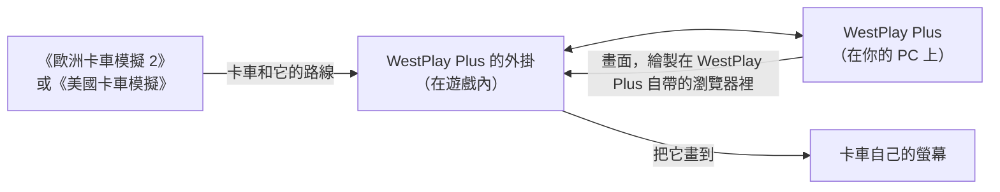

<p align="center"></p>

<h1 align="center">WestPlay Plus</h1>

<!-- languages:start -->
<p align="center">
  <a href="../../README.md">English</a> · <a href="README.zh-CN.md">简体中文</a> · <b>繁體中文</b> · <a href="README.ja.md">日本語</a> · <a href="README.ko.md">한국어</a> · <a href="README.de.md">Deutsch</a> · <a href="README.fr.md">Français</a> · <a href="README.fr-CA.md">Français (Canada)</a> · <a href="README.es.md">Español</a> · <a href="README.es-419.md">Español (Latinoamérica)</a> · <a href="README.it.md">Italiano</a> · <a href="README.pt-BR.md">Português (Brasil)</a> · <a href="README.pt-PT.md">Português (Portugal)</a> · <a href="README.ru.md">Русский</a> · <a href="README.pl.md">Polski</a> · <a href="README.nl.md">Nederlands</a> · <a href="README.tr.md">Türkçe</a> · <a href="README.uk.md">Українська</a> · <a href="README.cs.md">Čeština</a> · <a href="README.sk.md">Slovenčina</a> · <a href="README.hu.md">Magyar</a> · <a href="README.ro.md">Română</a> · <a href="README.bg.md">Български</a> · <a href="README.hr.md">Hrvatski</a> · <a href="README.sr-Latn.md">Srpski (latinica)</a> · <a href="README.sr-Cyrl.md">Српски (ћирилица)</a> · <a href="README.sl.md">Slovenščina</a> · <a href="README.mk.md">Македонски</a> · <a href="README.el.md">Ελληνικά</a> · <a href="README.sv.md">Svenska</a> · <a href="README.da.md">Dansk</a> · <a href="README.no.md">Norsk</a> · <a href="README.fi.md">Suomi</a> · <a href="README.et.md">Eesti</a> · <a href="README.lt.md">Lietuvių</a> · <a href="README.lv.md">Latviešu</a> · <a href="README.ca.md">Català</a> · <a href="README.gl.md">Galego</a> · <a href="README.vi.md">Tiếng Việt</a>
</p>
<!-- languages:end -->

<!-- english-only:start -->
<p align="center"><sub>西里西亞語、巴斯克語、喬治亞語在軟體裡都支援，但暫時沒有 README：這三種語言的譯文還沒人校對過。英文版在儲存庫首頁，內容一樣完整。</sub></p>
<!-- english-only:end -->

<p align="center">
  <b>給《歐洲卡車模擬 2》和《美國卡車模擬》的卡車，裝一塊 CarPlay 風格的車機螢幕。</b><br>
  你的地圖、你的音樂、你的 YouTube，都在卡車自己的儀表螢幕上。
  <br>
  <a href="https://github.com/enes-less/WestPlay">WestPlay</a> 的修改版分支，做了一些最佳化，也加了新功能。
</p>

<p align="center">
  <a href="https://github.com/HandsomeTurtle0307/WestPlay-Plus/releases/latest"></a>
  
  
  
  <a href="../../LICENSE"></a>
</p>

WestPlay Plus 把一塊手機風格的車機螢幕，裝進遊戲裡卡車自己的儀表螢幕：《歐洲卡車模擬 2》和《美國卡車模擬》共用一塊。路線畫在一張用你自己的遊戲產生的地圖上，音樂、YouTube、路上的天氣，都擺在真車上裝螢幕的那個位置；按住一個鍵，就能用滑鼠操作。

<!-- why:start -->

## 為什麼要做這玩意

本來我想找一個 CarPlay 的 mod，然後就翻到了 WestPlay，發現這個做得非常好（真的非常非常好），就是最佳化不太好，給我電腦卡崩了，所以我決定自己完善一下，最佳化最佳化效能，加點新功能啥的（也算是站在巨人的肩膀上啦，嘿嘿~😊）

<!-- easter-egg:start -->
> 其實還有一點原因，就是我之前情緒激動時做了一些（可以說是很多）影響到別人（特別是我本來並不想傷害的人）的事，現在想想很內疚很難受，並且對未來很迷茫（包括學習和將來的規劃），所以只能抓住這一點我可以掌握的東西（沒錯，就是程式設計），來暫時蓋住我在別的方面的痛苦，唉🥲之後我也不知道該怎麼辦，反正走一步看一步吧 :)‍💨
<!-- easter-egg:end -->

<!-- why:end -->

## 功能

**地圖來自你自己的遊戲。** 直接從遊戲本體的地圖畫出來，支援地圖模組（ProMods 之類），有路線和逐個路口的指示，搜到的地點還能直接加進遊戲內建的 GPS。

**為開車準備的儀表板。** 地圖旁邊就是正在播的東西、要去的地方，還有路上的天氣，全在一塊螢幕上。

**你的音樂。** Apple Music、Spotify 和 YouTube Music，都有正在播放畫面和歌詞。歌曲的 MV 能直接在正在播放裡播；YouTube 那邊支援頻道、播放清單、字幕和畫質。播放器應用程式則負責播你放進遊戲內建音樂資料夾的歌。

**明暗兩種主題，也能換成你自己的樣子。** 天黑下來，或者你打開大燈，它會像車上的光線感應器一樣自己變暗。桌布和應用程式圖示都能換。

**PC 上的配套程式**負責把這些都準備好：找到你的遊戲（ETS2、ATS，或兩個都有），挨個裝好 WestPlay Plus、把地圖產生出來，然後就安靜待在旁邊，不再煩你。

## 運作原理



WestPlay Plus 在自己的瀏覽器裡畫出畫面（就在你的 PC 上），外掛再把畫面一格一格投到遊戲裡卡車的螢幕上。卡車自己的螢幕和資訊列還是卡車說了算：WestPlay Plus 只是頂掉 GPS 的位置；資訊列要不要留，由「車輛資訊列」（Vehicle Bar）這個設定決定。

## 卡車

WestPlay Plus 有兩種出現方式：出現在卡車自己的螢幕上，或出現在 WestPlay Plus 平板上。

**出現在卡車自己的螢幕上。** 現實裡本來就配備 CarPlay 的車型，WestPlay Plus 直接頂掉 GPS，順著螢幕的形狀鋪在儀表螢幕上。不用買、不用裝，上車就在那裡。以下是《歐洲卡車模擬 2》：

- **DAF** XF 與 XG/XG+ 2021、XF Electric 與 XD（以及 Jasper 的 DAF 2021）
- **Scania** S 與 R，搭配 7 吋螢幕或 Smart Dash，以及 S BEV
- **Iveco** S-Way
- **Renault** T（2024）
- **Volvo** FH（2021 與 2024）
- **客車 DLC：** Scania Touring 與 MAN Lion's Coach（2024）
- **Oyuncuyusbis 的客車：** Mercedes-Benz Travego 16 SHD、MAN Lion's Coach 與 Setra S 531 DT，畫面在它們自己的儀表螢幕上
- **Setra S 516 HD/2**（Oyuncuyusbis 的）：走客車自己的 GPS 螢幕，也就是它的「Gps」部件。這個要你自己去卡車商店裝——依玩家要求，用客車自己的螢幕，但不預設幫你加

**出現在 WestPlay Plus 平板上。** 其他所有卡車，不管是遊戲內建還是模組車，都用平板來看 WestPlay Plus。平板在卡車商店裡裝：配件（Accessories）裡的懸掛物品，或儀表台套組。卡車自己的螢幕繼續放遊戲導航。只要車上有懸掛物品，就有這塊平板；你後來才裝的模組車也有（下次進遊戲就出現了）。

**在《美國卡車模擬》裡**，目前所有卡車都是靠平板用 WestPlay Plus。現實中有 CarPlay 對應車型的，之後也會讓 WestPlay Plus 出現在它們自己的螢幕上。

|                  | 卡車自己的螢幕   | WestPlay Plus 平板             |
| ---------------- | ---------------- | ------------------------------ |
| 卡車             | 上面那些 ETS2 卡車 | 其他所有卡車，以及目前所有 ATS 卡車 |
| 怎麼取得         | 什麼都不用做，本來就在 | 在卡車商店裡安裝          |
| 遊戲的導航       | 被 WestPlay Plus 取代 | 留在卡車的螢幕上          |

### 音效

下面這些《歐洲卡車模擬 2》的卡車，音樂是從車內真實位置的喇叭出來的，每個喇叭都在駕駛室裡它該在的地方響。其他卡車，以及目前《美國卡車模擬》的卡車，都是普通立體聲。

- **Scania S 與 R（2016）、S BEV** — 車門低音、A 柱高音、車頂低音
- **Scania R（2009）、Streamline** — 車門低音、A 柱高音
- **DAF XF（105）** — A 柱高音；Super Space Cab 車型在車頂架上有兩對，其他車型一個車頂單元
- **DAF XF Euro 6** — 車門低音、A 柱高音；Super Space Cab 車型在車頂架上有兩對，其他車型一個車頂單元
- **DAF XF、XG、XG+（2021）、XF Electric 與 XD** — 車門低音、A 柱高音、車頂一對、一個中置單元
- **MAN TGX** — 車門低音；XXL 車型在兩側內壁高處還各有兩個小單元
- **MAN TGX Euro 6** — 車門低音；XL 車型在每個車頂角落還有一個小單元
- **MAN TGX（2020）** — 每扇車門一個低音加一個中音，A 柱高音
- **Mercedes-Benz Actros（2014）** — 車門低音、車頂一對、A 柱高音
- **Mercedes-Benz Actros（2009）** — 車門低音、車頂架前角一對
- **Volvo FH（2021、2024）、FH16（2012）** — 車門低音、後牆低音
- **Volvo FH16（2009）** — 每扇車門一個單元
- **Iveco Stralis** — 車頂控制台兩端各一個單元；高頂車型在副駕駛一側還有一個小的
- **Iveco Hi-Way** — 車頂控制台兩端各一個單元，兩側高處各一個
- **Iveco S-Way** — 每扇車門一個低音加一個高音
- **Renault Magnum** — 每個車頂角落一個單元，車頂控制台上有高音
- **Renault Premium** — 車頂兩側各一個單元，低頂車型位置更低
- **Renault T** — A 柱高音、後牆一對；2024 年式內裝有車門低音
- **Renault E-Tech T** — 車門低音、A 柱高音、後牆一對
- **JuseeTV 的 Scania PGR** — 你安裝的部件自帶的喇叭：車門、A 柱、頂部控制台、後牆

## 安裝

1. 從[最新版本](https://github.com/HandsomeTurtle0307/WestPlay-Plus/releases/latest)下載安裝程式並執行。
2. 配套程式會開啟，帶你走完剩下的：找到你的遊戲（ETS2、ATS 或兩個都有），給每個遊戲裝上 WestPlay Plus 的外掛和螢幕模組，再把地圖產生出來。
3. 啟動遊戲，坐上卡車。

**更新：** 本分支不會自動更新。想知道有沒有新版本，去[發行頁面](https://github.com/HandsomeTurtle0307/WestPlay-Plus/releases)看。配套程式的「關於」頁面裡也有這個連結。

**系統需求：** Windows 10 或 11（64 位元）；《歐洲卡車模擬 2》1.62（1.61 也行），或《美國卡車模擬》1.62（別的版本多半也能跑，碰到沒測過的版本，配套程式會提醒你）；以及 Microsoft Edge WebView2（Windows 11 已內建，缺了安裝程式會補上）。

## 隱私權

WestPlay Plus 沒有伺服器、沒有自己的帳號，也沒有任何統計。它不蒐集、也不傳送任何關於你的資訊。

- 登入是在 Apple Music、Spotify 和 YouTube 自己的頁面上完成的，用的是 WestPlay Plus 在 PC 上另外一套瀏覽器設定檔，跟你平常開瀏覽器一樣。WestPlay Plus 本身不會儲存任何帳號資料。
- 地圖由你的遊戲在你的 PC 上產生，也一直留在那裡。
- WestPlay Plus 只與你使用的服務通訊；只有當你開啟它的發行頁面時，才會連上 GitHub。

## 意見回饋

有問題、有想法，或想給點建議，去 [GitHub](https://github.com/HandsomeTurtle0307/WestPlay-Plus/issues) 開個 issue 就行。

## 從原始碼建置

你需要 Windows 上的 [Rust](https://rustup.rs)（stable）和 [Node.js](https://nodejs.org) 24。

```sh
npm install      # 配套程式和介面的相依套件
npm run dev      # 啟動 WestPlay Plus，介面即時重新載入
```

`cargo test --workspace` 與 `npm test --prefix ui` 用來跑測試。遊戲外掛用 `cargo build --release -p westplay-plugin` 建置。

## 授權條款

WestPlay Plus 是自由軟體：你可以依 GNU 通用公共授權條款第 3 版（或你選擇的更新版本）的條款重新散布與修改它。詳見 [LICENSE](../../LICENSE)。

版權所有 © 2026 HandsomeTurtle0307。WestPlay Plus 用到的第三方函式庫各自保留自己的授權條款：清單見 [THIRD_PARTY_LICENSES.md](../../THIRD_PARTY_LICENSES.md)，著作權聲明見 [THIRD_PARTY_NOTICES.md](../../THIRD_PARTY_NOTICES.md)。

## 專案來源

WestPlay Plus 是 [WestPlay](https://github.com/enes-less/WestPlay) 的修改版分支（fork）。

本專案的絕大部分設計、程式碼與素材來自原專案 **WestPlay**（作者 [enes-less](https://github.com/enes-less/WestPlay)），
這是一個極其優秀的歐卡 2 / 美卡車內中控螢幕模組。本分支只是在它之上做了一些最佳化與功能新增，並對原作者表達由衷感謝。
建議同時支持原專案（如果可以的話能支持支持我嘛😭😭😭，開發軟體不易啊~）

<!-- translated:start -->
<sub>各個語言的 README 由英語版翻譯而來。因為作者能力有限（肯定不能全會 43 種語言😭😭），翻譯出的 README 可能有不完備的地方，請大家見諒~ 如果你是某種語言的使用者，並且發現翻譯得不完善，歡迎指正~</sub>
<!-- translated:end -->

<sub>WestPlay Plus 是一個獨立專案，跟 Apple、SCS Software、Spotify、Google 以及各家卡車製造商都沒有隸屬關係，也沒有得到它們的背書。CarPlay、Apple Music、Spotify、YouTube、YouTube Music 以及各卡車廠商的名稱和標誌，都是各自所有者的商標，這裡只是用來說明 WestPlay Plus 相容哪些東西。</sub>
